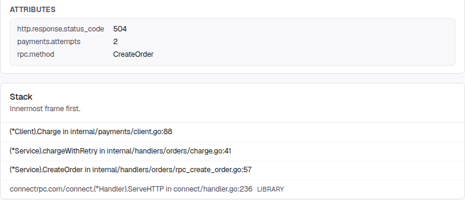
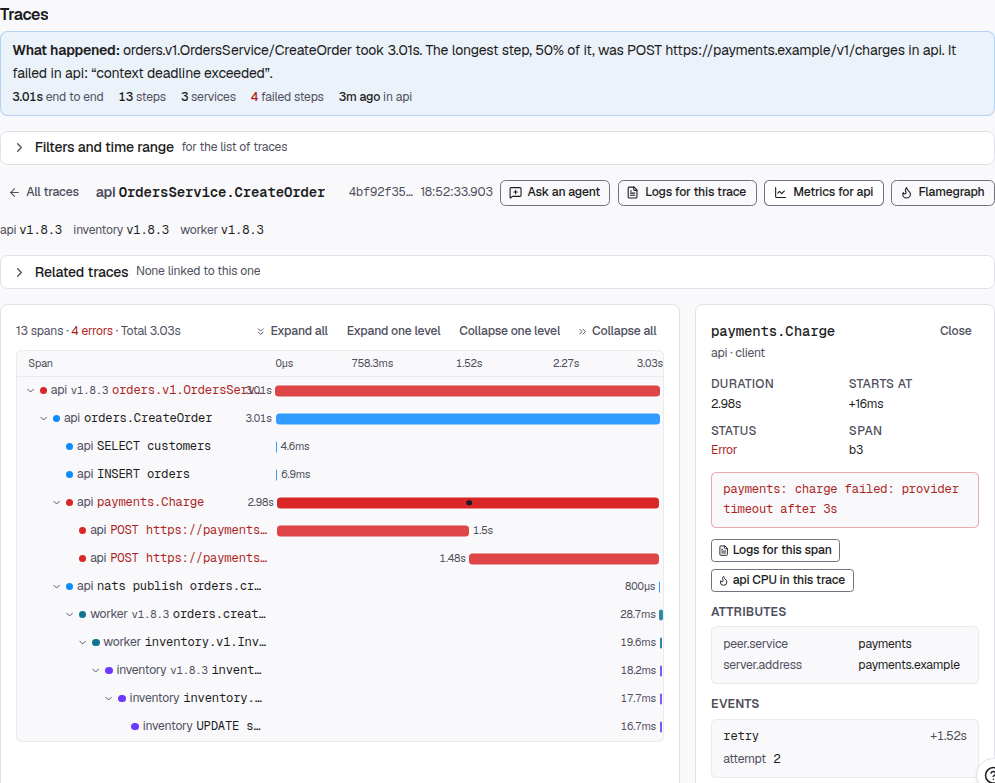
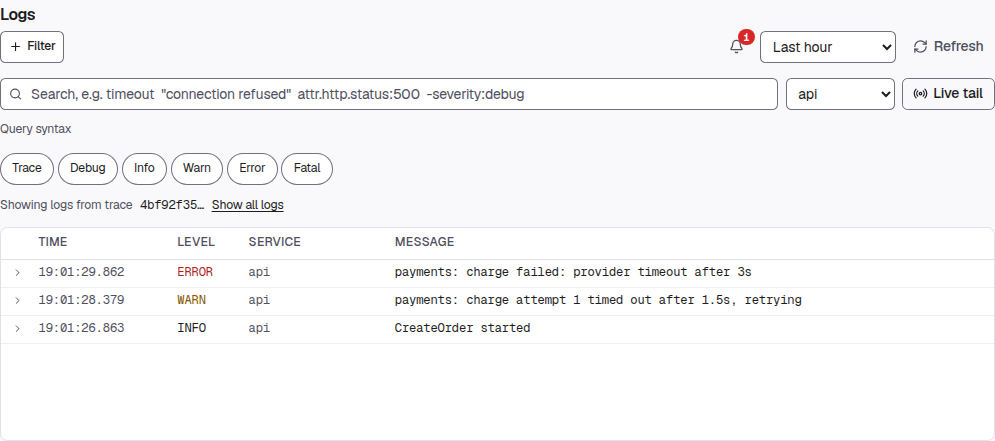

# Forge

**Forge is an opinionated, open-source Go + React framework and deploy platform
that ships the production system — dev environments, tests, secrets, multiple
environments, releases, observability and hosting — from the first commit, built
for AI agents to work in.**

The Go framework for AI-generated code, with an MCP server that deploys your app:

```bash
# Deploy a Vite or Next.js static app without an account (live URL + 72-hour claim link)
npx -y @reliantlabs/forge@latest env deploy prod --claimable

# Use from your agent: an MCP server to deploy your app (Claude Code; Cursor, Codex and Gemini below)
claude mcp add forge -- npx -y @reliantlabs/forge mcp

# Not sure where to start? forge start prints the one next command for this directory
forge start
```

Install `forge`, and the other ways to run it: [Install](#install).

<p align="center">
  <a href="https://reliantlabs.io/products/forge">Website</a>
  ·
  <a href="https://demo.reliantlabs.io/forge/demo?section=built">Live demo</a>
  ·
  <a href="https://docs.reliantlabs.io/forge/overview">Docs</a>
  ·
  <a href="https://github.com/reliant-labs/reliant">Reliant</a>
  ·
  <a href="https://join.slack.com/t/reliant-pn51441/shared_invite/zt-4c7wet6o2-W_Tksw80LaRGxZqUz9GQdA">Slack</a>
</p>

<p align="center">
  <a href="https://github.com/reliant-labs/forge/releases/latest"></a>
  <a href="LICENSE"></a>
  <a href="https://www.npmjs.com/package/@reliantlabs/forge"></a>
</p>

Most teams build that system in year two, under deadline, on top of a codebase
that wasn't shaped for it. With Forge the first commit already has it, wired
into files you own and can change.

**Try it in the browser first: [the live demo](https://demo.reliantlabs.io/forge/demo?section=built).**

## See what happened after deployment

Forge deploys and operates your app without requiring Reliant's coding harness.
Keep your editor or agent; follow an issue into its trace and logs.

These are screenshots of the [public demo](https://demo.reliantlabs.io/forge):
**read-only sample data, not live production telemetry**. The `prod` label is the
sample app's environment, not a claim about customer traffic.



**1. Inspect the issue.** The demo's [payment timeout](https://demo.reliantlabs.io/forge/p/shop/observability/errors?env=prod&issue=iss-orders-deadline)
shows the failed request's attributes and stack, including the retry path.



**2. Follow its trace.** [Open the linked request](https://demo.reliantlabs.io/forge/p/shop/observability/traces?env=prod&trace=4bf92f3577b34da6a3ce929d0e0e4736&span=b3)
to inspect the payment attempts alongside the database and worker spans.



**3. Read the matching logs.** [Filter to the same trace and API service](https://demo.reliantlabs.io/forge/p/shop/observability/logs?env=prod&trace=4bf92f3577b34da6a3ce929d0e0e4736&service=api)
to see the retry warning and timeout error in context.

[Capture sources and cropping notes](docs/images/README.md).

## Quick start

```bash
# Install (macOS / Linux; Windows, Homebrew, npm and go install: see Install below)
curl -fsSL https://raw.githubusercontent.com/reliant-labs/forge/main/install.sh | sh

forge project new my-app && cd my-app
forge scaffold service billing
forge generate
forge env up dev
```

That last command brings up Postgres, runs your migrations, and starts your
services and frontends, then prints a table of URLs and a log file for each
process, including the HyperDX UI, already receiving the app's traces, metrics
and logs. With a frontend (`forge project new my-app --frontend web`) it also
starts a local identity provider, so the app's own sign-in page works on the
first run. No signup, no external accounts, no cloud project, no cluster.

Add tables (a `// forge:entity` message and `forge scaffold`) and a fresh
database is seeded with foreign-key-coherent rows that satisfy every constraint
your schema declares, so the app boots alive instead of empty.

When you want it online, `forge env deploy staging` builds a release once and
deploys it. A new project's staging and prod are bound to Reliant hosting; the
same environments deploy to a Kubernetes cluster you run, or as host processes,
by changing where each workload is bound. Before you call a change done:
`forge generate && forge lint && go build ./... && task test`.

## Everything included

What a new app would otherwise stitch together from separate tools:

<!-- benefits:start -->

|                | What you get                                                                                                                                                                                                                                                                                                                      |
| -------------- | --------------------------------------------------------------------------------------------------------------------------------------------------------------------------------------------------------------------------------------------------------------------------------------------------------------------------------- |
| **Build**      | [One marker, a whole entity](docs/benefits.md#entity-from-one-marker) · [Proto in, full stack out](docs/benefits.md#proto-to-everything)                                                                                                                                                                                          |
| **Data**       | [SQL migrations are the schema](docs/benefits.md#sql-first-schema) · [Migration safety checks](docs/benefits.md#migration-safety)                                                                                                                                                                                                 |
| **Test**       | [Real Postgres in every test](docs/benefits.md#pgtest-real-postgres) · [A generated mock per interface](docs/benefits.md#generated-mocks)                                                                                                                                                                                         |
| **Dev**        | [The whole stack, one command](docs/benefits.md#env-up-dev) · [A dev stack per worktree](docs/benefits.md#per-worktree-devstacks)                                                                                                                                                                                                 |
| **Guardrails** | [Bug-class linters, one verdict](docs/benefits.md#one-lint-gate) · [The whole CI gate, locally](docs/benefits.md#local-ci-gate)                                                                                                                                                                                                   |
| **Security**   | [Auth that fails closed](docs/benefits.md#auth-fail-closed) · [Errors never leak internals](docs/benefits.md#svcerr-redaction) · [Secrets never in git](docs/benefits.md#secrets-model) · [Dependency and image scanning](docs/benefits.md#vuln-scan) · [Signed images, SBOM and provenance](docs/benefits.md#image-supply-chain) |
| **Ship**       | [Build once, promote by digest](docs/benefits.md#build-once-promote-by-digest) · [Deploy anywhere, declare once](docs/benefits.md#workload-once-bind-per-env)                                                                                                                                                                     |
| **Host**       | [Managed Postgres](docs/benefits.md#managed-postgres) · [Static hosting with a CDN](docs/benefits.md#static-hosting-cdn) · [Custom domains with automatic HTTPS](docs/benefits.md#custom-domains-tls)                                                                                                                             |
| **Run**        | [Observability stack included](docs/benefits.md#local-clickstack) · [Production alerts out of the box](docs/benefits.md#default-alerts) · [Prove each deploy is good](docs/benefits.md#obs-check)                                                                                                                                 |
| **Agents**     | [Skills that match your forge](docs/benefits.md#skills-in-the-binary) · [Built-in MCP server](docs/benefits.md#mcp-server)                                                                                                                                                                                                        |

Every benefit, with how to use it and the code that backs it: [docs/benefits.md](docs/benefits.md)

<!-- benefits:end -->

Add [Reliant](https://reliantlabs.io) and the list grows an agent harness,
cloud dev machines, AI code and security review, and an on-call agent. Forge
doesn't need any of them.

## Built for your agent

When an agent writes most of the code, the bottleneck stops being how fast you
can write it and becomes **knowing whether it's right**. Forge is one binary on
your `PATH` with no plugin, editor extension or server, so anything that can run
a shell command can drive it: Claude Code, Codex, Cursor, Copilot, Gemini CLI,
Aider, a harness you wrote, or a CI job. A person at a terminal uses the same
commands, so there is nothing an agent can do that you can't check by hand.

- **Skills live in the binary.** `forge skill search <topic>` and
  `forge skill load <name>` print the playbook for an area, about 150 of them,
  matched to the installed version. Nothing to paste into a prompt, nothing to
  drift.
- **It explains itself.** `forge start` prints the one command for the
  directory you are in (deploy the app already there, or create one), and
  `forge start app` the path from an empty directory to authored protos. `forge project capabilities --json` lists every verb, lint
  analyzer and marker, enumerated from the binary, so it can't go stale.
- **Scaffolding and lints are guardrails against AI slop.** `forge scaffold`
  lands each service, rpc, worker or entity in the right place, already wired.
  `forge lint` rejects what review misses, names the file, line, rule and fix,
  and `forge lint --quiet` ends with the verdict, so the agent reads one line to
  know whether it is done.
- **It debugs from real telemetry.** `forge obs status`, `forge obs issues` and
  `forge obs trace` read a running app's logs, traces, errors and alerts, so a
  fix starts from what happened rather than a guess.
- **Checks never fake a pass.** A check that cannot obtain its facts reports
  UNDETERMINED, never green, never skipped.
- **The project tells the agent all of this.** `forge project new` writes
  `AGENTS.md` and a pointer for the agent it detects (Claude Code, Cursor,
  Copilot). Any MCP-capable harness can run `forge mcp` instead: see
  [Use as an MCP server](#use-as-an-mcp-server).

To use Forge from any agent, put this in the prompt or its instructions file:

```text
Use Forge (github.com/reliant-labs/forge) for this project.
Run `forge start` first and follow it. Load depth with
`forge skill search <topic>` and `forge skill load <name>`.
A change is done when `forge lint`, `go build ./...` and `task test` pass.
```

## Use as an MCP server

<a href="https://cursor.com/en/install-mcp?name=forge&config=eyJjb21tYW5kIjoibnB4IiwiYXJncyI6WyIteSIsIkByZWxpYW50bGFicy9mb3JnZSIsIm1jcCJdfQ=="></a>
<a href="https://insiders.vscode.dev/redirect/mcp/install?name=forge&config=%7B%22command%22%3A%22npx%22%2C%22args%22%3A%5B%22-y%22%2C%22%40reliantlabs%2Fforge%22%2C%22mcp%22%5D%7D"></a>

`forge mcp` serves forge over the Model Context Protocol on stdio. It is in the
official MCP registry as `io.github.reliant-labs/forge`, and `npx` runs it with
nothing to install, no API key and no config. For Claude Code:

```bash
claude mcp add forge -- npx -y @reliantlabs/forge mcp
```

Or commit a `.mcp.json` to the project (Cursor reads the same shape from
`.cursor/mcp.json`):

```json
{
  "mcpServers": {
    "forge": {
      "command": "npx",
      "args": ["-y", "@reliantlabs/forge", "mcp"]
    }
  }
}
```

For Codex (CLI, IDE extension and desktop app share the config):

```bash
codex mcp add forge -- npx -y @reliantlabs/forge mcp
```

or in `~/.codex/config.toml` (or a trusted project's `.codex/config.toml`):

```toml
[mcp_servers.forge]
command = "npx"
args = ["-y", "@reliantlabs/forge", "mcp"]
```

For Gemini CLI, this repository is an extension (`gemini-extension.json`):

```bash
gemini extensions install https://github.com/reliant-labs/forge
```

`deploy_claimable` puts a Vite app or a Next.js static export live with no
account and returns its URL plus a claim link that is good for 72 hours. The
other tools introspect the project, read the skill catalog, and run `lint` and
`generate`. Every tool, and the config for Codex: [docs/mcp.md](docs/mcp.md).

## Opinionated, never a wall

The opinions come from a principal engineer with more than a decade of building
reliable systems, and several exist because the unsafe version caused a real
incident:

- **An error message once shipped a database password** to an unauthenticated
  caller. Now `svcerr.Wrap` replaces unrecognized errors with
  `internal server error` and keeps the original server-side.
- **Images built on an arm64 laptop once got pushed to amd64 nodes.** Now cloud
  targets require an explicit `platform`, and it fails at author time.
- **Replicas once half-migrated a schema.** Now migrations apply from an
  initContainer under a Postgres advisory lock, and a failed one stalls the
  rollout with the old pods still serving.

Every default is overridable and every generated file has an owned seam beside
it:

- An ORM you can drop out of to raw SQL.
- A middleware chain in a `serve.go` you own and can reorder.
- `pkg/` as a library you import, not a framework you live inside.
- Each workload binds to a host process, Compose, a cluster you operate or
  Reliant hosting, in the same KCL. It deploys code it never compiled, in any
  language: our own control plane builds three services out of a separate
  repository that Forge never compiles.

More in [docs/concepts.md](docs/concepts.md#8-opinions-with-an-exit).

## Who this isn't for

- **You don't want generated code in your repo.** Forge writes real files and
  regenerates them; if you'd rather hand-author everything, the ownership model
  is overhead.
- **You need a REST-first public API.** Connect RPC is the native surface; REST
  URLs are available via Vanguard, but a hand-shaped OpenAPI contract works
  against the grain.
- **Postgres isn't your database.** MySQL, SQLite and non-relational stores
  aren't supported.
- **Your backend isn't a container.** A service deploys as an image (static
  sites are the exception: they ship as files).
- **You want a framework you'll outgrow and replace.** Forge holds structure for
  the life of the project; for a one-time scaffold, use a template repo.

## Install

All of them give you a single `forge` binary; none needs a C toolchain.

```bash
# macOS / Linux (amd64, arm64): no sudo, no prompts, checks the release's sha256
curl -fsSL https://raw.githubusercontent.com/reliant-labs/forge/main/install.sh | sh
```

```powershell
# Windows (amd64, arm64)
irm https://raw.githubusercontent.com/reliant-labs/forge/main/install.ps1 | iex
```

```bash
# Homebrew (macOS and Linux)
brew install reliant-labs/reliant/forge

# npm / npx: downloads the same verified binary on first run
npx @reliantlabs/forge version

# Go toolchain
go install github.com/reliant-labs/forge/cmd/forge@latest
```

To install forge's agent skill with [skills.sh](https://skills.sh): `npx skills add reliant-labs/forge --skill forge`

Pinning a version for CI, verifying a release's signature, and building from a
clone: [docs/install.md](docs/install.md).

## Learn more

- [Forge user guide](https://docs.reliantlabs.io/forge/overview): quick start, project anatomy, environments and deploys, hosting, secrets, domains, observability, troubleshooting
- [docs/getting-started.md](docs/getting-started.md): the first journey from a checkout, and which files are yours
- [docs/concepts.md](docs/concepts.md): why Forge is shaped this way
- [docs/benefits.md](docs/benefits.md): every benefit, how to use it and the code that backs it
- [docs/mcp.md](docs/mcp.md): `forge mcp` for Claude Code, Codex and Cursor
- [CONTRIBUTING.md](CONTRIBUTING.md): the dev loop, pre-commit hooks and PR process

## License

Copyright 2025-2026 Reliant Labs, Inc. Licensed under the
[Apache License, Version 2.0](LICENSE); see also [`NOTICE`](NOTICE). That
covers all of forge: the CLI, the `github.com/reliant-labs/forge/pkg/...`
libraries your services import, the KCL modules, and the
`@reliantlabs/forge-web-runtime` npm package your frontends bundle.

**Earlier versions.** Forge versions published before this change were
released under the Business Source License 1.1. Reliant Labs, Inc., as their
copyright holder, also licenses every one of those versions — every commit of
this repository, tagged or not, and every published version of
`@reliantlabs/forge-web-runtime` — under the Apache License, Version 2.0. You
may use any of them under either license.

**What forge writes into your project is yours.** Generated code, scaffolded
files, and the components forge copies into your frontends become part of
your project. Where any of that output reproduces or derives from forge's own
templates or component library, Reliant Labs, Inc. grants you a perpetual,
worldwide, non-exclusive, no-charge, royalty-free, irrevocable license to use,
reproduce, modify, sublicense and distribute it under terms of your choice,
without any obligation to carry forge's license text, `NOTICE` or other
attribution. This grant covers that output only. Forge itself, including the
libraries and packages your project depends on, stays under the Apache
License 2.0.
