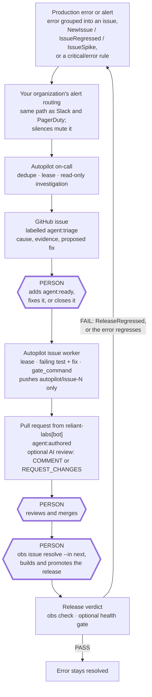

**In short**

- An alert or a new production error reaches Autopilot on-call through your organization's alert routing, with no URL or token to wire. On-call files **one** deduplicated GitHub issue, investigates it read-only and writes up a cause and a proposed fix. It stops there.
- Alert to fix is two linked workflows with a person between them. A person labels the issue `agent:ready`, the issue worker opens a pull request, and a person reviews and merges it. No Autopilot workflow approves, merges, deploys, rolls back or cuts a release.
- When an agent reads production on your behalf, the platform enforces read-only, not the prompt. Telemetry reads are rate limited on their own lane. Database reads run as a role that cannot write or see secret columns, need a reason, and are recorded before any rows come back.
- Unattended runs get less than attended ones: no credentials in their shells, no approvals that can wait, and no way into an audited production database. Leases stop two runs from working one item, turn caps bound each run, and a five-hop cap stops automations from triggering each other forever.

## The problem this solves

Letting an agent near production usually means one of two bad trades. Give it a broad credential and it can read everything, but it can also write everything, and a single prompt injection in an error message or an issue body is enough to turn it. Give it nothing and it works blind: you paste logs into a chat, it guesses, and nobody can say later what it looked at.

A stitched stack makes the middle ground expensive. The alerting tool doesn't know which repository a service lives in, the log store doesn't know which release was live, and the database has one application role that can write. Every guardrail is glue you write and maintain, and most teams skip it.

Reliant owns the seams in between: the alert, the error issue and the release it first appeared in, the repository, the read-only database role, the workflow and the GitHub identity. So each step an agent takes can be scoped to exactly what that step needs, and every step where something changes for real waits for a person.

## How it works

The path from a production error to a deployed fix. Shapes with a thick border are steps only a person takes.



### 1. An error becomes one alert

Reliant hosting groups the errors your services and pages report into **issues** and ties each to the release it first appeared in. It raises `NewIssue` when one appears, `IssueRegressed` when a resolved one comes back in a later release, and `IssueSpike` when an open one's rate jumps to five times its previous day. Those, `ReleaseRegressed` from a failed [release verdict](/deep-dives/how-release-verdicts-work), and your own `critical` and `error` rules reach Autopilot through the same alert routing as your other receivers.

On-call's trigger is declared `webhook: {source: alerting}`, so turning it on creates a receiver for it with nothing to copy ([Webhooks](/automations/webhooks)). It takes alerts from every environment of the project that raises them, hosted or one you monitor with `forge obs init`, never previews, and a silence mutes it too.

### 2. On-call files one investigated issue

Alert routing re-sends a firing group on every repeat interval and sends no idempotency header, so on-call deduplicates in two layers. The trigger names each event by its group, status and alert fingerprints, and a repeat within four hours starts nothing. After that window, on-call searches the repository's open issues for each alert's key: the Alertmanager fingerprint for a rule, or the issue id for an error, so a new error, its regression and its spike all land on one GitHub issue. A match gets a comment. If the search fails, on-call files nothing, because a missed alert costs less than a pile of duplicates.

A new key gets an issue labelled `agent:triage`, then a **lease** (below) and an investigation. The investigator gets file viewing, code search, skills, GitHub reads and a shell declared `credentials: none`, and no edit or write tools. It reads the checkout, compares the culprit with recent commits, and answers in a fixed shape: severity, summary, evidence, suspected cause, proposed fix and confidence. The run rewrites the issue with that answer. At most `max_investigations` new alerts per notification (default 5) are investigated, and the rest are filed without a write-up.

Error text is untrusted. A browser error comes in on a public ingest key, so any visitor can send a message written as instructions. On-call passes alert labels and annotations to the investigator as escaped JSON, each string cut to a safe length, inside tags its system prompt says never to obey. A scenario and a unit test feed it a forged error title and check that it is filed like any other error.

### 3. Gate one: a person decides

On-call never adds `agent:ready`; the scenario `never_sets_the_ready_label` holds it to that. The issue sits at `agent:triage` until a person reads it and chooses: hand it to an agent, fix it themselves, or close it as noise. If the bad release is hurting users now, this is also where a person [redeploys the last good release](/guides/hosting/recover-from-bad-deploy). Nothing rolls back on its own.

Only some people can pass this gate. The issue worker's trigger filter is CEL over the event's verified GitHub sender: the activation's owner or an account in `trusted_ids`. A label or `@reliant` mention from anyone else is skipped, and the text of issues and comments reaches the agent only as quoted data from trusted people ([who may start work](/guides/autopilot#who-may-start-work)).

### 4. The issue worker opens a pull request

The label starts a run that takes a lease on the issue, creates a worktree from the default branch, and gives an agent whose shell has no credentials up to 120 turns to write a failing test and the smallest fix. Then it runs your `gate_command`. If that fails, the agent gets one retry at half the turns. If it still fails, nothing is pushed.

The push itself happens in a `git_publish` node, not in the agent's shell. That node checks the branch against GitHub before anything leaves the machine. It pushes only an `autopilot/issue-<number>` branch, never the default branch, a protected branch or a fork, and never with `--force`. The push token exists for that one push and never reaches a shell, a file or the environment. Issues that would touch CI, secrets or deploy configuration, or need more than about 400 changed lines, are labelled `agent:punted` and handed back.

### 5. Gate two: a person merges

The pull request comes from `reliant-labs[bot]`, so you can approve and merge it yourself, and a branch rule that needs approval from someone other than the author works as it would for a teammate. The bot can write only if your own account can push to the repository. Its token is scoped to that repository and that action, and it lasts an hour ([who an automation acts as](/automations/overview#who-an-automation-acts-as)).

If you also run [AI pull request review](/guides/workflows/review-pull-requests-with-ai), its verdict is computed in one node whose expression can produce only `COMMENT` or `REQUEST_CHANGES`. A reviewer steered into answering `APPROVE` still posts a comment.

Merging is a GitHub action, `github/pr.merge@1`, that only a workflow action node can call. No agent can call it, and it needs `match_head_commit`, so a push after review is never merged ([merging is a workflow step](/integrations/github#merging-is-a-workflow-step-never-an-agent-tool)). No Autopilot workflow calls it. A team that wants something to merge without a person composes that workflow itself.

### 6. Ship it and close the loop

Merging closes the GitHub issue but leaves the error issue alone. A person ties the error to the release that will carry the fix with `reliant forge obs issue resolve <id> prod --in next`, builds a release from the merged commit and promotes it. That needs the `obs:triage` permission, which the read-only verbs don't. [`obs check`](/deep-dives/how-release-verdicts-work) then judges the release, and an opt-in health gate can hold the next promotion on that verdict. If the error comes back in a later release, it reopens as regressed. The old GitHub issue is closed by then, so on-call files a new one, and the loop starts again from the top.

## Reading production: telemetry, data and approvals

Autopilot is one way agents meet production. The other is a person's chat, where an agent debugs alongside you. Its shell is signed in as you, so it can use `reliant forge obs` and `reliant forge db query` with your grants, and the platform limits both.

### Telemetry reads are rate limited on their own lane

`obs status`, `issues`, `issue`, `logs`, `traces`, `trace` and `endpoints` read and change nothing. Each prints a JSON document with an exit code and the next commands to run ([why that helps an agent](/hosting/observability/agents)). Not every `obs` subcommand is a read: receivers, ingest tokens and issue triage change state, and triage needs `obs:triage`. Each CLI or agent credential gets 60 telemetry reads a minute per organization, on a query lane separate from the console's, so an agent stuck in a loop cannot blank your dashboards. Release checks get 6 a minute with a burst of 40. A refused read exits 2, which means "could not look", never "no errors" ([Debug production with an agent](/guides/observability/debug-production-with-ai-agent)).

### Database reads go through a role that cannot write

`reliant forge db query` on a hosted environment runs inside the platform as `forge_ro`, a role forge generates from your migrations. It runs one statement in a `READ ONLY` transaction with a timeout and row caps. A lexical guard refuses writes first, so the message is readable, and Postgres refuses them anyway. Columns marked `forge:secret`, or credential-shaped columns nobody has decided about, are never granted, so `select *` fails too. A production environment is `audited` by default: each query needs `--confirm-env` and `--reason`, plus the organization's `db:query` grant. The control plane records it, `obs changes` lists it, and if forge cannot write the audit record for a query it runs itself, it withholds the rows. An audited environment admits people only. An organization automation token is refused, so an unattended run cannot read production rows ([Let agents query production data](/guides/forge/let-agents-query-production-data)).

### Approvals need a person, and tokens stay narrow

Inside a workflow, an [approval node](/guides/workflows/require-human-approval) stops the run until a person approves. Deciding needs the `approvals:decide` permission, which your CLI login does not have, and so neither does any agent shell that inherits it. A person decides in the app. Lint flags a workflow that calls the approval service itself (`approval-decider`).

Deciding what runs unattended stays with people as well. An agent can write or edit an automation but cannot turn it on. The SDKs cannot enable a trigger, decide an approval or mint a token. A service that starts runs can hold a token as narrow as `runs:start` ([SDK scopes](/sdk/overview#scopes)). The [security model](/deep-dives/security-model) covers the full token design, and the [daemon security model](/deep-dives/daemon-security-model) covers what `credentials: none` removes from a shell.

### Leases, caps and loops

- **Leases.** Before on-call investigates or the issue worker codes, the run posts a lease comment as its own GitHub account, mirrored by `agent:working`. A second run that finds a live lease exits having written nothing. If two runs post at once, the later one steps aside. A run that dies leaves a lease that expires (60 minutes for on-call, 90 for the issue worker), and the next run takes over and says so. The lease is a convention between the workflows, not a lock GitHub enforces ([Leases](/guides/autopilot#leases)).
- **Turn caps, not dollar budgets.** An on-call investigation runs up to 45 turns, an issue-worker attempt 120 plus a 60-turn retry, and a PR review 40. These are inputs you can lower ([What it costs](/guides/autopilot#what-it-costs)). No workflow has a spend budget of its own. The hard ceiling on Reliant AI spend is the monthly limit on [automatic top-ups](/account/billing#auto-recharge).
- **Whose money.** An automation created in an organization with two or more live members spends only the organization's AI accounts (`Unattended funding: org_only`), whether it was turned on from the app or the CLI. If none can run the run's model, the firing fails and nothing is written ([How automations fire](/deep-dives/how-automations-fire#7-launch-and-which-ai-accounts-it-spends)).
- **Loops.** A chain of event-driven launches stops at five hops whatever the filters say, and comments the bot writes never fire a comment trigger, so a run cannot start itself ([The loop cap](/automations/overview#the-loop-cap)).

## Design decisions and trade-offs

**The gates are GitHub labels and merges, not approval nodes.** Nobody watches an automation's run, so its approval nodes resolve at once as `unattended` instead of waiting ([unattended by design](/automations/overview#unattended-by-design)). An approval that could stall an on-call run for hours would hold its lease and its machine. A label lives where the team already triages, can be given hours later, and starts a fresh run. The cost: a label is only as trusted as the filter that reads it, so `trusted_ids` matters, and a person can ignore a lease.

**The on-call investigator gets no telemetry credentials.** Its shell is `credentials: none` because the alert it reads may have been written by an attacker. It works from the error's title, culprit, first build and console link plus the code, and writes "logs/traces not reachable" rather than guessing. The cost is depth. For a trace-level look, a person opens a chat and [debugs with an agent](/guides/observability/debug-production-with-ai-agent) under their own rate-limited, attributed credential.

**A missed alert is cheaper than a duplicate.** When on-call cannot tell whether an issue already exists, it files nothing, because duplicates train people to ignore the label. The cost: during a GitHub outage an alert can go unfiled. It still pages through your other receivers, since on-call pages nobody itself.

**Read-only is enforced by Postgres, not by the prompt.** A prompt that says "only SELECT" fails the first time a model is talked out of it. The role cannot write, and its grants are rebuilt column by column after every migration. The cost: a column with a neutral name that holds a credential needs `forge:secret` by hand, because lint cannot spot it.

**Audited production admits people only.** An unattended run can investigate code and file issues, but it cannot read production rows. That rules out a fully autonomous data investigation. In return, every production query has a person's name and a reason on it.

**A verdict is evidence, not an actuator.** A release that fails its check raises `ReleaseRegressed`, which on-call can turn into an issue, and can hold the next promotion. It reverts nothing, because by then the release may have migrated data, and rolling back automatically past a migration is how a regression becomes data loss. Recovery is a person deploying a fixed or earlier release.

## Limits and what it does not do

- **Autopilot never merges, approves, deploys, rolls back or cuts a release.** A custom workflow you write can call `github/pr.merge@1` pinned to a reviewed head commit, but that is your composition, not Autopilot.
- **Alert to fix is never one hop.** It is two workflows with a person at each gate: one labels the issue `agent:ready`, and one merges the pull request.
- **There is no automatic rollback.** Recovery is redeploying a release, within your [rollback floors](/forge/deploy/release-gates#rollback-floors).
- **On-call does not read logs, traces, stack traces or rows.** Its write-up comes from the alert's labels and the code, and it says what it could not reach.
- **On-call does not see every alert.** Warnings from your own rules, preview environments and silenced alerts never reach it, and only `max_investigations` new alerts per notification get a write-up.
- **No per-workflow spend budget.** Turn caps bound each run. The wallet's monthly top-up limit is the hard ceiling.
- **`credentials: none` is a full sandbox only on Linux.** On macOS and Windows only the environment is scrubbed. For a wall that holds even if a credential leaks, turn on branch protection that requires a person's approval.
- **Leases are a convention.** GitHub does not enforce them, and a person can work an item an agent holds.

## See it for yourself

Every Autopilot workflow ships with scenarios that mock GitHub and the agents. Run them in any directory to watch the gates hold without spending a token:

```bash terminal
reliant workflow scenario run --include-builtins
```

```text Output (trimmed)
  ✓ autopilot-issue-worker/gate_still_failing_after_retry_publishes_nothing (26ms)
  ✓ autopilot-issue-worker/lease_race_lost_exits (10ms)
  ✓ autopilot-issue-worker/only_trusted_comments_reach_the_agent (17ms)
  ✓ autopilot-issue-worker/trusted_labeler_opens_pr (25ms)
  ✓ autopilot-oncall/forged_error_title_is_quoted_data_and_filed_bounded (26ms)
  ✓ autopilot-oncall/lease_held_files_but_does_not_investigate (12ms)
  ✓ autopilot-oncall/never_sets_the_ready_label (16ms)
  ✓ autopilot-oncall/over_the_investigation_cap_files_without_investigating (19ms)
  ✓ autopilot-oncall/same_fingerprint_dedupes (11ms)
  ✓ autopilot-oncall/search_failure_is_not_treated_as_new (10ms)
  ✓ autopilot-pr-review/reviewer_never_approves (26ms)
  …
  Total:   217 scenarios
  Passed:  217
```

`trusted_labeler_opens_pr` ends at a pull request, not a merge. Run one on its own with `--filter <name>`.

See which `obs` verbs read and which act:

```bash terminal
reliant forge obs --help
```

```text Output (trimmed)
  changes     What changed? Promotions, rollbacks, failed deploys and activity, newest first
  check       Did the deploy work? Judge a release by the window after it against the window before
  issue       Everything needed to fix one issue; resolve, ignore and unresolve triage it
  logs        Search and tail logs
  receivers   Route the org's alerts to Slack, a webhook, email or PagerDuty
  status      What is wrong right now? Services, open issues, alerts, telemetry and the release in force
  trace       One trace as a tree, with its errors and logs
```

Read how a database query is fenced:

```bash terminal
reliant forge db query --help
```

```text Output (trimmed)
Every query runs in a READ ONLY transaction with a statement timeout, as one
statement, under row and size caps. Writes, nextval() and a second statement
are refused: by a lexical guard first (so the message is readable), and by
Postgres itself regardless.
…
open (the default of a local or ephemeral env), audited (the default of any
other env: pass --confirm-env <env> and a --reason) or deny. A hosted env is
judged by the control plane from the policy its deployed release recorded, and
an audited one is open to people only (and to a db:query grant).
```

Once on-call is on, see the receiver it created and what it filters on (inside the Forge project), then the firings of its activation:

```bash terminal
reliant forge obs receivers list --json
reliant trigger events <activation id>
```

## Guides

- [Alerts to GitHub issues](/guides/workflows/production-alerts-to-github-issues): turn on on-call and see the deduplicated, investigated issue it files
- [Error to reviewed fix](/guides/workflows/production-error-to-fix): follow one production error through both gates to a deployed fix
- [Issues to pull requests](/guides/workflows/github-issues-to-pull-requests): label an issue `agent:ready` and review the pull request the issue worker opens
- [AI pull request review](/guides/workflows/review-pull-requests-with-ai): a review on every pull request that never approves or merges
- [Agents query prod data](/guides/forge/let-agents-query-production-data): audited, read-only SQL with secret columns withheld
- [Debug prod with an agent](/guides/observability/debug-production-with-ai-agent): errors, logs and traces through rate-limited read-only verbs
- [Find the culprit release](/guides/observability/find-release-that-caused-error): tie an error to the release and commits that introduced it
- [Require human approval](/guides/workflows/require-human-approval): stop a workflow you write until a person approves

## Reference

- [Autopilot](/guides/autopilot): every setting, label, lease and cost of the built-ins
- [Automations](/automations/overview): unattended runs, the loop cap, who an automation acts as, who can decide an approval
- [Webhooks](/automations/webhooks): the `source: alerting` trigger, and self-hosted Alertmanager
- [GitHub integration](/integrations/github): actions, the bot identity and `github/pr.merge@1`
- [Querying with forge obs](/hosting/observability/forge-obs): every verb, credentials and exit codes
- [Managed Postgres](/hosting/managed-postgres#read-the-data-safely): data access policy and the read-only role
- [SDK scopes](/sdk/overview#scopes): narrow tokens and what no SDK can do
- [Run agent commands without credentials](/guides/machines/sandbox-agent-commands-credentials-none): `credentials: none` in your own workflows
- [Release gates](/forge/deploy/release-gates): `obs check`, the health gate and rollback floors
