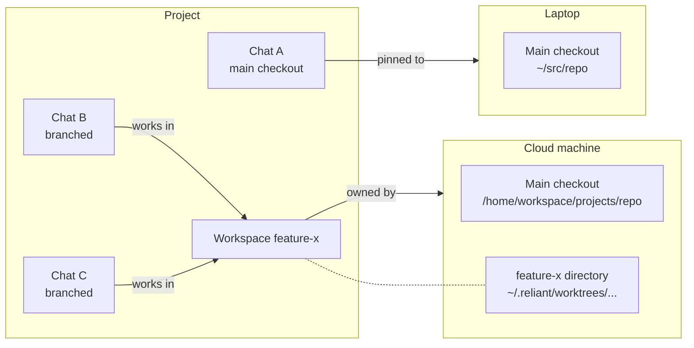
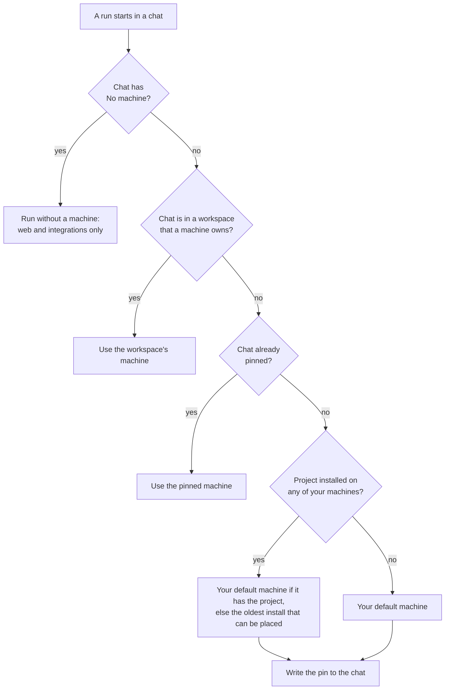

**In short**

- A chat runs on one machine. Reliant picks it once, when the chat's first run starts, and stores it with the chat. It changes only when you move the chat, or when that machine is deleted.
- A workspace (a git worktree on its own branch) exists on the disk of exactly one machine. A **branched chat** runs on that machine, whatever else is selected, and you can't switch it to another machine.
- A chat in the main checkout can move to any of your machines that has the project. The move applies from the chat's next run, and no files move with it.
- A suspended cloud machine is woken by sending a message, by a run's preflight check, or by opening its files. A tool call partway through a run never wakes it.
- Deleting a machine releases every chat and workspace bound to it. A workspace is picked up again by whichever machine later finds its directory on disk.

## The problem this solves

Reliant's servers never touch your files. Only a [daemon](/machines/overview) does, and you may have several: a laptop, a home server, one or more cloud machines. The same project can be checked out on several of them, each at its own path. A new branch exists only on the disk where it was created.

So every chat raises the same question: which disk is this agent working on? Answering it wrong is not a small bug. In an earlier version, a chat that named no machine re-chose one on every tool call, and the rule preferred a connected local computer. A user with several chats on a cloud machine connected their laptop, and every chat moved to the laptop on its next tool call, where the project often wasn't checked out at all.

The rules below exist so the answer is made once, written down and only changed on purpose. Where a checkout physically lives is never overridden by a preference.

## How it works

The first diagram shows what points at what. A project has a main checkout on each machine it is installed on. A workspace belongs to one machine. A chat sits in the main checkout or in one workspace, and carries its own machine pin.



Chat A could move to the cloud machine, because both machines have a main checkout. Chats B and C run on the cloud machine because `feature-x` exists only there.

The second diagram is the decision Reliant makes when a run starts and it has to name a machine.



A `daemon:` in a workflow or node sits above all of this for that workflow's steps. See [Design decisions](#design-decisions-and-trade-offs) for how it interacts with a workspace.

### Picking a chat's machine, once

When you start a chat you can pick a machine on the new-chat screen, or leave it on your [default machine](/machines/overview#your-default-machine). Either way, the chat is created with a machine already written on it. If no machine is picked, Reliant decides which machine the default means for this project at that moment:

1. If the chat is in a workspace that a machine owns, that machine.
2. Otherwise, among your machines where the project is installed, your default machine if it is one of them. If it isn't, the oldest install that Reliant can place, a machine that is connected, starting or asleep. Failing that, the oldest install.
3. If the project isn't installed anywhere yet, your default machine.

A machine that is asleep or still starting can be chosen. The run waits for it instead of going somewhere else. Only having no machine at all leaves a chat unpinned. Pinning is best effort. If writing the pin fails, the run starts anyway and the next run tries again, because a conversation always continues.

Changing your default machine later doesn't move chats that already have one.

### A workspace lives on one disk

A workspace is created on the machine of the chat it is created for. If there is no chat, it goes on the machine of the workspace it branches from, and failing that, the project's default machine. Its directory is under that machine's `~/.reliant/worktrees/<project>/<workspace>-<id>`. Reliant records that machine as the workspace's owner.

From then on, everything about that workspace goes to its owner: the agent's tool calls, the Files tab and file previews, the terminal, git status and diffs, and commits and pull requests from the Changes tab. A chat's pin can't pull that work elsewhere. If a chat in the workspace carries a pin to a different machine (from an old run, or from before the owner was recorded), the owner wins.

Skills, memory files and MCP servers come from the project config on the machine the call goes to. A chat on the cloud machine reads the cloud machine's copy.

### Switching a chat's machine

**Connect a machine** in the chat changes its pin. Reliant checks the machine you pick:

- It has to be yours. Another user's machine is reported as not found.
- Once the project is installed anywhere, the machine has to be one where it is installed. Otherwise you get `project is not installed on that daemon`.
- If the chat is in a workspace that another machine owns, the switch is refused with a sentence that names the owner, for example: `this workspace lives on "build-box", so a chat in it runs on "build-box": pick that machine, or start the chat in the main workspace`.

What a switch changes:

- **Where the chat's next run goes.** A run is handed the chat's machine when it starts and keeps it for its whole life. A run already in progress finishes on the machine it started on.
- **Nothing on disk.** No files are copied. The other machine works on its own main checkout, as it is on that disk. Uncommitted changes on the old machine stay there. Commit and push to carry work across.
- **A no-machine chat gains a machine.** The same action ends **No machine**. The change is one-way: clearing a chat's machine never turns it into a no-machine chat.

To continue a branched chat's work on another machine, push the branch and start a chat in a new workspace on the machine you want.

### Chats with no machine

**No machine** is a property of the chat, chosen when it starts and stored with it. Reliant never infers it from a machine being away. An absent machine is treated as asleep and gets woken. A no-machine chat is offered only tools that don't need your files. Nothing done for it resolves or wakes a machine, and it sits in the project's main checkout, never in a workspace a machine holds. Branching with **Continue without machine** from a chat whose machine is unavailable creates a new no-machine chat with the conversation so far. The original keeps its machine.

### Pools

An automation can target a **machine pool** instead of one machine. A pool is a named set of your machines whose labels match the pool's selector. Each run goes to the eligible member (project installed, not failed or removed) with the fewest live runs. If no member is free, the run waits for one that is starting. Failing that, it wakes a suspended member and waits. The chat the run creates is then pinned to that member, and all the rules above apply to it. Pools, labels and `reliant machine pool` need reliant v1.23.0 or later. See [Join a machine pool](/cli/run-a-machine#join-a-machine-pool-when-it-starts).

### Waking, suspending and resizing

A cloud machine suspends itself when idle. Suspending keeps its disk, so the main checkout and every workspace on it survive, but running processes, such as a dev server started in a workspace, do not. These start a wake:

- **Sending a message.** The send wakes the machine the chat is pinned to, or the one it is about to be pinned to.
- **A run's preflight check.** Before its first step, a run that needs a machine checks it, wakes it if it is asleep, and waits. This is how an automation's run at 3 a.m. gets a machine.
- **Opening the machine's files.** The Files tab, file previews and workspace operations start a wake and show **Waking up…** until it is back.
- **`reliant machine start`**, or **Resume** in Settings → Machines.

A tool call partway through a run does not wake a machine, and neither do background polls such as sidebar hints. A machine that suspends mid-run makes the run pause, as described in [How a tool call reaches your machine](/deep-dives/how-tool-calls-reach-your-machine#when-the-machine-is-away). Your next message wakes it.

Resizing needs a suspended machine and takes effect on its next start. The disk is never shrunk, so workspaces survive a resize. See [Manage cloud machines from the CLI](/guides/machines/manage-cloud-machines-cli).

### When a chat's machine is offline

There is no fallback to another machine. The checkout the chat works on is on that disk only, so the run waits for that machine:

- A suspended cloud machine is woken, and the run continues once it attaches, usually within a minute.
- Your own computer can't be woken remotely. The run shows **Waiting for machine** until the daemon reconnects.
- The wait ends early if the machine is deleted, or if it has reported failing to start for two minutes. Otherwise it gives up after six hours. When a run you started ends this way, your message isn't lost: it is queued for that machine and sent when the machine next connects. A run started by an automation fails, and the automation reports it.

### When a machine is deleted

Deleting a machine releases everything bound to it. Chats pinned to it lose their pin and are placed again at their next run. Workspaces it owned lose their owner, and so does the project's install record on it. If a machine later finds a workspace's directory on its disk, it adopts the workspace and becomes its owner. That is what happens when you re-register a computer under a new identity and its disk still holds the directories. A workspace whose directory is gone with the machine can't be recovered from Reliant. Its chats keep their history, and the branch survives only if it was pushed.

### Reclaiming disk on a machine

Each daemon can reclaim the disk of linked git worktrees nobody is using on its own machine. Reclaim reports only (`RELIANT_WORKTREE_RECLAIM=dry-run`) unless it is switched `on`. Switched `on`, it runs on its own schedule on any machine, your own computer included, whether or not the storage reaper runs. `reliant worktree reclaim scan --capture` captures what a pass would reclaim without deleting anything, so you can try a restore; see [Reclaim and restore worktrees](/guides/machines/reclaim-restore-worktrees). With it on, a clean worktree whose HEAD is on a remote is reclaimed after a day idle. Before it deletes one, it captures everything git can see of it into a local ref, `refs/reliant/reclaimed/<key>/<time>`. A worktree with work that only it holds is never reclaimed automatically. After about five days idle it is proposed for a person to free. Captures never expire. Because the capture is a ref in that machine's repository, you list and restore it on that same machine with `reliant worktree reclaimed` and `reliant worktree restore`. Archiving a workspace in the app is the other cleanup path, described in [Workspaces](/features/worktrees#cleaning-up).

## Design decisions and trade-offs

**Pin once, instead of resolving on every call.** Re-resolving would let a chat follow you to whichever machine is awake. But it also moves chats nobody asked to move, onto machines without the checkout, partway through a task. A stored pin makes a chat's machine visible and stable. The cost is that a chat pinned to a machine that is asleep wakes it, even when another machine is awake. That is deliberate, because the awake machine may not have the chat's files.

**The checkout's location beats every preference.** A workspace's owner overrides the chat's pin, because the directory exists nowhere else. Sending the work elsewhere would at best report a missing directory, and at worst act on a same-named path on another machine. The cost is that a branched chat is only as available as one machine. Reliant doesn't copy or sync workspaces between machines. A copy would drift, and two agents could then commit different histories to the same branch name.

**A switch doesn't touch a running run.** A run keeps the machine it started with, so a step can't begin on one disk and end on another. The cost is that a switch takes effect only at the next run.

**A `daemon:` in a workflow stays explicit.** A machine named by a workflow or node keeps its precedence even in a branched chat, because a workflow author who names a machine means it. The exception is a sub-agent thread with its own workspace, which always runs on that workspace's owner. The cost is that a `daemon:` pointing at a machine without the chat's workspace runs its steps on a disk where that workspace doesn't exist. Pin with care in workflows that run in workspaces. The guide [Choose which machine runs each workflow step](/guides/machines/pin-workflow-to-machine) covers the resolution order.

**Wake on intent, not on traffic.** A cloud machine is billed while it runs. Waking it when you send a message, when a run begins, or when you open its files ties the bill to something you did. Waking on every tool call would let a long-forgotten run, or a background poll, turn a machine on again and again. The cost is that a run whose machine suspends partway through pauses until you send a message.

**Release on delete, re-learn from evidence.** Bindings to a deleted machine pointed at an id nothing could reach, so affected chats never recovered. Releasing them and letting a machine prove ownership by finding the directory means a re-registered computer picks up its workspaces again. The cost is a short period where a released workspace has no owner, and requests about it fall back to default placement.

## Limits and what it does not do

- **No moving a branched chat.** There is no migrate or sync for a workspace. Push the branch and start a new workspace on the other machine.
- **No file transfer on switch.** Moving a main-checkout chat changes where commands run, not what is on either disk.
- **No failover.** A chat whose machine is offline waits for that machine. It is never sent to another one, even one that has the project.
- **Your own computer can't be woken.** Only cloud machines resume remotely. Your computer has to be on, with `reliant daemon start` running.
- **Waits are bounded.** A run waits up to six hours for its machine, and less if the machine is deleted or keeps failing to start.
- **Suspend keeps files, not processes.** Dev servers and background commands in a workspace stop when a cloud machine suspends.
- **No CLI for a chat's machine.** Switching is **Connect a machine** in the app. `reliant workflow run --daemon` picks the machine for a run you start from the CLI.
- **Pools need reliant v1.23.0 or later.** Older CLIs don't have `--label` or `reliant machine pool`.
- **Reclaim captures are local.** A capture lives in one machine's repository and is lost if that machine's disk is deleted.

## See it for yourself

**Which daemon serves this checkout?** A daemon's identity includes the workspace root it serves, so `reliant daemon status` gives a different answer depending on where you run it. Here it is run from the root the daemon serves, then from a checkout that has no daemon of its own:

```bash terminal
cd /home/workspace && reliant daemon status
```

```text
Daemon is running and its gateway stream is established
  PID:      21208
  Gateway:  https://gateway.reliantapi.com (tls)
  Stream:   connected for 28h48m11s
  Stability: stable — no reconnects since this daemon started
  Record:   /home/workspace/.reliant/instances/https-api.reliantapi.com-c9232e15/_default/workspace-b45e3fc5/daemon-state.json
```

```bash terminal
cd ~/.reliant/worktrees/reliant-labs/docs-guides-f28bb2c2/reliant && reliant daemon status
```

```text
No daemon running (no runtime record found)
  Record:   /home/workspace/.reliant/instances/https-api.reliantapi.com-c9232e15/_default/docs-guides-f28bb2c2-fc8cbae1/daemon-state.json
daemon not running
```

The second directory is a workspace on this machine. It needs no daemon of its own: the machine's one daemon runs the commands there. `reliant daemon ls` shows every daemon instance on the computer:

```bash terminal
reliant daemon ls
```

```text
RUNNING  PID    STREAM     UPTIME     INSTANCE
yes      21208  connected  28h47m57s  https-api.reliantapi.com-c9232e15/_default/workspace-b45e3fc5
```

**Where do workspaces live?** Each workspace is a directory under the owning machine's worktree root, one folder per project:

```bash terminal
ls ~/.reliant/worktrees/
ls ~/.reliant/worktrees/reliant-labs | head -3
```

```text
reliant-labs
approval-create-read-committed-bb1c6391
backlog-forge-2430-97acbc89
backlog-reliant-2863-868e970c
```

**What has this machine reclaimed?** Run the reclaim commands on the machine whose disk you care about. Here, nothing has been captured yet:

```bash terminal
reliant worktree reclaimed
reliant worktree reclaim report
```

```text
CAPTURED  PATH  BRANCH  WORK  REF  REPO
no reclaim report yet: the daemon writes one each pass (RELIANT_WORKTREE_RECLAIM=dry-run or on), or run `reliant worktree reclaim scan`
```

**Run on a named machine from the CLI.** `reliant workflow run` states the same rule for runs you start yourself:

```bash terminal
reliant workflow run --help | grep -A5 'The run executes on'
```

```text
The run executes on the project's machine, by default the user's default
machine. --daemon (a machine's daemon id or hostname, as Settings → Machines
shows them; a value that names no machine lists yours) runs it on that machine
instead; with --project-path the folder is looked up, attached or created on
that machine, which is the one that holds it. With --project-id the project
```

## Guides

- [Choose which machine runs each workflow step](/guides/machines/pin-workflow-to-machine): pin a workflow or node with `daemon:`, by kind, name or selector
- [Start, stop and resize cloud machines](/guides/machines/manage-cloud-machines-cli): `reliant machine list/start/stop/resize/rename`, and what wakes a machine
- [Reclaim and restore worktrees](/guides/machines/reclaim-restore-worktrees): free worktree disk and bring back a reclaimed worktree from its capture
- [Troubleshoot an offline machine](/guides/machines/troubleshoot-offline-machine): get a chat's machine connected again and resume a paused run

## Reference

- [Machines overview](/machines/overview): machine types, choosing a chat's machine and your default machine.
- [Choosing a machine in workflows](/machines/choosing): the `daemon:` field and machine status.
- [Cloud machines and plans](/machines/cloud): suspending, waking, sizes and disks.
- [Workspaces](/features/worktrees) and [Branching](/features/branching): creating, branching into and cleaning up workspaces.
- [No-machine runs](/automations/no-machine-runs): runs that need no machine at all.
- [How a tool call reaches your machine](/deep-dives/how-tool-calls-reach-your-machine): the path a call takes once its machine is chosen.
- [Machine identity and the daemon security model](/deep-dives/daemon-security-model): what a daemon can reach on the machine it runs on.
- [Run a machine from the CLI](/cli/run-a-machine): `daemon start` flags, labels and pools.
