**In short**

- Reliant's servers can't read your disk. The daemon is the only component with filesystem access, and it runs as your Unix user on the machine you connected.
- A machine proves who it is with its own `rlat_` access token, stored in `~/.reliant/daemon.json` (mode `0600`). The gateway checks the token against Reliant's token service on every connect, with no cache, so a revoked token is refused the next time the daemon dials. On Reliant's hosted service, revoking a token also ends the stream it opened.
- By default, an agent's shell command can reach everything your Unix user can. The daemon's file tools refuse to touch Reliant's own credential files, but a shell command can still read them.
- `credentials: none` removes credentials from a command's environment. On Linux it also runs the command in its own user, mount and PID namespaces, where `daemon.json`, `~/.git-credentials`, `~/.ssh`, cloud logins and the container socket don't exist. On macOS and Windows it only cleans the environment.
- Anything a command prints, or a file the agent reads, leaves the machine. It is stored with the chat and sent to your model provider.

## The problem this solves

A coding agent is useful because it can run your build, read your code and push a branch. Those are the same abilities a stolen credential or a prompt injection would want. An agent that reads an issue an outsider wrote, an error message a browser sent, or a pull request from a fork is reading text an attacker controls. If its shell holds your GitHub token, your cloud login and the key that lets the machine talk to Reliant, a single injected instruction can send all of them somewhere else.

Most setups either hand the agent your whole user account, or put it in a container that can't reach your real checkout and so can't do the work. Reliant gives the machine its own revocable credential, keeps the servers out of your filesystem, and lets a workflow take credentials away from the commands that read untrusted text.

## How it works

The diagram draws the trust boundary between your machine and Reliant's cloud. Credentials stay on the left of it. Tool calls and their output cross it.

```mermaid
flowchart LR
    subgraph machine["Your machine (your Unix user)"]
        creds[("Credential files<br/>daemon.json, ~/.git-credentials,<br/>~/.ssh, ~/.config/gh, cloud logins")]
        daemon["Daemon<br/>reliant daemon start"]
        shell["Agent shell<br/>credentials inherited"]
        sandbox["Agent shell<br/>credentials: none<br/>(Linux: own namespaces)"]
        repo[("Your repository")]
        daemon -->|reads its rlat_ token| creds
        daemon --> shell
        daemon --> sandbox
        shell -->|can read| creds
        shell --> repo
        sandbox -.->|cannot see: files absent| creds
        sandbox --> repo
    end

    subgraph cloud["Reliant cloud (no filesystem access)"]
        gateway["Gateway<br/>checks the token on every connect"]
        tokens["Token service<br/>validates, revokes"]
        worker["Agent loop<br/>workers"]
        store[("Chat history<br/>tool output")]
    end

    provider["Your model provider"]

    daemon ==>|outbound stream, rlat_ token| gateway
    gateway -->|introspect, uncached| tokens
    worker <-->|tool calls and output| gateway
    worker --> store
    worker -->|prompt plus tool output| provider
```



How a tool call travels over that stream is covered in [How a tool call reaches your machine](/deep-dives/how-tool-calls-reach-your-machine). This page covers who the stream belongs to and what a call can reach once it arrives.

### 1. Only the daemon touches your files

The API server, the workers and the gateway don't mount your disk and can't open a file on it. When the model wants to read a file or run a command, the worker sends the tool call to a daemon, and the daemon does the work and returns the result ([Privacy & security](/help/privacy)). On your own computer the daemon dials out to the gateway, so there is no inbound port to connect to. It runs as the Unix user that started it, with no permissions your account doesn't already have.

### 2. The machine gets its own credential

A machine signs in with a credential of its own, separate from your `reliant auth login`. You get one in one of three ways (`reliant daemon start --help`):

- **Pairing.** `reliant daemon start` or `reliant daemon register` runs a device-code sign-in. It prints a short code, and you approve "this machine" in the app. Nothing has to reach back to the terminal, so this works over SSH. The pairing asks for `daemon:connect` and nothing else. If you are logged in to the CLI, a pairing approved as a different account is refused and not saved.
- **A pasted token.** `echo "rlat_…" | reliant daemon start --token` takes a token you created under **Settings → Access Tokens**. Anything that isn't shaped like an `rlat_` token is refused before it is saved. If Reliant rejects the token, the daemon stops and deletes it. It doesn't fall back to pairing, because you chose that token ([Run a machine from the CLI](/cli/run-a-machine)).
- **The desktop app.** The app signs in and writes the credential for the daemon it starts.

The result is an `rlat_` access token stored in `~/.reliant/daemon.json`. That file is written with mode `0600` inside a `0700` directory, so other Unix users on the machine can't read it. The file is keyed by server and then by account, so one computer can hold credentials for several Reliant servers and several people without one overwriting another. Daemon credentials don't expire. They last until you revoke them.

Pairing the same daemon instance again doesn't add a second token. The token is named after the instance, and the server rotates on that name, so re-registering replaces that instance's previous token.

The token acts as you, and its scope is deliberately narrow on the wire. To open a stream, the gateway accepts only tokens that carry `daemon:connect`. Forge commands that run on the machine don't use the token directly. They exchange it for a token that lasts at most an hour, limited to what your organization grants you at that moment ([Forge sign-in](/forge/sign-in)).

### 3. The gateway checks the token on every connect

Every time the daemon opens a stream, the gateway sends the token to the deployment's token authority. On Reliant's hosted service that is the control plane. On a self-hosted server it is the server's own token table. The lookup is uncached. Connects are rare, and the stream is the most valuable surface Reliant has, so each connect pays for a fresh check. The gateway refuses the stream if the token:

- isn't an `rlat_` token (`daemon credential must be an rlat_ access token; re-register the daemon`)
- has been revoked or is unknown (`invalid daemon auth token`)
- lacks `daemon:connect` (`token does not grant daemon:connect`)

If the token service is unreachable, the daemon gets "unavailable" rather than "unauthenticated". It retries and keeps its good token instead of discarding it.

On Reliant's hosted service, revoking a token does more than block the next connect. When a daemon credential is revoked, or its owner leaves the organization, the control plane tells every gateway replica. The replica holding that daemon's stream ends it. The daemon keeps redialing, so if access is restored with a new credential it recovers without a restart.

### 4. Instance identity: server × account × workspace

A credential identifies an account. A daemon *instance* is narrower: one server, one account and one workspace. The workspace defaults to the git worktree root of the directory you started the daemon in. Each instance has its own folder, `~/.reliant/instances/<server>/<account>/<workspace>/`, holding its runtime record, its server-assigned daemon id and its logs. Two checkouts on one computer are two daemons. Two accounts on one computer are two daemons, even in the same workspace.

The daemon id lives in the instance folder, not in `daemon.json`, because one credential serves every instance of an account on the machine while each instance must register as itself.

### 5. What an ordinary command can reach

With the default `credentials` setting, a shell command the agent runs is a child of the daemon, running as your user. It can read anything you can read: your SSH keys, `~/.config/gh/hosts.yml`, `~/.git-credentials`, cloud logins, and `daemon.json` itself. It can also reach the container socket if your user can. It inherits the daemon's environment, along with a git credential helper and a forge credential helper. That is what lets the agent push a branch or deploy as you.

There is one fixed guard that applies to every caller. The daemon's file tools, such as `view` and `edit`, refuse Reliant's own credential files: `~/.reliant/daemon.json`, `~/.reliant/forge-token-cache.json` and the shared forge credentials file. Symlinks and hard links to those files are refused too. A model has no reason to open those files, and once one is in a model's context it can end up in whatever the model writes. This guard covers file tools only. A `cat` in a credentialed shell isn't stopped by it.

### 6. `credentials: none`

A workflow can set `credentials: none` on a `run` node, or bind it on the `shell` tool an agent uses, where the model is never shown the parameter ([Custom workflows](/workflows/custom-workflows)). This setting has two parts.

**The environment, on every operating system.** The command doesn't inherit the daemon's environment wholesale. It starts from a short allowlist of variables a build needs. The allowlist then drops anything that looks like a secret, by name (`token`, `secret`, `key`, `dsn`, `password`, …) or by shape (a JWT, a PEM private key, a URL with a password in it, a GitHub, OpenAI or Anthropic key, an `rlat_` token). GitHub, git, ssh, cloud and forge credential variables are removed by name. Git's credential helpers and askpass are reset, `GIT_TERMINAL_PROMPT=0` is set, `GH_CONFIG_DIR` points at an empty read-only directory, and `GIT_SSH_COMMAND` is `/bin/false`. A `git push` or `gh pr merge` fails to authenticate and returns at once instead of prompting.

**The sandbox, on Linux only.** The daemon re-runs itself as a small init process that starts the command in its own user, mount and PID namespaces:

- The credential files and directories are absent from the command's view of the filesystem. These include `daemon.json`, the forge token cache and credentials, `~/.git-credentials`, `~/.ssh`, `~/.gnupg`, `~/.config/gh`, `~/.netrc`, `~/.npmrc`, `~/.aws`, `~/.azure`, `~/.config/gcloud`, `~/.docker/config.json`, `~/.kube/config`, Claude and Codex logins, and the daemon's own data directory. Gemini CLI's, Cursor Agent's and Copilot CLI's sign-ins (`~/.gemini`, `~/.cursor`, `~/.config/cursor`, `~/.copilot`) are still readable in this release, with a one-line notice on the command's stderr when they exist, and are hidden from the next minor release.
- Container engine sockets (Docker, containerd, Podman) are replaced with `/dev/null`, because whoever holds one can ask the engine for root.
- Files that decide what a *later* run executes or believes are read-only: shell startup files, git config, the global memory file, skills, the daemon's binary and config, and every other project checkout. The command can't plant something for the next credentialed step to run.
- `/tmp` and `/var/tmp` are private to the command.
- The command sees only its own processes, so it can't read the daemon's environment or memory through `/proc`.
- The command has no capabilities and can't gain any (`no_new_privs`).

The sandbox fails closed. On a host that doesn't allow unprivileged user namespaces, such as a hardened kernel or a container whose seccomp profile blocks them, the command is not run, and the refusal says why (exit status 126). Every Reliant cloud machine is Linux, so a `credentials: none` command there always gets the sandbox or doesn't run at all.

The sandbox keeps the network, because a `git fetch` or a package install has to work, so services on loopback stay reachable. The command can also write the checkout it was given. It is a boundary around your credentials, not around your code.

### 7. Process groups and machine limits

Every command the daemon starts leads its own process group, so `shell_kill` and a stopped run take down the whole tree, not just the top process. On a cloud machine, each command is also born into a cgroup of its own with a cap on threads. A runaway command hits its own limit and fails alone, the daemon keeps a reserve so it can still kill and report, and a kill reaches processes that tried to escape with `setsid`.

On Linux, the daemon also watches the whole machine. When your user's processes and threads pass 70% of the limit, it refuses *new* heavy background commands until the count falls below 60%. It never stops a running command or refuses a foreground or light one. It sends a report to your inbox naming the largest process trees and the agent that started each. Trees the daemon didn't start are listed as untracked. On cloud machines the daemon also recognizes a command killed by the kernel's out-of-memory killer, and reports memory pressure to the gateway before it gets that far.

### 8. What leaves the machine

Credentials stay on the machine, but output doesn't. Whatever the agent reads, and whatever a command prints, goes back over the stream, is stored with the chat and is sent to your model provider. That includes secrets: if a command echoes a token, the token is now in your chat. [Privacy & security](/help/privacy) has the full table of what is stored where.

A cloud machine is different in one way. Its whole disk is on Reliant's infrastructure, in Google Cloud (us-central1), and the machine runs inside its own lightweight VM.

## Design decisions and trade-offs

**A credential per machine, not your login.** The daemon could reuse your CLI login, but that token carries `reliant:api` and would let anything on the machine act as you everywhere. A separate `daemon:connect` credential can be listed, scoped and revoked per machine in **Settings → Access Tokens**. The cost is a second sign-in to keep in step, which the CLI handles by refusing to connect a daemon as anyone other than the logged-in account.

**Check every connect, uncached.** A cache would save a round trip, but revocation would wait for the cache to expire. Connects are rare, so Reliant pays for the round trip. The cost is that a token-service outage blocks new streams; daemons treat it as "retry", not "bad token".

**Credentials are inherited by default.** Most chats need to push, open pull requests and deploy, and a default of `none` would break all of that. So the safe setting is opt-in per node or per tool binding. The built-in Autopilot workflows opt in for every shell and `run` node, and push through a `git_publish` node that never gives its credential to a shell ([Autopilot](/guides/autopilot)).

**Namespaces, not a container or a second user.** A container needs an image and a privileged runtime, and a second Unix user needs root. Unprivileged namespaces need neither, so they work on a laptop and in a cloud pod alike. macOS and Windows have no equivalent that is both strong and unprivileged, so there Reliant only cleans the environment.

**Fail closed.** If the sandbox can't be built, the command doesn't run. A `credentials: none` command that quietly ran with credentials would be worse than an error, because the workflow author would believe it was safe.

## Limits and what it does not do

- **On macOS and Windows, `credentials: none` only cleans the environment.** A command that goes looking can still read `~/.config/gh/hosts.yml`, `~/.git-credentials` or `~/.ssh` there. The daemon's file tools still refuse Reliant's own credential files.
- **A default shell has your whole user account.** Without `credentials: none`, an agent's command can read every file you can, `daemon.json` included. Use approval modes and `credentials: none` for runs that read untrusted text.
- **The sandbox doesn't isolate the network or the workspace.** A sandboxed command can still make outbound requests, reach services on loopback and change or delete files in the checkout it was given.
- **Revocation doesn't recall what was already exchanged.** A forge token exchanged from a daemon credential can stay usable until it expires, at most an hour after the parent is revoked ([Forge sign-in](/forge/sign-in)).
- **Daemon credentials don't expire.** They last until you revoke them under **Settings → Access Tokens**, so revoke the token of a machine you've given away or lost.
- **Output isn't filtered.** Secrets get no special handling once a command prints them. They are stored with the chat and sent to your model provider.
- **Process limits are mostly cloud-machine features.** Per-command cgroups need a delegated cgroup v2 subtree, which cloud machines have and most laptops don't. The machine-wide 70% guard needs Linux. On macOS and Windows a command gets its own process group and nothing more.
- **Cloud machines.** Each runs in its own lightweight VM; this page claims nothing further about that isolation.

## See it for yourself

**Check the credential files' permissions.** List the modes without printing any contents:

```bash terminal
ls -la ~/.reliant/ | grep -E 'daemon.json|forge-token-cache|instances'
stat -c '%A %n' ~/.git-credentials ~/.config/gh
```

```text
-rw-------  1 reliant reliant  499 Nov 19 04:35 daemon.json
-rw-------  1 reliant reliant 1881 Nov 20 07:09 forge-token-cache.json
drwx------  3 reliant reliant 4096 Nov 19 04:30 instances
-rw------- /home/workspace/.git-credentials
drwx------ /home/workspace/.config/gh
```

The shape of `daemon.json` is server, then account, then one credential. Here every value is redacted, and there is no `expires_at` because daemon credentials don't expire:

```json ~/.reliant/daemon.json (values redacted)
{
  "origins": {
    "https://api.reliantapi.com": {
      "_default": {
        "pat": "rlat_…(redacted)",
        "server_url": "<26 chars>",
        "gateway_url": "<30 chars>",
        "registered_at": "<30 chars>",
        "account_id": "<36 chars>",
        "account_email": "<19 chars>"
      }
    }
  }
}
```

Never `cat` this file into a chat. The daemon's file tools refuse it outright (`refused: this is a Reliant credential file…`), but a credentialed shell doesn't.

**See instance identity.** `reliant daemon status` looks up the instance for the workspace you run it from. In a checkout that has no daemon of its own, it finds nothing, even while another instance on the same computer is connected:

```bash terminal
cd path/to/another-checkout && reliant daemon status; echo "exit=$?"
reliant daemon ls
```

```text
No daemon running (no runtime record found)
  Record:   /home/workspace/.reliant/instances/https-api.reliantapi.com-c9232e15/_default/docs-guides-f28bb2c2-fc8cbae1/daemon-state.json
daemon not running
exit=1
RUNNING  PID    STREAM     UPTIME     INSTANCE
yes      21208  connected  26h38m34s  https-api.reliantapi.com-c9232e15/_default/workspace-b45e3fc5
```

**Compare a credentialed shell with `credentials: none`.** Run the same probe twice on a Linux machine: once in an ordinary agent shell, and once from a workflow `run` node or a shell bound to `credentials: none`. None of these commands prints a credential:

```bash terminal
ls -l ~/.reliant/daemon.json ~/.git-credentials; ls -ld ~/.ssh
ls -l /run/docker.sock
gh auth status
ps -e --no-headers | wc -l
grep -E 'CapEff|NoNewPrivs' /proc/self/status
```

In the ordinary shell (account name redacted):

```text
-rw------- 1 reliant reliant  75 Nov 20 07:16 /home/workspace/.git-credentials
-rw------- 1 reliant reliant 499 Nov 19 04:35 /home/workspace/.reliant/daemon.json
drwx------ 2 reliant reliant 4096 Nov 19 20:30 /home/workspace/.ssh
srw-rw---- 1 root docker 0 Nov 19 04:26 /run/docker.sock
github.com
  X Failed to log in to github.com account <redacted> (/home/workspace/.config/gh/hosts.yml)
933
CapEff:	0000000000000000
NoNewPrivs:	0
```

Under `credentials: none`:

```text
ls: cannot access '/home/workspace/.reliant/daemon.json': No such file or directory
ls: cannot access '/home/workspace/.git-credentials': No such file or directory
ls: cannot access '/home/workspace/.ssh': No such file or directory
crw-rw-rw- 1 nobody nogroup 1, 3 Nov 18 22:52 /run/docker.sock
You are not logged into any GitHub hosts. To log in, run: gh auth login
4
CapEff:	0000000000000000
NoNewPrivs:	1
```

The credential files are gone, not just unreadable. The Docker socket is now `/dev/null` (character device `1, 3`). The command sees a handful of its own processes instead of the machine's 933, and it can't gain privileges. Two more probes in the same sandboxed shell show the rest:

```text
$ touch ~/.bashrc
touch: cannot touch '/home/workspace/.bashrc': Read-only file system
$ git push --dry-run origin HEAD:refs/heads/never-created
fatal: could not read Username for 'https://github.com': terminal prompts disabled
```

The network still works: `curl https://api.github.com` returned `200` from the same sandboxed shell.

## Guides

- [Connect your computer as a machine](/guides/machines/connect-computer-as-machine): pair a computer with `reliant daemon start`, approve it in the app, and confirm the stream is up
- [Run commands without your credentials](/guides/machines/sandbox-agent-commands-credentials-none): set `credentials: none` on a node or an agent's shell for runs that read untrusted text
- [Run agents on your own server](/guides/machines/run-agents-on-your-own-server): run the daemon headless with a token, under systemd, on a server or Raspberry Pi
- [Autopilot](/guides/autopilot): the built-in workflows run every shell with `credentials: none` and push through `git_publish`

## Reference

- [How a tool call reaches your machine](/deep-dives/how-tool-calls-reach-your-machine): the outbound stream, heartbeats and reconnects.
- [Privacy & security](/help/privacy): what is stored, what your model provider sees, and how cloud machines differ.
- [Sign in and tokens](/cli/sign-in): CLI logins, API tokens and daemon credentials compared, and how to revoke them.
- [Run a machine from the CLI](/cli/run-a-machine) and [Your own computer](/machines/your-computer): pairing, `--token`, instances and service managers.
- [Forge sign-in](/forge/sign-in): how forge commands on a daemon exchange its credential for a short-lived token.
- [Custom workflows](/workflows/custom-workflows) and [Nodes](/reference/nodes): where `credentials: none` is set.
- [Server roles](/architecture/distributed): the gateway and its credential checks, for operators.
