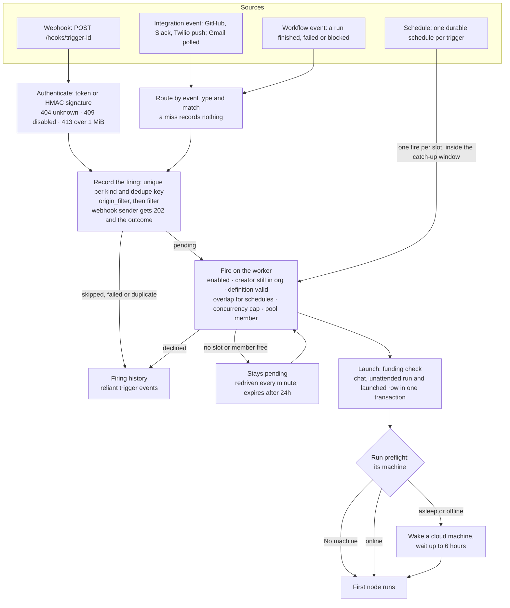

**In short**

- An automation starts a run from a **schedule**, a **webhook**, an **integration event** (GitHub, Slack, Twilio, Gmail) or a **workflow event** (another run finished, failed or blocked). Every event a trigger listens to is recorded with its outcome and the reason, whether it launched or not.
- Each firing has a key: the scheduled slot, the sender's idempotency header, the provider's event id. A repeat of a key starts nothing.
- A webhook sender gets `202` as soon as its delivery is recorded; the launch happens on the worker. A missed schedule slot runs late only inside its catch-up window (10 minutes by default).
- Before launching, the fire re-reads the workflow's trigger declaration and applies overlap, the workflow's `concurrency:` cap, and which AI accounts the run may spend.
- The run then checks its machine: a **No machine** run needs none, a sleeping cloud machine is woken, an offline computer is waited for up to six hours. An automation never moves to another machine.

[Automations](/automations/overview) is the reference for declaring and enabling triggers. This page explains what happens between an event arriving and the run's first step.

## The problem this solves

Running an agent from cron or a webhook looks easy: a crontab entry, an HTTP handler, a call to start the agent. The trouble is the cases around it. A sender retries and you get two runs. A weekend outage replays forty stale runs on Monday. A ten-minute job on a five-minute schedule stacks up copies of itself. A webhook body tells the agent to ignore its instructions. The laptop the job needs is asleep. And nobody can say why the automation stopped producing runs, because nothing was written down when it didn't.

Reliant gives every firing a durable identity and a recorded outcome, and gives each of those cases (catch-up, overlap, concurrency, funding, machine) a defined answer that lands in the automation's history.

## How it works

The diagram follows an event from its source to the run's first step. Read it top to bottom.



### 1. Every firing gets one identity

All four sources end the same way: a **firing record** (the rows `reliant trigger events` lists), unique on its kind and a dedupe key. The key is what makes repeats harmless:

| Source | Dedupe key |
|--------|------------|
| Schedule | The scheduled slot. Each slot's fire has its own id, and the run's chat id is derived from it, so a retried fire lands in the same chat |
| Webhook | `dedupe_key` when the trigger declares one; otherwise the first of `Idempotency-Key`, `X-Idempotency-Key` or `X-Delivery-Id`; otherwise a hash of the body within the same minute |
| Integration event | The provider's own event or delivery id |
| Workflow event | The run's outcome event: one per run reaching an outcome |

A second delivery with a key already on record writes nothing new. It reports the first one's outcome, with `duplicate: true` for a webhook. If the first delivery is still pending, the second one restarts its fire, which attaches to the existing execution instead of starting a new one.

### 2. Schedules: one fire per slot, a short catch-up

Enabling a schedule creates a durable schedule for that trigger on the workflow engine (Temporal). Edits and pauses converge onto it, and each API server start repairs any that drifted. Each slot starts a short fire workflow, bounded to ten minutes, that runs the checks and the launch.

The **catch-up window** decides what happens to a slot that came due while the system was down. Temporal's own default would replay a year of missed slots. Reliant's is 10 minutes, settable per trigger (`catchup_window`, or `--catchup-window`). A slot missed by more than that never fires, and leaves no row, because the fire writes the record. Cron is the 5-field form only, and an `interval` must be at least a minute.

**Overlap** is checked at launch, inside the launch transaction, under a lock on the trigger, so fires released together after an outage queue instead of all passing at once. With `overlap: skip` (the default), the fire looks at the run the trigger last launched. If that run is starting, active or **paused**, the firing is recorded skipped (`previous run is active (chat …)`). A run whose start failed doesn't hold the schedule: the next fire abandons it and launches. `overlap: allow` skips the check, and a manual `reliant trigger fire` bypasses both overlap and the enabled flag.

### 3. Webhooks: answer fast, record first

The webhook receiver runs on the API server, where the sender is waiting: GitHub gives up after 10 seconds, Slack after 3. So it does only the synchronous part. It authenticates (a token in the path, a bearer token, or an HMAC of the raw body), records the firing, starts the fire on the worker, and answers. Unknown trigger, wrong token and bad signature are the same `404`, so trigger ids aren't revealed. A disabled trigger answers an authenticated caller `409`, so a retrying sender stops. Over 1 MiB is `413`. Only `503` (the delivery could not be recorded) asks the sender to retry.

The record is written **before** the fire starts. If the start is lost, the firing stays pending, and a redriver that passes every minute restarts any fire pending for over two minutes. So a sender that never retries still gets exactly one run. A firing still pending after 24 hours is closed as failed (`the event was never launched; it is too old to start now`). The [webhook guide](/guides/workflows/start-agent-from-webhook) shows each response from a live trigger.

### 4. App events and workflow events

GitHub, Slack and Twilio **push** events to Reliant's provider endpoints, each verified with the provider's own signature. Gmail is **polled**, every five minutes by default; a missed poll isn't run late, since the next one reads everything since the last.

Routing comes before any record. An event of a type the trigger doesn't listen to, or whose attributes miss its `match` (another repository, say), writes **nothing**, so a busy GitHub organization can't bury a trigger's history in events it never asked for.

A workflow event is raised when one of your runs finishes, fails or blocks on a person. It never fires on a run its own trigger started, or on that run's descendants, and a chain of event-launched runs stops at five hops ([the loop cap](/automations/overview#the-loop-cap)).

### 5. Filters, echoes and untrusted payloads

`origin_filter` runs first and decides by who caused the event; by default it drops the workflow's own echoes ([Telling your own writes apart](/automations/overview#telling-your-own-writes-apart)). `filter` then decides by what the event says. A false filter is recorded **skipped**, with the expression. A filter that can't evaluate (it read a field this payload lacks) is recorded **failed**, because that is a bug in the filter. Guard optional fields with `has()` or `.?field.orValue()`.

The payload is **untrusted data**. Secret-looking headers and query parameters are removed before it is stored. The run's first message is your prompt followed by the event inside a labelled `<trigger_event>` block (cut at 16 KiB; the whole payload stays on `trigger.payload`). A hidden system message, which never contains event content, tells the agent the block is data from an outside sender and never instructions. That lowers the risk of prompt injection; it doesn't remove it.

### 6. The fire: checks on the worker

The fire is a short durable workflow on the worker, safe to retry. In order, it:

1. **Continues its own record if it has one**, so a retry of a fire that launched reports that launch.
2. **Checks the creator.** Every run executes as the trigger's creator. If they have left the organization, the firing fails and the trigger pauses.
3. **Re-reads the declaration.** A trigger fires from the workflow's `triggers:` block as it is **now**, and records the definition it used: machine, path, commit and content hash. A file that no longer parses refuses the firing; it never falls back to an older version. An activation missing a required input is recorded skipped, naming the input.
4. **Applies overlap**, for schedules.
5. **Applies the workflow's `concurrency:` cap** ([WorkflowConcurrency](/reference/workflow-schema#workflowconcurrency)). Slots are pooled per owner, project and workflow. A firing with no free slot stays **pending** in a queue: FIFO, or highest `priority` first, and with `waiting: latest` only the newest waiting firing per key survives (older ones are recorded skipped, "superseded"). A finishing run hands its slot straight to the next. A cap replaces the overlap check: firings wait instead of skipping. Manual fires count, chat starts don't, and a run paused on a model provider holds no slot.
6. **Places a pool-bound trigger** on the free member with the fewest live runs, or waits the same way ([Pools](/deep-dives/chats-worktrees-machines#pools)).

A trigger bound to one machine never falls back to another: its runs' credential is bound to that machine, and its checkout is on that disk. If the machine was deleted, the firing fails with `trigger's daemon no longer exists; edit the trigger to choose another`.

### 7. Launch, and which AI accounts it spends

The launch writes the chat, the run and the `launched` record in one transaction. The run is **unattended**: approvals resolve as `unattended` and questions with no answer ([Unattended by design](/automations/overview#unattended-by-design)).

Nobody is there to ask about billing halfway through, so each trigger is stamped, at creation, with which AI accounts its runs may spend (`Unattended funding` in `reliant trigger get`):

| Stamp | Applies when | Runs may spend |
|-------|--------------|----------------|
| `org_only` | Created in an organization with two or more live members | Only the organization's sources: its API keys granted to the owner, and its Reliant credits. Never personal accounts or a seat |
| `any` | A solo organization, an unknown member count, or no organization | Everything the owner's own runs may use |

`reliant trigger update <name> --org-accounts-only` tightens a trigger. Loosening is done in the app, and in an organization with other members it is refused unless the organization's policy lets automations spend members' own accounts.

For an `org_only` trigger, the launch first resolves the run's model against the organization's sources. If none serves it, nothing is written and the firing fails (`This automation runs only on its organization's AI accounts, and none of them can run …`). A second such failure in a row pauses the trigger and emails the organization's owners and admins. Creating or enabling such a trigger is not refused, because accounts change; its response warns that no account can run the model yet and that two failed firings pause it, and `reliant trigger get` shows `Paused by Reliant: no_org_account` once it has. A run with no model input, or on a local model, isn't checked at launch: it starts, and pauses at its first model call until an account can serve it, as the [PR review guide](/guides/workflows/review-pull-requests-with-ai) shows.

### 8. The run's machine: preflight, wake and wait

Before its first node, every run checks its machine:

- **No machine.** Nothing is checked or woken. The run gets only server-side tools, and a workflow that needs a machine was refused at enable time ([No-machine runs](/automations/no-machine-runs)).
- **Online.** The run starts.
- **Asleep or offline.** Preflight is the run's one wake point, and an unattended run wakes its machine with the automation's delegated credential. It polls every 2 seconds for a minute, then sleeps on a durable timer (rechecking from 30 seconds, backing off to 5 minutes) that a connecting machine cuts short. A suspended cloud machine usually attaches within a minute. Your own computer can't be woken remotely, so the run shows **Waiting for machine** until its daemon reconnects. A removed machine, or one whose failure to start persists, ends the wait at once. After six hours the run fails: `Your machine didn't come online within 6 hours`.

A tool call later in the run never wakes a machine; if it suspends mid-run, the run pauses ([When the machine is away](/deep-dives/how-tool-calls-reach-your-machine#when-the-machine-is-away)).

### 9. When an automation keeps failing

A failed run never pauses a schedule: a trigger that retired itself quietly would tell nobody. The system pauses a trigger only when every later firing would hit the same wall: its creator left the organization, the organization's policy refuses its model, two firings in a row found no organization account, or its project is scheduled for deletion. Each records why; `reliant trigger enable` resumes it once fixed. Health comes from the last ten firings, and a failing automation raises one Inbox item per failure streak ([Watching your automations](/automations/overview#watching-your-automations)).

## Design decisions and trade-offs

**Record every firing, not only launches.** Otherwise "it didn't fire" and "it fired and was skipped" look the same. The cost is history volume, which is why routing misses are left out.

**The receiver acknowledges, the worker launches.** Webhook replies stay inside providers' timeouts, and record-then-start with a redriver loses no accepted event. The cost is that `202` means "recorded", not "ran": a sender learns the result from the run, or from a step that reports back.

**A short catch-up window.** A hiccup becomes a late run, and a long outage becomes missed slots instead of a burst of stale agent runs. The cost is that a daily job inside a long outage skips a day. Raise `catchup_window` for a job that must not be missed.

**Overlap under a lock, at launch.** Without the lock, fires released together would all see "nothing running". The cost is that a paused run holds the schedule until it ends.

**Fire from the declaration as it is now.** Editing `triggers:` changes the automation without re-enabling it, and each firing records what it ran. The cost is that a broken edit refuses firings until it is fixed, instead of running code no longer in the repository.

**Never switch machines, check funding before launch.** A run never lands on another disk or on someone's personal account. The cost is a run held up to six hours for an offline machine, and failed firings in an organization with no account for the model.

## Limits and what it does not do

- **A slot missed beyond the catch-up window leaves no trace** in the firing history.
- **Overlap applies only to schedules**, and gives way to `concurrency:` when the workflow declares one. Webhook and app events are bounded only by `concurrency:`.
- **A waiting firing expires after 24 hours**, recorded failed.
- **Signed (HMAC) webhooks are enabled from the CLI:** `reliant trigger activate --hmac-secret-file <trigger>=<file>` takes the secret; the **Enable** dialog does not yet.
- **`reliant trigger activate` doesn't print a webhook's token.** Take it from the app.
- **A schedule created without `--workflow` records nothing when it fires** (v1.21.3). Pass `--workflow`.
- **`reliant trigger deactivate` without `--project-id` pauses the workflow in every project.**
- **The agent-shell refusal is a guardrail, not a boundary.** `create`, `update`, `enable` and `activate` refuse when the daemon's agent-shell marker is set, but that is an environment variable in a shell that holds your CLI login. The intended path is an agent's activation request, which you approve in chat.
- **Alert delivery to a `source: alerting` trigger is unconfirmed.** Enabling one provisions the organization's alert receiver (`reliant forge obs receivers list` shows it), but no alert was seen to arrive in testing.
- **No fallback machine, and a six-hour cap** on waiting for one.
- **The payload is fenced, not sanitized.** Scope what an automation can write ([Who an automation acts as](/automations/overview#who-an-automation-acts-as)).

## See it for yourself

Try a webhook trigger's filter and dedupe key against sample payloads before enabling anything. These run on your machine with no account. A filter that reads a missing field is an error, which a live firing records as **failed**:

```bash terminal
$ reliant workflow eval --scope trigger --trigger-payload '{"body":{"status":"failed","deploy_id":"d-142"}}' \
    "trigger.payload.body.?status.orValue('') == 'failed'"
true
  type: bool (read as expression)
$ reliant workflow eval --scope trigger --trigger-payload '{"body":{"deploy_id":"d-144"}}' \
    "trigger.payload.body.status == 'failed'"
✗ eval error: CEL evaluation error: no such key: status
  hint: a field the data lacks is an error, not null: guard it with has(x.f) or x.?f.orValue(default)
$ reliant workflow eval --scope trigger --trigger-payload '{"body":{"status":"failed","deploy_id":"d-142"}}' \
    "{{ trigger.payload.body.deploy_id }}"
"d-142"
  type: string (read as template)
```

Validate the whole workflow against a sample event. `-V` prints the trigger warnings, and lint flags an unbounded agent holding a `concurrency` slot ([slot-unbounded-wait](/workflows/lint#slot-unbounded-wait)):

```text terminal
$ reliant workflow validate .reliant/workflows/deploy-watch.yaml \
    --trigger-payload '{"body":{"status":"succeeded","deploy_id":"d-143"}}' -V
...
Warnings:
  - trigger "deploy-failed": its filter does not match this sample event
Lint:
  Lint error: [slot-unbounded-wait] look: the child's loop builtin://agent → agent_loop has no iteration bound, holding this workflow's max_running slot (bound it with iter.iteration in while)
```

With an account, create a throwaway schedule whose workflow is a single `run: echo` step (no model), then read it back. These are the defaults: skip on overlap, a 10-minute catch-up. In an organization with other members it is stamped `org_only`, and it still launches, because a run with no model input isn't checked at launch.

```text terminal
$ reliant trigger create --name guides-sandbox-automations --interval 1m \
    --workflow nightly-report --daemon <machine> --message "Run the sandbox report."
$ reliant trigger list
NAME                        STATE    HEALTH   SCHEDULE  DAEMON       WORKFLOW        NEXT FIRE             LAST
guides-sandbox-automations  enabled  healthy  every 1m  <daemon-id>  nightly-report  2026-11-20T11:22:00Z  launched at 2026-11-20T11:21:00Z
$ reliant trigger get guides-sandbox-automations
State:               enabled
Health:              healthy
Workflow:            nightly-report
Acting as:           app (the Reliant GitHub App's bot)
Unattended funding:  org_only (its runs spend only the organization's AI accounts)
Schedule:            every 1m
Timezone:            UTC
Overlap:             skip
Catchup window:      10m0s
Next fire:           2026-11-20T11:22:00Z
...
```

Then read its firings. Each row sits exactly on its slot and names the definition it fired from:

```text terminal
$ reliant trigger events guides-sandbox-automations
OCCURRED AT           OUTCOME   CHAT                                  DEFINITION                                                                                     DETAIL
2026-11-20T11:20:00Z  launched  5ee0dfc7-5692-5841-8150-74d28f2a0f35  machine <machine> at .reliant/workflows/nightly-report.yaml @ master 58e7b35, clean (sha256 7dfb0f985f12)  -
2026-11-20T11:19:00Z  launched  242e49d4-800b-54b0-9e20-845384e7e25d  machine <machine> at .reliant/workflows/nightly-report.yaml @ master 58e7b35, clean (sha256 7dfb0f985f12)  -
2026-11-20T11:18:00Z  launched  bdfb57af-a311-5611-beb2-5921222128a7  machine <machine> at .reliant/workflows/nightly-report.yaml @ master 58e7b35, clean (sha256 7dfb0f985f12)  -
$ reliant trigger delete guides-sandbox-automations
```

The chat ids are name-based UUIDs derived from each slot, which is why a retried fire can't land in a second chat. A skipped firing carries its reason in DETAIL, for example `filter did not match: <the filter>`; the [webhook guide](/guides/workflows/start-agent-from-webhook) shows one. Deleting the trigger keeps its runs.

## Guides

- [Run an AI agent on a schedule](/guides/workflows/run-an-agent-on-a-schedule): create a schedule, watch it fire, and read its history
- [Start an agent from any webhook](/guides/workflows/start-agent-from-webhook): a webhook trigger, every response code, and the run it starts
- [Review every pull request with AI](/guides/workflows/review-pull-requests-with-ai): GitHub events that start a review run
- [Turn labelled issues into pull requests](/guides/workflows/github-issues-to-pull-requests): a label event starts an agent that opens a PR for a person to merge
- [Turn production alerts into GitHub issues](/guides/workflows/production-alerts-to-github-issues): the `source: alerting` webhook behind Autopilot on-call
- [Call any API without exposing the key](/guides/workflows/call-api-without-exposing-key): what an unattended run can call, and with what credential
- [Run a nightly dependency sweep](/guides/workflows/nightly-dependency-security-sweep): a schedule that files issues for what it finds
- [Post a daily digest to Slack](/guides/workflows/daily-slack-digest): a no-machine schedule that only talks to Slack
- [Build a Slack bot that answers in threads](/guides/workflows/slack-bot-agent): a Slack mention event that starts an agent
- [Run one workflow when another finishes](/guides/workflows/chain-workflows-on-finish): workflow events, and the five-hop chain limit

## Reference

- [Automations](/automations/overview): declaring triggers, enabling them, `trigger.activation`, origin filters, health and the Inbox.
- [Schedules](/automations/schedules), [Webhooks](/automations/webhooks), [Workflow events](/automations/workflow-events) and [No-machine runs](/automations/no-machine-runs): each source's fields and commands.
- [Workflow schema](/reference/workflow-schema#workflowconcurrency): the `concurrency:` block.
- [CEL expressions](/reference/cel-expressions): what filters and keys can read.
- [Integrations](/integrations/overview): the events each app delivers.
- [How Reliant workflows run](/deep-dives/how-workflows-run): what the run does after its first node starts.
- [How chats, workspaces and machines fit together](/deep-dives/chats-worktrees-machines): machine pinning, pools and wake rules.
- [CLI reference](/reference/cli): every `reliant trigger` subcommand and flag.
