**In short**

- You write two inputs: proto files (the API) and SQL migrations (the schema). `forge generate` turns them into the Go and TypeScript stubs, the ORM, the CRUD wiring, React Query hooks, mocks, test helpers, the composition graph and the deploy config, in one ordered run.
- Each output is either regenerated on every run or written once and then yours. A run never overwrites a file you own, and it stops if you edited one it owns.
- A run that changes nothing records the tree as verified. The next run on the same tree prints `nothing to do` and exits in under a second.
- Concurrent runs in one checkout queue on `.forge/forge.lock` rather than collide. A failed or interrupted run puts back every file it wrote.
- For an agent, a feature becomes a few lines of input plus one command. It does not have to read and rewrite eight layers by hand, and it gets a named error when the inputs disagree.

## The problem this solves

A typical Go and React app with an RPC API has several layers that all describe the same data: the wire messages, the database structs, the conversions between them, the handler registration, the frontend client and its hooks, test doubles, and the database grants. Each layer is usually generated by a different tool, or written by hand: `protoc` for stubs, an ORM generator for structs, an OpenAPI generator for the client, a mock generator. A Makefile runs them in some order. The order, what to do when one fails halfway, and whether a hand-edited generated file survives the next run are all left to you.

Each layer is also a place for one change to be missed. Add a column, and someone has to remember the struct, the conversion, the search filter, the read-only grant and the mock data. For a person that is tedium. For an agent it is also context: every layer it has to read and rewrite costs tokens, and every layer it forgets is a bug that compiles.

Forge replaces the stitched toolchain with one command that knows every layer. [Two sources of truth](/forge/concepts/two-sources-of-truth) explains why the inputs are split into proto and SQL, and [Generated vs yours](/forge/concepts/generated-vs-yours) explains how files declare their owner. This page covers the run itself: what it reads, the order of its steps, what it writes, and how it stays safe to run often, in parallel, and on a broken tree.

## How it works

```mermaid
flowchart LR
    subgraph IN["You write"]
        P["proto/ services, RPCs, messages"]
        M["db/migrations/ SQL"]
        C["forge.yaml, deploy/kcl/"]
        K["internal packages: contracts"]
    end
    subgraph RUN["forge generate: one run, holding .forge/forge.lock"]
        direction TB
        S0{"tree already verified?"}
        S1["compile proto: buf generate, descriptor"]
        S2["apply migrations once to a throwaway Postgres, read the schema back"]
        S3["project: stubs, ORM, CRUD wiring, hooks, mocks"]
        S4["wire: composition graph, config, deploy, CI"]
        S5["tidy, goimports, drift guard, go build"]
        S0 -->|no| S1 --> S2 --> S3 --> S4 --> S5
    end
    subgraph GEN["Regenerated every run"]
        G1["gen/ Go and TS stubs"]
        G2["internal/db ORM and stores"]
        G3["handlers_crud_ops_gen.go"]
        G4["frontend hooks and mock data"]
        G5["mock_gen.go, test helpers"]
        G6["graph_gen.go, procedures_gen.go, grants"]
    end
    subgraph YOURS["Written once, then yours"]
        Y1["rpc stubs, handlers_crud.go"]
        Y2["CRUD pages, nav, dashboard"]
        Y3["providers.go, compose.go (reconciled)"]
        Y4["repo_ext.go query files"]
    end
    IN --> S0
    S0 -->|yes| D["nothing to do"]
    S5 --> GEN
    S5 --> YOURS
```



Read the diagram left to right. Everything in the first lane is yours, and so is everything in the last. A run rewrites only the regenerated lane. It writes a file in the last lane once, when the file does not exist yet and has never existed, and then leaves it alone. The one exception is `compose.go`, where a run adds entries for new components and never touches the expressions you wrote.

The pipeline is a typed list of steps. Each step has a gate that decides whether it applies to this project, and `reliant forge generate --dry-run` prints the list without running it. On the scratch project used for this page (one `catalog` service, two tables, one web frontend) the plan has 75 steps, and 70 apply:

```text
Pipeline plan (75 steps, 70 will run):
  [RUN]  load project config
  [RUN]  forge version compatibility
  [RUN]  check Tier-1 file-stomp guard
  [RUN]  buf generate (Go stubs)
  [RUN]  descriptor extraction
  [RUN]  plan ORM entities
  [SKIP] OpenAPI specs (protoc-gen-connect-openapi)   (api.openapi=false or features.codegen=false)
  [RUN]  TypeScript stubs (frontends)
  [RUN]  frontend CRUD pages
  [RUN]  service stubs
  [RUN]  internal/db/ ORM (entity-driven)
  [RUN]  CRUD handlers
  [RUN]  frontend hooks
  [RUN]  service mocks
  [RUN]  internal package contracts
  [RUN]  open-procedure set (pkg/middleware)
  [RUN]  internal/app composition (hybrid DI)
  [RUN]  per-service test helpers
  [RUN]  db/embed.go (embedded migrations)
  [RUN]  observability dashboards
  [RUN]  CI workflows
  [RUN]  frontend mocks + transport
  [RUN]  goimports on generated Go
  [RUN]  cleanup stale codegen
  [RUN]  Tier-1 file-stomp guard: compare drift with fresh renders
  [RUN]  go build (validate generated code)
  [RUN]  deploy KCL loads
  ...
```

The stages below follow that order.

### Lock, then check whether there is anything to do

Every run that may write the project first takes the project's lock, `.forge/forge.lock`. Then it fingerprints the tree and compares it with the last run that verified it (see [The `nothing to do` cache](#the-nothing-to-do-cache) below). If they match, the run stops there. On a machine shared by many agents, a run that has real work also waits for one of the machine's heavy slots, which it takes before the lock. The cache check needs no slot, so a run with nothing to do never waits behind real work.

### Read the inputs and check the forge version

The run loads `forge.yaml`, derives the frontend inventory, and loads the hashes that certify each generated file. It refuses to continue if the running forge is not the one `forge.yaml` pins, because a different forge would rewrite generated files that the pinned one would have left alone ([the version check](/cli/forge)). The file-stomp guard then looks for generated files you have edited. A file that no longer matches its own hash is compared with what this run would write. If the content matches, it is re-recorded. If not, the run fails with one report naming every edited file.

### Compile the proto

`buf generate` writes the Go and Connect stubs into `gen/`. A forge plugin extracts the services, RPCs and config messages into `gen/forge_descriptor/`, one file per `.proto`. Every later step reads that descriptor instead of parsing proto again.

### Apply the migrations once

Forge applies every migration in `db/migrations/` to a throwaway Postgres and reads the schema back from Postgres's own catalog. The server is your dev stack's Postgres when one is reachable, and otherwise an embedded Postgres that needs no Docker. The schema is applied once per run, to a template database, and every step that needs it reads a copy. The `--timings` output reports this:

```text
   shadow schema: migrations applied 1× (2.95s), reused by 10 more reader(s)
```

A migration Postgres rejects stops the run here, with Postgres's error and the statement. Because the schema comes from Postgres rather than from a parser, anything Postgres accepts works.

### Project the app

This is the bulk of the run. The steps join the descriptor with the applied schema:

- **Entities.** An entity is a table in the applied schema whose CRUD RPCs a service declares. For each one, the run writes the ORM row type and store under `internal/db/`, and the CRUD wiring and conversions in `handlers_crud_ops_gen.go`. The conversions map the fields the message and the table share, by name. [What makes an RPC CRUD](/forge/concepts/two-sources-of-truth#what-makes-an-rpc-crud) has the exact rule.
- **Stubs for what you have not written.** An RPC with no handler method gets a stub in its own `rpc_<name>.go`, written once. That file is yours from then on.
- **Frontend.** TypeScript stubs, one typed React Query hook per RPC, deterministic mock data per entity, and, the first time an entity appears, its list, detail, create and edit pages.
- **Mocks and contracts.** A recording mock for every service, and a `mock_gen.go` for every interface in an internal package's contract.
- **Per-RPC policy.** `pkg/middleware/procedures_gen.go` lists the RPCs that set `auth_required: false` or a timeout.

### Wire it together

The composition step resolves every component's `Deps` by type and writes `graph_gen.go` and `routes_gen.go`. It reconciles `compose.go` by adding constructor methods and `Deps` keys that are missing, and it fails, naming the field, when a dependency is missing, ambiguous or cyclic. [Contracts and dependency injection](/forge/concepts/contracts-and-injection) covers this in detail, under "How `compose.go` is reconciled". The same stage writes the per-service test helpers, embeds the migrations into the binary, writes the read-only role's grants from the applied schema, and regenerates the KCL config, observability dashboards, CI workflows and seed data.

### Tidy, guard and validate

`go mod tidy` and `goimports` run over the generated code. Stale generated files from removed inputs are deleted. Then the run checks its own work: it compares any drift with fresh renders, compiles the whole tree with `go build`, and loads every environment's KCL. A run is only reported as complete when the tree it leaves builds.

### What a run does when it fails

From the first write onward, every file a run writes is journaled with its previous bytes. If any step fails, the build included, or you interrupt the run with Ctrl-C, the run puts every file back. By default it keeps running the steps that do not depend on the failed one, so one run reports every independent error at once. `--strict` (listed by `--help-dev`) stops at the first failure instead. This is the end of a run on a migration with a typo in it:

```text
❌ ROOT CAUSE (this is the error to fix):
   migrate generation failed: failed to generate db/grants/readonly_gen.sql: introspect schema for read-only grants: apply migration 20261120072110_add_product_sku.up.sql to shadow schema: ERROR: syntax error at or near "NUL" (SQLSTATE 42601)
statement:
ALTER TABLE products ADD COLUMN weight NUMERIC NOT NUL;

↩️  generate failed its own validation — reverted 18 file(s) this run wrote; your tree is back to its pre-run state (checked against the pre-run tree; no `git checkout` needed; ...)
```

`git status` was the same before and after that run. The generated sources that failed are kept under `.forge/failed-generate/`, with the full error in `error.txt`, so you can read the code the error points at. The next successful run removes them.

### A change, end to end

To see the projection at work, add a `sku` column to the `products` table in a new migration, and the same field to the `Product` message:

```bash terminal
reliant forge db migration new add_product_sku --backward-compatible "additive column the previous release never reads"
```
```sql db/migrations/20261120072110_add_product_sku.up.sql
ALTER TABLE products ADD COLUMN sku TEXT NOT NULL DEFAULT '';
```
```protobuf proto/services/catalog/v1/catalog.proto
  string sku = 8;
```

One `reliant forge generate` (18 seconds here) changed these files, in addition to the two you edited:

```text
 M db/grants/readonly/public.products_gen.sql
 M frontends/web/src/gen/services/catalog/v1/catalog_pb.ts
 M frontends/web/src/mocks/products_gen.ts
 M gen/forge_service_catalog.json
 M gen/services/catalog/v1/catalog.pb.go
 M internal/db/product_orm_gen.go
 M internal/handlers/catalog/handlers_crud_ops_gen.go
```

The row type gained the field, the conversions copy it both ways, and the read-only role may now select it. Because `sku` is a text column, it also joined the list RPC's free-text search:

```diff internal/handlers/catalog/handlers_crud_ops_gen.go
+	m.Sku = e.Sku
+	e.Sku = m.Sku
-				opts = append(opts, orm.WhereILikeAny([]string{"name"}, "%"+*req.Search+"%"))
+				opts = append(opts, orm.WhereILikeAny([]string{"name", "sku"}, "%"+*req.Search+"%"))
```

Nothing under `frontends/web/src/app/products/` changed. The product pages were written once, when the entity was born, and they are yours now, so showing `sku` in the form is an edit you make. The same is true of `handlers_crud.go` and the migration itself.

## What this saves an agent

The savings come from what the agent does not have to do, not from a faster model:

- **It writes inputs, not layers.** In the example above, the agent's whole change was one SQL statement and one proto field. Seven generated files followed. It never reads or writes conversion code, grants or mock data.
- **"Did I regenerate?" costs nothing to answer.** Running generate on an unchanged tree takes under a second, so an agent can run it whenever it is unsure, instead of reasoning about whether its last edit needs it.
- **Mistakes come back named.** An edited generated file, a dependency nothing provides, or SQL Postgres rejects each fails the run with the file and the reason. A CRUD RPC with no table generates a handler that returns `Unimplemented` rather than a guess. The agent does not have to find the problem by reading generated code.
- **Parallel agents need no coordination.** Two agents in one checkout can both run generate. The second waits for the first and then usually finds nothing to do.
- **It can find any symbol without searching.** `reliant forge project shapes --grep <Name>` lists the RPC, message, table, handler, store and hook with `file:line`, because generate put each of them in a known place.

## Design decisions and trade-offs

**One ordered pipeline instead of a set of generators.** Steps share one parsed descriptor and one applied schema, and the order is fixed in code, so a hook never runs before the stubs it needs. The cost is that any input change runs every step. On the scratch project a full run took 18 to 27 seconds, and the time grows with the project. Two memos inside a run reduce it: `go mod tidy` is skipped for a module whose `go.mod`, `go.sum` and imports are what its last tidy left, and the validating build is skipped when every Go build input is byte-identical to one it last passed on.

**Read the schema from Postgres instead of parsing SQL.** Forge used an in-memory SQLite shadow before, and it broke on the first schema-qualified table name. Applying the migrations to real Postgres means there is nothing to normalize and no dialect to model. The cost is a Postgres server for every run that projects the schema, and about 3 seconds to apply the migrations on this project.

### The `nothing to do` cache

**Cache whole runs that change nothing, instead of individual steps.** A skip claims exactly one thing: a full run with this forge binary, these tools and this environment, started from this tree, changed nothing. Generate is a function of what it reads, so it would produce the same tree again. Nothing weaker is recorded. A run that wrote files is not evidence, because only the next run can show that the output has settled. So after a change the first run does the work, the second run verifies and records, and the third skips:

```text
✅ Code generation complete — 58 file(s) up to date, 0 changed.
⚡ Recorded as a verified fixed point: re-running with nothing changed skips straight to done (--no-cache forces a full run).
```
```text
⏭️  forge generate: nothing to do — the tree is byte-identical to one a full run verified as its own output moments ago (517 files; forge binary, tools and environment unchanged). --no-cache runs every step and repeats its notes.
```

That skip took 0.31 seconds. The fingerprint covers the work tree by content, the gitignored files generate reads (such as `go.work` and installed `node_modules`), the outputs the recorded run wrote, local `replace` targets, the forge executable, every tool generate runs (Go, buf and its plugins, goimports, node, hook commands), the environment variables that steer them, and which Postgres server the schema would be applied to. The cost of this design is that the run right after a change is always a full one, even though it usually writes nothing. A false skip, which would leave stale code that still compiles, is the failure the design ranks above every other, so the cache refuses to skip during a merge or rebase and records only full-strength runs.

### The `.forge/forge.lock` lock

**Queue concurrent runs instead of failing them.** Two pipelines in one tree would interleave their writes and, worse, their rollbacks: each would restore what it saw before writing, which could be the other run's fresh output. The second run's inputs are as valid as the first's, so it waits and says why:

```text
⏳ forge: waiting for pid 1332948 (reliant forge generate --no-cache), which holds this project's generate lock (.forge/forge.lock); this run starts as soon as it finishes.
⏭️  forge generate: nothing to do — the tree is byte-identical to one a full run verified as its own output moments ago (516 files; forge binary, tools and environment unchanged). ...
```

The lock is an operating-system file lock, not the file's existence. The OS releases it when the holder exits, however it exits, so a crashed run never leaves it stuck and there is nothing to delete. Never delete the file: a waiter blocked on the old file and a newcomer that created a new one would both hold "the" lock. Every `reliant forge scaffold` command takes the same lock for its whole run. The cost is that a run can wait the full length of another agent's run, 20 seconds in the example above.

**Undo a failed run instead of leaving it half written.** A run that stopped mid-way used to leave mocks in their pre-`goimports` form and an ORM file that did not match the code beside it, and the fix was a `git checkout` that could also discard your own work. The rollback journal makes a failed run cost nothing but its error message. The cost is that a run never leaves partial progress to inspect in place, which is why the failing sources are copied to `.forge/failed-generate/` instead.

## Limits and what it does not do

- **It does not change your files after they exist.** Migrations, handler bodies, `rpc_<name>.go` files, `providers.go` and the CRUD pages are written once. A new column reaches the generated layers, but not the pages or forms you already have. Generate does not tell you which pages are missing a new field.
- **It does not write schema changes.** `// forge:entity` with bare `reliant forge scaffold` writes a table's first migration only. Every later change is a migration you write.
- **It does not write access rules.** Generated CRUD requires a signed-in caller and does not check who it is. Row scoping is code you write in the handler. `reliant forge project audit` lists the RPCs that never look at the caller.
- **The cache is per checkout.** `.forge/generate-cache.json` is gitignored, so a fresh clone, a new worktree or CI runs in full the first time. The lock is per checkout too: two worktrees each have their own.
- **The cache has known gaps.** A tool that a generate hook runs indirectly (a Makefile target calling an unpinned binary), a hand edit inside `node_modules` that npm's lockfile does not record, and a Postgres upgraded in place at the same address can each cause a false skip. Pin hook tools by version. `--no-cache`, or `FORGE_GENERATE_NO_CACHE=1`, always runs every step.
- **It runs only under the pinned forge.** `reliant forge` hands off to the version `forge.yaml` pins, and a mismatched forge refuses to generate.
- **Narrowed runs skip hooks.** A run narrowed with `--steps` or `--templates-only` does not run the project's generate hooks, and says so.

## See it for yourself

Run these inside any Forge project, for example the one [Build a Go and React app with Connect RPC](/guides/forge/build-go-react-app-connect-rpc) creates.

Print the pipeline plan without running it:

```bash terminal
reliant forge generate --dry-run
```

Run generate twice, then a third time, to watch the run, the verification and the skip. `--timings` (listed by `--help-dev`) prints where the time went:

```bash terminal
reliant forge generate --timings
reliant forge generate
reliant forge generate
```

See how many files forge certifies as its own, and how many it wrote once and handed to you:

```bash terminal
reliant forge project audit --json | jq '.categories.codegen.summary'
reliant forge project scaffolded | head -1
```
```text
"51 certified, 0 modified, 0 disowned, 0 orphans, 0 missing"
174 scaffold-once file(s) recorded in .forge/scaffolded/ (0 absent, 0 declined):
```

Find every layer one entity produced:

```bash terminal
reliant forge project shapes --grep Product
```
```text
rpc      CatalogService.CreateProduct     proto/services/catalog/v1/catalog.proto:22
handler  CatalogService.CreateProduct     internal/handlers/catalog/handlers_crud.go:59
message  Product                          proto/services/catalog/v1/catalog.proto:83
table    products                         db/migrations/20261120063250_create_products.up.sql:5
store    ProductStore                     internal/db/product_store_gen.go:17
hook     useListProducts                  frontends/web/src/hooks/catalog-service-hooks_gen.ts:223
...
```

## Guides

- [Build a Go and React app with Connect RPC](/guides/forge/build-go-react-app-connect-rpc): create a project and run generate for the first time
- [Add a database table with a CRUD API and pages](/guides/forge/add-table-crud-api-pages): one marked message becomes a migration, RPCs, hooks and pages
- [Add a custom RPC with typed React hooks](/guides/forge/add-custom-rpc): logic CRUD can't express, with its stub and hook generated
- [Expose REST endpoints and an OpenAPI spec](/guides/forge/rest-and-openapi-from-connect): turn on the OpenAPI step the plan above skips
- [Build the UI before the backend](/guides/forge/build-ui-before-backend-mock-mode): run the frontend on the generated mock data

## Reference

- [Two sources of truth](/forge/concepts/two-sources-of-truth): proto and migrations, and the rule that makes an RPC CRUD
- [Generated vs yours](/forge/concepts/generated-vs-yours): file headers, drift detection, disowning and rescaffolding
- [Contracts and dependency injection](/forge/concepts/contracts-and-injection): `Deps`, mocks and `compose.go` reconciliation
- [Project anatomy](/forge/project-anatomy): where each kind of file lives
- [Adding a feature](/forge/adding-features): the everyday loop of edit, generate, lint and test
- [How Forge keeps Postgres migrations safe](/deep-dives/safe-migrations): what happens to migrations after generate
- [The `reliant forge` CLI](/cli/forge): version pinning and command reference
