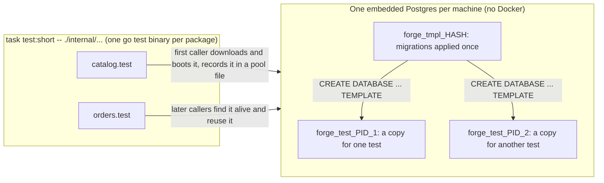
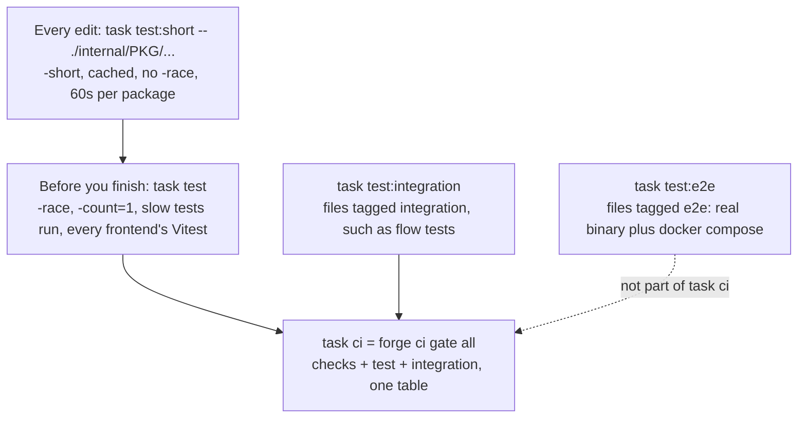

**In short**

- Database tests run against a real Postgres that Forge downloads and boots on first use. Docker is not needed. One server per machine is shared by every test process, and each test gets a database of its own.
- Migrations can be applied once, to a template database keyed by a hash of the migration files. Each test then gets a copy of the template instead of replaying the whole chain.
- `forge generate` writes a lifecycle test for a service's first entity, row factories derived from the schema, a test harness, and mocks that fail loudly when a test forgets to program them.
- Two tiers: `task test:short` for every edit (`-short`, cached, no race detector), and `task test` before you finish. A test that is slow says so with `testkit.Slow`, and two tools catch the ones that do not.
- A skipped check is not a passed one. `task ci` fails on any skip you did not name, and `forge ci verify-test-run` fails a package whose tests all skipped.

## The problem this solves

Most Go services test their data layer in one of three ways, and each has a cost. Mocking the repository is fast, but a mock cannot fail the way SQL does: it never breaks a `CHECK` constraint, a foreign key or a unique index. SQLite as a stand-in rejects Postgres types and syntax, or accepts them and behaves differently. A Postgres container per test package, through testcontainers or a compose file, is faithful. It also needs Docker on every laptop and CI runner, and a fan-out of package binaries starts one container each, which is how a CI sandbox runs out of memory.

Speed has its own trap. Go's test cache makes an unchanged package cost nothing, which is what keeps an edit loop fast. But the cache can only see the files the test process itself opens. A test that shells out to `git`, `kcl` or `go build` reads files the cache never sees, so after an edit that breaks it, the cached run still says `ok`. Teams that get burned by this add `-count=1` everywhere, and every run becomes a full run.

Forge's test model tries to avoid all of these: a real Postgres with no container, a cache you can trust, and a rule that skipped or unverified work is never reported as green.

## How it works



### One Postgres per machine, booted on demand

`forge/pkg/pgtest` provides the database. The first test that asks for one downloads a real Postgres binary into your user cache directory and boots it. It writes the server's address to a pool file under the system temp directory, guarded by a file lock. Every other test process on the machine, whether another package binary in the same run, another worktree or another agent, reads the pool file, checks that the server is alive, and reuses it. So the number of embedded servers running at once is one, not one per package. That matters on a small sandbox, where each server claims shared memory and semaphores.

The server is tuned for tests: `fsync`, `synchronous_commit` and `full_page_writes` are off. It boots the Postgres major that `database.postgres_version` in `forge.yaml` declares, so you test against the major production runs. With nothing declared it boots the newest major Forge ships. `FORGE_TEST_POSTGRES_VERSION` overrides the major for one run, and `FORGE_TEST_POSTGRES_URL` points the whole suite at a server you already run, such as a CI service container. When a version is declared, the harness checks the external server's major against it and fails by name on a mismatch.

Each process holds a lease on the server while it uses it. A `go test` binary never releases its lease explicitly, so a server stays up after a run ends. The next run reuses it, and a later run removes one that has sat for 30 minutes with no live user.

### A template per migration set, a copy per test

`testkit.NewMigratedPostgresDB(t, migrations)`, which the generated harness exposes as `NewMigratedTestDB(t)`, hashes your embedded migration files into a key. The first caller with that key applies every migration to a template database on the shared server, holding a Postgres advisory lock so that two package binaries do not build it at once. Every test then gets its own database through `CREATE DATABASE ... TEMPLATE`, which copies files instead of replaying SQL. For a few hundred migrations and a few hundred tests, that is the difference between seconds and minutes.

Edit a migration and the hash changes, so the next test builds a fresh template and the old one is never served. Templates unused for a day are dropped (`FORGE_TEST_TEMPLATE_TTL` changes that). Each per-test database is named after the process that created it, so one that a crashed run left behind is dropped by the next run that reaches the server.

### What `forge generate` writes for you

| File | Owner | What it gives you |
|---|---|---|
| `internal/handlers/<svc>/handlers_crud_test.go` | yours, written once | `TestCRUD_<Entity>_Lifecycle` for the service's first entity: two creates with distinct IDs, get, list, a full update, a field-masked update, an unknown mask path, update and delete of a missing ID, double delete. It also checks that error messages leak no SQL or driver text. |
| `internal/handlers/<svc>/factories_gen_test.go` | regenerated | `New<Entity>(t, db, overrides…)` inserts a minimal valid row, and `New<Create>Request(t, db, variant)` seeds the foreign-key parents and returns a request the schema accepts. Both are rebuilt from the applied schema, so a new `CHECK` or `NOT NULL` column flows into your tests on the next generate. |
| `internal/handlers/<svc>/helpers_gen_test.go` | regenerated | `NewTest<Service>(t, opts…)`, `NewMigratedTestDB`, `AuthedContext` and a Connect client over an in-process server. Missing interface dependencies are filled with stubs. |
| `internal/<pkg>/mock_gen.go` | regenerated | A mock for every interface in a package's `contract.go`. Each method records its call; set `XxxFunc` to program it. |
| `internal/handlers/mocks/<svc>_mock_gen.go` | regenerated | A recording mock of each proto service, one function field per RPC, for code that calls the service. |
| `handlers_scaffold_<rpc>_test.go` (per custom RPC) | yours | A table row that expects `Unimplemented`. It fails the moment you implement the RPC, which forces a real assertion in its place. |
| `e2e/<svc>/` | yours | A suite behind the `e2e` build tag that builds the binary, starts Postgres with `docker compose`, runs the server and checks its health endpoint. |

Two choices in the mocks are deliberate. A method you never programmed returns an error naming the mock and the method, never a zero value with a nil error, because a nil error from a lookup reads as "found" and from a policy check as "allowed". And the tests call handlers directly with a claims-bearing context (`AuthedContext`, `testkit.WithRoles`), so they skip the token exchange without pretending validation happened.

The lifecycle test reads `db/migrations` with `os.ReadFile` inside the test process, so the test cache sees every migration it applies. `forge/pkg/tdd` supplies the table-driven helpers (`tdd.TableRPC`, `tdd.TableContract`, `tdd.E2EClient`) that the scaffolded tests are built on.

### Two tiers, and where each test runs



The fast tier leaves out `-count=1` on purpose. Go's cache keys on the test binary, its flags, and the files and environment variables the test reads. For a test that builds its own state, such as a `t.TempDir()` or a fresh database, a cached pass is a real pass. It also leaves out `-race`, which rebuilds every package and runs two to ten times slower. `task test` turns both back on. The scaffolded CI workflow calls the same Taskfile targets, so there is one definition of the suite.

The embedded database is not counted as slow. Every test shares the server and gets a cheap database, so the generated CRUD tests stay in the fast tier.

### Marking the slow tests

A test is fast unless it says otherwise. One that takes more than about two seconds, or that execs a toolchain, starts a container or dials an outside host, calls `testkit.Slow` first:

```go internal/handlers/catalog/howtests_demo_test.go
func TestRendersProd(t *testing.T) {
	testkit.Slow(t, "execs git over the checkout", testkit.Inputs("deploy/kcl/**"))
	// ...
}
```

`testkit.Slow` skips under `-short` and in the integration lane, which also compiles untagged tests that `task test` already ran. The reason you pass becomes the skip message. `testkit.Inputs` names the files the test depends on. The globs must be string literals, because a tool that selects tests by what a change touched reads them from source without running the test. A plain `if testing.Short() { t.Skip("…") }` also counts as a marker.

Two guards catch the tests nobody marked, because neither sees everything:

- `reliant forge lint --slow-tests` reads source. It flags a test that execs `go`, `forge`, `kcl`, `node`, `npm`, `git`, `docker` or `kubectl`, drives containers, or dials an external host, with no `testing.Short` guard on the way.
- `go test -short -json ./... | reliant forge ci test-budget` reads a run. It flags every top-level test that ran under `-short` and took longer than `--budget` (default 2s), whatever made it slow.

### Why a child process breaks the cache

Go records each file the test process opens or stats, and replays the cached result only if those files are unchanged. A file that a child process reads is invisible to it. Here is a test that runs `git grep` over a deploy file, run in the fast tier, then run again after the file changed so that the test should fail:

```text terminal
$ task test:short -- ./internal/cachedemo/
ok  	example.com/shop/internal/cachedemo	0.008s
$ sed -i 's/^_cluster_replicas = 3/_cluster_replicas = 2/' deploy/kcl/prod/main.k
$ task test:short -- ./internal/cachedemo/
ok  	example.com/shop/internal/cachedemo	(cached)
$ go test -short -count=1 ./internal/cachedemo/
--- FAIL: TestProdHasThreeReplicas (0.00s)
    cachedemo_test.go:17: prod replicas changed: _cluster_replicas = 2
FAIL
```

The cached `ok` is a stale pass. That is why such a test must skip under `-short` or read its inputs itself. `lint --slow-tests` flags it:

```text terminal
❌ slow-tests — 1 error
   ✗ internal/cachedemo/cachedemo_test.go:11 [forge-slow-test-unmarked] TestProdHasThreeReplicas is not marked slow but execs `git` at cachedemo_test.go:12; mark it slow so it leaves the fast tier: testkit.Slow(t, "<what makes it slow>") (forge/pkg/testkit), or `if testing.Short() { t.Skip("<why>") }`
```

### Skip is not pass

`task ci` runs `forge ci gate all`: the checks lane (verify-generated, lint, build, vulnerability and license scans, KCL validation), then `task test`, then `task test:integration`, in one summary table. Every check runs even after another failed. A check that could not run, because a tool or a prerequisite was missing, is listed as SKIPPED and fails the gate unless you name it in `CI_SKIP`, where it stays listed. On a branch, the unit lane runs only the packages your change reaches, and falls back to the whole suite when anything other than Go source changed.

The same rule applies to tests. A package whose tests all skipped prints `ok`, and that `ok` proves nothing. `forge ci verify-test-run` reads a `go test -json` record and fails a package where every test skipped, or where most did. The scaffolded release workflow runs it on the `task test` output. A package that is expected to skip, such as one that needs Docker, is declared once in `forge.yaml` under `ci.test_skips.allow`, with a reason.

## Design decisions and trade-offs

**Real Postgres, not mocks or SQLite.** Forge targets Postgres only, and the ORM is projected from your applied migrations. A test that does not run those migrations on Postgres does not test the code that ships. The cost is a server boot. In the run below, downloading a 15 MB Postgres 17 archive and booting it took 2.5 seconds, and every later test on that server paid nothing for it.

**An embedded binary, not a container.** Docker is the most common missing prerequisite on laptops, CI runners and sandboxes, and one container per package is what exhausts a memory cap. The embedded server runs as your user with nothing to install. The cost is a cache directory holding a Postgres binary per major, and a server that outlives the run until it is reused or reaped.

**Template copies, not a migration replay per test.** Copying a template database is file I/O, and replaying the chain is SQL. The cost is a key you must trust: the generated helper hashes the migration files themselves, so a stale template cannot be served.

**Mark the slow tests, not the fast ones.** If fast tests had to opt in, every new test would be slow until someone remembered to mark it. Marking the slow ones makes the default cheap and puts the declaration where the cost is. The cost is that the marker can be forgotten, which is why both a source check and a timing check exist.

**Go's own `-short` flag, not a custom one.** Plain `go test`, an IDE's run button and the test cache all keep working. The cost is that `-short` means only "the fast tier"; there is no finer grading.

**Skipped work fails.** A gate that treats "could not run" as "passed" goes green on the machine that lacked the tool. Failing on unnamed skips is stricter, and you write `CI_SKIP=<check>` when a skip is intended, but the summary never claims a check ran when it did not.

## Limits and what it does not do

- **Only the first entity in a service gets a lifecycle test.** A second entity gets factories (`New<Entity>`, `New<Create>Request`) but no test of its own. Copy the first entity's test, as [Add a database table with a CRUD API and pages](/guides/forge/add-table-crud-api-pages) does.
- **The scaffolded lifecycle test applies migrations itself.** Its `crudTestDB` helper replays `db/migrations` into an empty database for each test. The template copy applies only to tests that use `NewMigratedTestDB` or `testkit.NewMigratedPostgresDB`.
- **No generated browser end-to-end tests.** Forge writes no Playwright or Cypress suite. Each frontend gets Vitest unit tests for its components and hooks, which `task test` runs. The generated `e2e/` suite checks the built binary's health endpoint and needs Docker for its Postgres. Multi-step flows are yours to write.
- **Flow tests are yours.** A test that spans several entities through a custom RPC is hand-written, behind the `integration` tag. `seedplan.SeedGraph(t, db, "<table>")` seeds the foreign-key spine it needs.
- **The slow-test checks are opt-in.** `lint --slow-tests` runs only when you name it, and the scaffolded CI workflow does not run `forge ci test-budget`. Add either to your gate if you want it enforced.
- **The cache sees only the test process.** Forge flags child processes it can recognize. A test that reads a shared outside resource, such as a running stack, belongs behind the `integration` or `e2e` tag.
- **The tests run on whatever Postgres major you declare.** If `forge.yaml` declares none, they run on the newest major Forge ships, which may not be the one production runs.
- **The embedded server stays up after a run.** It is reused by the next run, or removed by a later run once it has had no user for 30 minutes.

## See it for yourself

Run these in any Forge project with an entity, for example the one [Add a database table with a CRUD API and pages](/guides/forge/add-table-crud-api-pages) creates.

Run the fast tier twice. The second run replays the cache:

```bash terminal
task test:short -- ./internal/...
task test:short -- ./internal/...
```
```text
ok  	example.com/shop/internal/handlers/catalog	0.237s
...
ok  	example.com/shop/internal/handlers/catalog	(cached)
```

Watch the embedded Postgres boot with Docker unreachable. Asking for a major nobody on the machine is running yet forces a fresh server. A test that selects `current_setting('data_directory')`, `current_database()` and the `forge_tmpl_%` rows of `pg_database` shows where it landed:

```bash terminal
DOCKER_HOST=unix:///nonexistent.sock FORGE_TEST_POSTGRES_VERSION=17 \
  go test -short -count=1 -v -run 'TestWhereIsMyDatabase|TestRendersProd' ./internal/handlers/catalog/
```
```text
=== RUN   TestWhereIsMyDatabase
    howtests_demo_test.go:22: postgres 17.5, data dir /tmp/forge-pgtest-17.5.0/40025/data, database forge_test_cb348e5b6cb6_370967_49be60f9_1795168148_1
--- PASS: TestWhereIsMyDatabase (2.52s)
=== RUN   TestRendersProd
    howtests_demo_test.go:27: slow test, skipped under -short: execs git over the checkout; runs in the full tier (go test without -short, task test)
--- SKIP: TestRendersProd (0.00s)
```

On the default major the same test reuses the running server and reports its template, in a fraction of the time:

```text
    howtests_demo_test.go:22: postgres 18.3, data dir /tmp/forge-pgtest/40371/data, database forge_test_cb348e5b6cb6_455482_9bda9661_1795168264_1
    howtests_demo_test.go:28: templates on this server: forge_tmpl_7a0813c7653ff43cc048
--- PASS: TestWhereIsMyDatabase (0.06s)
```

Run the full tier, where the slow test runs:

```bash terminal
task test -- -v -run 'TestRendersProd|TestWhereIsMyDatabase' ./internal/handlers/catalog/
```
```text
task: [test]  go test -race -count=1 -timeout 120s -v -run 'TestRendersProd|TestWhereIsMyDatabase' ./internal/handlers/catalog/
...
=== RUN   TestRendersProd
    howtests_demo_test.go:32: last deploy change: 81873cd init
--- PASS: TestRendersProd (0.00s)
```

Find an unmarked slow test in a `-short` run. `TestRecomputesPrices` is a test that sleeps 2.5 seconds, standing in for one that grew slow:

```bash terminal
go test -short -json -run TestRecomputesPrices ./internal/cachedemo/ > budget.json
reliant forge ci test-budget --from budget.json
```
```text
test budget 2s: 1 test(s) ran, 1 over budget
  ✗ TestRecomputesPrices                                 2.51s  internal/cachedemo/budget_test.go:9
```

Make a package whose `ok` proves nothing, by selecting only its slow test under `-short`, and let `verify-test-run` say so. Like `test-budget` above, it exits 1:

```bash terminal
go test -short -json -run TestRendersProd ./internal/handlers/catalog/ > skip.json
reliant forge ci verify-test-run --from skip.json
```
```text
❌ 1 package(s) skipped so much that their pass proves nothing:

  100%  example.com/shop/internal/handlers/catalog — 1 of 1 tests skipped (zero-evidence: nothing in this package ran, so its pass proves nothing)
        1× "slow test, skipped under -short: execs git over the checkout; runs in the full tier (go test without...
```

## Guides

- [Test a Go API against a real Postgres database](/guides/forge/test-go-api-real-postgres): run the generated lifecycle test, then write your own with factories and mocks
- [Keep your test suite fast](/guides/forge/keep-test-suite-fast): mark slow tests and enforce a time budget on the fast tier
- [Gate pull requests on lint, tests and generated-code drift](/guides/forge/gate-prs-forge-lint-tests): run the same gate locally and in CI
- [Add a database table with a CRUD API and pages](/guides/forge/add-table-crud-api-pages): the entity whose lifecycle test this page runs

## Reference

- [Adding a feature](/forge/adding-features#generate-lint-test): the everyday loop of edit, generate, lint and test
- [Contracts and dependency injection](/forge/concepts/contracts-and-injection#generated-mocks): `contract.go`, `Deps` and generated mocks
- [Generated vs yours](/forge/concepts/generated-vs-yours): which test files are regenerated and which are yours
- [Tracing and test rules](/forge/linting/rules-tracing-and-tests#forge-slow-test-unmarked): `forge-slow-test-unmarked` and `forge-slow-test-inputs`
- [Lint overview](/forge/linting/overview): lanes, the verdict line, and why skipped lanes fail
- [How forge generate turns proto and SQL into a whole app](/deep-dives/how-forge-generate-works): where the factories and mocks come from
- [How Forge keeps Postgres migrations safe](/deep-dives/safe-migrations): what the migrations your tests apply must declare
- [The `reliant forge` CLI](/cli/forge): version pinning and command reference
