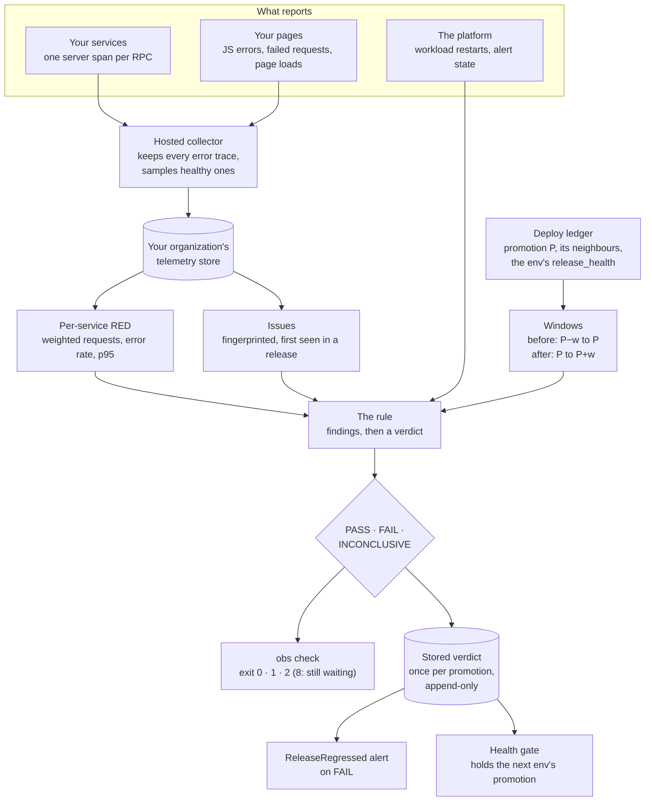

**In short**

- Your services report a span per RPC, your pages report browser errors and page loads, and the platform adds restarts and alerts. Errors are grouped into **issues**, each tied to the release it first appeared in.
- A release is judged by comparing a window after its promotion with an equal window before it, per service: requests, error rate and p95 latency, plus the issues, alerts and restarts it opened.
- There are three verdicts. PASS: we looked, and nothing got worse. FAIL: we looked, and it did. INCONCLUSIVE: not proven good, which is what missing or thin evidence produces. Missing telemetry is never green.
- One rule computes the verdict for `reliant forge obs check`, the console and the control plane. On Reliant hosting the control plane judges every promotion once, stores the verdict, raises `ReleaseRegressed` on a FAIL, and an opt-in health gate can hold the next environment's promotion on it.
- Nothing rolls back. Recovering is deploying a fixed or earlier release.

## The problem this solves

"Did the deploy work?" usually gets answered by a finished rollout, a health endpoint returning 200 and a glance at a dashboard. None of those says whether the new code is worse than the old. A rollout finishes on a release that throws on one RPC in ten, and a dashboard shows a spike without saying which release caused it.

Stitched-together stacks close the gap with canary tooling that needs its own metric queries, per-service thresholds and a separate place to look. And a typical alert treats "no data" as "no problem": a query that returns nothing fires nothing, so an app that stopped sending telemetry looks healthy.

Reliant builds the verdict from data the app already sends, judges every release with the same declared policy, and treats an absence of evidence as an answer of its own.

## How it works



### Signals: what each release is measured on

[What every boundary records](/hosting/observability/signals) covers the instrumentation. Release health reads three kinds of evidence:

- **Server spans.** Each service's requests, error rate and p50/p95/p99 latency come from its own OpenTelemetry server spans, one per RPC, named for the RPC and carrying its Connect status code.
- **Browser telemetry.** A scaffolded frontend reports JavaScript errors, failed fetch and XHR calls, and page loads. A frontend is judged on errors per page view, the share of its requests that failed, and its p95 page load, beside any backend or on its own.
- **What the platform sees.** Workload restarts in the after window, and alerts that opened in it and are still firing. These count even for an app that sends no traces.

Only errors that are the server's fault count. A caller's mistake, such as `InvalidArgument`, is not an issue, and in the run [below](#a-real-run-three-releases) an API answering every call `unauthenticated` measured a 0% error rate. [Error levels](/hosting/observability/signals#who-has-to-act-error-levels) explains how a status maps to a class.

### Sampling is corrected for

On hosting, the collector tail-samples traces: it keeps every trace with an error and every slow one, and a sample of the healthy rest. Counting stored spans naively would inflate error rates roughly tenfold. So each kept span carries its sampling probability in its W3C `tracestate`, and every count, ratio and percentile is weighted by the inverse of it. The request counts a check reports are estimates of real requests, not counts of stored rows.

### Issues tie errors to releases

An **issue** is one distinct bug. The platform fingerprints server errors by where they were raised, the RPC, the message with its variable parts masked and the kind of failure, never by line number, so an issue keeps its identity across releases; [How errors are grouped](/hosting/observability/dashboards-and-alerts#how-errors-are-grouped) has the details. Every issue records the version it was first seen in and its state per environment.

That gives release health two findings that need no comparison at all:

- `new_issue`: an issue first seen in this release, at or after the promotion, with at least `new_issue_min_events` events (3 by default) in the after window.
- `regressed_issue`: a resolved issue that came back at or after the promotion, with at least `regressed_issue_min_events` events (the same, unless set).

The platform's `NewIssue` and `IssueRegressed` alerts fire on the same issues, so release health judges each as its issue rather than counting the bug twice, unless you made that alert rule critical.

### The windows

A promotion is the moment an environment was pointed at a release; the deploy ledger records it as `promoted_at`. Release health takes a window width `w` (15 minutes by default, 1 minute to 6 hours) and compares:

- the **before** window, `[P − w, P)`: the previous release's traffic;
- the **after** window, `[P, P + w)`: this release's.

Each window stops at the neighbouring promotion, so a release is never blamed for its predecessor or credited with its successor, and the after window stops at the present. When a promotion's deploy gates record that a later attempt shipped it, the after window starts then instead.

### Attribution: a finding has to be the release's

Before a finding may fail a release, three questions are asked:

1. **Was the window the live release's?** If the window ended before the release went live, it measured the previous release. The report says `window_not_live` and the verdict is INCONCLUSIVE.
2. **Did the release serve the window?** `version_share` is the judged release's share of the after window's traffic. Under 50%, the rollout had not finished there, `rollout_incomplete` is set, and a verdict that would have been PASS is INCONCLUSIVE.
3. **Is the finding the release's?** A service's error rate or latency is not the release's when another version served most of that service's traffic. An issue is not the release's when every one of its after-window events came from another version.

A finding that fails a question stays in the report as a warning, with the reason in `findings[].unattributed`. Alerts and restarts carry no version, so a low share never excuses them.

### The rule: findings, then a verdict

Comparative findings, `error_rate`, `latency` and the browser ones, need a baseline. A service is compared only when it has `min_requests` requests (50 by default) in **both** windows. An `error_rate` finding also needs the rise to exceed `max_error_rate_increase` (one percentage point by default) and at least `error_rate_min_errors` errors (10 by default) after the promotion, so a handful of failures on a quiet service is not read as a broken release. Where per-RPC figures are available, the rise and the p95 ratio are computed per RPC and weighted by traffic, so a window that happens to hold a different mix of endpoints does not look like a regression.

Each finding's policy is `fail` when its code is in the environment's `fail_on` list and `warn` otherwise. By default `error_rate`, `new_issue`, `regressed_issue` and `alert_firing` fail; latency and restarts warn. A critical alert that opened in the after window fails the release whatever `fail_on` says.

Then the verdict, in this order:

| Verdict | When |
|---|---|
| **FAIL** | Any finding with policy `fail` fired. A clear failure is a failure even while the window is still open. |
| **INCONCLUSIVE** | The window is not the live release's, the rollout was incomplete, alert state could not be read, the release was promoted into a critical alert that was already firing, the after window has not finished, or no service could be compared. |
| **PASS** | None of the above, and at least one service had enough traffic in both windows to compare. |

An INCONCLUSIVE document names its cause in `reason_code`, in that same order of precedence. The common ones: `window_open` (check again), `no_request_telemetry` (no request span and no browser telemetry in either window), `thin_baseline` (enough requests after the promotion, too few before it, typical of a first deploy) and `low_traffic` (too few after it). Once the window has closed, a check of the same promotion reads the same window, so the last three are final for that promotion. [Release gates](/forge/deploy/release-gates#what-each-exit-code-means) says what a pipeline does with each.

### Where the verdict goes

`reliant forge obs check <env>` computes the verdict on request and exits with it: 0 PASS, 1 FAIL, 2 INCONCLUSIVE or could not look, and 8 when `--wait` ran out before the after window closed. The exit code always equals the document's `exit_code`. Against a hosted environment the CLI asks the control plane, which reads the telemetry and runs the rule; against your local stack it reads the local store and runs the same rule itself.

On Reliant hosting the control plane also judges every promotion on its own. Two minutes after the after window closes, so late telemetry is in, it judges the promotion with the environment's declared `release_health` and no client overrides, and writes the verdict once: one row per promotion, first writer wins, and the table rejects updates. A restart or a second evaluator reads the stored row instead of judging again. `reliant forge env releases list <env>` shows it in the `HEALTH` column.

A stored FAIL raises a `ReleaseRegressed` alert naming the release, the previous release, the commit range and the count of failing findings. It fires for an hour, then resolves; PASS and INCONCLUSIVE raise nothing. It never counts against the next release, so a fix promoted right after a bad deploy is not failed by its predecessor's alert.

### The health gate

The gate is how a verdict holds a promotion. With `delivery_policy.health_gate.after = ["staging"]` in prod's KCL, the control plane refuses to promote release R to prod until staging's stored verdict for R is `pass`. The check runs inside the promotion's transaction, so no client can skip it; only a recorded `--override-health-gate "<why>"` gets past. Because a verdict row never changes, a PASS the gate admitted on cannot turn into a FAIL, and a verdict not yet written reads as pending, never as admission. [The health gate (opt-in)](/forge/deploy/releases-and-promotion#the-health-gate-opt-in) has the refusal codes and the audit mode.

## A real run, three releases

These are real results from a throwaway Go API on Reliant hosting, with `release_health { window = "5m", min_requests = 20 }` declared in its prod KCL and a loop calling one RPC twice a second.

**v9.3.0, the first deploy.** The traffic loop started only when `env deploy` returned, seconds before the 5-minute after window closed, and no request landed in either window. No evidence, so the verdict is not a pass:

```json obs check prod --wait --json (v9.3.0, trimmed)
{
  "ok": false,
  "exit_code": 2,
  "verdict": "INCONCLUSIVE",
  "reason_code": "no_request_telemetry",
  "subject": { "release": "v9.3.0", "promoted_at": "2026-11-20T08:57:56.545966Z", "marker_source": "promotion" },
  "windows": {
    "before": { "from": "2026-11-20T08:52:56.545966Z", "to": "2026-11-20T08:57:56.545966Z" },
    "after":  { "from": "2026-11-20T08:57:56.545966Z", "to": "2026-11-20T09:02:56.545966Z" },
    "after_complete": true
  },
  "findings": []
}
```

Every threshold in the document says `"source": "release_shape"`: it came from the environment's declaration, recorded in the release.

**v9.4.0, a no-op change**, deployed while the traffic loop ran. Both windows had traffic, the new version served 89% of the after window, and nothing got worse:

```json obs check prod --wait --json (v9.4.0, trimmed)
{
  "ok": true,
  "exit_code": 0,
  "verdict": "PASS",
  "subject": { "release": "v9.4.0", "previous_release": "v9.3.0", "promoted_at": "2026-11-20T09:06:46.218488Z" },
  "services": [
    {
      "service": "api",
      "before": { "requests": 372, "error_rate": 0, "p95_ms": 0.946328 },
      "after":  { "requests": 384, "error_rate": 0, "p95_ms": 0.537742 },
      "version_share": 0.8854166666666666
    }
  ],
  "findings": [],
  "waited": "2m24s"
}
```

**v9.5.0, a deliberate regression.** `GetProduct` was opened to signed-out callers and made to return an error, and a second loop started calling it. The error rate rose by 31 points with 194 errors, so `error_rate` fails. The same failure opened new issues first seen in v9.5.0, so `new_issue` fails too. The p95 ratio passed its limit as well, but latency only warns by default:

```json obs check prod --json (v9.5.0, trimmed)
{
  "ok": false,
  "exit_code": 1,
  "verdict": "FAIL",
  "subject": { "release": "v9.5.0", "previous_release": "v9.4.0", "promoted_at": "2026-11-20T09:17:08.443194Z" },
  "services": [
    {
      "service": "api",
      "before": { "requests": 492, "error_rate": 0, "p95_ms": 0.543437 },
      "after":  { "requests": 618, "error_rate": 0.313915857605178, "p95_ms": 1.067105 },
      "version_share": 0.9546925566343042
    }
  ],
  "findings": [
    { "code": "error_rate", "policy": "fail", "message": "api: error rate 0.0% -> 31.4% (+31.4%, limit +1.0%; 194 errors)" },
    { "code": "latency", "policy": "warn", "message": "api: p95 1ms -> 1ms (1.96x, limit 1.5x)" },
    { "code": "new_issue", "policy": "fail", "message": "new issue 6c7d658e-0a9e-4398-a683-c76e0049c08f: *errors.errorString: rpc failed (274 events)" },
    { "code": "new_issue", "policy": "fail", "message": "new issue c96ae314-f2ca-4948-a8d1-8342a3edf588: internal: internal server error: audit.event (274 events)" }
  ],
  "new_issues": [
    { "id": "6c7d658e-0a9e-4398-a683-c76e0049c08f", "first_version": "v9.5.0", "events": 274, "window_versions": { "v9.5.0": 298 } }
  ],
  "suggested": [
    "forge obs issue 6c7d658e-0a9e-4398-a683-c76e0049c08f prod",
    "forge obs endpoints prod --sort errors"
  ]
}
```

The one failure was grouped as two issues, because the request log and the audit record each reported it. `window_versions` is the attribution check at work: every event of the issue came from v9.5.0, so the issue is the release's. `suggested` holds the next commands to run, so you or an agent can go from the verdict straight to the issue.

The control plane judged each promotion on its own once its window closed and stored the verdict. `env releases list` shows it in the `HEALTH` column:

```text env releases list prod (WHO column removed)
AT                    RELEASE        WHAT                   COMMITS  ROLLOUT         GATES  HEALTH
2026-11-20 09:17:08Z  v9.5.0 (live)  promote (from v9.4.0)  1        succeeded 20s   -      fail
2026-11-20 09:06:46Z  v9.4.0         promote (from v9.3.0)  1        succeeded 25s   -      pass
2026-11-20 08:57:56Z  v9.3.0         first promote          4        succeeded 1m5s  -      inconclusive
```

The `fail` raised `ReleaseRegressed` less than three minutes after v9.5.0's window closed, read here from `obs status prod --json`:

```json ReleaseRegressed (trimmed)
{
  "rule": "ReleaseRegressed",
  "state": "firing",
  "labels": {
    "release": "v9.5.0",
    "previous_release": "v9.4.0",
    "git_commit": "799f5a72908f6114f251a4663c3461ce466a44ea",
    "previous_commit": "7e7cfd1e1d38fcb419089406da765f120fc80afa",
    "promotion_id": "3e6790b7-2b6c-48a5-9a34-e09c1c6a703b"
  },
  "summary": "Release v9.5.0 regressed prod: 3 failing release-health findings after its window closed. Check it: forge obs check prod --release v9.5.0",
  "firing_at": "2026-11-20T09:24:47.953957Z",
  "value": 3
}
```

Nothing rolled back. v9.5.0 stayed live until the environment was deleted.

## Design decisions and trade-offs

**One rule, three callers.** The rule is a pure function with no I/O and no clock: callers fetch the facts and it decides. `obs check`, the control plane's API and the `ReleaseRegressed` evaluator all call it, so the CLI, the console and the gate cannot disagree. The cost is version skew: a control plane can predate a rule a newer CLI knows, so the CLI re-applies the rules it knows to the control plane's answer and never prints PASS where the newer rule would hold the release.

**Compare against the previous release, not a fixed SLO.** A relative comparison needs no per-service tuning and catches "this release made it worse" on day one. It misses a service that was already bad, and it cannot judge without a baseline, which is why a first deploy or a quiet environment comes back `thin_baseline` or `low_traffic`. A quiet environment lowers `min_requests`, widens `window` or sets `require_baseline = "none"` in its `release_health`.

**Three verdicts, and no data is never green.** A two-state check has to pick a side when evidence is missing, and most tools pick "no alert". Reliant makes "not proven good" its own outcome and exit code. The cost is friction: a pipeline on a quiet environment stops at exit 2 until someone accepts that, with `--allow-inconclusive` on one call or a lower threshold in KCL.

**Judge once, store forever.** A verdict written once can always explain the gate decision that read it, and a PASS cannot later become a FAIL under a promotion admitted on it. The cost: telemetry arriving after the two-minute settle is not in the stored verdict. `obs check` re-reads the window and can say something different; the gate and the alert go by the stored row.

**The server decides the gate, not the client.** `--threshold`, `--fail-on` and `--allow-inconclusive` change what your command prints and exits with, never the stored verdict or what the gate admits. A CI script cannot loosen production's bar by accident; loosening it on purpose is a KCL change that ships in a release.

**Attribution before blame.** Without the version checks, a release still rolling out would be judged on its predecessor's traffic, and an old bug's events would fail whichever release was live. The cost: a release still rolling out in the window can be INCONCLUSIVE but never PASS.

**A verdict is evidence, not an actuator.** By the time a window closes, the release may have run migrations and written data in its new shape, and rolling back automatically past that is how a regression becomes data loss. So a FAIL alerts and can refuse the next promotion, and reverts nothing.

## Limits and what it does not do

- **No automatic rollback.** A FAIL raises `ReleaseRegressed` and, through the opt-in health gate, holds a promotion to the next environment. The failing release stays live until you deploy something else: a fix, or an earlier release your [rollback floors](/forge/deploy/release-gates#rollback-floors) admit.
- **The health gate is opt-in and off by default.** A project that declares no `health_gate` is never held. A self-hosted environment with no control plane records the declaration and refuses nothing.
- **No request telemetry, no request verdict.** Request figures come only from your services' own server spans and your pages' browser telemetry; the platform's ingress counts are not used, even though the INCONCLUSIVE text mentions the ingress. An app forge did not build, such as one adopted by its Dockerfile, gets `no_request_telemetry` until it exports OpenTelemetry traces to `$OTEL_EXPORTER_OTLP_ENDPOINT`. Restarts, alerts and issues are still judged.
- **A static site is judged by real visitors.** With no server spans, a site's only request evidence is the telemetry its pages send from real browsers. `curl` and uptime pings run no JavaScript, so a site with no visitors stays INCONCLUSIVE `no_request_telemetry`. The reason text's advice to add an OpenTelemetry SDK does not apply to a static site; the remedy is page views.
- **Synthetic release probes are not generally available.** The default `fail_on` list includes `probe_failed`, but the platform runs release probes only where an operator has switched them on. Do not count on probes to judge a quiet environment.
- **The first deploy has no baseline.** Its before window holds no traffic, so with the default `require_baseline` it comes back `thin_baseline` (or `no_request_telemetry` if nothing was called), however healthy it is.
- **Short windows are easy to miss.** The after window starts at the promotion, not when your traffic does, and `env deploy` returns only after the whole rollout, database and site included.
- **Locally, only part of the rule runs.** A local environment has no promotions, so you name the start with `--since`, and regressed issues, alerts and restarts are reported as not evaluated.
- **The stored verdict is not re-judged.** Late telemetry is not in it. A promotion the evaluator never reached within 72 hours has no stored verdict, which a health gate reads as not proven, and `ReleaseRegressed` fires only within the hour after the window closed.

## See it for yourself

Every flag, exit code and reason code is in the help text of the forge your project pins (forge v1.5.0 or later for `thin_baseline` and the attribution fields):

```bash terminal
reliant forge obs check --help
```

After a hosted deploy, wait for the verdict and pull out the parts this page describes:

```bash terminal
reliant forge obs check prod --wait --json | jq '{exit_code, verdict, reason_code, subject, windows, version_share, services, findings, not_evaluated}'
```

See which threshold came from where (`release_shape`, `default` or `request`):

```bash terminal
reliant forge obs check prod --release v1.4.2 --json --fields thresholds
```

Compare with what the control plane stored, which is what the gate reads:

```bash terminal
reliant forge env releases list prod
```

## Guides

- [Gate prod on release health](/guides/hosting/gate-production-deploy-release-health): hold a production promotion until staging proves the release good
- [Send OpenTelemetry from any app](/guides/observability/send-opentelemetry-from-any-app): turn `no_request_telemetry` into real request, error and latency data
- [Find the release that caused an error](/guides/observability/find-release-that-caused-error): go from an issue to the version and commits that introduced it
- [Find your slowest RPCs](/guides/observability/find-slowest-rpcs): read p95 latency per RPC, then the trace behind it
- [Debug production with an AI agent](/guides/observability/debug-production-with-ai-agent): let an agent read the verdict, the issue and the trace for you

## Reference

- [Release gates](/forge/deploy/release-gates): `obs check` exit codes, `release_health` thresholds, the health gate and rollback floors
- [Releases and promotion](/forge/deploy/releases-and-promotion#the-health-gate-opt-in): where the gate sits inside a promotion
- [Querying with forge obs](/hosting/observability/forge-obs#obs-check-did-the-deploy-work): `obs check` flags and its JSON document
- [What every boundary records](/hosting/observability/signals): the spans, metrics and logs a verdict is built from
- [Where telemetry goes](/hosting/observability/where-it-goes): the local stack, the hosted store and sampling
- [Hosted dashboards, alerts and issues](/hosting/observability/dashboards-and-alerts): issue grouping, `NewIssue`/`IssueRegressed` and how `ReleaseRegressed` reaches you
- CLI: [`obs check`](/reference/cli#reliant-forge-obs-check)
