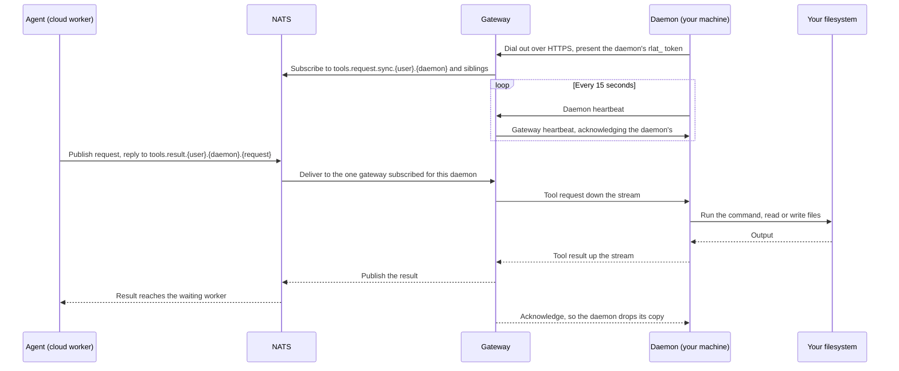

**In short**

- The daemon on your machine dials **out** to Reliant's gateway and holds one long-lived, two-way gRPC stream open. Your machine needs no open inbound port.
- When an agent calls a tool that needs your files or shell, the cloud worker publishes the request on a NATS subject named after your user and your daemon. Only the gateway holding your daemon's stream is subscribed to it, so only that gateway receives it and sends it down the stream.
- The daemon and the gateway exchange heartbeats every 15 seconds. A daemon that stops cleanly shows as disconnected at once. One that vanishes without a word is treated as gone after 90 seconds of silence.
- A short drop is ridden out: the daemon reconnects by itself, a call that never reached it is sent again, and a result it finished while away is delivered when it comes back.
- If the machine stays unreachable, the chat shows **Waiting for machine**. After three steps in a row that could not reach it, spanning at least two minutes, the run pauses, and it resumes when the machine reconnects or you send a message.

## The problem this solves

Reliant's API server, workers and gateway run in the cloud and have no access to your filesystem. Only the daemon does, and it may be on your laptop, a home server behind NAT, or a managed cloud machine. An agent's `shell` or `edit` call therefore has to cross from a stateless cloud worker to one specific process on one specific computer, and come back with the answer.

The usual ways to wire that up each break something. Having the cloud dial your machine means opening an inbound port, a VPN, or an SSH tunnel on every computer you use. Pinning each chat to the server that holds your machine's connection makes that server a single point of failure and stops workers from scaling freely. A queue that holds commands until the machine returns runs a shell command minutes late, after the agent has moved on.

Reliant's path avoids all three. Your machine connects outward, any worker can reach any daemon, and calls that can't be delivered now fail fast instead of running late.

## How it works

The diagram follows one synchronous tool call, such as an agent running `go test` through the `shell` tool. Lanes run left to right in the order the request travels.



### 1. The daemon dials out and stays connected

`reliant daemon start` opens an HTTPS (HTTP/2) connection to the gateway, `https://gateway.reliantapi.com` by default, and opens one bidirectional gRPC stream on it. It authenticates with the daemon's own `rlat_` access token, stored in `~/.reliant/daemon.json` after pairing. The gateway accepts only daemon credentials on that listener. From then on the gateway sends requests down the stream and the daemon sends results back up it, so traffic flows both ways on a connection your machine opened.

When the stream comes up, the gateway subscribes to that daemon's NATS subjects: `tools.request.{user}.{daemon}` and `tools.request.sync.{user}.{daemon}` for tool calls, plus siblings for cancellation, background processes, generic daemon commands and terminals. When the stream ends, it unsubscribes.

### 2. The worker decides the call needs your machine

Every tool declares where it runs. Tools that need your files, shell or git run on the daemon. Tools that need only Reliant's database run on the server. Network-only tools such as web search can run on either side, and the worker runs those itself, with no round trip. A few tools, `fetch` among them, prefer your machine when the run has one and fall back to the worker when it doesn't. A run with no machine is still offered them.

For a daemon-bound call, the worker first resolves which of your daemons the run targets: the one the chat, workflow node or automation names, or your default. It then publishes the request to `tools.request.sync.{user}.{daemon}`. The reply address is a subject of its own, `tools.result.{user}.{daemon}.{request}`, not an inbox that only the forwarding gateway knows. Step 6 explains why.

The worker waits for as long as the tool's own timeout plus 30 seconds, or 10 minutes when the tool sets no timeout, and never past the run's own deadline.

### 3. NATS delivers it to exactly one gateway

The subject names one daemon, and only the gateway holding that daemon's stream subscribes to it. Neither the worker nor anything else keeps a table of which gateway holds which daemon. The subject is the address.

That also gives a clear answer when the daemon isn't there. If no gateway is subscribed, NATS reports that the message had no responders, and the worker knows at once that the daemon isn't connected. That is the condition behind the error text `no daemon connected for user`.

### 4. The gateway forwards it down the stream

The gateway hands each request to its own goroutine before sending it to the daemon. Without that, NATS would deliver one daemon's requests to the gateway one at a time, so a two-minute `go test` from one chat would hold up a one-line `sed` from another chat that shares the machine. Requests that are too large for one NATS message, 1 MB by default, are split into chunks and reassembled on the other side. A single request can be up to 32 MB, and each chunk must arrive within 30 seconds of the one before it.

### 5. The daemon runs it on your machine

The daemon runs the command or file operation as your Unix user, in the worktree the run targets, and logs one line per call to its own log (see [See it for yourself](#see-it-for-yourself)). Each call runs on its own, separately from the stream that delivered it. If the stream drops, the work keeps going.

### 6. The result travels back

The daemon sends the result up the stream and keeps a copy until a gateway acknowledges it. The gateway publishes the result to the request's result subject, where the worker is listening, and the agent's turn continues.

Because the result has its own address, it doesn't depend on the stream that carried the request. If that stream dropped mid-call, the daemon resends every result that hasn't been acknowledged over its next stream, whichever gateway replica that lands on, and that gateway publishes it to the same subject. Duplicates are harmless: a result is the same bytes however often it's sent, and the worker takes the first one.

### Heartbeats: how each side knows the other is there

HTTP/2 pings aren't enough to tell whether the far side is listening. The nearest HTTP/2 peer is often a load balancer that answers pings itself, and a successful send only means the bytes were buffered. So both ends check each other at the application level:

| Who | Does what | Gives up after |
|---|---|---|
| Daemon | Sends a heartbeat every 15 s | Ends the session and redials if the gateway sends nothing for 90 s, or leaves one of its heartbeats unacknowledged for 90 s |
| Gateway | Sends a heartbeat every 15 s, acknowledging the newest daemon heartbeat it has read | Tears the stream down when it has read nothing from the daemon for 90 s (checked once a minute) |
| Routing and the app | Treat a daemon's connection record as live while heartbeats keep renewing it | Read a daemon as gone 90 s after its last heartbeat. A clean stop deletes the record immediately |

The 90 seconds is six missed heartbeats. It used to be 30 seconds, two missed heartbeats, and a single delayed write was then enough to show a live daemon as offline.

### Reconnecting

When a session ends, the daemon redials on its own. It waits 1 second, then doubles the wait on each failure up to 15 seconds, and goes back to 1 second after any session that lasted 30 seconds or more. A rejected credential is retried on the same schedule, because the fix (a new token, a gateway rollout finishing) usually happens around a running daemon. The daemon stops for good only when retrying can't help: the gateway accepted its identity and still refused it, or another daemon process took over the same identity. Two processes sharing one identity would otherwise evict each other forever.

Gateway rollouts don't drop the connection. A draining gateway replica tells its daemons it is moving. Each daemon dials a new replica straight away while the old stream keeps serving, then retires the old stream once its work has moved.

### When the machine is away

What happens to a call depends on whether it reached the daemon.

- **It never got there** (no responders, or a machine still starting). Nothing ran, so it's safe to send again. If the daemon was heard from within the last 90 seconds, the worker waits for it to reconnect and resends, bounded by the call's own deadline. A machine that has been gone longer, a laptop closed an hour ago, fails at once with `no daemon connected for user`. A call that did wait and still failed says how long, for example `(waited 47s for the machine to reconnect)`.
- **It was in flight when the stream dropped.** The daemon may have run it and may still be running it. The worker waits for the daemon to come back and asks it what became of the request. A result it holds is delivered. A call that only reads state (listing files, checking a background process) can be sent again. Anything else, a shell command in particular, is never re-run blindly: if the daemon came back without knowing the request, because the daemon process itself restarted, the call reports that its outcome is unknown.

Meanwhile the chat shows **Waiting for machine**. The run counts steps whose machine-bound tool calls all failed with "no daemon connected". After three such steps in a row, and once the machine has been unreachable for at least two minutes, the run pauses with this message:

> Paused: this chat has been unable to reach its machine for two minutes. The machine may still be reconnecting; this chat will resume on its own when it does, or send a message to retry now.

Any tool call that reaches the machine resets the count. Steps with no machine involvement, such as a model call, neither reset nor add to it. The two-minute floor is there so a gateway rollout, which briefly leaves every daemon reconnecting, never makes you resume a chat by hand.

## Design decisions and trade-offs

**The daemon connects out; the cloud never connects in.** The alternative, a gateway dialing each machine, needs an inbound port, a tunnel or a VPN on every computer, and fails behind most home and office networks. Outbound-only means your machine runs with no open port, and the [privacy page](/help/privacy) can say so plainly. The cost is a stateful gateway tier: each gateway holds live streams, so rollouts need the drain-and-move handoff described above. (`reliant daemon start --server-mode` exists for the reverse direction, where a gateway dials in. Ordinary setups don't use it.)

**NATS sits between the worker and the gateway.** Workers are stateless and any replica may run your run's next step. Gateways hold streams. Routing by subject means no component keeps a table of who holds which daemon, a worker never has to find the right gateway, and "no responders" gives a ground-truth answer to "is this daemon connected right now" without trusting a timestamp that decays. The costs are one extra hop and NATS's per-message size limit, which is why large payloads are chunked.

**Tool calls wait and resend; they are never queued.** Holding a request at the gateway until the daemon returns sounds kinder, but a shell command delivered after its caller gave up runs late, out of order with whatever the agent did next, and its answer has nowhere to go. So a call either reaches a live daemon, waits a bounded time for one that was there moments ago, or fails fast. The cost is that a call made while your laptop is closed fails rather than running when you open it. A few setup commands that are safe to apply late, such as preparing a new project's repository, are the exception: they are queued and delivered when one of your daemons next connects.

**Results have their own address, and the daemon keeps them until acknowledged.** Earlier, the only thing waiting for a result was the gateway replica that forwarded the request, so every gateway rollout failed every call in flight, including long `shell_wait` calls that were about to succeed. Addressing the result by user, daemon and request lets any gateway deliver it. The cost is possible duplicate deliveries, which the worker ignores.

**90 seconds of silence before "gone".** A shorter window detects a crash sooner but flips live daemons to offline on one slow heartbeat, which used to fail chat preflight checks and flicker the status dot. A clean stop is reported immediately whatever the window, so the generous threshold only delays noticing a crash or a pulled network cable.

**A paused run instead of a failed one.** An agent that keeps calling tools on an absent machine burns a model turn per call and gets nothing. Pausing after three offline steps and two minutes keeps the conversation intact, so it can resume from where it stopped.

## Limits and what it does not do

- **A crash takes up to 90 seconds to show.** A daemon that dies or loses its network without closing the stream can still look connected for up to 90 seconds. The gateway checks for silent streams once a minute, so tearing one down can take up to about two and a half minutes. Calls sent in that window reach a stream nobody is answering and wait for their timeout or the reconnect grace.
- **Calls are not queued for a machine that is away.** A call made while your daemon has been gone for more than 90 seconds fails straight away. The run pauses instead of retrying for ever.
- **A shell command interrupted by a dropped stream is not re-run.** If the daemon process restarted while it was running, its outcome is reported as unknown, and the agent decides what to do next.
- **A daemon restart loses its running calls.** Results survive a dropped stream, not the daemon process exiting.
- **Size limits.** One request can be up to 32 MB after encoding. Larger ones fail before anything is sent.
- **Tool calls don't wake a cloud machine.** A suspended cloud machine is woken by a run's preflight check or a message you send, not by a tool call partway through a run (see [Waking and suspending](/machines/cloud#waking-and-suspending)).
- **Your machine needs outbound HTTPS to the gateway.** A network that blocks long-lived HTTP/2 connections to `gateway.reliantapi.com` keeps the stream from coming up, and `reliant daemon status` says so.
- **What crosses the link is stored.** Whatever a command prints or the agent reads goes back over this path to Reliant, is stored with the chat and is sent to your model provider. See [Privacy & security](/help/privacy).

## See it for yourself

**Is the stream up, and has it held?** `reliant daemon status` reports the stream, not just the process, and exits non-zero unless the stream is established and has stayed up for two minutes. That makes it usable as a preflight check in scripts.

```bash terminal
reliant daemon status
```

```text
Daemon is running and its gateway stream is established
  PID:      21208
  Binary:   /opt/reliant/bin/reliant (built 2026-11-19T04:27:16Z, 26h40m26s ago)
  Gateway:  https://gateway.reliantapi.com (tls)
  Stream:   connected for 26h29m22s
  Stability: stable — no reconnects since this daemon started
  Record:   /home/workspace/.reliant/instances/https-api.reliantapi.com-c9232e15/_default/workspace-b45e3fc5/daemon-state.json
```

A daemon that is running but not connected is not "running" for tool calls. Here is one started in an empty home directory with `--non-interactive`, so it has no credential:

```bash terminal
reliant daemon start --non-interactive --name scratch-daemon   # in another terminal
reliant daemon status; echo "exit=$?"
```

```text
Daemon is running but has no usable credentials — waiting for sign-in
  PID:      865874
  Stream:   awaiting_credentials for 11s
            never connected since this daemon started
  Error:    waiting for credentials to appear on disk
daemon gateway stream is not established (awaiting_credentials) — it can serve no tool calls
exit=1
```

A stream that keeps dropping prints `Stability: UNSTABLE`, and the command fails with `daemon gateway stream is flapping — N sessions, last dropped Xs ago (needs 2m0s unbroken)`.

**Every daemon on this computer.** `reliant daemon ls` lists each instance with its stream state:

```bash terminal
reliant daemon ls
```

```text
RUNNING  PID    STREAM     UPTIME     INSTANCE
yes      21208  connected  26h29m22s  https-api.reliantapi.com-c9232e15/_default/workspace-b45e3fc5
```

**Watch calls arrive, and a gateway rollout pass.** `reliant daemon logs` follows the daemon's log, one line per finished tool call:

```text
level=INFO msg="[🔧 ToolsDaemonClient] tool finished" tool=shell outcome=ok duration_ms=60039
level=INFO msg="[🔧 ToolsDaemonClient] tool finished" tool=shell_wait outcome=ok duration_ms=10041
```

The log file sits beside the record `daemon status` prints, in `logs/tools-daemon.log`. Searching it for the handoff shows a gateway rollout that never dropped the connection, which is why the status above still says "no reconnects":

```bash terminal
grep -E 'draining|Retiring|identity assigned' ~/.reliant/instances/*/*/*/logs/tools-daemon.log
```

```text
12:08:54.217Z msg="Gateway replica is draining; moving to another replica" deadline=2026-11-19T12:09:19.187Z in_flight=0
12:08:54.217Z msg="Connecting to gateway" url=https://gateway.reliantapi.com
12:08:54.535Z msg="Retiring the drained gateway stream; its work has moved"
12:08:54.536Z msg="Daemon identity assigned by gateway"
```

Other lines to look for: `Session ended; reconnecting` (an unplanned drop, with the backoff `delay`), `Gateway stream is dead; ending the session to reconnect` (a heartbeat check failed), `Rejected: credentials not accepted — retrying` and `Fatal error — not reconnecting`.

## Guides

- [Connect your computer as a machine](/guides/machines/connect-computer-as-machine): pair a computer with `reliant daemon start` and confirm the stream is up
- [Run agents on your own server](/guides/machines/run-agents-on-your-own-server): run the daemon headless with a token, under systemd, on a server or Raspberry Pi
- [Troubleshoot an offline machine](/guides/machines/troubleshoot-offline-machine): fix a machine that is offline, waking or not connecting, and resume a paused chat

## Reference

- [Server roles: API, worker and daemon gateway](/architecture/distributed): the operator reference for the three server roles, their flags, and the NATS subjects ([tool routing](/architecture/distributed#tool-routing-architecture)).
- [Architecture overview](/architecture/overview): where the daemon sits among Reliant's components.
- [Your own computer](/machines/your-computer) and [Run a machine from the CLI](/cli/run-a-machine): pairing, flags, service managers, logs.
- [Choosing a machine](/machines/choosing): how a run picks its daemon, and machine status.
- [Troubleshooting](/help/troubleshooting): "is offline", "Waiting for machine" and related errors.
- [Privacy & security](/help/privacy): what leaves your machine and where it is stored.
