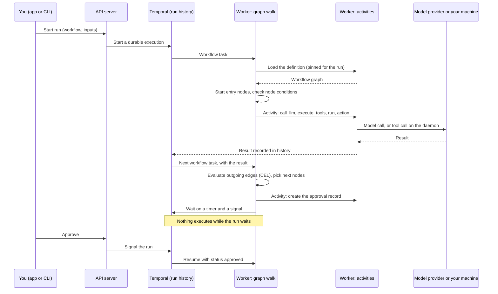
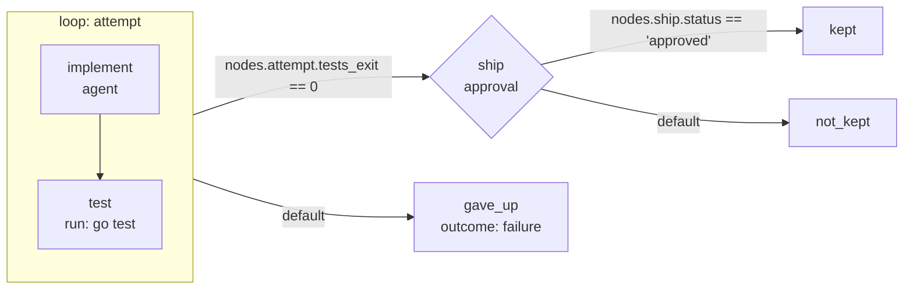

**In short**

- A workflow is a graph in YAML: **nodes** are steps (an agent, a model call, a shell command, an integration action, an approval), and **edges** say which node runs next. An edge picks its target with a CEL condition over the outputs of the nodes that already ran.
- Each run is one durable execution on Temporal. Walking the graph and evaluating CEL is deterministic code; anything that touches the outside world (a model call, a tool call on your machine, a database write) is an activity whose result is recorded. A worker that dies mid-run is replaced and the run carries on from its recorded history.
- Loops repeat a body while a CEL condition holds, an edge with several targets fans out, and a `join` waits for the branches to finish.
- Approvals, questions and pauses wait on a timer and a signal. While a run waits, nothing is executing for it: no model is called and no worker is busy.
- `reliant workflow validate`, `lint` and `scenario run` check all of this on your machine before a run starts. Scenarios run the real engine with only the activities mocked.

[Workflows overview](/workflows/overview) introduces workflows from the chat side. This page explains the machinery underneath.

## The problem this solves

An agent on its own is a loop: call the model, run the tools it asks for, repeat. That is enough for a chat, but work you would hand to a team has more shape. Fix the code, run the tests, try again if they fail, stop after three attempts, ask a person before anything ships. Written as a prompt, that shape is a request the model may or may not honor. Written as a script around an LLM SDK, it lasts only as long as the process. A deploy, a crash or a laptop going to sleep loses the run, and an approval that has to wait overnight means a process sitting idle for hours.

Reliant takes the shape out of the prompt and puts it in a graph, which the engine follows exactly. It also runs that graph as a durable execution. The state of every run is recorded step by step, so a run can wait days for a person, survive a worker restart, and resume where it stopped.

## How it works

The diagram follows one run through an agent step and an approval. Lanes run left to right from you to the outside world.



### 1. A run starts and pins its definition

Starting a run, whether from the chat composer, `reliant workflow run`, or an automation firing, asks the API server to start a durable execution on Temporal. A worker (`reliant server worker`, the [Temporal workflow worker](/architecture/distributed)) picks it up. Its first act is to load the workflow definition through an activity.

That load pins the project's workflow catalog as it is at that moment. Every later load in the same run (a sub-workflow, a loop body, a spawned sub-agent, a preset) uses the pin. So a run executes the definition tree it started with, and an edit you push mid-run applies to the next run.

### 2. The graph walk is deterministic code

The workflow code keeps one rule: given the same recorded history, it makes the same decisions. That code walks the graph.

When a node finishes, the engine looks at every edge whose `from` is that node:

- An edge with only `default:` sends the run to those targets.
- An edge with `cases:` tries each case **in order**. The first whose `condition` is true wins, and a case with no condition always matches. If none matches, the run goes to `default:`. When there is no `default:` either, that branch ends.
- A `to:` or `default:` list with several nodes starts all of them at once.

Conditions are raw CEL (no `{{ }}`) over the run's state: `nodes.<id>.*` for outputs of nodes that ran, `inputs.*`, `workflow.*`, and inside a loop body `iter.*` and `outputs.*`. A node's own `condition:` is checked before it runs. When it is false, the node is recorded as skipped and its outgoing edges still route, so a skipped step never strands the graph.

An edge condition that fails to evaluate, such as one reading a field that is not there, fails the run. It never falls through to a guess. This is why CEL guards like `has(nodes.review.response)` appear throughout the built-in workflows.

A graph, or a loop body's iteration, is finished when nothing is running and no edge has produced a next node.

Here is the example used on the rest of this page, `fix-until-green`. An agent fixes code, a `run` step runs the tests, the loop repeats until they pass, and a person approves the result:



```yaml .reliant/workflows/fix-until-green.yaml
name: fix-until-green
description: An agent fixes the code, a shell step runs the tests, and the loop repeats until they pass; a person approves the result.

inputs:
  test_command:
    type: string
    default: "go test ./..."
  max_attempts:
    type: integer
    default: 3

entry: [attempt]

nodes:
  - id: attempt
    type: loop
    while: "outputs.tests_exit != 0 && iter.iteration < inputs.max_attempts"
    inline:
      entry: [implement]
      outputs:
        tests_exit: "{{nodes.test.exit_code}}"
      nodes:
        - id: implement
          type: workflow
          ref: builtin://agent
          thread:
            inject:
              role: user
              content: "Make `{{inputs.test_command}}` pass. Attempt {{iter.iteration + 1}}."
        - id: test
          type: run
          command: "{{inputs.test_command}}"
          timeout: 10m
      edges:
        - from: implement
          default: [test]

  - id: ship
    type: approval
    title: "Tests pass. Keep the change?"
    timeout: 72h

  - id: kept
    type: save_message
    role: assistant
    content: "Approved after {{nodes.attempt._iterations}} attempt(s)."

  - id: gave_up
    type: save_message
    role: assistant
    content: "Tests still fail after {{nodes.attempt._iterations}} attempts."
    outcome: failure

  - id: not_kept
    type: save_message
    role: assistant
    content: "Not approved ({{nodes.ship.status}})."

edges:
  - from: attempt
    cases:
      - condition: "nodes.attempt.tests_exit == 0"
        to: [ship]
    default: [gave_up]
  - from: ship
    cases:
      - condition: "nodes.ship.status == 'approved'"
        to: [kept]
    default: [not_kept]
```

### 3. Steps that touch the world are activities

Most node types are dispatched as activities: `call_llm`, `execute_tools`, `invoke_tool`, `action`, `git_publish`, `save_message`, `create_worktree`, `compact`. A `run` node sends its command to your machine as an activity too, after the engine has made sure the machine is reachable. A tool call that needs your files travels from the worker to the daemon on your machine; [How a tool call reaches your machine](/deep-dives/how-tool-calls-reach-your-machine) follows that path.

Every graph step runs on the same retry ladder: up to five attempts, starting one second apart and doubling to at most a minute. An activity also heartbeats. If the worker running it dies, Temporal notices within the 60-second heartbeat timeout and gives the step to another worker. The steps are written so a retry converges instead of repeating itself. A tool call whose outcome was already recorded is not run a second time, and a model call that was cut off keeps its partial turn under the same message.

Some nodes never leave the workflow code. `compute` evaluates CEL expressions into named outputs with no model, no shell and no activity. `join`, `loop`, `router` and `workflow` (an agent or sub-workflow) are structural: they arrange other steps rather than doing work themselves. Sub-workflows and spawned sub-agents run inside the parent's execution, not as separate executions, so one run is one history.

### 4. Loops, fan-out and joins

A sequential `loop` runs its body, then evaluates `while`. It repeats while `while` is true, so the body always runs at least once. Inside the body, `iter.iteration` counts from 0 and `outputs.*` holds the previous iteration's declared outputs. The loop's own outputs, read as `nodes.<loop>.*`, come from the last iteration, plus `_iterations`. With `items:` a loop walks a list instead, and `parallel: true` runs its iterations at once, with `on_failure` choosing whether one failed iteration stops the others.

Fan-out needs no special node: an edge with several targets starts them together. A `join` node waits for them. Its sources are every node with an edge into it. The default condition is `all`; `any` fires on the first source to finish. A source that was skipped counts as finished, so an optional branch whose condition was false does not hold the join forever. Get It Right uses exactly this: after `implement`, lint, test and build run in parallel, and `join_checks` waits for all three before the review.

### 5. Waiting on people: approvals, questions and pauses

An `approval` node first writes an approval record (an activity, so it shows in the chat and your Inbox). Then the run waits on two things at once: a signal named for that approval, and a timer. When you approve or deny, the API server signals the run, and the node's output carries `status: approved` or `denied`. If the timer fires first, the status is `timeout`. The timer defaults to one hour; set `timeout:` for anything longer, such as the `72h` above. An `ask_question` node works the same way with a fixed 24-hour timer.

While a run waits, nothing is executing for it. There is no activity in flight, no model call and no worker busy; the run is a timer and a signal subscription in its recorded history. A cloud machine may be suspended by its idle policy during a long wait. Before the next step that needs the machine, the engine wakes it.

Pausing uses the same mechanism. **Stop generation**, `Esc` or `reliant workflow pause` sends a pause signal. Work in flight is cancelled and the run blocks at the next step boundary until a resume signal or a new message arrives. Changing the model or mode mid-run is a signal too, and it takes effect on the next model call. [Pause, resume and steer](/workflows/workflow-control) covers the controls.

### 6. What a crash or restart does

Workers hold no state of their own. When one restarts, another worker replays the run's recorded history through the same deterministic code: the same edges evaluate the same way over the same recorded results, and the run continues from the step where it was. In-flight activities are retried as described above. This is what [Architecture](/architecture/overview) means by a durable execution engine that survives crashes and restarts.

## Design decisions and trade-offs

**A declared graph instead of a prompt or a script.** The shape of the work is data the engine follows and the tooling can read. Validation finds an unreachable node or a bad CEL expression before anything runs, and lint can reason about whether a run always ends. The alternative, an agent told the procedure in its prompt, is shorter to write but nobody can check it, and models skip steps. The cost is that a graph is more verbose than prose, and conditional logic lives in CEL rather than in a general-purpose language.

**Deterministic orchestration, recorded activities.** Splitting the walk from the side effects is what makes a run replayable after a crash and free while it waits. The alternative, a job queue that runs each step as a task, needs its own state table, retry bookkeeping and timers, and a wait of several days ties up a worker or a cron sweep. The cost is a discipline on the engine's own code (it must stay deterministic, and changes to it are version-gated so old histories still replay) and a history that grows with every step.

**Deterministic steps beside agents.** A `run` step's exit code, a `compute` step's arithmetic and an integration action's status code are facts, and the graph can route on them. Get It Right treats its lint, test and build exit codes as authoritative: a red check can never produce a passing verdict, however the reviewing agent grades the change. The alternative, asking an agent whether the tests passed, puts a judgment where a fact is available. The cost is more nodes: a deterministic check is written out rather than left to an agent to remember.

**One execution per run.** Sub-workflows, loop bodies and spawned sub-agents run inside the parent's execution. Cancelling, pausing and replaying a run then covers everything it started, with no separate executions to track down. The cost is history size. A very long run hands off to a fresh execution when its history passes about 10,000 events or 10 MB, and rebuilds its conversation from the saved thread.

**No fabricated answers in unattended runs.** When nobody is watching, as in an [automation](/automations/overview#unattended-by-design), an approval resolves at once with `status: unattended` and a question resolves with no answer. Neither is recorded as a decision. Gate on `status == 'approved'` and an unattended run takes the not-approved branch. The alternative, auto-approving, would let an automation approve itself.

## Limits and what it does not do

- **An approval in an automation is not a gate.** It resolves immediately as `unattended`. To have a person decide something an automation proposes, put the decision outside the run: a pull request a person merges, or an issue a person labels.
- **The approval timer defaults to one hour**, and a question's is a fixed 24 hours. A run that should wait longer for a person needs an explicit `timeout:` on the approval.
- **A loop has no built-in iteration cap.** The bound is whatever your `while` says. Lint warns when a `while` never reads `iter.iteration` ([loop-unbounded](/workflows/lint#loop-unbounded)).
- **A branch with no matching case and no default ends quietly.** Lint warns ([edge-no-default](/workflows/lint#edge-no-default)).
- **A `run` step with no `timeout:` may run for the 30-day activity default.** Lint warns ([run-no-timeout](/workflows/lint#run-no-timeout)).
- **Retries are bounded.** After five failed attempts, a step of the main agent pauses the run and waits for you, while an unattended run retries itself for about half an hour and then fails ([automatic pause on failure](/workflows/workflow-control#automatic-pause-on-failure)).
- **A paused run still holds its concurrency slot.** It counts against the workflow's `concurrency.max_running` until it ends, except while it waits on a model provider.
- **Edits apply to the next run.** A running run keeps the definition it started with.
- **A long-run handoff drops in-memory state.** The new execution rebuilds the conversation from the thread; values held only in the old run's memory do not carry over.
- **Scenarios prove routing, not results.** They mock every activity, so they show the graph does the right thing with a given model reply or exit code, not that your prompt or command produces it.
- **Lint runs when you ask for it**, in `reliant workflow lint` and `reliant workflow validate`, never when a workflow is saved or started.

## See it for yourself

All four commands run on your machine with no account. Save the workflow above, add three scenarios under `.reliant/workflows/fix-until-green/scenarios/`, and validate it. Validation also lints project workflows:

```bash terminal
$ reliant workflow validate
Validating 1 workflow(s)

  ✓ fix-until-green.yaml (fix-until-green)
...
✅ All workflows valid
```

Leave out `entry:` and validation names every node that becomes unreachable:

```text terminal
  ✗ fix-until-green.yaml (fix-until-green)
      Error: fix-until-green.entry: entry field is required (specify the starting node(s): entry: [node1] or entry: [node1, node2])
      Error: fix-until-green.nodes.attempt: node 'attempt' is unreachable (not connected from entry via edges) (add an edge to this node or include it in 'entry')
```

Run the scenarios. Each one feeds the real engine mocked model replies and exit codes: tests that fail once and then pass, tests that never pass, and an approval that is denied.

```bash terminal
$ reliant workflow scenario run
Running 3 scenario(s) across 1 workflow(s)

  ✓ fix-until-green/approval_denied (499ms)
  ✓ fix-until-green/green_on_second_try (10ms)
  ✓ fix-until-green/never_green (12ms)
...
✅ All scenarios passed
```

The `never_green` scenario sets `max_attempts: 2`, feeds two failing exit codes and expects `outcome: failed` at `gave_up`. That shows the `while` bound and the edge default doing their jobs without a model or a machine.

Remove the loop's bound and the test step's timeout, and lint reports both:

```bash terminal
$ reliant workflow lint
  ✓ fix-until-green.yaml (fix-until-green)
      Lint warning: [loop-unbounded] attempt: the loop's while never reads iter.iteration and it has no items, so nothing bounds it (add `&& iter.iteration < N` to while)
      Lint warning: [run-no-timeout] attempt.test: run node has no timeout; a hung command runs for the 30-day activity default (set timeout: to the longest the command may take)

1 workflow(s): 0 lint error(s), 3 warning(s)
```

Try an edge condition against sample state with `reliant workflow eval`. A missing field is an error, not `false`, which is why a condition that reads an optional output needs a `has()` guard:

```bash terminal
$ reliant workflow eval --nodes '{"ship":{"status":"timeout"}}' "nodes.ship.status == 'approved'"
false
  type: bool (read as expression)
$ reliant workflow eval --nodes '{}' "nodes.ship.status == 'approved'"
✗ eval error: CEL evaluation error: no such key: ship
  hint: a field the data lacks is an error, not null: guard it with has(x.f) or x.?f.orValue(default)
```

## Guides

- [Write your first multi-agent workflow](/guides/workflows/first-multi-agent-workflow): a planner, an implementer and a reviewer, routed with CEL
- [Loop an agent until your tests pass](/guides/workflows/run-tests-until-they-pass): a `run` step, a CEL condition and a bounded loop
- [Require human approval](/guides/workflows/require-human-approval): approval and question nodes, the Inbox, and unattended runs
- [Use a different model for each step](/guides/workflows/choose-model-per-step): pick the model and thinking level per node
- [Test a workflow before you ship it](/guides/workflows/test-workflows-with-scenarios): scenarios on the real engine, with activities mocked
- [Catch workflows that break unattended](/guides/workflows/lint-unattended-workflows): the lint rules for runs nobody is watching
- [Pause, steer and resume a run](/guides/workflows/pause-and-steer-a-run): control a run while it works

## Reference

- [Node types](/reference/nodes): every node's inputs and outputs, and the fields all nodes share.
- [Workflow schema](/reference/workflow-schema): top-level fields, edges and cases, `concurrency`, `on_failure` and `finally`.
- [CEL expressions](/reference/cel-expressions): the namespaces and functions conditions can use.
- [Scenario schema](/reference/scenario-schema) and [Testing workflows](/workflows/testing): events, expectations and partial runs.
- [Workflow lint](/workflows/lint): every rule and how to allow a finding.
- [Workflows from the terminal](/cli/workflows): `validate`, `lint`, `scenario run`, `run`, `pause` and `resume`.
- [Distributed architecture](/architecture/distributed): the API server, worker and gateway, and what each connects to.
