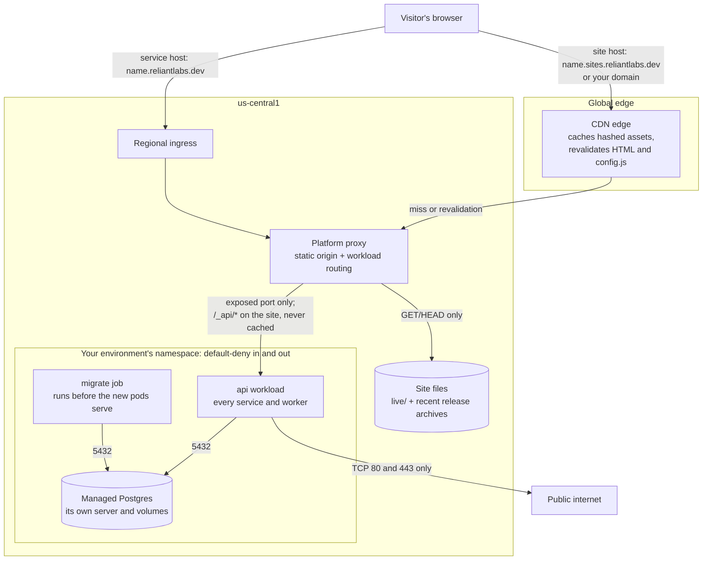
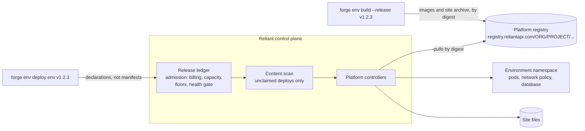

**In short**

- A deploy publishes declarations (a workload, a managed database, a static site), not Kubernetes manifests. Reliant's own controllers turn them into running things, so the platform decides the pod, its network and its placement.
- Static files are served by a global CDN edge in front of one origin. Content-hashed assets are cached for a year, while HTML and `/config.js` revalidate on every load. A deploy therefore shows up on the next page load with no cache purge.
- Each environment's workloads run in a namespace of their own that denies all traffic in and out by default. The only things opened are DNS, outbound TCP 80 and 443 to public addresses, the environment's own database, the telemetry agent, and inbound traffic on the one exposed port.
- Each managed database is its own Postgres server in that namespace, with no internet egress. Its owner password is generated inside the cluster, and the control plane never stores it.
- There are no hosted cron-kind workloads or operators.

## The problem this solves

A small team that ships a frontend, an API and a database on rented infrastructure ends up stitching together a CDN, a bucket, a container platform, a managed database and DNS, each with its own account and its own defaults. The defaults are where it goes wrong: outbound traffic is usually open, so one compromised dependency can reach the cloud metadata server; database passwords end up on laptops; and every deploy needs a cache purge someone eventually forgets.

Reliant hosting is one platform with one set of defaults, chosen for a shared, multi-tenant setting. You declare what to run in your environment's KCL ([Environments & deploys](/forge/environments-and-deploys)). The parts that would loosen isolation (the pod spec, the network policy, the database credential) are composed by the platform rather than written by you, so you can't loosen them by accident. [Hosting overview](/hosting/overview) is the product introduction, with billing and what hosting refuses. This page is about how it works.

## How it works

Two paths matter: a visitor's request, and a deploy.





### Declarations in, platform-composed objects out

`forge env render prod --list` on a hosted environment prints objects of three kinds, and the render says they are "published to the control plane, not applied". A `Workload` (the `api` service and the `migrate` job), a `ManagedDatabase` and a `StaticSite` are custom resources the control plane records against a release. Its controllers then build the real objects in your environment's namespace: the Deployment, the pods, the Services, the network policies and the Postgres server.

The platform composing the pod is why hosting refuses fields such as sidecars, volumes, `securityContext`, node selectors and RBAC ([what hosting does not run](/hosting/overview#what-hosting-does-not-run)). Each one would let a tenant write part of a pod that runs on machines shared with other customers. Workload pods run under a sandboxed container runtime on those shared machines and get no Kubernetes API access. That is also why an operator can't run hosted.

Images come only from the platform's registry, under your organization's path, pinned by digest ([any app, any language](/hosting/overview#any-app-any-language)). A reference to any other registry is refused, so a workload can't name an image that belongs to the platform or to another tenant.

### One environment, one namespace, closed by default

Every hosted environment gets its own namespace, and it carries a deny-all network policy from the moment it is created, before anything is deployed into it. Network policies are additive allow-lists, so a policy that selects every pod and allows nothing can only tighten. Each workload then gets narrow allows on top:

| Direction | Allowed | Why |
|---|---|---|
| Out | DNS to the cluster resolver | Names have to resolve |
| Out | TCP 80 and 443 to public addresses | Calls to outside APIs. Private ranges, link-local (the metadata server) and loopback are excluded |
| Out | Port 5432 on each database the workload references | The database runs on a private address, which the internet rule excludes |
| Out | The node's telemetry agent (OTLP 4317/4318), when observability is on | Logs, traces and metrics leave through it ([where telemetry goes](/hosting/observability/where-it-goes)) |
| In | The workload's declared ports from its own namespace | Workloads in one environment can call each other |
| In | The one exposed port | Where the platform proxy delivers outside requests. Other tenants' pods can't dial it, because their own egress excludes private addresses |

Staging and prod are different namespaces, so a staging pod has no route to prod's pods or prod's database. A migrate job runs inside the pods it gates, so it gets the same allows as the workload, including its database. [Safe migrations](/deep-dives/safe-migrations) covers the ordering.

### Managed Postgres: a server per database, credentials that stay in the cluster

A `ManagedDatabase` becomes a dedicated Postgres server, with its own pods and volumes, in the environment's namespace. No other tenant's data is on that server, and its CPU, memory, disk I/O and WAL throughput belong to your environment alone. An earlier design put tenant databases on one shared instance, where a naming collision once handed staging a working credential for prod's data. A server per database in a namespace per environment makes that mistake impossible to express.

The database has its own network policy, separate from the workloads': it starts at deny-all, accepts connections only from its own environment's pods and the platform's audited query path (below), and has no internet egress. Its only other egress is its own backup stream and the cluster API it needs to manage itself.

Credentials follow the same rule. The owner password is generated inside the cluster when the database is created and reaches your workloads only as `DATABASE_URL`, through `forge.DatabaseRef`. The control plane stores no database password and has no credential that can open your database as its owner. The one exception is reading, not owning: [`forge db query`](/hosting/managed-postgres#read-the-data-safely) connects as the read-only `forge_ro` role. The control plane reads that role's password from the environment's cluster for each audited query and connects to the database pod over TLS, verified against the cluster's CA. `forge_ro` can't see `forge:secret` columns. Backups, the 7-day point-in-time window and restore-as-a-declaration are on [Managed Postgres](/hosting/managed-postgres).

### The static edge and origin

A site's files sit in a platform bucket under a prefix for your organization, environment and site. A release archive is immutable, and there is a `live/` prefix the site is served from. You hold no storage credential at all. Only the platform's controller writes to the bucket, and only the origin reads it, so the boundary between tenants is the platform-owned mapping from hostname to prefix. Prefixes are built from validated labels, and a request path containing `..` is refused with a 400 rather than cleaned up.

Platform hostnames look like `velvet-numbat.sites.reliantlabs.dev`, and they resolve to a global anycast address. A CDN edge answers from cache where it can and forwards the rest to the origin in `us-central1`. The origin's `Cache-Control` header is the whole contract between them:

| Response | `Cache-Control` | Effect |
|---|---|---|
| Content-hashed asset (`/assets/index-BExvtddb.js`) | `public, max-age=31536000, immutable` | Cached at the edge and in the browser for a year. A new build gives the file a new name |
| HTML, `/config.js` and everything else outside the asset directory | `no-cache` | Revalidated with the origin on each load (a `304` against its ETag when unchanged), so a deploy is visible on the next load |
| A 404 from the origin | `no-store` | A cached 404 would outlive the deploy that adds the page |

The origin also has rules a plain file server doesn't:

- **SPA fallback, or real 404s.** A path with no file extension (`/pricing`) returns `index.html` with a 200, so a client-side router can draw it, unless the site ships a `404.html`, in which case it gets that page with a 404. A missing file *with* an extension (`/missing.js`) is always a 404, never the app shell parsed as JavaScript.
- **Stale tabs keep working.** A page loaded before a deploy may lazy-load a chunk the new release no longer has. For files under the asset directory, the origin looks in the archives of recent releases, newest first. This is why a release's files count three times against storage (live, its archive, and the previous release's archive).
- **Headers.** Every response carries `nosniff`, a `Referrer-Policy` and HSTS. A `_headers` file at the root of the build (the Netlify and Cloudflare Pages format) can add your own, such as a `Content-Security-Policy`, but can't set platform-owned headers (`Cache-Control`, `Set-Cookie`, `Strict-Transport-Security`, `Content-Type`). Because the file is part of the build, a release promoted by digest serves the same headers in prod as it did in staging. The file itself is never served.
- **Redirects.** A `_redirects` file at the root of the build declares them, one rule per line in a subset of the Netlify and Cloudflare Pages format: `/from /to [301|302|307|308]`, with an exact path or a trailing `/*` whose match the target reuses as `:splat`, and 301 the default. A published file at the same path wins unless the status ends in `!` (`301!`), so a catch-all never hides your own pages. The query string is kept. A permanent redirect is cached for an hour, not forever, so removing a rule takes effect within the hour. A line the platform can't follow (a `200` rewrite, a condition, a placeholder other than `:splat`) fails the deploy with each bad line named, rather than being dropped. An unclaimed site may redirect only within its own hostname, and once claimed its rules to other domains apply with no redeploy. The file itself is never served.
- **Platform paths.** `/config.js` is written per environment by the platform ([runtime config](/forge/deploy/what-gets-deployed#on-reliant-hosting)), `/_api/*` reaches the environment's `api` workload on the site's own origin with its responses made `private` so the CDN never caches them, `/_otel` takes browser telemetry, and `/_forge/geo` returns the visitor's country as the edge saw it, so a consent banner doesn't have to send the IP address to a third-party geo API. Your own files can't shadow these paths.

### Who pays for a static site

The free static tier is **one organization per person**, not one per organization. Each founder holds it in one organization they own (their personal one by default, movable once every 30 days), and that organization can host any number of static sites in any number of environments. Organizations and people are many-to-many, so a per-organization allowance would hand out another free tier every time someone created an organization. An organization with app hosting billing pays for its own sites and is outside the allowance. Admission and serving read the same designation, so a site in any other unbilled organization is held, not served free. The free tier caps storage at 1 GiB per site and 10 GiB in total, and traffic at 10 GiB a month, after which the site answers `429` until the month rolls over ([billing](/hosting/overview#billing)).

Traffic is metered exactly once per request. The origin counts the bytes of every cache miss it serves, and the edge's logs are counted for cache hits only. A capped organization's hosts are purged from the edge so that its cache can't keep serving past the cap.

### Unclaimed deploys and content scanning

[`--claimable`](/forge/deploy-without-an-account) publishes with no account, so the platform treats an unclaimed deploy as untrusted:

- It is served on a separate registered domain, `reliantpreview.dev`, which is on the Public Suffix List and sends `X-Robots-Tag: noindex`. An abuse report against one preview name can't reach customers' sites on `reliantlabs.dev`.
- Its service has no outbound internet and its resolver answers only cluster names. Its database gets no backups. Claiming restores the normal network.
- Its artifacts are scanned before anything goes live, and only a clean result is admitted. Today the scan is static inspection: phishing-kit and crypto-miner heuristics, a refusal of any form field that collects a credential (a password, card number or one-time code), and a reputation lookup of the URLs the files contain. A refusal comes back as `claimable_content_refused`, and when the scanner can't run the deploy is refused, never admitted. Signature-based antivirus scanning is built but switched off in production.

A claimed organization is never scanned: its deploys are attributable to an account.

### Capacity, shape and the limits block

The plan every `forge env deploy` prints includes a **Capacity** block: what the deploy asks for, against the ceiling for one deployment.

For an organization on pay-as-you-go app hosting, that ceiling is 2,000m of CPU and 8 GiB of memory, summed over every workload and replica in the deploy, and 50 GiB of storage. These are safety caps: your monthly admission budget is what bounds spend. A deploy over the ceiling is refused, not queued. Separately, forge holds each hosted workload's resource *requests* to a fixed shape band of 4 GiB of memory per vCPU, in 125m steps (125m with 512 MiB, 250m with 1 GiB, 500m with 2 GiB, and so on). The default, 250m with 1 GiB, is on the band. `forge env shape <env>` prints what the environment declares. An unclaimed deploy uses the claimable plan's much smaller caps instead (one service at 125m and 128 MiB, a 256 MiB database).

## Design decisions and trade-offs

**Declarations instead of manifests.** The alternative is to let tenants apply their own Kubernetes objects, which is more flexible. It's also impossible to make safe on shared machines, because the pod spec is where isolation lives. The cost is the refusal list above. The way out for any one workload is to [bind it to a cluster you operate](/forge/deploy/environments#connecting-a-cluster-you-operate) and keep the rest hosted.

**Deny-all for the whole namespace, plus per-workload allows.** A deny-all policy for each workload would leave any pod that no policy selects with open networking. A namespace-wide deny-all with nothing allowed can only tighten. The cost is that outbound traffic is web ports only: SMTP on 587, an external Postgres on 5432 or a Redis on 6379 can't be reached from a hosted workload. Use an HTTPS API for email, the managed database, or run that workload on your own cluster.

**A Postgres server per database, not a shared instance.** A shared instance is cheaper and easier to run. It also needed per-role grants, connection limits and timeouts so one tenant couldn't take everyone down, and it still couldn't isolate resources. The cost of a server per database is a server per database, which is why database instances (1 to 3) and storage are declared and billed.

**One bucket with prefixes, not a bucket per tenant.** A bucket per tenant sounds safer, but tenants hold no storage principal either way, and bucket creation is rate-limited per project, which a busy flow of per-pull-request previews would contend for. The real boundary is the hostname-to-prefix mapping, and the origin and the controller defend it.

**Revalidation instead of purges.** A purge keyed to the platform hostname misses the same site under a custom domain, and an SPA's routes are URLs, not files a purge list names. Revalidation costs one origin round trip for each page's HTML and is always correct.

## Limits and what it does not do

- **No hosted cron-kind workloads.** A `kind = "cron"` workload fails the render on hosted, because scheduled pods aren't metered yet. A worker that runs its own schedule (`forge scaffold worker <name> --kind cron`) is an ordinary worker and runs hosted.
- **No operators, CRDs or RBAC.** There is no Kubernetes API access on shared machines.
- **Outbound is TCP 80 and 443 to public addresses only.** Private addresses and other ports are blocked. An unclaimed service has no outbound internet at all.
- **The database is reachable only from inside the environment.** You can't connect to it from a laptop with a connection string; use `forge db query`.
- **One API workload.** Every service and worker runs in the one `api` workload, reached at `/_api` on the site's host. A service split out on its own gets no origin the frontend can reach ([what gets hosted](/hosting/overview#what-gets-hosted)).
- **Deleting an environment doesn't delete the project.** `forge env delete <env> --yes` removes the environment, its workloads, URLs and databases (unless `--keep-data`). The project's release images stay in the registry, and there is no command that deletes a hosted project.
- **Static responses can't set cookies, cache policy or HSTS.** The platform owns those headers. HSTS `includeSubDomains` is set per custom domain, with [`forge cloud domain add --hsts-include-subdomains`](/reference/cli#reliant-forge-domain-add).
- **Content scanning is static inspection** and applies only to unclaimed deploys. It can't see URLs or form fields that are built at run time.

## See it for yourself

These were run with forge v1.6.1 (the version reliant v1.21.3 embeds) in a scaffolded API project and a scaffolded static site.

See what a hosted environment declares. Nothing is applied by your machine:

```bash terminal
reliant forge env render prod --list
```

```text
CLUSTER  KIND             NAMESPACE  NAME       APP
hosted   Workload         -          migrate    -
hosted   Workload         -          api        -
hosted   ManagedDatabase  -          probe-api  -

hosted (published to the control plane, not applied):
  migrate (job): {..."args":["db","migrate","up"],"resources":{"cpuRequestMillicores":250,"memoryRequestBytes":1073741824},...,{"name":"DATABASE_URL","databaseRef":{"name":"probe-api"}},...,"before":["*"]}
  api (service): {..."args":["server"],"replicas":1,...,"ports":[{"name":"http","port":8080,"protocol":"tcp","expose":true}],...}
  probe-api (database)
```

The database URL is a `databaseRef`, not a value. The migrate job runs `before` every workload. The api has a single exposed port.

Deploy a static site and read the capacity block. This run was in an organization with an exemption, so its ceiling is the platform maximum rather than the pay-as-you-go caps described above:

```bash terminal
reliant forge env build prod --release v5.5.5
reliant forge env deploy prod v5.5.5 --yes
```

```text
Rollout of v5.5.5 to prod: SUCCEEDED
...
Capacity  OK (ceiling 65753m CPU, 263.0 GiB memory, 750 GiB storage)
  demand    0m CPU, 0.0 GiB memory, 0 GiB storage; 0 workload(s), 0 database(s), 0 build(s), 1 static site(s)
```

`reliant forge env status prod` then prints the site's address:

```text
  url web: https://velvet-numbat.sites.reliantlabs.dev (served through the CDN edge)
```

Read the cache contract and the edge from outside. The site shipped a `_headers` file with one `Permissions-Policy` line:

```bash terminal
curl -sI https://velvet-numbat.sites.reliantlabs.dev/
curl -s -o /dev/null -D - https://velvet-numbat.sites.reliantlabs.dev/assets/index-BExvtddb.js   # run twice
curl -sI https://velvet-numbat.sites.reliantlabs.dev/pricing
curl -sI https://velvet-numbat.sites.reliantlabs.dev/missing.js
curl -s  https://velvet-numbat.sites.reliantlabs.dev/_forge/geo
```

```text
HTTP/2 200
cache-control: no-cache
etag: "CN/+voaslpgDEAE="
permissions-policy: camera=(), microphone=()
referrer-policy: strict-origin-when-cross-origin
strict-transport-security: max-age=31536000
x-content-type-options: nosniff
via: 1.1 google

cache-control: public, max-age=31536000, immutable
age: 3                                  # second GET: served from the edge cache

HTTP/2 200                              # /pricing: no extension, SPA fallback
cache-control: no-cache

HTTP/2 404                              # /missing.js: an asset, never the app shell
cache-control: no-store

{"country":"FR","subdivision":null}
```

`curl -I` sends `HEAD`, which the edge doesn't answer from cache, so use a `GET` (`-o /dev/null -D -`) to see the `age:` header. Tear the environment down afterwards:

```bash terminal
reliant forge env delete prod --yes
```

```text
Removed: the environment, its deployments, workloads, URLs, Flux objects, custom resources, namespaces
  AND its managed databases' data. IRREVERSIBLE (pass --keep-data to retain the databases).
Kept: the project's release images in the registry (they belong to the project, not this environment).
```

## Guides

- [Deploy a static site to the CDN](/guides/forge/deploy-static-site-cdn): build a Vite or Next.js export once and publish it to static hosting
- [Deploy a Go API with managed Postgres](/guides/hosting/deploy-go-api-managed-postgres): ship the api workload, its migrate job and a dedicated database
- [Preview environment per pull request](/guides/hosting/preview-environment-every-pull-request): a self-expiring hosted environment for each pull request
- [Promote staging to production](/guides/hosting/promote-release-staging-to-production): deploy the exact release staging runs, by digest
- [Recover from a bad deploy](/guides/hosting/recover-from-bad-deploy): roll forward, or redeploy an earlier release above every floor
- [Add a custom domain with HTTPS](/guides/hosting/custom-domain-https): point your own hostname at a hosted site or service
- [Manage production secrets](/guides/hosting/manage-production-secrets): write-only secrets per environment, delivered at deploy time
- [Stop a hosted environment](/guides/hosting/stop-hosted-environment): suspend workloads you aren't using, and start them again
- [Restore Postgres to a point in time](/guides/hosting/restore-postgres-point-in-time): recover data with a restoring database declaration

## Reference

- [Hosting overview](/hosting/overview): what gets hosted, billing, queued deploys and what hosting refuses
- [Managed Postgres](/hosting/managed-postgres): declaring a database, backups, restore and read-only queries
- [Secrets](/hosting/secrets): write-only secrets and how they reach workloads
- [Custom domains](/hosting/custom-domains): DNS records, states and certificates
- [Deploy without an account](/forge/deploy-without-an-account): the claimable plan's limits and refusals
- [Releases and promotion](/forge/deploy/releases-and-promotion) and [safe migrations](/deep-dives/safe-migrations): what a deploy does before the new pods serve
- [Security model](/deep-dives/security-model): auth, secrets and the read-only role across the stack
- CLI: [`env render`](/reference/cli#reliant-forge-env-render), [`env shape`](/reference/cli#reliant-forge-env-shape), [`env deploy`](/reference/cli#reliant-forge-env-deploy), [`env status`](/reference/cli#reliant-forge-env-status), [`env stop`](/reference/cli#reliant-forge-env-stop), [`env delete`](/reference/cli#reliant-forge-env-delete)
