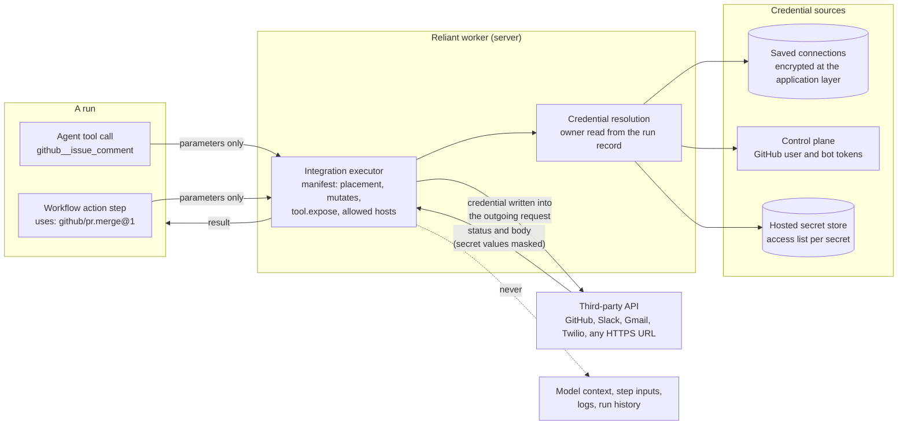

**In short**

- Every integration action runs on Reliant's servers, never on your machine. A connection's token is looked up by the worker for the one call that needs it and written into that request. An agent sees the action's parameters and its result, never the credential.
- Whose credential a call uses is read from the run record, not from anything the agent or the payload supplies. On hosted Reliant, GitHub tokens never sit in Reliant's own database: the worker asks the control plane for the run owner's token at call time.
- An automation can write to GitHub as `reliant-labs[bot]` instead of as you, so a person can approve and merge what an agent opens. The bot writes only where you can push, with a token scoped to one repository.
- A workflow can use a stored secret, such as an API key, only in a credential slot and only if the secret's access list names the workflow. The value is never a step input, so it never reaches a model, a log or the run history.
- Some actions are workflow steps only. Merging a pull request (`github/pr.merge@1`) and writing check runs can't be called by any agent, and merging needs the exact head commit that was reviewed.

## The problem this solves

The usual way to let an agent act on GitHub or Slack is to hand it a token: an environment variable in its shell, a key pasted into a tool config, an MCP server started with your personal access token. From then on, the token is wherever the agent's text goes. A command can print it, a prompt injection in an issue body can ask for it, and anything the agent reads is sent to the model provider ([Privacy & Security](/help/privacy) spells this out for shells). A token in a shell also carries everything its owner can do, so a run that only needed to post a comment could also delete a branch.

There is a second, quieter problem: identity. An agent that writes as you opens pull requests as you, and GitHub won't let you approve your own pull request. So either nobody reviews the agent's work, or someone turns off the review rule.

Reliant splits the problem in two. The credential stays on the server, behind an executor that knows what each action is allowed to do. The identity a write carries is a setting on the automation, not a token you pass around.

## How it works



### 1. An action is declared once, for workflows and agents

Each integration is a manifest in Reliant's catalog. An action in it, such as `issue.comment` or `message.post`, declares its parameters, its output, the HTTP call it makes and three fields that decide where and by whom it can be used:

- **`placement`**: where the call runs. Every action in the built-in catalog is `placement: server`. The connection resolver refuses a credential to any call placed on a daemon, so a token can't leave the server even through a misconfigured action.
- **`mutates`**: whether the action changes something outside Reliant (posts, sends, creates, updates). Reads are `mutates: false`.
- **`tool.expose`**: whether agents get the action as a tool, named `<integration>__<action>` (`github__issue_comment`, `slack__message_post`). Without it, the action exists only as a workflow step.

A workflow uses the action as a step (`type: action`, `uses: github/issue.comment@1`); an agent calls the same action as a tool. Both reach the same executor with the same parameter schema, so there is one implementation of each action, not one per surface. [Integrations](/integrations/overview) shows both forms.

### 2. The executor resolves the credential, not the caller

When a call arrives, the executor finds a credential in a fixed order, and the first hit wins:

1. the connection the step names with `connection:`;
2. the run owner's default saved connection for that integration;
3. the integration's delegated broker, if it has one. On hosted Reliant, GitHub has one: the worker asks the control plane for the run owner's current GitHub token at call time, so no GitHub token is stored in Reliant's own database.

The owner is always read from the run record. Nothing in the call's parameters, the trigger payload or the model's output can say "use someone else's connection". A polled trigger, which has no run, reads its owner and connection from the trigger record instead.

Saved integration credentials are encrypted at the application layer ([Privacy & Security](/help/privacy)). If a provider rejects an OAuth token, the executor refreshes it once and retries; a second rejection is final and tells you to reconnect.

The credential is written into the outgoing request and nowhere else. It is sent only to the integration's own hosts (GitHub's API for GitHub), or for `http/request@1`, only to the host the request started at. A redirect to another host fails the step instead of carrying the credential along.

### 3. Agents get a tool only when it can work

An agent is offered an integration's tools only when the run's owner has a usable credential for it. A connection that needs re-authorizing doesn't count. A tool that is present but fails with 401 is worse than an absent one, because the agent keeps trying it.

In a chat, an action with `mutates: true` asks for permission the way a shell command does, under your approval mode. In an unattended run, one a schedule, webhook or integration event started, a mutating integration tool is withheld entirely unless the workflow step names it exactly in its `preloaded_tools` or `loadable_tools`. A tag or `"*"` doesn't count, because a broad sweep is the path a prompt injection in an issue body or an email would take. Read-only actions stay reachable. [Unattended by design](/automations/overview#unattended-by-design) covers the rule for every withheld tool category.

When you enable an automation, the approval screen lists each integration action the workflow can take, whether it reads or changes something, which connection it will use and its target (repository, channel, URL), along with each secret it uses.

### 4. Who a GitHub write speaks as

An automation's GitHub writes are made as the identity in its settings. A new automation defaults to **Reliant bot**, `reliant-labs[bot]`; writing as **You** is an explicit choice (`reliant trigger activate --acting-as owner`). Pull requests, reviews and comments the bot writes belong to the bot, so you can approve and merge what an agent opened, and a branch rule that wants a reviewer other than the last pusher still works.

The bot's token is minted per call, and it can't do anything you couldn't do yourself:

- The control plane checks that **your** account has push access to the repository.
- It mints an installation token scoped to **that one repository** and to only the permissions the action needs, valid for at most an hour.
- Only writes use the bot. Reads use your own access.
- A write the bot can't make is an error, never a quiet fallback to your name.
- Every bot comment, review and pull request ends with a footer naming the automation and its owner.

[Acting as the Reliant bot](/integrations/github#acting-as-the-reliant-bot) has the full sequence. GitHub is the only integration with a bot. Slack always posts as the Reliant Slack bot user, and Gmail and Twilio act through the connection you saved.

The same split applies on the command line. `reliant github gh --repo owner/name -- <gh args>` runs `gh` as the bot for one repository, so a person or a script can label or review as the bot without holding the App's key.

### 5. Secrets a workflow uses but never reads

For an API with no integration of its own, a workflow declares the secrets it needs and puts one in a **credential slot**: an `http/request@1` header (`"Bearer {{ secrets.TRADER_KEY }}"`), or `credential: { secret: NAME }` on an integration action. A secret anywhere else is a validation error, and a `run` step never receives one, because a command can print its own environment.

For one step attempt, the worker asks the control plane for the value with a one-use ticket bound to the secrets the step names, and writes it only into the outgoing request. The value is never a step input, so the run's recorded step input holds a placeholder instead of the value. If the API echoes the key back, the recorded output shows `[secret]`. The [security model](/deep-dives/security-model#7-secrets-a-workflow-uses-but-never-sees) and [HTTP: secrets](/integrations/http#secrets) have the full rules.

Which workflows may use a secret is the secret's **access list**, keyed by the Reliant project and workflow name:

```bash terminal
reliant forge env secret allow --env staging --workflow trader-bot --project <id> TRADER_KEY
reliant forge env secret access --env staging TRADER_KEY
reliant forge env secret deny  --env staging --workflow trader-bot --project <id> TRADER_KEY
```

Only org owners and admins may edit a list, as themselves: an org automation token, which has no person behind it, can't approve a workflow's use of a secret. A protected environment also asks for a fresh emailed code first (step-up). A workflow that isn't on the list fails the step before any value is read, with a one-line message naming the `allow` command. Every resolution leaves an audit row that names the run, the secret and its version, never the value.

Access lists replace an older per-request grant (`GrantHostedHTTPUse`, used through an action's `hosted_use`), which pinned one secret to one exact origin, method and path. Existing grants were copied into access-list entries, and the old path keeps working for workflows that still use it. The list is the whole policy now: it names no destination. That is why [the HTTP page](/integrations/http#credentials) asks you to write a literal, trusted URL in any step that carries a credential.

### 6. Some actions are workflow steps only

An action without `tool.expose` can't be called by an agent. In the GitHub catalog that is seven actions:

| Action | Why it is a workflow step only |
|---|---|
| `pr.merge` | Merging is a pipeline's decision, made after a review of an exact head |
| `check_run.create`, `check_run.update` | A check is the workflow's record about a commit, not something an agent posts about its own work. GitHub accepts them only from the App, so the automation must act as the bot |
| `users.search`, `user.get_by_id`, `app.installations.list`, `app.installation_repositories.list` | Lookups that back the app's pickers for typed inputs |

`github/pr.merge@1` is the one worth understanding. Its `action` is `enable_auto`, `disable_auto`, `dequeue` or `merge`, and `enable_auto` and `merge` require `match_head_commit`, the full SHA of the head that was reviewed. If the pull request's head is anything else, nothing changes and the step fails, so a push made after the review is never merged. `pr.update` can't merge whatever it is given. The [Autopilot](/guides/autopilot) built-ins never call `pr.merge`: whether anything merges without a person is a decision you make by composing it into a workflow of your own ([Merging is a workflow step](/integrations/github#merging-is-a-workflow-step-never-an-agent-tool)).

### 7. Scoped tokens for your own code

Your own services reach Reliant through the SDKs with an `rlat_` API token that acts as the person who created it. The runs it starts use that person's connections, so a service never needs a GitHub or Slack token of its own: it starts a run, and the run's integration steps resolve credentials as above.

A token can be as narrow as `runs:start` or `triggers:fire` ([SDK scopes](/sdk/overview#scopes)). Some authority isn't in the public API at all: no SDK can enable or edit a trigger, decide an approval, rotate a webhook token or mint a token. A webhook trigger has a narrower credential still, its own token or signing secret, which can deliver an event to that one trigger and nothing else.

## Design decisions and trade-offs

**Server-side execution instead of tokens in the agent's shell.** The alternative is the common one: put a token where the agent runs and let it call `gh` or `curl`. That works with any tool, but the token is then text the agent can print, and its reach is the token's full scope. Running every action on the server confines the credential to one process and one request. The cost is that only cataloged actions and `http/request@1` get this treatment. Writes an agent makes through its own shell (`gh`, `git push`) use whatever credentials that shell has, look like you to GitHub, and aren't recorded as the workflow's own writes.

**One manifest for steps and tools.** Declaring each action once means a workflow and an agent can't disagree about what `issue.comment` does or which hosts it may reach. The cost is that the exposure decision is coarse: an action is a tool for every agent or for none, and finer control comes from the unattended rule and approval modes, not from the manifest.

**A bot identity instead of a shared service account.** A shared bot account saved as a connection would also give agents their own name, but its token would carry its full access everywhere. Minting per call, per repository, only after checking your own push access, means the bot is never more powerful than the person behind the automation. The cost is a dependency on the control plane: on a self-hosted deployment there is nothing to mint the token, so **Reliant bot** is refused when you save the automation.

**Access lists instead of per-request grants.** The older grant bound a secret to one exact origin, method and path. That was precise, but every new endpoint meant a new grant, and the grant duplicated what the workflow already said. The access list answers one question, "may this workflow use this secret", and leaves the destination to the workflow file, which is reviewed like code. The cost is that a workflow on the list can send the secret to any HTTPS host it names, so a step that builds its URL from caller input or model output is a leak waiting to happen.

**Withhold, don't warn, in unattended runs.** An unattended run could be handed every tool with a warning in the prompt. Prompts don't enforce anything, so Reliant removes mutating integration tools unless a step names them. The cost is an extra line of YAML for each workflow that should post or comment on its own.

## Limits and what it does not do

- **A credential is only as safe as the API you send it to.** An endpoint that echoes request headers returns the value in its response. Reliant masks a secret it resolved, but it can't stop the remote server from keeping a copy.
- **A saved generic HTTP connection has no fixed destination.** The workflow chooses the host with `url`. Use a literal, trusted origin in any authenticated step.
- **Results are not secret.** What an action returns, such as an issue body, a Slack message or an email, goes to the agent and the model provider like any other tool output.
- **Shell commands bypass all of this.** An agent that runs `gh` or `curl` with credentials in its environment is outside the executor. Use `credentials: none` for runs that read untrusted text ([the daemon security model](/deep-dives/daemon-security-model)).
- **Only GitHub has a bot identity.** Slack posts as the Reliant Slack bot; Gmail, Twilio and HTTP always act through your own connection.
- **Reliant bot needs the hosted control plane.** Self-hosted deployments use your own connection or a separate bot account saved as a connection.
- **Access lists cover hosted secrets only.** A local `FileSecrets` store has no access lists, and `forge env secret allow` needs `--project`, the Reliant project id that owns the workflow (`reliant project list`).
- **Nothing merges on its own.** No built-in workflow calls `github/pr.merge@1`. A custom workflow you write can, and only at the head commit you pass it.

## See it for yourself

List the GitHub actions no agent can call. In a clone of the [Reliant repository](https://github.com/reliant-labs/reliant):

```bash terminal
rg --files-without-match 'expose: true' internal/integrations/catalog/github/actions | sort
```

```text
internal/integrations/catalog/github/actions/app.installation_repositories.list.yaml
internal/integrations/catalog/github/actions/app.installations.list.yaml
internal/integrations/catalog/github/actions/check_run.create.yaml
internal/integrations/catalog/github/actions/check_run.update.yaml
internal/integrations/catalog/github/actions/pr.merge.yaml
internal/integrations/catalog/github/actions/user.get_by_id.yaml
internal/integrations/catalog/github/actions/users.search.yaml
```

Read the bot's guarantees from the CLI:

```bash terminal
reliant github --help
```

```text
Act on GitHub as the Reliant GitHub App's bot, reliant-labs[bot], or as yourself.

Implementation is yours: commit, push and open pull requests as you (git's
credential helper already does). Reviewing, labelling and merging are the
bot's: use 'reliant github gh --repo owner/name -- <gh args>' for them.

The bot writes only where you can push: control-plane checks your own GitHub
access before it mints the token, scopes the token to one repository, and
records the mint in its audit log. Tokens last at most an hour and are never
stored.
```

See which identity a new automation writes as:

```bash terminal
reliant trigger activate --help | grep acting-as
```

```text
      --acting-as string          Who GitHub writes speak as: app (the Reliant bot) or owner (default: app for a new activation, unchanged otherwise)
```

Read what a secret's access list governs, inside a Forge project with a hosted environment (forge v1.0.13 or later):

```bash terminal
reliant forge env secret allow --help
```

```text
Add a workflow to a hosted secret's access list. A Reliant workflow that
references the secret ({{ secrets.NAME }} in an http/request header) runs only
if its (project, workflow name) is on the list; any run or trigger of that
workflow may then use it. Idempotent.

The list is the whole policy: it names no destination, path or step.
Only org owners and admins may edit it, and a protected environment asks for
step-up; the control plane's refusal is printed as it is sent.

Usage:
  reliant forge env secret allow --env <environment> --workflow <name> --project <id> <NAME> [flags]
```

To watch a run be refused, allowed and refused again, follow [Call any API from a workflow without exposing the key](/guides/workflows/call-api-without-exposing-key).

## Guides

- [Call an API without exposing the key](/guides/workflows/call-api-without-exposing-key): store a key, allow one workflow, and call the API with it in a request header
- [Start an agent from a webhook](/guides/workflows/start-agent-from-webhook): a trigger with its own narrow token, and the payload treated as untrusted data
- [Review pull requests with AI](/guides/workflows/review-pull-requests-with-ai): reviews posted as the Reliant bot on every pull request
- [Turn issues into pull requests](/guides/workflows/github-issues-to-pull-requests): the bot opens the pull request, so a person can approve and merge it
- [Post a daily Slack digest](/guides/workflows/daily-slack-digest): a scheduled run that posts through your Slack connection
- [Build a Slack bot agent](/guides/workflows/slack-bot-agent): answer @-mentions in threads as the Reliant Slack bot
- [Triage email with an agent](/guides/workflows/triage-email-with-an-agent): classify new Gmail messages and reply or label them
- [Answer SMS and WhatsApp](/guides/workflows/sms-whatsapp-agent): reply to incoming Twilio messages with an agent

## Reference

- [Integrations overview](/integrations/overview): connections, action steps and agent tools
- [GitHub](/integrations/github): actions, events, the bot identity and merging
- [HTTP](/integrations/http): `http/request@1`, credential slots and access lists
- [Slack](/integrations/slack), [Gmail](/integrations/gmail), [Twilio](/integrations/twilio)
- [Automations: who an automation acts as](/automations/overview#who-an-automation-acts-as) and [unattended by design](/automations/overview#unattended-by-design)
- [SDKs: credentials and scopes](/sdk/overview#scopes)
- [Secrets](/hosting/secrets): the hosted store, versions and step-up
- [The Reliant security model](/deep-dives/security-model) and [how agents operate production safely](/deep-dives/agents-in-production)
- CLI: [`secret allow`](/reference/cli#reliant-forge-secret-allow), [workflows and triggers](/cli/workflows)
