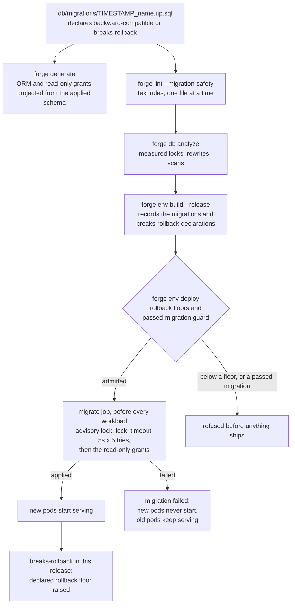

**In short**

- Your migrations are the schema. Forge applies them to a real Postgres and generates the ORM and the read-only role's grants from what Postgres reports.
- Each migration says whether the release still serving survives it: `forge:backward-compatible` or `forge:breaks-rollback`. The declaration is your claim. Lint checks the SQL for known hazards; nothing checks the claim against your code.
- `forge lint --migration-safety` reads the SQL text. `forge db analyze` runs the migration on a disposable Postgres and reports the locks, rewrites and scans it actually caused.
- In a deploy, migrations run before any new pod serves, under a 5-second `lock_timeout` by default. A failed migration leaves the old pods serving.
- There are no down migrations. Forge rolls forward. A `breaks-rollback` migration raises a rollback floor, so nobody can redeploy a release that can't run on the new schema.

## The problem this solves

A schema change and a code change never land at the same instant. During a rolling deploy, the new release migrates the database, and the previous release keeps serving traffic on the new schema until its last pod is gone. If a pod of the old release is rescheduled mid-deploy, it starts against the new schema too. So every migration has a second audience besides the code it ships with: the code it replaces.

A typical stitched-together stack handles this with convention. You write a migration that works on your empty test database. A reviewer might notice that `ADD COLUMN … NOT NULL` with no default fails on a table with rows. Nobody notices that `SET NOT NULL` holds a lock that blocks every read while it scans a large table. A down migration sits in the repo looking like a safety net, though it has never run and would drop data written since. When something goes wrong, the fix is a hand-run SQL session against production.

Forge replaces each of those conventions with a mechanism. Each one is narrow, and the [Limits](#limits-and-what-it-does-not-do) section says where each stops.

## How it works



### Migrations are the schema

You declare tables in SQL files under `db/migrations/`, and nowhere else. `forge generate` applies them, in order, to a throwaway Postgres and reads the schema back from Postgres's catalog. The entity structs, the stores and the CRUD conversions are generated from that applied schema. So is `db/grants/readonly_gen.sql`, the column list the read-only role may select. [Two sources of truth](/forge/concepts/two-sources-of-truth) covers the projection in detail.

That has a safety consequence. There is no second schema language to drift from the first. If the generated code compiles, it matches the schema your migrations produce, because that schema is where the code came from. Anything Postgres accepts works, including `JSONB`, generated columns and `CHECK` constraints, because Forge reads the result instead of parsing the input.

Migrations are versioned by UTC timestamp and created with `reliant forge db migration new`, so two branches don't pick the same number. The binary embeds them, so the production image can migrate itself without a `db/migrations` directory on disk.

### Every migration declares whether the previous release survives

Pass `--backward-compatible "<why>"` or `--breaks-rollback "<why>"` to `db migration new` and it writes the declaration as the file's first line (without either flag, you add the line yourself):

```sql db/migrations/20261120071321_add_task_webhook_secret.up.sql
-- forge:backward-compatible — new nullable column the running release never reads
```

The alternative is `--breaks-rollback "<why>"`, for a dropped or renamed column the old code reads, or a `NOT NULL` column it doesn't write. Two parts of the system read the declaration:

- **The migrator**, at runtime. As it applies a migration, it records what the migration declared in a bookkeeping table beside `schema_migrations`. When an older binary starts and finds the schema ahead of the newest migration it embeds, it reads those records. If every newer version was declared backward-compatible, it serves. Otherwise it refuses to start: "NOTHING WAS APPLIED and this binary refuses to serve." A version with no record, or with `breaks-rollback`, counts as not compatible.
- **The release cut**, at build time. A release records every `breaks-rollback` migration it carries. When an environment is promoted to that release, it gets a [declared rollback floor](#rollback-floors-instead-of-down-migrations).

Saying nothing is read as "not compatible". To make every migration a deliberate choice, set `database.migration_safety.require_compat_declaration: true` in `forge.yaml`. A migration with neither declaration then fails `migration-compat-undeclared`. [Write zero-downtime Postgres migrations](/guides/forge/zero-downtime-postgres-migrations) walks through the expand/contract pattern this assumes.

### Lint reads the SQL text

`forge lint --migration-safety` reads every `*.up.sql` and flags SQL that works on an empty database and fails on a populated one. It also catches version mistakes that make a migration silently never run. The [migration rules](/forge/linting/rules-migrations) page lists every rule. In short:

- data loss: `destructive-change`
- statements that fail on a table with rows: `unsafe-add-not-null-column`, `set-not-null-without-backfill`
- table rewrites: `volatile-default`
- down migrations: `no-down-migration`
- transaction mistakes: `non-transactional-statement`, `enum-value-used-before-commit`
- version mistakes: `duplicate-migration-version`, `non-timestamp-migration-version`, `migration-version-below-merged-head`

The lane runs as part of plain `forge lint`, so it gates every change. It is fast because it never touches a database. That is also why it can't tell how long a statement runs, or what lock a statement really takes on your Postgres version.

### `db analyze` measures what the SQL does

`reliant forge db analyze` (forge v1.7.0 or later) fills that gap. It applies the migrations you added since `--base` to an embedded Postgres, statement by statement and each file in its own transaction, the way the migrator does. For each statement it reports the locks taken (from `pg_locks`), the tables and indexes rewritten (new `relfilenode`), the tables scanned, and the time. Its rules include `db-analyze-access-exclusive-lock`, `db-analyze-table-rewrite`, `db-analyze-validation-scan` and `db-analyze-blocking-index-build`. They warn in v1.7.0 and gate from v1.7.1 ([lint rollout](/forge/linting/rollout)).

It needs Postgres, so it is a separate command rather than a lane of `forge lint`. Run it before you push, in a review lane or in a full gate. [Measure migration locks and table rewrites](/guides/forge/measure-migration-locks) shows real findings and fixes. With `--target dsn` it runs against a copy of a snapshot you mark as safe to copy, so you see real row counts and timings. It never writes to the target itself.

### Migrations gate the rollout

The scaffolded `deploy/kcl/workloads.k` declares migration as a workload of its own:

```kcl deploy/kcl/workloads.k
migrate = fw.Workload {
    name = "migrate"
    kind = "job"
    args = ["db", "migrate", "up"]
    before = [fw.BEFORE_ALL]
    ...
}
```

`before = [fw.BEFORE_ALL]` gates every workload in the environment. On a cluster, and on Reliant hosting, it runs as an init container ahead of each gated pod, so the schema is current before any new pod serves a request. On the host runtime, Forge runs it to completion before starting anything it gates. Replicas racing the same migration are safe: the migrator takes a Postgres advisory lock, so one applies and the rest find nothing to do.

If a migration fails, the init container fails, the new pods never become ready, and the old pods keep serving. The release still serving is protected by the same declaration as before. A rescheduled old pod runs its own migrate step against the newer schema, and the schema-ahead check above decides whether it may serve.

`AUTO_MIGRATE` exists for the host loop in development. It is off in rendered cloud environments, because replicas racing to migrate at startup, each already answering its readiness probe, is not a migration strategy.

### Lock timeouts are set on every run

`ALTER TABLE` takes `ACCESS EXCLUSIVE`. While it waits behind one long-running query, every later query on that table queues behind it, including plain reads. One slow report plus one migration is an outage of that table.

So the migrator sets a `lock_timeout` of 5 seconds and a `statement_timeout` of 30 minutes on its session for every run. A migration that can't get its lock in time is rolled back and tried again with backoff, five attempts in all. If it keeps timing out, the run fails with the schema left at the previous version: nothing was applied, so a re-run is a retry, not a recovery. A file that needs longer says so in review, with `-- forge:lock-timeout 30s` or `-- forge:statement-timeout 2h`. A file can also disable either limit with `0` or `off`. [Managed Postgres](/hosting/managed-postgres#migrations-run-in-the-deploy) describes the same limits on Reliant hosting.

### The release refuses migrations it can never apply

The migrator only applies versions above the one the database has reached. A release carrying a migration numbered at or below one an environment has already passed can never run it there. Forge checks this without a database. Each release records the migrations it carries, and the environment's promotion history says which releases it applied. `forge env build --release` and `forge env deploy` both refuse such a release before anything ships, instead of letting new pods crash-loop in production.

### Rollback floors instead of down migrations

Forge never runs down SQL, and `no-down-migration` rejects a `.down.sql` file. Once a migration has run and the new release has written data in the new shape, reversing the DDL would lose that data. Recovery is a deploy: a new release with a forward fix, or an earlier release.

Deploying an earlier release is only safe while that release can run on the current schema. That's what [rollback floors](/forge/deploy/release-gates#rollback-floors) enforce. When an environment is promoted to a release carrying a `breaks-rollback` migration, it gets a declared floor. After that, any release without that migration is refused with `below_rollback_floor`, before anything is built. That includes a release cut later from a branch that never had the migration, which a plain "older than" comparison would miss. `reliant forge env floor check <env> <release>` asks the question without deploying.

### The read-only role and secret columns

A forge-managed Postgres has a read-only role, `forge_ro`. `reliant forge db query` reads through it, inside a `READ ONLY` transaction. Its privileges come from the migrations as well. After every migration run, in the same session and under the same lock, the migrator applies `db/grants/readonly_gen.sql`. That script revokes everything the role holds, then grants `SELECT` column by column on exactly the declared columns. The role never gets a table-level `SELECT`, so a column added later stays unreadable until the next `forge generate` has decided whether it is secret.

A column is withheld when it is marked `forge:secret`, either as a SQL `COMMENT ON COLUMN` or on the proto field. A credential-shaped column that nobody has decided about (a token, password or key) is withheld too, and `forge lint --db-grants` fails until someone marks it `forge:secret` or `forge:readable <why>`. Postgres enforces the boundary, not a redactor, so `select *`, `upper(col)` and `row_to_json` can't read a withheld column. [Let AI agents query production data read-only](/guides/forge/let-agents-query-production-data) covers the query side.

## Design decisions and trade-offs

**A declaration, not an inference.** Whether the previous release survives a schema depends on that release's code, not on the SQL. `DROP TABLE` of a table nothing reads is safe; `ADD COLUMN … NOT NULL` with no default breaks every old insert. An inference from the SQL would be wrong in both directions, so the author states it once, in the file, where review sees it. The cost: a wrong declaration is believed.

**Text lint plus measurement, not one or the other.** The text lint is instant and runs on every change, but it can't see locks. `db analyze` sees locks, but needs Postgres and only measures empty tables unless you give it a snapshot. Forge keeps both, so the cheap check runs everywhere and the measured one runs where Postgres is available.

**Fail fast on locks instead of waiting.** A 5-second lock wait with retries can fail a deploy that would have succeeded after a minute's wait. Forge accepts that, because a migration queued behind a long reader blocks every query on the table while it waits. A file that needs a longer wait raises its own limit.

**Roll forward only.** Without down migrations, a bad migration is fixed with another migration. In exchange, there is never an untested reverse path, and floors keep "deploy an earlier release" from reaching a release the data no longer fits.

**Convergent grants, not deltas.** Revoking everything and granting the declared columns on every run means a column that became secret loses its grant on the next migration run. A delta would keep it readable until someone noticed.

## Limits and what it does not do

- **Declared and linted, not proven.** The compatibility declaration is your claim about the previous release's code. Lint checks the SQL for known hazards; nothing checks the claim against your code. This migration passes `forge lint --migration-safety`, though the claim is false:

  ```text
  -- forge:backward-compatible — (a wrong claim: the previous release still selects tasks.done)
  -- forge:allow-destructive
  ALTER TABLE tasks DROP COLUMN done;

  ✓ migration-safety
  ✅ All 1 gating linters passed.
  ```

  The migrator would let the old release serve on that schema, and its queries would fail. Expand/contract is still your job.
- **Lint matches patterns.** It catches the hazards it has rules for, one file at a time. It doesn't know your table sizes, your traffic, or SQL it has no rule for.
- **`db analyze` and lint disagree on one pattern.** The three-migration way to make a column `NOT NULL` without a blocking scan (`CHECK … NOT VALID`, then `VALIDATE CONSTRAINT`, then `SET NOT NULL`) is what `db analyze` recommends. `lint --migration-safety` judges each file alone, so it fails the third file with `set-not-null-without-backfill`. Until that is fixed, add `-- forge:allow-unsafe-not-null` with a reason to the third file, as the [locks guide](/guides/forge/measure-migration-locks) shows.
- **Empty tables by default.** `db analyze`'s scratch target has no rows. It shows which locks and rewrites a statement causes, not how long they take on your data. Use `--target dsn` with a snapshot for timings.
- **No automatic rollback.** Nothing reverts a release for you. A release that rolls out fine and then regresses stays live until you deploy a fix or an earlier release above every floor.
- **A failed migration doesn't undo itself across files.** Each file is one transaction, so a failed file leaves nothing of itself behind. Files applied before it in the same run stay applied.
- **Timeouts can be turned off.** The 5-second default is set on every run, but a file can raise or disable it. Review those directives.
- **The read-only role has known gaps.** A `SECURITY DEFINER` function that the role may execute runs as its owner, and can return secret columns. Forge generates none, and the migrator logs a warning for each one it finds. The grants also don't cover views, privileges held by `PUBLIC`, or row-level security.

## See it for yourself

Run these in a Forge project with a database, pinned to forge v1.7.0 or later, in a git repo with at least one commit.

Measure a pending migration on an embedded Postgres, with no docker:

```bash terminal
reliant forge db analyze --base HEAD
```

```text
db/migrations/20261120071321_add_task_webhook_secret.up.sql
  line 12: ALTER TABLE tasks ADD COLUMN webhook_secret TEXT
    2.7ms
    locks:    tasks AccessExclusiveLock
  line 13: COMMENT ON COLUMN tasks.webhook_secret IS 'forge:secret'
    0.5ms
    locks:    tasks ShareUpdateExclusiveLock
    held:     tasks AccessExclusiveLock (taken by an earlier statement of the file)

1 migration(s) analyzed, 2 statement(s) executed
```

Add a credential-shaped column without deciding about it, and the grants lint fails:

```bash terminal
reliant forge lint --db-grants
```

```text
❌ db-grants — 1 error
   ✗ [forge-db-grants-undecided] tasks.webhook_secret looks like a credential and nobody decided it: forge_ro cannot read it
```

After you add `COMMENT ON COLUMN tasks.webhook_secret IS 'forge:secret';` and run `reliant forge generate`, the grants row leaves the column out:

```sql db/grants/readonly/public.tasks_gen.sql
('public', 'tasks', ARRAY['created_at', 'done', 'due_at', 'id', 'owner', 'priority', 'title', 'updated_at']::text[])
--   public.tasks: webhook_secret  (forge:secret, withheld)
```

See the migrate job that gates the rollout, and which floors an environment holds:

```bash terminal
reliant forge env render prod --list    # migrate (job) with "before":["*"], then api (service)
reliant forge env floor show prod       # needs a hosted env
```

## Guides

- [Zero-downtime migrations](/guides/forge/zero-downtime-postgres-migrations): declare compatibility, expand then contract, and lint each migration
- [Measure migration locks](/guides/forge/measure-migration-locks): run pending migrations on a disposable Postgres and read the locks and rewrites
- [Let agents query production data](/guides/forge/let-agents-query-production-data): read-only, audited queries through the role that can't see secret columns
- [Seed realistic dev data](/guides/forge/seed-realistic-dev-data): generate rows that fit the schema your migrations build
- [Recover from a bad deploy](/guides/hosting/recover-from-bad-deploy): roll forward, or redeploy an earlier release above every floor
- [Restore Postgres to a point in time](/guides/hosting/restore-postgres-point-in-time): recover data a migration or a bad release damaged

## Reference

- [Lint rules: migrations](/forge/linting/rules-migrations): every rule of `--migration-safety`, with a bad example and its fix
- [Release gates: rollback floors](/forge/deploy/release-gates#rollback-floors): order and declared floors, and how to lift them
- [Managed Postgres](/hosting/managed-postgres): migrations in a hosted deploy, backups, and reading data safely
- [Two sources of truth](/forge/concepts/two-sources-of-truth): what `forge generate` projects from the applied schema
- [Lint rollout](/forge/linting/rollout): how the `db-analyze-*` rules warn before they gate
- CLI: [`db analyze`](/reference/cli#reliant-forge-db-analyze), [`db query`](/reference/cli#reliant-forge-db-query), [`env floor`](/reference/cli#reliant-forge-env-floor)
