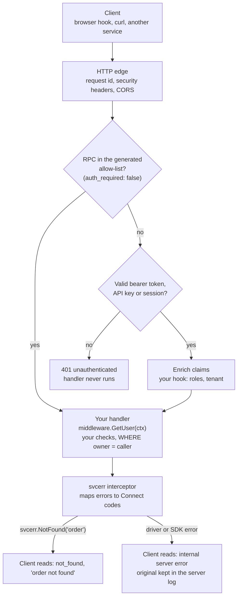
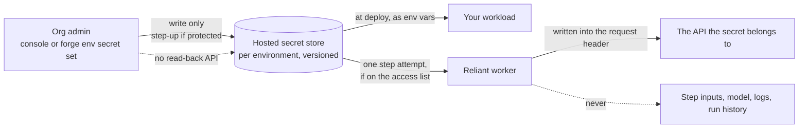

**In short**

- Every RPC of a forge API needs a valid credential unless its proto says `auth_required: false`. A server with no validator refuses to start, and no environment variable turns authentication off.
- Authentication only proves who is calling. Forge generates no access checks and no row filters: you write them in the handler with `middleware.GetUser`. `reliant forge project audit` lists every signed-in RPC whose handler never reads the caller, and a `forge:owner` column turns that list into a failing gate for the table.
- Errors the application never wrote leave as `internal server error`. The SQL, DSN or host name in them stays in your server log.
- Hosted secrets are write-only and versioned. A protected environment asks for a fresh email code before a value changes. A workflow can put a secret into an HTTP header without the value ever reaching a step, a model or a log.
- Every machine credential is one `rlat_` token format with a closed list of scopes, and a token can never mint authority its holder lacks.

## The problem this solves

Most API breaches don't need a clever exploit. An endpoint ships without the auth check someone meant to add. A signed-in user changes an id in the URL and reads another customer's rows. A database error, echoed back to the client, includes the connection string. A token minted for CI can also delete production. A key pasted into a prompt ends up in a model provider's logs.

In a stack you assemble yourself, each of those is a rule someone has to remember in every handler and pipeline, and when agents write much of the code, nobody can rely on remembering. Reliant makes each rule either the default or something a tool reports. Where neither is possible, as with access rules only your product can define, this page says so.

## How it works

The first diagram follows one request through a forge API. The second follows a secret from the person who sets it to the code or workflow that uses it.





### 1. Auth fails closed, per RPC

A forge service builds its interceptor chain from slots, and authentication is the one slot without a default. The authentication library resolves one of three modes when the chain is built:

- **Validate.** A validator is installed. The scaffold's `internal/app/providers.go` passes `AnonymousOK: false`, so a request with no credential is rejected unless the RPC it names is on the allow-list.
- **Passthrough.** `ExternalAuth: true`, written into your own middleware file, says another interceptor owns identity. It is the only way to run without the check, and it is visible in code review.
- **Unconfigured.** Neither of the above. Construction fails and the server doesn't start.

The allow-list isn't maintained by hand. Forge projects it from the protos into `pkg/middleware/procedures_gen.go`, and an RPC is listed only because its proto says `option (forge.v1.method) = { auth_required: false }`. Matching is exact and uses Connect's generated procedure constants, so a renamed RPC breaks the build instead of leaving a stale string behind. The probes (`/healthz`, `/readyz`, `/metrics`) sit in front of the chain and need no credential. [Middleware and the request path](/forge/concepts/middleware-and-request-path#auth-fails-closed) walks the whole chain and its order.

A credential reaches the validator by its shape. A bearer JWT goes to the validator `SetupAuth` builds, an `fk_` API key goes to a validator over your own table (hashed and compared in constant time), and the native sign-in session cookie is read last. After validation, an enrich hook you own (`enrichClaims` in `pkg/middleware`, or a component that implements `ClaimsEnricher`) can add roles, an org or a tenant to the claims before any handler runs. If it returns an error, the request is rejected. [Add sign-in with passkeys, magic links or social login](/guides/forge/add-sign-in-passkeys) covers the sign-in side.

### 2. You write the access rules, and the audit finds the gaps

Authentication answers "is this a signed-in caller?". It can't answer "may this caller read order 42?", because only your product knows how users, teams and rows relate. Forge generates no access control. Every generated CRUD shim says so on the line above it:

```go internal/handlers/catalog/handlers_crud.go
// Auth: AUTHENTICATED, UNSCOPED — nothing reads the caller; scope with middleware.GetUser(ctx) (see file header).
```

What forge can do is read your handlers. The `unscoped_auth` category of `reliant forge project audit` takes the authenticated RPCs from the proto descriptors and the handler bodies from the Go source, and lists every authenticated RPC whose handler never resolves the caller. A handler counts as resolving the caller when it calls `middleware.GetUser`, or a helper of yours marked `//forge:resolves-caller`. An RPC that really is the same for every caller, such as a public plan catalog, says so in code:

```go internal/handlers/billing/rpc_list_plans.go
// forge:auth-unscoped-ok: the plan catalog is the same for every caller
func (s *Service) ListPlans(...)
```

The reason is required, and the audit echoes it back in `acknowledged_rpcs` so a reviewer reads it. There is no lint flag for this check. It is part of the audit.

On its own, the category is a warning. A fresh scaffold is unscoped by construction, so failing it would fail every new project. The gate arms when you declare where a table's owner lives, by marking the column `forge:owner`. Declare it as `// forge:owner` on the proto field before you scaffold the entity, and forge writes `COMMENT ON COLUMN … IS 'forge:owner'` into the migration and scaffolds CRUD shims that resolve the claims, add the owner predicate to Get, List, Update and Delete, and stamp the column from the caller on Create and Update. It leaves one marked expression for you: how a caller's claims map onto the owner value. Declared later, the shims already exist, so `forge project audit` prints each wrapper for you to paste. From then on, an authenticated CRUD RPC over that table whose handler never reads the caller is an error, and `forge project audit` fails. The gate arms per table, so an owned `orders` table doesn't fail an unscoped RPC over a global `products` catalog. Forge never injects a `WHERE` clause at runtime: the scoping is code in your repository that you can read and change. [Scope rows to their owner](/guides/forge/scope-rows-to-owner) and [Find endpoints missing auth checks](/guides/forge/find-endpoints-missing-auth-checks) walk through both steps.

### 3. One listener, one audience

A service that serves end users and one that serves daemons or operators shouldn't share a front door. Each authenticator provider carries `//forge:audience <name>` (the scaffold marks `NewUserAuth` as `user`), and each service declares the audience it belongs to. A listener refuses to start if it mounts a service of another audience. `reliant forge lint --graph` proves the same statically and fails with [`forge-graph-audience`](/forge/linting/rules-deploy-and-secrets#forge-graph-audience), naming the listener, the service, both audiences and the authenticator.

### 4. Errors never carry internals

Handlers return `svcerr.Wrap(err)`, and an interceptor next to the handler applies the same mapping to anything a handler returns. An error your code built, like `svcerr.NotFound("order")`, reaches the client with its code and your text. An error your code never wrote, from a driver, an SDK or the standard library, becomes `CodeInternal` with the fixed message `internal server error`, and the original is kept as a cause that reaches the log. Context you add with `fmt.Errorf("… %w", err)` is for the operator and never reaches the client either. `svcerr` is an ordinary Go package, so a service that doesn't use the rest of forge can import it too.

The one exception is a hand-built `*connect.Error`. It is a handler's explicit verdict and passes through as written, so `connect.NewError(code, err)` publishes `err.Error()`. [`forgeconv-handler-connect-error`](/forge/linting/rules-conventions#forgeconv-handler-connect-error) flags each one in a handler package, and `reliant forge lint fix connect-errors` rewrites the fixed-text ones. [The error path](/forge/concepts/middleware-and-request-path#the-error-path) covers reasons and error classes.

### 5. The database role agents read through

A forge-managed Postgres has a read-only role, `forge_ro`, and `reliant forge db query` reads through it in a `READ ONLY` transaction. Its grants are rebuilt column by column after every migration. A column marked `forge:secret` is never granted, so Postgres itself refuses it, through `select *` and `row_to_json` alike. A token-, password- or key-shaped column nobody has decided about is withheld as well, and `reliant forge lint --db-grants` fails until someone marks it `forge:secret` or `forge:readable <why>`. On a hosted environment, `db query` also needs `--confirm-env`, a `--reason` and the org's `db:query` grant, and it records an audit row. [How Forge keeps Postgres migrations safe](/deep-dives/safe-migrations#the-read-only-role-and-secret-columns) explains how the grants converge. [Let agents query production data](/guides/forge/let-agents-query-production-data) covers the query side.

### 6. Hosted secrets are write-only

A hosted environment's secrets live in Reliant's managed store, one store per environment. You set a value in the console or with `reliant forge env secret set --env prod NAME`, which reads the value from stdin so it never lands in shell history. Nothing reads it back: the credential Reliant's servers hold may read secret metadata but not secret data, so the storage layer refuses the request. Every write is a new version, and values reach workloads at deploy time as environment variables. Setting a secret needs the org admin role, or an automation token with `secret:write`.

An environment marked **protected** adds a step-up before any change. To set, delete, undelete or destroy a value, an admin requests a one-time code emailed to their verified address. The code is good for 10 minutes and 5 attempts, and opens a 15-minute window for that person in that environment. Listing secrets is never gated. An org automation token has no person behind it, so it can't change a protected environment at all. Every write, step-up and refused write leaves an audit row naming the actor, secret and version, never the value. Without the step-up machinery, a protected environment is read-only, not open. [Secrets](/hosting/secrets) is the reference, and [Manage production secrets per environment](/guides/hosting/manage-production-secrets) is the task guide.

### 7. Secrets a workflow uses but never sees

A workflow declares the secrets it needs and puts one in a credential slot: an `http/request@1` header such as `"Bearer {{ secrets.TRADER_KEY }}"`, or `credential: { secret: NAME }` on an integration action. Anywhere else, a secret reference is a validation error, and a `run` step never receives one, because a command can print its own environment. For one step attempt, the worker fetches the value through the control plane and writes it only into the outgoing request. It never becomes a step input, so it isn't in the run's state, its history, logs, spans, outputs or the UI. The request goes over HTTPS only, and redirects are followed only within the starting host.

Which workflows may use a secret is the secret's access list. An org owner or admin edits it with `reliant forge env secret allow NAME --env <env> --workflow <name>`, and a protected environment asks for the step-up here too. [HTTP requests: secrets](/integrations/http#secrets) has the full rules, and [Call any API from a workflow without exposing the key](/guides/workflows/call-api-without-exposing-key) walks through one.

### 8. One machine credential, closed scopes

Every machine credential Reliant issues is an `rlat_` token: 32 bytes from a cryptographic random source, stored as a SHA-256 hash and compared in constant time. A daemon's connection, a CI deploy token and an API token differ only in their scopes and binding. The scope list is closed: a scope that can't be spelled can't be granted. A token can be bound to one daemon, proxied port, connector or environment, which limits what a leaked one can reach, and a token with `token:write` can never mint a scope its holder doesn't hold.

So forge commands on a signed-in machine use a token valid for at most an hour, clipped to your current org grants ([Forge sign-in](/forge/sign-in)). CI gets an org automation token with only the scopes it names (`reliant forge cloud token create --name github-actions --scopes deploy:read,deploy:write`). A service that starts runs can hold an API token as narrow as `runs:start`, and no SDK can enable a trigger or decide an approval ([SDK scopes](/sdk/overview#scopes)).

How a machine's own token is stored, checked and revoked is in [the daemon security model](/deep-dives/daemon-security-model).

### 9. Supply chain and secret scanning in the repository

A project `reliant forge project new` creates for an API ships three pieces of repository hygiene:

- **`.github/workflows/build-images.yml`** signs each pushed image with cosign (keyless, through GitHub's OIDC token), generates an SPDX SBOM and uploads it as a workflow artifact, and attaches a build-provenance attestation. All three act on the immutable digest, not a tag. A Trivy scan job runs after the build.
- **`.pre-commit-config.yaml`** includes the gitleaks hook. Where the `pre-commit` tool is installed, the scaffolded git hook runs it and stops a commit that contains a credential-shaped string.
- **`.github/workflows/pre-commit.yml`** runs the same hooks, gitleaks included, on pull requests and pushes to `main`.

Forge's own releases ship checksums and a Sigstore attestation, and `install.sh` verifies them with `gh` or `cosign` before installing.

## Design decisions and trade-offs

**Deny by default at the RPC, not at a gateway.** The allow-list lives next to each RPC in the proto and is projected into code, so there is one place to declare a public endpoint and no second list to drift. The cost: making an RPC public is a proto change and a regenerate, not a config flag.

**No ambient off switch.** An environment variable that disabled auth would be settable from any shell and invisible in the code. Only a field in your own source can. The cost: a quick local experiment without auth needs a code edit.

**Audit the access rules, don't generate them.** The mapping from claims to rows is product logic, and a filter injected at runtime is one you can't review. So forge scaffolds the wrapper once, in a file you own, and checks the result. The cost: the check proves a handler reads the caller, not that it uses the answer correctly.

**Advisory until you declare an owner.** Failing every unscoped RPC would fail every fresh project. Arming per table on `forge:owner` makes the gate strict exactly where you said ownership matters. The cost: a project that never declares an owner only ever gets warnings.

**Redact by default, with one explicit escape.** svcerr can't tell which text in a hand-built `connect.Error` a client should read, so it leaves those alone and a lint rule finds them instead of guessing. The cost is a warning to clear in code that predates svcerr.

**Write-only secrets.** Nothing can read a value back, which removes a whole class of leak. The cost: a lost value is rotated at its source, never recovered.

**Step-up by email.** Your verified address needs no enrolment and works for people who sign in with OAuth and have no password. It defeats a stolen session or token, not a compromised mailbox; the audit trail is the detection for that.

## Limits and what it does not do

- **Forge generates no authorization.** No roles, no permission checks, no row-level filters at runtime. `middleware.GetUser` gives you the caller; the rules are your code. Multi-tenancy isn't automatic.
- **The unscoped-auth audit is a static check.** It finds handlers that never read the caller. It can't tell whether a handler that does read the caller filters correctly. A custom (non-CRUD) RPC is reported as a warning but can't arm the per-table gate. The check runs in `forge project audit`, not as a `forge lint` flag.
- **A hand-built `connect.Error` is not redacted.** Its message goes out as written. The lint rule flags it as a warning, not an error.
- **The read-only role has gaps.** A `SECURITY DEFINER` function the role may execute runs as its owner, and the grants don't cover views, privileges held by `PUBLIC` or row-level security ([details](/deep-dives/safe-migrations#limits-and-what-it-does-not-do)).
- **Secret scanning is the gitleaks pre-commit hook only.** It is scaffolded into new API projects, runs locally only if the `pre-commit` tool is installed (the git hook is a no-op otherwise), and in CI through the scaffolded `pre-commit.yml`. `git commit --no-verify` skips it. Static-site projects don't get the hook, and Reliant runs no platform-side secret scanning.
- **Image signing lives in the generated GitHub workflow.** `reliant forge env build` itself doesn't sign or produce an SBOM. The workflow uploads the SBOM as a run artifact rather than attaching it to the image, and it skips the provenance attestation on private repositories unless you are on GitHub Enterprise Cloud.
- **`install.sh` falls back to checksums.** With neither `gh` nor `cosign` installed, it warns and installs on the sha256 alone, unless you ask it to require the signature.
- **A secret is only as safe as the API you send it to.** An endpoint that echoes request headers returns the value in its response. A new secret version reaches a running workload only on its next deploy or restart.

## See it for yourself

These ran in a copy of the shop project from [Add a table, CRUD API and pages](/guides/forge/add-table-crud-api-pages), pinned to forge v1.6.1.

List the authenticated RPCs that never read the caller. The list sits under `categories`:

```bash terminal
reliant forge project audit --json | jq '.categories.unscoped_auth | {status, summary, first: .details.unscoped_rpcs[0]}'
```

```json jq output
{
  "status": "warn",
  "summary": "10 of 10 authenticated RPC(s) never resolve the caller — every signed-in caller is treated identically (middleware.GetUser)",
  "first": {
    "service": "CatalogService",
    "method": "CreateProduct",
    "file": "internal/handlers/catalog/handlers_crud.go",
    "delegating": false
  }
}
```

Call a generated RPC with no credential, then with a bad one, against the dev stack (`reliant forge env up dev`):

```bash terminal
curl -s -i -X POST http://localhost:8085/services.catalog.v1.CatalogService/ListProducts \
  -H 'Content-Type: application/json' -d '{}'
```

```text
HTTP/1.1 401 Unauthorized
(headers trimmed)
{"code":"unauthenticated","message":"missing Authorization header (procedure is not on the unauthenticated allow-list)"}
```

With `Authorization: Bearer not-a-real-token` the answer is also a 401, `invalid token: … token is malformed`. `/healthz` answers 200 with no credential. Your API's port is printed by `env up`; run `reliant forge env down dev` when you are done.

Add a credential-shaped column and check whether the read-only role may see it:

```sql db/migrations/20261120090000_add_supplier_api_key.up.sql
-- forge:backward-compatible — a new nullable column; old releases never read it.
ALTER TABLE products ADD COLUMN supplier_api_key TEXT;
```

```bash terminal
reliant forge lint --db-grants
```

```text
❌ db-grants — 1 error
   ✗ [forge-db-grants-undecided] products.supplier_api_key looks like a credential and nobody decided it: forge_ro cannot read it
forge lint: 1 gating linter(s) failed: db-grants.
```

Add `COMMENT ON COLUMN products.supplier_api_key IS 'forge:secret';` to the migration, and the lint passes. After `reliant forge generate`, `db/grants/readonly/public.products_gen.sql` grants every other column and says why this one is missing:

```sql db/grants/readonly/public.products_gen.sql
('public', 'products', ARRAY['active', 'created_at', 'id', 'name', 'price_cents', 'updated_at']::text[])
--   public.products: supplier_api_key  (forge:secret, withheld)
```

Find the secret-scanning hook in a new API project:

```yaml .pre-commit-config.yaml
  - repo: https://github.com/gitleaks/gitleaks
    rev: v8.18.4
    hooks:
      - id: gitleaks
```

## Guides

- [Find endpoints missing auth checks](/guides/forge/find-endpoints-missing-auth-checks): read the unscoped-auth audit, fix each RPC or acknowledge it with a reason
- [Scope rows to their owner](/guides/forge/scope-rows-to-owner): declare a `forge:owner` column and filter every query by the caller
- [Add sign-in with passkeys](/guides/forge/add-sign-in-passkeys): passkeys, magic links or social login, and the RPCs and pages that stay public
- [Let agents query production data](/guides/forge/let-agents-query-production-data): read-only, audited queries through a role that can't see secret columns
- [Manage production secrets](/guides/hosting/manage-production-secrets): set write-only secrets per environment and verify them without reading them
- [Call an API without exposing the key](/guides/workflows/call-api-without-exposing-key): use a stored secret in a workflow's HTTP request header
- [Sandbox agent commands](/guides/machines/sandbox-agent-commands-credentials-none): run commands that read untrusted text with `credentials: none`
- [Scan dependencies for vulnerabilities](/guides/forge/scan-dependencies-vulnerabilities): Go, npm and container scans with reviewed exemptions that expire

## Reference

- [Middleware and the request path](/forge/concepts/middleware-and-request-path): the interceptor chain, fail-closed auth and the error path in full
- [The daemon security model](/deep-dives/daemon-security-model): machine identity, `rlat_` daemon tokens and `credentials: none`
- [How Forge keeps Postgres migrations safe](/deep-dives/safe-migrations): the `forge_ro` role and how its grants converge
- [Secrets](/hosting/secrets): the hosted store, versions, delete and destroy
- [HTTP requests: secrets](/integrations/http#secrets): credential slots and access lists for workflows
- [GitHub integration](/integrations/github): the bot identity integrations act as
- [Forge sign-in](/forge/sign-in) and [SDK scopes](/sdk/overview#scopes): short-lived forge tokens and narrow API tokens
- Lint rules: [`forge-graph-audience`](/forge/linting/rules-deploy-and-secrets#forge-graph-audience), [`forgeconv-handler-connect-error`](/forge/linting/rules-conventions#forgeconv-handler-connect-error), [`forge-db-grants-undecided`](/forge/linting/rules-schema-and-writes#forge-db-grants-undecided)
- CLI: [`project audit`](/reference/cli#reliant-forge-project-audit), [`lint`](/reference/cli#reliant-forge-lint), [`secret set`](/reference/cli#reliant-forge-secret-set), [`secret allow`](/reference/cli#reliant-forge-secret-allow), [`db query`](/reference/cli#reliant-forge-db-query), [`cloud token create`](/reference/cli#reliant-forge-cloud-token-create), [`fix connect-errors`](/reference/cli#reliant-forge-fix-connect-errors)
