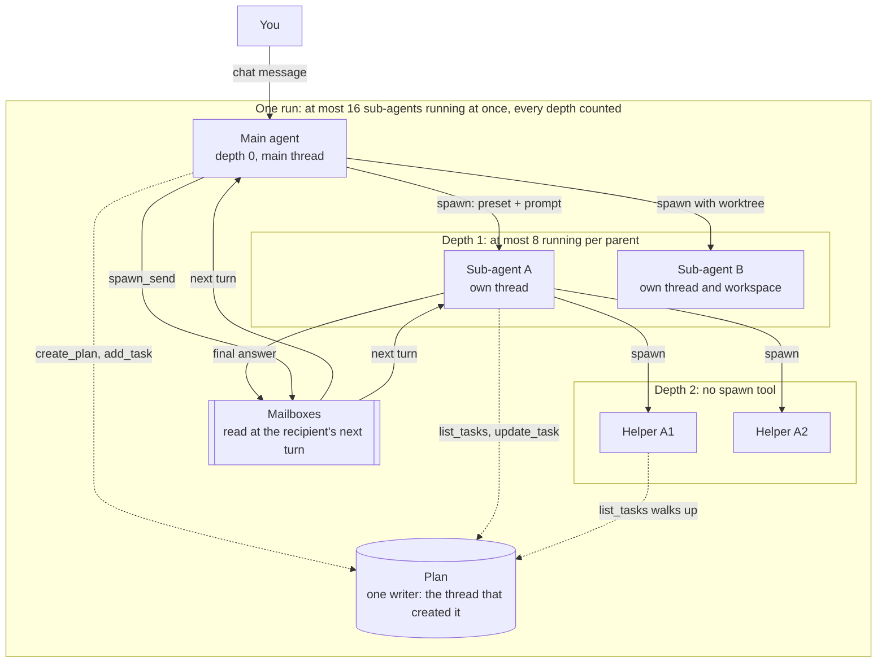
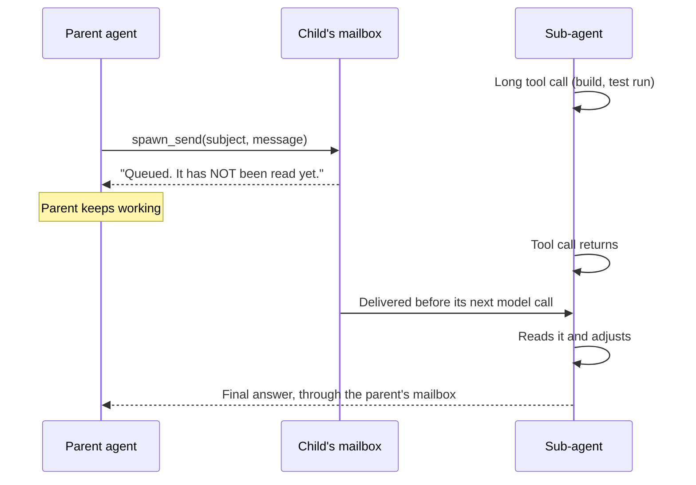

**In short**

- A sub-agent is a new agent in a **thread of its own**. It starts with your prompt, its preset and the project's memory, not with the parent's conversation. Only its final answer comes back to the parent.
- Spawning nests **two levels deep**: the main agent's sub-agents may start sub-agents of their own, and those cannot.
- By default one agent runs at most **8** sub-agents at once and a whole run at most **16**. Two run inputs change this, and a spawn past either cap is refused, not queued.
- Sub-agents **read the nearest ancestor's plan**. Only the thread that owns the plan can change its shape. A sub-agent reports progress on its task with `update_task`.
- Messages between agents go into a **mailbox** that is read at the recipient's next turn. A sent message is queued, not yet read.

## The problem this solves

An agent's context window is its working memory, and every tool result lands in it. Say you ask one agent to audit eight services. It reads thousands of lines of code, runs searches, and collects logs, all in one conversation. By the fourth service the window holds the first three services' raw output, and the agent either compacts it or reasons over noise. The work that matters, comparing findings and deciding what to do, happens in the most crowded part of the conversation.

The usual workaround is to run several agents in separate terminals and copy results between them by hand. That isolates context, but you become the scheduler and the message bus. Nobody tracks which agent owns which piece, and two agents editing one checkout overwrite each other.

Reliant builds the isolation into the run. A parent agent hands a unit of work to a sub-agent with the `spawn` tool. The sub-agent does the reading in its own thread and returns a summary. The parent's window holds the summary, not the reading. The parent stays free while children work, so it can plan, start more children, or answer you.

## How it works

The diagram shows one run: the main agent, its sub-agents at two depths, the plan they share and the mailboxes that carry results and messages.



### A spawn creates a new thread

A thread is a sequence of messages: user input, model responses and tool results. Every chat has a main thread, and [threads](/features/threads) explains the three modes a workflow node can use: `inherit`, `new` and `fork`.

A spawn always uses `new`. The runtime creates an empty thread and adds your prompt as its first user message. It then runs the [built-in agent workflow](/workflows/spawn) with the preset you chose, which sets the model, tools and system prompt. The sub-agent does not see the parent's transcript or tool results. It knows only what the prompt says, plus what any agent gets, such as the project's memory files. Resuming a sub-agent with `spawn` and its `agent_id` reuses that agent's own thread, so it continues where it left off.

The child also inherits two things from its parent: the parent's permission tier, and its working directory unless you name a workspace (see [Threads and worktrees](#threads-and-worktrees)).

### The call returns at once

`spawn` returns a handle, the new agent's id, as soon as the thread exists. The child's turns run in the background, inside the parent's execution. [How workflows run](/deep-dives/how-workflows-run) covers why: cancelling or pausing a run covers everything it started, and a long run that hands off to a fresh execution carries its live sub-agents with it.

While children run, the parent keeps working. Three tools manage them, and each is offered only when it has something to act on:

| Tool | What it does | On the tool list when |
| --- | --- | --- |
| [`spawn_status`](/reference/tools#spawn_status) | Lists your direct sub-agents, or shows one agent's status and last message. With `wait: true` it blocks until that agent finishes. | The agent has sub-agents, from the turn after its first spawn |
| [`spawn_send`](/reference/tools#spawn_send) | Queues a message for a sub-agent, or for your own parent. | The agent has a parent or sub-agents to message |
| [`spawn_stop`](/reference/tools#spawn_stop) | Asks a direct sub-agent to stop at its next step boundary. | The agent may spawn or has spawned |

A parent whose turn ends while it still has running sub-agents does not finish. It waits, and it wakes when a message reaches its mailbox.

### Results and messages go through a mailbox

Each thread has a mailbox. When a sub-agent finishes, the runtime writes its final answer into the parent's mailbox, marked completed, cancelled or failed. `spawn_send` writes into the same kind of mailbox. So does a message you type into a sub-agent's thread in the app.

A mailbox is read only at a step boundary of the recipient's agent loop, the moment before its next model call. The recipient sees one notice listing everything that arrived since its last action, in order, followed by the messages themselves. The notice tells the model these arrived after its last action and may change its plan.



This timing explains the tool's wording. `spawn_send` returns "Queued for delivery", and the receipt says the message has not been read. A child in the middle of a 10-minute test run reads your message after the test run returns, not before. `spawn_stop` is a request on the same terms: the agent stops at its next step boundary. `spawn_status` with `wait: true` is how you learn that a stop actually landed.

Sending also wakes the recipient. Without that, a parent waiting on its children would not read a child's message until some other child finished.

`spawn_send` goes only between a parent and its direct children. The id `parent` always names your own parent. A message to a sibling or an unrelated agent is refused.

### Two levels of nesting

Each agent carries a spawn depth: 0 for the main agent, 1 for its sub-agents, 2 for theirs. The limit is a constant, `MaxSpawnDepth = 2`. An agent at depth 2 is never offered `spawn`, whatever its preset declares. If it asks for one anyway, it is told:

```text
Spawning is not available to this sub-agent: spawn nests at most 2 levels deep, and this agent is already at that depth (it was spawned by a sub-agent), so it cannot spawn sub-agents of its own. Do the work yourself, one item after another, or tell your parent (spawn_send) which parts it should fan out.
```

The spawn tool tells each agent where it sits. A depth-1 agent is told that its children cannot spawn, so it should give them leaf work and never tell one to "fan out". The main agent is told that a sub-agent it hands a large slice may fan it out once more.

This makes an orchestrator, worker and helper shape possible. The main agent splits a project into areas, a worker per area splits its area into units, and helpers do the units.

### Concurrency caps

Two inputs on the run cap how many sub-agents run at once:

| Input | Default | Range in the built-in agent | Caps |
| --- | --- | --- | --- |
| `max_concurrent_sub_agents` | 8 | 1–64 | One agent's running sub-agents. Each agent's own children count; a sibling's don't. |
| `max_concurrent_sub_agents_total` | 16 | 1–256 | The whole run's running sub-agents, at every depth. |

The defaults are constants in the runtime. The built-in agent workflow declares both inputs, hidden in the app. The runtime reads them once, from the inputs of the run's root workflow, and applies them to every agent in the run. A missing or non-positive value keeps the default. A workflow of your own sets them by declaring inputs with the same names.

A sub-agent holds its slot from the moment its spawn is admitted until it finishes. A sub-agent parked on a question or approval is still running and still holds its slot.

A spawn past a cap is refused, and nothing starts. The tool result names the cap and the input that sets it, and tells the agent to wait for a sub-agent to finish and spawn again. It also says not to merge units of work to fit under the limit. The spawns in one batch are admitted in order, so a batch that crosses a cap starts the ones that fit and refuses the rest.

The caps are ceilings, not targets. Above about six concurrent sub-agents the model provider starts throttling and every agent slows down. The spawn tool tells agents to keep about six running and start the next as one finishes.

### The plan sub-agents can read

Plans and tasks are keyed by thread, and a sub-agent's thread is new, so on its own it would have no plan. Reads walk up instead. When a sub-agent calls `list_tasks`, `get_plan` or `list_ready_tasks` and its thread has no plan, Reliant follows the parent links to the **nearest** thread that has one. A sub-agent that makes a plan of its own works to that plan, and its children see it as their nearest ancestor's.

Writes do not walk up. `add_task`, editing the plan and adding dependencies apply only to the calling thread's own plan. On an inherited plan they are refused with a message naming the thread that owns it. Several sub-agents share one board, so it has one writer, and nothing has to resolve conflicting edits to its shape.

What a sub-agent can change is a task row. `update_task` resolves a task number against the plan the sub-agent can see, so an agent spawned for task 4 can mark task 4 in progress and then completed, and set itself as the assignee. Siblings see the assignment in `list_tasks` and skip claimed work.

So the plan works as a delegation board: the parent writes tasks at the size of one sub-agent's job, and the children report on them.

## Threads and worktrees

A sub-agent works in its parent's working directory unless you give it a workspace. Context isolation does not isolate files: two sub-agents editing one checkout can still overwrite each other.

For edits that run in parallel, the parent first creates a workspace with the [`worktree` tool](/reference/tools#worktree) (`action: create`, a `name`, optionally a `base_branch`). Then it names the workspace in the spawn: `spawn(worktree="<name>")`. The sub-agent's working directory becomes that checkout, on its own branch, so its shell and file tools work there. The workspace shows up in the app's sidebar like one you made yourself. You can open it, review its branch and archive it.

A workspace exists on one machine's disk, so a sub-agent with its own workspace always runs on the machine that holds it. [How chats, workspaces and machines fit together](/deep-dives/chats-worktrees-machines) covers that rule and what follows from it. [Workspaces](/features/worktrees) covers creating them from the app and from workflow nodes.

## Design decisions and trade-offs

**Sub-agents get a prompt, not a copy of the conversation.** The alternative is `fork`: copy the parent's messages into the child, as a workflow node can. That would save writing a brief, but every child would start with the parent's full window, which is the cost spawning exists to avoid. The cost of the choice is that the brief is the child's whole world. A vague prompt makes the child rediscover what the parent already knew. Writing shared findings to a file and naming its path in each prompt keeps briefs short and complete.

**Spawn is asynchronous.** A blocking spawn would be simpler to reason about, since the result would arrive in the same turn. It would also hold the parent idle and make a fan-out of six take six times as long. Asynchronous spawning means the parent must be written to react to results in later turns, and the tools say so.

**Depth is capped at 2.** Unbounded recursion lets one runaway agent multiply into dozens. Depth 1 would forbid the orchestrator, worker and helper shape that large tasks need. Two levels allow one more split and stop there. The cost is that a depth-2 helper that finds more parallel work has to do it serially, or tell its parent which parts to fan out.

**A spawn past a cap is refused, not queued.** A hidden queue would let an agent think work had started when it had not. A refusal is a tool result the agent reads and acts on. The cost is that the agent has to retry, which it is told to do once a child finishes.

**The plan has one writer.** Letting every sub-agent edit the shared plan would make one task list a piece of shared memory with no conflict resolution. Reads walking up was the part that was missing; before it, sub-agents built private plans of their own and the parent's board never reached them. Keeping writes local costs a sub-agent the ability to add a task it discovers. It reports the new work to its parent instead, or plans it in a plan of its own.

**Messages are delivered between turns.** Interrupting a model mid-call or mid-tool would lose work. Delivering at step boundaries keeps every turn whole. The cost is latency: a message waits for the current tool call to return.

## Limits and what it does not do

- **Nesting stops at depth 2.** This is a constant in the runtime, not an input you can change.
- **The concurrency caps are defaults.** 8 per agent and 16 per run, set by `max_concurrent_sub_agents` and `max_concurrent_sub_agents_total` on the run's root workflow. A value set on a nested workflow is not read. The built-in agent accepts up to 64 and 256.
- **No queue.** A refused spawn starts nothing and holds no slot. The agent spawns again later.
- **A sent message is not a read message.** Delivery waits for the recipient's next turn. A message queued to an agent whose loop exits before that turn is marked undelivered.
- **Messages go parent to child only.** Siblings cannot message each other, and `spawn_stop` and `spawn_status` see only your direct children. Siblings coordinate through the parent or through the plan.
- **A finished agent is not woken by a message.** `spawn_send` to a completed or stopped agent is refused. Resume it with `spawn` and its `agent_id`. A sub-agent that stopped on an error is the exception: a message from its parent resumes it.
- **Every spawn runs the built-in agent.** The preset selects its behavior. You cannot pass arbitrary parameters, only a preset from the allowed list.
- **Context isolation is not file isolation.** Without a workspace, sub-agents share the parent's checkout.
- **Branching a chat does not hand over its sub-agents.** A branch lists the original's sub-agents read-only. Their results keep going to the original chat ([sub-agents and branching](/workflows/spawn#branching-a-chat-that-has-sub-agents)).

## See it for yourself

The output below was captured from inside a real run: the agent that wrote this page is a depth-2 sub-agent of a docs orchestrator.

**The two-level tree of a run.** `reliant workflow status` prints a run's node tree. Each `builtin://agent` row is a sub-agent, and indentation is depth. Nothing is indented a third level. The execution id is the chat id:

```bash terminal
reliant workflow status 1ea43ece-9763-5119-b2a2-e23dc8a2de6b
```

```text
Execution 1ea43ece-9763-5119-b2a2-e23dc8a2de6b
  Workflow:  builtin://agent
  Status:    RUNNING
  Started:   2026-11-20T05:15:55Z
  Open questions: 0   Open approvals: 0

NODE THREADS (child workflows)
  builtin://agent  [COMPLETED]  2m52s
  builtin://agent  [COMPLETED]  3m55s
    builtin://agent  [COMPLETED]  2m43s
    builtin://agent  [COMPLETED]  2m30s
  ...
  builtin://agent  [RUNNING]
    builtin://agent  [COMPLETED]  33m53s
    ...
    builtin://agent  [RUNNING]
    builtin://agent  [RUNNING]
    builtin://agent  [RUNNING]
```

The running depth-1 agent in that output has six depth-2 children running, under its cap of 8. The tree names the workflow, not each agent's title. Use the thread tabs in the app (**All**, **Main**, one per sub-agent) to read a particular sub-agent's conversation.

**The inherited plan.** A sub-agent with no plan of its own that calls `list_tasks` gets its ancestor's board, with a header that says so. Trimmed:

```text
Tasks for Plan (Total: 7):

This plan belongs to an ancestor thread (1ea43ece-9763-5119-b2a2-e23dc8a2de6b) — you are reading the board you were spawned from.
You cannot modify it; update the task you were given, or create_plan for work of your own.

Status Summary:
- Pending: 0
- In Progress: 1
- Completed: 5
- Blocked: 1
```

That plan belongs to the main thread, two hops up. The depth-1 orchestrator in between made no plan of its own, so the walk went past it.

**The tool list at depth 2.** The same sub-agent's tool list includes `spawn_send`, because it has a parent to report to. It has no `spawn`, because it is at the depth limit, and so no `spawn_stop`. It has no `spawn_status`, because it has no sub-agents to look at.

**Lower the caps for a run.** To start the built-in agent with tighter caps from the CLI, pass the inputs as JSON numbers in a file. Values given with `--input key=value` are sent as strings, and an integer input does not parse text.

```json caps.json
{ "max_concurrent_sub_agents": 4, "max_concurrent_sub_agents_total": 8 }
```

```bash terminal
reliant workflow run agent --project-path . --input-file caps.json -m "Audit each service under internal/ for unchecked errors"
```

This starts a real run on your account. `reliant workflow status <chat-id>` then shows its tree as above.

## Guides

- [Delegate work to parallel sub-agents](/guides/workflows/delegate-to-sub-agents): use spawn, spawn_send, spawn_status and spawn_stop, with a plan and briefing files
- [Run parallel coding agents in separate git worktrees](/guides/workflows/parallel-agents-git-worktrees): give each agent its own workspace and branch, then join the results
- [Best of Three](/guides/best-of-three): a built-in workflow that runs three candidates in separate workspaces
- [Build your first multi-agent workflow](/guides/workflows/first-multi-agent-workflow): agents as workflow nodes, each with its own thread

## Reference

- [Sub-agents](/workflows/spawn): the `spawn` tool's parameters, `spawn_presets`, errors and resuming.
- [Threads](/features/threads): thread modes, `memo`, `inject` and the `thread.*` CEL fields.
- [Workspaces](/features/worktrees): creating, using and cleaning up workspaces.
- [Tools reference](/reference/tools): [`create_plan`](/reference/tools#create_plan), [`list_tasks`](/reference/tools#list_tasks), [`update_task`](/reference/tools#update_task), [`spawn_send`](/reference/tools#spawn_send), [`spawn_status`](/reference/tools#spawn_status), [`spawn_stop`](/reference/tools#spawn_stop), [`worktree`](/reference/tools#worktree).
- [Presets](/workflows/presets): what a preset sets for a sub-agent.
- [Workflows CLI](/cli/workflows): `reliant workflow run`, `status` and `watch`.
