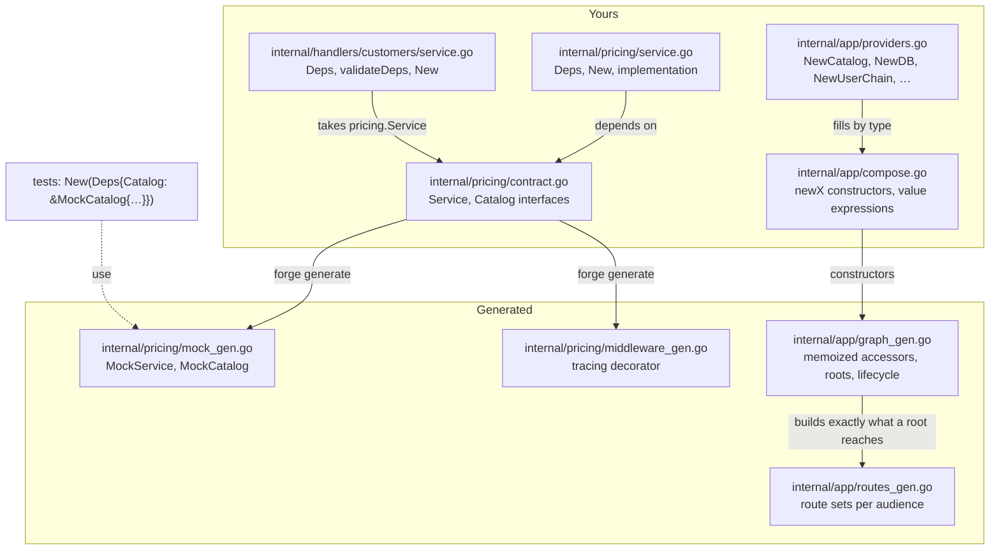

A forge project is built from small components that each declare what they need, and a composition root that supplies it. This page covers the pieces: the `contract.go` file that defines a package's boundary, the `Deps` struct every component takes, the mocks forge generates so tests never need hand-written fakes, and the two files in `internal/app/` where everything is connected.

The point of the arrangement is that wiring is mechanical. A component says what it needs by naming types, forge fills each need by type, and a mistake (a missing dependency, a concrete type where an interface belongs) fails at generate, lint or construction time rather than on the first request.

## The package and its flow



Read it from the top left. You write `contract.go` and `service.go`. Forge reads `contract.go` and writes a mock and a tracing decorator beside it. The composition root, in `internal/app/`, is where the packages meet: `providers.go` says how to build the things that are not components, `compose.go` holds one constructor per component, and `graph_gen.go` ties them into memoized accessors.

## `contract.go`: the boundary of a package

An internal package that does real work (talks to a database, calls an outside API, holds state) exposes one Go interface in `contract.go`. `forge scaffold package pricing` writes the package; the scaffolded files are `contract.go`, `service.go`, `contract_test.go`, `observe_chain.go`, and the generated `mock_gen.go` and `middleware_gen.go`.

Here is a contract with one method and one dependency, as used for this page:

```go
// internal/pricing/contract.go
package pricing

import "context"

// Service defines the pricing package boundary.
type Service interface {
	// Quote prices qty units of sku, in cents.
	Quote(ctx context.Context, sku string, qty int) (int64, error)
}

// Catalog is the one thing pricing needs from the product catalog.
type Catalog interface {
	UnitPrice(ctx context.Context, sku string) (int64, error)
}
```

`Service` is what other packages see. `Catalog` is what this package needs from someone else, and it lives here, in the package that uses it, with only the one method `pricing` calls. That is deliberate. Declare an interface where it is consumed, and keep it narrow: a one- or two-method interface is a real abstraction, and a ten-method one is a concrete type in disguise that leaks into every test. Two small local declarations are better than one shared exported one.

The implementation takes its dependencies through a `Deps` struct and returns the interface:

```go
// internal/pricing/service.go
type Deps struct {
	Logger  *slog.Logger
	Config  *config.Config
	Catalog Catalog
}

func New(deps Deps) (Service, error) {
	return &service{deps: deps}, nil
}
```

Every field you add to `Deps` must be an interface (or a function or plain data), with `Logger` and `Config` as the two carve-outs. `forgeconv-deps-are-interfaces` is an error, because `Store *db.PostgresRepository` compiles and then makes every test of the package open a real database. Related rules in the same family run on every component's `Deps`:

| Rule | Catches |
|---|---|
| `forgeconv-deps-are-interfaces` | A concrete struct in `Deps`, which defeats the all-mock unit-test surface. |
| `forgeconv-deps-surface` | An interface field with methods the package never calls. An error when the interface is foreign and has more than ten methods; `forge fix narrow-deps <pkg>` writes the narrow interface for you. |
| `forgeconv-no-container-deps` | A service locator or an `any` field. |
| `forgeconv-deps-no-downcast` | Type-asserting a dependency back to its concrete type. |
| `forgeconv-no-getenv` | Reading the process environment inside a component; config arrives through `Deps` instead (see [The config system](/forge/concepts/config-system)). |
| `forgeconv-internal-package-missing-contract` | A package made by hand, so wiring, mocks and tracing (which all key on `contract.go`) cannot see it. |

`forge lint --conventions` runs the `forgeconv-*` family, and a rule that is new to a forge release warns for one release before it gates. A single finding that is genuinely fine can be suppressed in place with `//forge:lint-disable-next-line <rule>: <reason>`, and an error-severity rule requires the reason.

<Note>
A handler package, which is a service rather than a domain package, has no `contract.go`. Its methods on `*Service` are the handlers. When a handler's logic needs transport-free tests, or a worker or another service also calls it, move that logic into a package like `pricing` and have the handler take the package's `Service` as a `Deps` field.
</Note>

## Generated mocks

Run `forge generate` and every `contract.go` gets a sibling `mock_gen.go` holding a mock for **every** interface in the file, not only `Service`. This is what was written for the contract above:

```go
// Code generated by forge. DO NOT EDIT.
// Source: contract.go in this package.

// MockCatalog is a test mock for the Catalog interface.
//
// The embedded contractkit.Recorder records every call so tests can
// assert call counts and captured arguments. Set XxxFunc fields to
// override per-method behaviour; unset methods return the canonical
// "MockCatalog.<Method>Func not set" error.
type MockCatalog struct {
	contractkit.Recorder
	UnitPriceFunc func(context.Context, string) (int64, error)
}

// UnitPrice records the call and delegates to UnitPriceFunc when set.
func (m *MockCatalog) UnitPrice(ctx context.Context, sku string) (int64, error) {
	m.Recorder.Record("UnitPrice", ctx, sku)
	if m.UnitPriceFunc != nil {
		return m.UnitPriceFunc(ctx, sku)
	}
	return 0, contractkit.MockNotSet("MockCatalog", "UnitPrice")
}

// Compile-time check.
var _ Catalog = (*MockCatalog)(nil)
```

A test scripts a case by setting `UnitPriceFunc`, and asserts with `m.Calls("UnitPrice")` or `m.CallCount("UnitPrice")`. Because the mock is generated from the interface, it cannot drift from it: add a method to `Catalog` and the next `forge generate` adds the field and method. A hand-written fake is a second implementation that agrees with whatever bug its author had, which is why forge generates the mock and `lint` points you at it.

Two details are worth knowing. `contract.go` and `mock_gen.go` are an edit pair: adding a method to an interface breaks the compile-time conformance check until the mock catches up, so re-run `forge generate` after editing a contract. And only interfaces declared in `contract.go` get mocks, so declare dependency interfaces there rather than in `service.go`.

Services get the same treatment from the proto. `internal/handlers/mocks/customers_mock_gen.go` holds a `CustomersServiceMock` with one `<Rpc>Func` field per RPC, and an unset field returns `svcerr.Unimplemented`.

### The tracing decorator

A package whose `New` carries the `forge:constructor` marker (the scaffold adds it) also gets `middleware_gen.go`, a decorator that routes every `Service` method through an in-process chain: span, metrics, structured log and panic recovery.

```go
func (o *forgeMiddlewareService) Quote(ctx context.Context, sku string, qty int) (int64, error) {
	return o.chain.Around(ctx, "pricing.Quote", func(ctx context.Context) (int64, error) {
		return o.inner.Quote(ctx, sku, qty)
	})
}
```

The decorator records the method name, duration and error status, and captures no arguments or results. You tune the chain in the owned `observe_chain.go`. `// forge:no-observe` on the constructor opts a package out, and on a single method it skips just that method. [Observability](/forge/observability) covers where those spans go.

## Handler `Deps` and `validateDeps`

A service's handler package follows the same shape. This is the scaffolded `internal/handlers/customers/service.go` after the entity above was added:

```go
type Deps struct {
	DB     orm.Context
	Logger *slog.Logger
	Config *config.Config
	// Add your dependencies here (e.g. Repo Repository). Required ones get
	// a validateDeps() check below. Tag intentionally-optional fields with
	// the `forge:optional-dep` directive directly above the field.
}

// validateDeps returns an error if any required Deps field is nil. The
// gate runs once at construction so handlers need no per-RPC nil-checks.
func (d Deps) validateDeps() error {
	if d.Logger == nil {
		return fmt.Errorf("customers: Deps.Logger is required")
	}
	if d.Config == nil {
		return fmt.Errorf("customers: Deps.Config is required")
	}
	if d.DB == nil {
		return fmt.Errorf("Deps.DB is required by the generated CRUD handlers — set DATABASE_URL (the generated bootstrap constructs the ORM client from it)")
	}
	…
}

func New(deps Deps) (*Service, error) {
	if err := deps.validateDeps(); err != nil {
		return nil, err
	}
	return &Service{deps: deps}, nil
}
```

Two things are worth noticing. First, forge added the `DB` field and its check itself when the table appeared, because the generated CRUD handlers need the ORM. The file is yours, so you can edit anything in it, but forge extends the pieces it knows are required. Second, `validateDeps` runs once, when the service is constructed. A required dependency that is `nil` is a boot error naming the field, not a nil-pointer panic on the first request. Handlers therefore contain no defensive nil checks. Mark a dependency that is genuinely optional with the `forge:optional-dep` directive so it is skipped.

## Where the wiring lives

Four files in `internal/app/` assemble the process. Two are yours (one of them kept in shape by forge) and two are generated:

| File | Owner | What it holds |
|---|---|---|
| `providers.go` | You, written once | Functions shaped `func New<X>(<X>Deps) (T, error)` that build things that are not handlers or packages: the database pool, the ORM client, the HTTP client, the auth validator, the interceptor chain, the listener. |
| `compose.go` | You, reconciled by forge | One `new<X>` constructor method per node, holding the value expression for every `Deps` field. |
| `graph_gen.go` | Generated | The `Graph` type, one memoized accessor `g.<X>()` per node, each root's `Build` and `Run`. |
| `routes_gen.go` | Generated | A route set per audience, mounting every service whose proto declares that audience. |

A **provider** is any function in `providers.go` that takes a `<X>Deps` struct and returns the value. Forge discovers it, resolves each field of its `Deps` by type, and the result becomes available to anything that asks for that type. This is the scaffolded `NewORM`:

```go
// ORMDeps is the pool the ORM client runs on.
type ORMDeps struct {
	DB *DB
}

// NewORM is the ORM client over the serving pool — what a handler's
// `DB orm.Context` Deps field resolves to. No database, no client.
func NewORM(d ORMDeps) (*orm.Client, error) {
	if d.DB.DB == nil {
		return nil, nil
	}
	return orm.NewClientWithDB(d.DB.DB, "postgres")
}
```

Identity is the Go type, which is why two listeners are two distinct types (`type APIListener struct{ *serverkit.Listener }`) and why resolution needs no names. A provider whose value has `Run`, `Drain`, `Close` or `Ready` methods is supervised: started after everything it depends on, drained and closed before them. Nothing is opened eagerly. A process builds only what its root reaches, so a provider nothing reaches is never constructed and never dialed.

### How `compose.go` is reconciled

`compose.go` is the one hybrid file. You own it, in the sense that forge never rewrites the expressions you put in it. But `forge generate` keeps its **shape** in sync with the code:

- a node with no `new<X>` method (a service, package, worker or provider you just added) gets one, with each `Deps` field resolved by type;
- a `Deps` field a node gained gets its key added, and a key whose field no longer exists is dropped;
- a key that two nodes could fill is a generate error until you write the value yourself.

Adding a `DB orm.Context` field to the `customers` handler is enough to see it happen. Before, `compose.go` had:

```go
func (g *Graph) newCustomers() (*customers.Service, error) {
	return customers.New(customers.Deps{
		Logger: g.Log,
		Config: g.Cfg,
	})
}
```

After `forge generate`, with no edit to `compose.go` by hand:

```go
func (g *Graph) newCustomers() (*customers.Service, error) {
	return customers.New(customers.Deps{
		Logger: g.Log,
		Config: g.Cfg,
		DB:     g.ORM(),
	})
}
```

A package gets its entry in the same way, and `compose.go` wraps its constructor in the tracing decorator:

```go
func (g *Graph) newPricing() (pricing.Service, error) {
	svc, err := pricing.New(pricing.Deps{
		Logger: g.Log,
		Config: g.Cfg,
	})
	if err != nil {
		return nil, err
	}
	return pricing.NewServiceWithForgeMiddleware(svc), nil
}
```

Change what fills a field by editing its expression here. Forge will not touch it again. If you want to stop reconciliation altogether, `forge project disown internal/app/compose.go --reason "<why>"` opts out (see [Generated vs yours](/forge/concepts/generated-vs-yours)).

### What happens when a dependency has no provider

When a component asks for a type that nothing provides, forge says so rather than leaving a `nil`. After the `pricing` package above gained a `Catalog` field and no provider existed for it, `forge generate` reported:

```text
⚠️  1 node(s) no root reaches are left out of the composition graph, because forge cannot fill their Deps: Pricing. graph_gen.go has no accessor for them and compose.go gets no constructor until a root reaches one — then generate names every provider it lacks. `forge lint --graph` reports each (forge-graph-unreachable)
```

Two cases follow from that message. A component that no process uses yet is left out of the graph, with `forge-graph-unreachable` reported by `forge lint --graph`. The moment a root (a process's entry point, by default the binary's `server`) reaches it, which happens as soon as a handler takes it as a `Deps` field, an unfillable field fails `forge generate` and names every provider it lacks. Either way, fix it by adding a provider (`func NewCatalog(CatalogDeps) (pricing.Catalog, error)`) to `providers.go`, and the next generate resolves the field. This is the "fails loudly" property: a dependency graph that cannot be built is a generate-time error, not a production incident.

### Roots

A **root** is what a single process runs. The scaffold generates one, `Server`, behind `<binary> server`, and `cmd/<binary>/cmd/roots_gen.go` makes one command per root. Splitting a process (an API in one pod, workers in another) means declaring another root in `internal/app`, not adding a command per service. Each root's `Run` builds exactly the closure of nodes it reaches, starts them in dependency order so a listener accepts traffic only after everything behind it is up, and stops them in reverse.

## Related topics

[Middleware and the request path](/forge/concepts/middleware-and-request-path) follows a request through the chain `NewUserChain` builds. [The config system](/forge/concepts/config-system) explains where `Config` comes from. Agents can load the `contracts`, `service-layer`, `interactor` and `architecture` skills for the full conventions.
