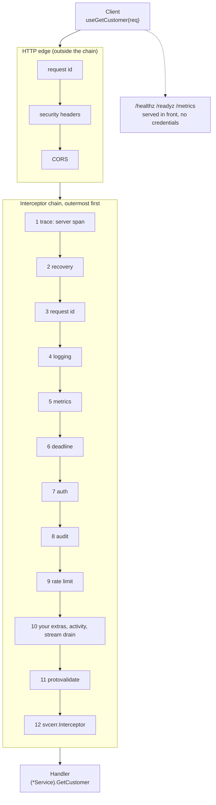
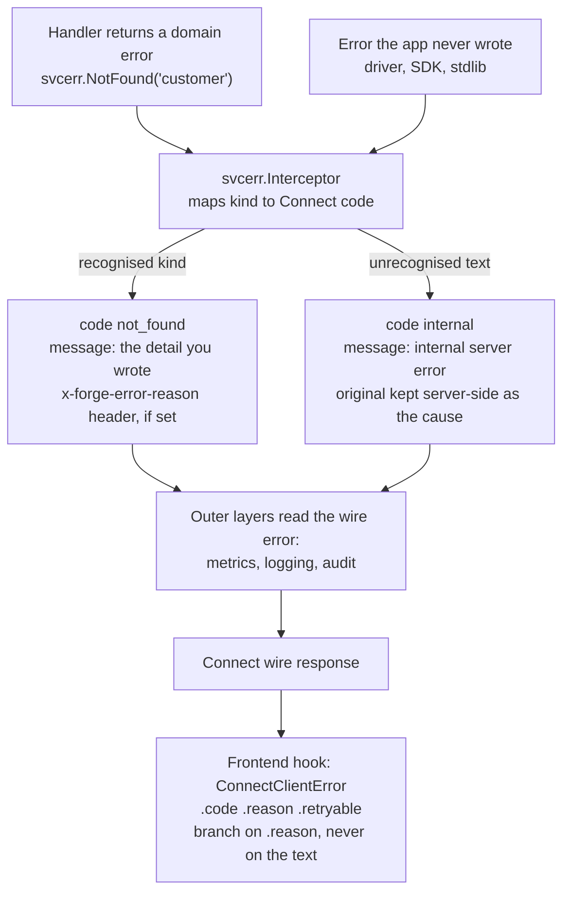

Every request a forge service answers passes through the same ordered stack of layers before it reaches your handler. The stack is built once, by one library function, from slots that each have a working default. You do not assemble it in `main`, and you cannot forget a layer by leaving a line out, which is the property that matters most when many agents are adding services to the same project.

This page walks the request path in order, then the path an error takes on the way back, and ends with how to change or drop a layer. For where the chain is built and handed to the listener, see [Contracts and dependency injection](/forge/concepts/contracts-and-injection#where-the-wiring-lives). For where the logs, metrics and traces this chain produces end up, see [Observability](/forge/observability).

## The request path

A browser hook, or any Connect, gRPC or JSON client, sends the request to the process's one HTTP listener. The listener serves every service on one mux at one origin. The request first meets a thin HTTP layer, then the interceptor chain, then the handler.



Read the middle box top to bottom: the first layer sees the request first and the response last. Two placements are deliberate. The trace layer is outermost, so a request that auth rejects still has a span and every log line carries its `trace_id`. And `svcerr.Interceptor` is innermost, next to the handler, so every layer outside it sees the already-mapped wire error.

The order, with what each layer does:

| # | Layer | What it does |
|---|---|---|
| 1 | Trace | Opens the server span, sets pprof labels so profile samples tie to the span, and returns the trace context in a `traceresponse` header, on failures too. An inbound `traceparent` becomes the span's parent unless you narrow whom to trust. |
| 2 | Recovery | Turns a panic in anything below into `Internal`. The panic value and stack are logged; the client gets only `internal server error`. |
| 3 | Request id | Uses the id already in the context, else the inbound `X-Request-Id`, else mints one. Whichever layer chose the id echoes it, so the response carries exactly one. |
| 4 | Logging | Writes `rpc failed` for every failure and `rpc completed` for successes, with procedure, duration and request id. |
| 5 | Metrics | Records `rpc.server.calls`, `rpc.server.errors` and `rpc.server.duration`, labelled by procedure, and the error counter by `code` and `error_class`. |
| 6 | Deadline | Bounds the RPC's time and warns about one still running. Runs before auth, so a slow token lookup counts against the budget. |
| 7 | Auth | Proves who is calling. Fails closed (below). |
| 8 | Audit | Records who called what, reading the caller auth admitted. |
| 9 | Rate limit | Throttles by the authenticated caller, when `RATE_LIMIT_RPS` is above zero. |
| 10 | Extras, activity, stream drain | Your own interceptors, then the typed activity event an RPC declares, then the binding that lets a rollout end a long-lived stream with a status clients redial on. |
| 11 | Protovalidate | Rejects a request whose `buf.validate` rules fail with `InvalidArgument`, right before the handler. |
| 12 | `svcerr.Interceptor` | Maps the handler's error to its Connect code (below). |

Beyond the interceptors, the chain applies payload caps: 4 MiB each for a request and a response by default. `connect-go` reads and decodes a whole body before any interceptor can reject it, so an uncapped handler turns one anonymous request into an out-of-memory kill.

### The HTTP edge

CORS, security headers and the request id sit in front of the chain as ordinary HTTP middleware. The CORS preflight is answered before anything else runs, which is why a header your web client adds must be listed in `CORS_ALLOW_HEADERS` or the browser refuses every call. Outside development, HSTS is on and CORS allows only `CORS_ORIGINS`; with the `environment` field set to exactly `development`, an origin-reflecting policy applies instead so a local frontend works with no setup. Probes and `/metrics` are served in front of both, so a kubelet or scraper reaches them without credentials or CORS. Forge refuses to start a listener whose config turns on CORS or security headers but supplies no implementation, so the layer cannot be silently absent.

### Deadlines

Every unary RPC gets a 30 second server deadline by default, streams are unbounded, and a unary RPC still running after 10 seconds is logged at WARN while it runs. Give one RPC its own budget in the proto, and forge projects it into `pkg/middleware/procedures_gen.go`:

```protobuf
rpc Export(ExportRequest) returns (ExportResponse) {
  option (forge.v1.method) = { timeout: { seconds: 120 } };
}
```

A negative timeout means no server deadline for that RPC.

## Auth fails closed

Authentication is the one slot the chain refuses to default. Building a chain with no authenticator is an error, so a server that authenticates nobody cannot be created by forgetting a line. In the scaffold, `providers.go` builds the authenticator from your `SetupAuth` validator and passes `AnonymousOK: false`; a server with no validator is a boot error, not a running process.

What follows from that is the rule an RPC author sees: **every RPC requires a valid token unless its proto says otherwise.** Making one public is a single edit next to the RPC:

```protobuf
rpc GetStatus(GetStatusRequest) returns (GetStatusResponse) {
  option (forge.v1.method) = { auth_required: false };
}
```

Forge projects that annotation into the generated allow-list, using Connect's own procedure constants:

```go
// UnauthenticatedProcedures is the set of RPCs a caller may reach with no
// credentials. The auth interceptor reads it, and everything not in it is
// rejected before any handler runs.
//
// It is DERIVED, not maintained: an RPC is here because its proto says
// auth_required: false, and for no other reason.
var UnauthenticatedProcedures = map[string]struct{}{
	"/grpc.health.v1.Health/Check": {},
	"/grpc.health.v1.Health/Watch": {},
}
```

Matching is exact, never by substring, and an RPC that is renamed or deleted breaks the build instead of leaving a string that matches nothing.

Auth decides only whether the caller is signed in. What they may see and change is your code: read the caller with `middleware.GetUser(ctx)` in the handler and add the checks and row filters your product needs. The generated CRUD shims say so on every method (`Auth: AUTHENTICATED, UNSCOPED`), and `forge project audit` lists RPCs that are authenticated but never look at who the caller is. The `auth` skill covers validators, API keys and the dev identity provider.

Chains also carry an **audience**. A listener serving signed-in users and one serving a daemon or an operator are different chains with different authenticators, and a service declares which audience it belongs to. The listener refuses to start if it mounts a service of another audience, and `forge lint --graph` proves the same statically.

## The error path

Handlers return domain errors, never hand-built Connect errors. `forge/pkg/svcerr` provides the vocabulary, and the innermost interceptor translates it.



Follow a handler error down the left, through the interceptor, and out to the client. The interceptor sits closest to the handler, so everything outside it (metrics, logging, audit) sees the final code instead of a sentinel.

In a handler, the whole discipline is one line:

```go
if err != nil {
	return nil, svcerr.Wrap(err)
}
```

`Wrap` is idempotent, so wrapping an error twice is safe, and the interceptor applies it to anything a handler returns, so `return nil, svcerr.PermissionDenied("admin only")` also works. The constructors map to Connect codes one to one (`NotFound`, `InvalidArgument`, `AlreadyExists`, `PermissionDenied`, `FailedPrecondition`, `ResourceExhausted`, `Internal`, `Unauthenticated`, and the rest). Each carries a sentinel, so `errors.Is(err, svcerr.ErrNotFound)` keeps working server-side.

### What the client is allowed to read

The rule that makes this safe is about whose text is on the wire. A message the application chose, such as `svcerr.NotFound("customer")`, passes through. An error the application never wrote is a diagnostic: Postgres text can contain SQL, schema names and a connection string, and a vendor SDK's text routinely contains worse. So an unrecognised error becomes `CodeInternal` with the fixed message `internal server error`, and the original is kept as an unexported cause that reaches the log and stays reachable with `errors.Is` and `errors.As`.

Wrapping context follows the same rule. `fmt.Errorf("get customer %s from %s: %w", id, shard, err)` is context for the operator: it reaches the log, not the client. Text meant for the client goes in the constructor's argument, and `svcerr.WithCause(outer, cause)` attaches a server-only cause that decides nothing the client sees.

The one exception is a `*connect.Error`, which is a handler's explicit verdict and passes through untouched. That makes `connect.NewError(code, err)` the way to publish `err.Error()` by accident, so `forgeconv-handler-connect-error` flags every one in a handler package and `forge fix connect-errors` rewrites the fixed-text ones.

### Reasons, not message text

To give the frontend something stable to branch on, attach a reason:

```go
return nil, svcerr.WithReason(
	svcerr.FailedPrecondition("no active subscription"),
	"no_active_subscription",
)
```

It travels as the Connect metadata key `x-forge-error-reason`, which CORS exposes to browsers by default. The generated hooks surface it as `.reason` on `ConnectClientError` along with `.code`, `.codeName`, `.status` and `.retryable`, and `userMessage(err)` renders a displayable string. The generated CRUD layer stamps a reason from a fixed vocabulary on every error it produces, so a scaffolded frontend never reads a null reason on a CRUD path. For your own RPCs, pick snake_case codes and branch on those; message text can change without notice.

### Who has to act: error class

The logging layer also decides how loud an error is by who must act on it. A failure the caller caused (a validation error, a missing row, a disconnected client) is class `user` or `canceled` and logs at INFO. A server fault is class `server` and logs at ERROR, except `DeadlineExceeded`, `Aborted` and `Unimplemented`, which log at WARN. ERROR is what alerts match and what post-deploy gates fail on, so this keeps user mistakes from burying real faults. Nothing is hidden: a user error is still written with its error, class and code, and the metrics keep both labels so the volume stays countable. Override the classification for an error type forge cannot recognise with `observe.WithErrorClassifier`.

Successful calls log every time by default. Set `LOG_SUCCESS_SAMPLE_WINDOW` (for example `10s`) to log at most one success per procedure per window, with a `suppressed` count; failures and successes slower than one second are always logged.

## Changing the chain

The chain is built in `NewUserChain` in `internal/app/providers.go`, which is yours:

```go
chain, err := serverkit.NewChain(serverkit.ChainDeps{
	Auth:   d.Auth,
	Logger: d.Logger,
	Deadline:  serverkit.Deadline{Procedures: middleware.ProcedureDeadlines},
	RateLimit: fmw.RateLimitInterceptor(fmw.RateLimitOptions{Rps: int(d.Config.RateLimitRps), Burst: int(d.Config.RateLimitBurst)}, middleware.ClaimsFromContext),
	LogOptions: []observe.LogOption{observe.WithSuccessSampling(d.Config.LogSuccessSampleWindow.AsDuration())},
	ReadMaxBytes: d.ServerCfg.ReadMaxBytes,
	SendMaxBytes: d.ServerCfg.SendMaxBytes,
})
```

Every slot except `Auth` has a default. A field you set replaces that slot and runs in the same position. To drop one, say so explicitly with an `Omit` value, so removal is a visible line in a reviewed diff:

| Constant | Drops |
|---|---|
| `serverkit.NoTrace` | The server span. |
| `serverkit.NoDeadline` | Server deadlines and the slow-call watchdog. A wedged handler then holds its request until the client gives up. |
| `serverkit.NoAudit` | The audit record. |
| `serverkit.NoActivity` | Declared activity events. |
| `serverkit.NoStreamDrain` | Stream binding to the listener's drain. |
| `serverkit.NoValidate` | `buf.validate` checks. |

`Extras` takes your own interceptors; they run after rate limiting and before activity. Passing an `Omit` for the wrong slot, or a nil extra, is a construction error, as is a chain whose authenticator cannot name the caller for audit and activity (they would record every call as anonymous). A project that needs a second kind of caller builds a second chain with its own authenticator.

<Note>
Interceptors are for requests crossing the wire. Between your own packages, the per-package tracing decorator generated from `contract.go` does the equivalent job in process. See [the tracing decorator](/forge/concepts/contracts-and-injection#the-tracing-decorator).
</Note>

## Related topics

[Two sources of truth](/forge/concepts/two-sources-of-truth) explains how `auth_required` and `timeout` reach this chain from the proto. [The config system](/forge/concepts/config-system) lists the settings these layers read (`CORS_ORIGINS`, `RATE_LIMIT_RPS`, `LOG_SUCCESS_SAMPLE_WINDOW`). Agents can load the `auth`, `api` and `observability` skills.
