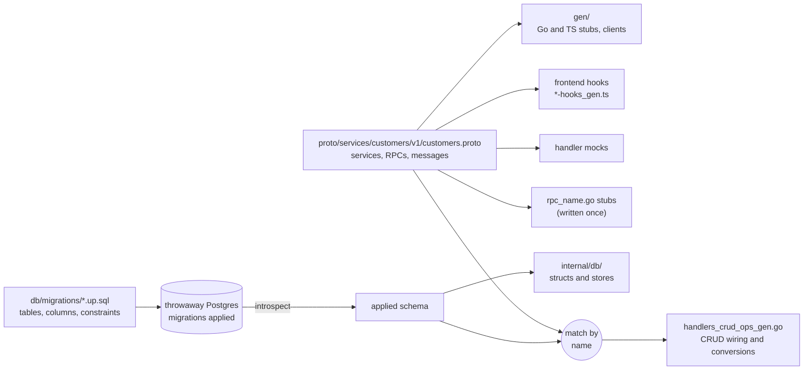

A forge project keeps two files-of-record, and each answers a different question. The **proto** files under `proto/services/` say what crosses the wire: which services exist, which RPCs they offer and what the messages look like. The **migrations** under `db/migrations/` say what is stored: tables, columns, constraints. Nearly everything else in the repository is a projection of one or both, and `forge generate` rewrites those projections whenever an input changes.

This page explains the split, shows what comes out of it, and covers the one rule that decides whether an RPC gets generated CRUD behavior. [Project anatomy](/forge/project-anatomy) has the directory layout, and [Adding a feature](/forge/adding-features) has the day-to-day loop.

## Why there are two

Putting the schema in the proto, or the API in the schema, looks tidier on paper, and forge used to do the first. Schema was declared with annotations on proto messages, and migrations were derived from them. The two have different lifetimes in practice. A column is added the day a feature starts and may never be shown to a client. A wire field is renamed for a new client while the column keeps its name for years. Tying them together meant every change to one forced a decision about the other, so forge removed the entity annotations and made SQL the only place a table is declared.

The result is that the two sides evolve on independent clocks, and the generated conversion code maps the **intersection of wire fields and columns by name**. A column with no matching wire field never leaks onto the wire. A wire field with no matching column never reaches the database. You can add either side first.

For an agent this removes a class of mistakes. There is no second schema language to keep in sync, so there is nothing to forget to update. Proto errors are caught by `buf`, schema errors by Postgres itself, and anything left over by `forge generate`, which fails loudly instead of guessing.



Read the diagram from the two inputs on the left. Everything on the right is generated, with the one exception of the `rpc_<name>.go` stubs, which forge writes once and you then own. The only place the two inputs meet is the match-by-name step, which produces the per-entity CRUD wiring.

## What `forge generate` projects

`forge generate` applies your migrations to a real, disposable Postgres, reads the schema back, and combines it with the proto descriptor. Because the schema comes from Postgres itself, anything Postgres accepts works: `JSONB`, arrays, generated columns, `CHECK` constraints, triggers.

Every generated file says which input it came from in its header. These are the `Source:` lines from a project with one service and one table, lightly trimmed:

| Output | Source line in its header |
|---|---|
| `internal/db/customer_orm_gen.go` | `the APPLIED schema (db/migrations) of table customers` |
| `internal/db/customer_store_gen.go` | `the APPLIED schema (db/migrations), the CRUD delegates of customer_orm_gen.go beside it` |
| `internal/handlers/customers/handlers_crud_ops_gen.go` | `the APPLIED schema (db/migrations) joined with the proto CRUD shapes` |
| `internal/handlers/mocks/customers_mock_gen.go` | `proto service CustomersService, one recording mock per rpc it declares` |
| `frontends/web/src/hooks/customers-service-hooks_gen.ts` | `proto descriptor` |
| `pkg/middleware/procedures_gen.go` | `every rpc whose (forge.v1.method) sets auth_required: false or a timeout` |
| `pkg/config/config_gen.go` | `proto/demo/config/v1/config.proto` |

The proto side of an entity is ordinary protobuf. This is the whole `customers` service from the scratch project used for this page:

```protobuf
service CustomersService {
  rpc CreateCustomer(CreateCustomerRequest) returns (CreateCustomerResponse);
  rpc GetCustomer(GetCustomerRequest) returns (GetCustomerResponse);
  rpc ListCustomers(ListCustomersRequest) returns (ListCustomersResponse);

  // Not plain CRUD: archives the customer and stops their subscriptions.
  rpc ArchiveCustomer(ArchiveCustomerRequest) returns (ArchiveCustomerResponse);
}

message Customer {
  string id = 1;
  string name = 2;
  string email = 3;
}
```

The schema side is a migration, which `forge db migration new create_customers` created with a UTC version so parallel branches never collide:

```sql
-- forge:backward-compatible — new table, no previous-release reader
CREATE TABLE customers (
    id          TEXT PRIMARY KEY DEFAULT gen_random_uuid()::text,
    name        TEXT NOT NULL,
    email       TEXT NOT NULL,
    created_at  TIMESTAMPTZ NOT NULL DEFAULT now(),
    updated_at  TIMESTAMPTZ NOT NULL DEFAULT now()
);
```

After `forge generate`, the row type is a projection of that table (the `id` line is trimmed here):

```go
// Customer is the customers row type — a projection of the APPLIED schema
// (db/migrations). Evolve it by writing migrations; `forge generate`
// regenerates this struct from the introspected schema.
type Customer struct {
	bun.BaseModel `bun:"table:customers,alias:customers"`
	…
	Name          string    `bun:"name,notnull"`
	Email         string    `bun:"email,notnull"`
	CreatedAt     time.Time `bun:"created_at,notnull,default:now()"`
	UpdatedAt     time.Time `bun:"updated_at,notnull,default:now()"`
	CustomerExtra           // computed / in-memory-only fields — see customer_repo_ext.go
}
```

And the conversion between the two is generated, not hand-written. Note that `created_at` and `updated_at` are columns with no wire field, so they stay off the message:

```go
// customerToProto projects the db row onto the wire message.
// Column-only fields stay off the wire; wire-only fields stay zero.
func customerToProto(e *db.Customer) (*pb.Customer, error) {
	…
	m := &pb.Customer{}
	m.Id = e.ID
	m.Name = e.Name
	m.Email = e.Email
	return m, nil
}
```

Changing the schema is always a new migration followed by `forge generate`, and the struct follows. If clients should see the new column, add the field to the proto message too. Migrations are forward-only and carry a `forge:backward-compatible` or `forge:breaks-rollback` marker, which `forge lint --migration-safety` checks. See [Adding a feature](/forge/adding-features#a-schema-change).

<Note>
`forge scaffold` can write both halves for you. Mark a proto message with `// forge:entity` and run bare `forge scaffold`: it injects the five CRUD RPCs and writes the create-table migration. That migration is yours from birth. Forge never reads the proto again to regenerate or edit it, so evolving the table is always a new migration.
</Note>

## What makes an RPC CRUD

An RPC is wired as CRUD only when all of these hold:

- it is **unary**;
- its name is exactly `Create<E>`, `Get<E>`, `Update<E>`, `Delete<E>` or `List<Es>`;
- `<E>` is an **entity**: there is a table for it in the applied schema (the snake_case plural of the name) **and** a proto message with that name.

Everything else is a custom RPC, including RPCs that start with a CRUD verb:

| RPC | CRUD? | Why |
|---|---|---|
| `GetCustomer`, `ListCustomers` (table `customers`, message `Customer`) | Yes | Name, table and message all match. |
| `UpdateJobStatus` | No | `JobStatus` is an enum, not a table and message. |
| `CreateInvoiceFromEstimate`, `ListJobsByCrew` | No | No `InvoiceFromEstimate` or `JobsByCrew` entity exists. |
| `ArchiveCustomer` | No | Not a CRUD verb. |

The rule is exact on purpose. Name RPCs for the domain operation, and never rename one to dodge or trigger detection: renaming `UpdateJobStatus` to `ChangeJobStatus` buys nothing. The one real collision is an RPC whose remainder is another entity's name, such as `UpdateJobNote` when `JobNote` is an entity: that is `JobNote`'s Update.

The two kinds get different treatment. In the scratch project, the three CRUD RPCs got delegating methods in the owned `handlers_crud.go`, with the per-entity wiring in the regenerated `handlers_crud_ops_gen.go`. The custom `ArchiveCustomer` got a stub in its own file, `rpc_archive_customer.go`, plus a test row that goes red when you implement it:

```go
// ArchiveCustomer implements the ArchiveCustomer RPC.
// FORGE_SCAFFOLD: implement business logic; remove this marker when done.
// forge:gen unwired-stub symbol=customers.ArchiveCustomer
func (s *Service) ArchiveCustomer(
	ctx context.Context,
	req *connect.Request[pb.ArchiveCustomerRequest],
) (*connect.Response[pb.ArchiveCustomerResponse], error) {
	return nil, svcerr.Wrap(svcerr.ScaffoldStub("ArchiveCustomer"))
}
```

The distinction also reaches the frontend. Forge cannot know what a custom mutation touched, so its generated hook invalidates every query on the service. A CRUD mutation invalidates only its entity's queries. These are the hook lines from the scratch project:

```ts
export const useCreateCustomer = createMutationHook<…>(
  customersServiceKeys.customer,          // CRUD: only the customer entity's queries
  (req) => client.createCustomer(req),
);

export const useArchiveCustomer = createMutationHook<…>(
  customersServiceKeys.all,               // custom: everything on the service
  (req) => client.archiveCustomer(req),
);
```

To make a read hook keyed under an entity instead of the whole service, put `// forge:query-scope <Entity>` above the custom read RPC.

### When a CRUD-named RPC isn't CRUD

Sometimes the name fits but the behavior doesn't: `CreateTask` that also wires up dependencies, for example. Put `// forge:custom` on its own line above the RPC:

```protobuf
// forge:custom — creating a task also wires its dependencies.
rpc CreateTask(CreateTaskRequest) returns (CreateTaskResponse);
```

It is then custom everywhere: a stub instead of a CRUD shim, a test row, a service-wide invalidating hook, and no scaffolded page. Mark every CRUD-named RPC of a table and the table gets no CRUD wiring, page or seed root. It still keeps its store: the ORM projects every table in the applied schema whether or not an RPC names it. To keep a table off the ORM entirely, give it a table comment in a migration:

```sql
COMMENT ON TABLE audit_events IS 'forge:no-entity';
```

### Customizing a CRUD RPC

You do not edit or disown `handlers_crud_ops_gen.go` to change what a CRUD RPC does. The method in `handlers_crud.go` is yours: replace its delegation with real code, or take the generated op, change the one field you need, and keep delegating so the shared lifecycle in `forge/pkg/crud` keeps handling errors, pagination and update masks. Row scoping and permission checks go here too, since the delegation reads no caller. The `db/crud-overrides` skill (`forge skill load db/crud-overrides`) has the worked recipe.

## Which side holds which rule

A few constraints belong on one side only, and putting them on the wrong one is the usual source of drift:

| You want | Put it in | Because |
|---|---|---|
| A column to be `NOT NULL`, unique or checked | the migration | Postgres enforces it for every writer, not only your API. |
| A request field to be optional, validated or an enum | the proto (`optional`, `buf.validate` rules) | It describes the wire contract. |
| A column clients may read but never write | the proto field, as `// forge:read-only` | It is a statement about the API. |
| A column that only the server sets, once | the migration, as `COMMENT ON COLUMN … IS 'forge:immutable'` | It is a statement about storage. |
| A value Postgres derives from the same row | the proto field, as `// forge:generated <sql expr>` at birth | Forge births it as a `GENERATED ALWAYS … STORED` column. |
| Row ownership (who a row belongs to) | a column you write in the migration, declared with `forge:owner` | Forge stores no ownership of its own. |

`forge project annotations` prints the whole vocabulary, and the `db/write-policy` skill is the decision table for the write-policy markers.

## Related topics

[Contracts and dependency injection](/forge/concepts/contracts-and-injection) covers what happens once the generated handlers need collaborators. [Generated vs yours](/forge/concepts/generated-vs-yours) explains how forge tells its output from yours, and [Middleware and the request path](/forge/concepts/middleware-and-request-path) follows an RPC through the server.
