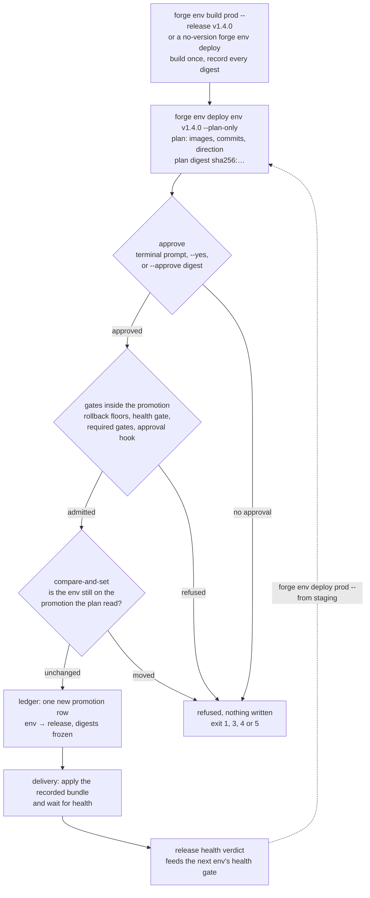

**In short**

- A deploy ships a **release**: an immutable record of one build, holding the digest of every image and static bundle, the commit and tree it came from, and the rendered objects the environment runs. It is built once, and every environment that takes it runs the same bytes.
- Nothing is written until someone approves a **plan**. `--approve <digest>` approves the exact plan you read; if anything moved since, the deploy is refused with exit 3.
- Every promotion is a **compare-and-set** on an append-only ledger, so a hotfix that lands while your pipeline waits turns the pipeline red instead of being overwritten.
- Gates run inside the promotion: **rollback floors** always, and, when you declare them, a **health gate** (prod waits until staging proves the release good), required checks and your own approval hook.
- There is **no rollback command and no automatic rollback**. Recovery is a new deploy: a fix, or an earlier release that every floor admits.

## The problem this solves

In a typical pipeline each environment builds from a branch. Staging builds commit `a1b2c3` and prod builds it again, possibly with a different base image or dependency, so what passed staging is not quite what prod runs. The approval in between approves whatever the next job does. A hotfix that lands on prod while the pipeline waits gets overwritten, and a "rollback" button redeploys an old image onto a schema the new release already migrated.

Forge replaces each of those with something you can check: one build that promotion references, an approval bound to a digest, a promotion that asserts what it replaces, and going back as a visible deploy that floors can refuse.

## How it works



A release is cut once. Each environment that takes it goes through a plan, an approval, the gates and a compare-and-set, and only then gains a ledger row. Delivery applies what that row names, and the release's health verdict can gate the next environment.

### What a release is

A release you cut by hand has the name you give it (`v1.4.0`). One that a no-version deploy cuts is named `<YYYYMMDD>.<HHMMSS>-<tree12>`: the UTC cut time and the first twelve characters of the git tree. Names sort by time, which is how a plan tells forward from back. Reuse never matches on the name: forge compares the provenance each release records, so a hand-named release is found by what it holds.

A release records the digest of every artifact the environment declares, the environment's shape, the commits since the previous release, and its dashboards and alert rules. Plans flag a release cut from a dirty tree.

Its deployable form is an **OCI bundle**: one image manifest in your organization's registry path, holding exactly one layer of rendered manifests. The same tree produces the same digest (sorted entries, fixed timestamps, a reproducible Docker source date), and the apply step reads the bundle without re-rendering, so what a reviewer approved is what runs. Platform charts such as cert-manager are deliberately left out, because a bundle that owned them could delete its own reconciler; install them with `forge env deploy <env> --target <chart>`.

### Cutting a release

```bash terminal
forge env build prod --release v1.4.0    # build, push, record v1.4.0; promote nothing
forge env deploy staging                 # build this checkout, cut a release, deploy it
```

`env build --release` builds the environment-agnostic artifacts once, pushes them and records their digests. Re-cutting a version over the same artifacts is a no-op, and over different ones it is refused. The cut fails if anything the environment declares is missing. When building and cutting are separate CI jobs, `--push` in one and `--release v1.4.0 --no-build` in the next records the release without a rebuild.

A deploy **with no version** builds the same way, then deploys. If a release already holds this exact clean checkout, it prints `reusing release …`; otherwise `cutting new release … because …`. A dirty checkout headed for a shared environment asks first, and with no terminal it refuses with exit 5, having built nothing.

A deploy **with a version, or `--from`**, builds nothing: a redeploy, a move to an older release, or a spec-change deploy where the KCL moved and the release did not. Scoped deploys (`--target api`, `--frontends-only`) need a version too, because a release covering only some artifacts would not describe what is running.

### The plan, and approving it

A promotion **is** the deploy: the platform picks up a new ledger row within minutes and rolls the stack. So the review comes before the write. The plan compares what the environment runs with the target: every image as unchanged, changed, added or removed, the commits between, the floor verdict, and the **direction**, `INITIAL`, `AHEAD` or `BEHIND`. It compares against the last *succeeded* apply, so a failed attempt is never mistaken for what is running.

- **At a terminal** you are asked, and the default is no.
- **In CI**, `--yes` means "I read the plan". With no terminal and no `--yes`, the deploy exits 5 having cut the release but promoted nothing, so approving later needs no rebuild.
- **With a separate review step**, split it in two. Stage two deploys only if the plan is still the one stage one printed:

  ```bash terminal
  PLAN=$(forge env deploy prod --plan-only --json)
  forge env deploy prod "$(jq -r .target.release <<<"$PLAN")" \
    --approve "$(jq -r .deploy_plan.digest <<<"$PLAN")"
  ```

  Stage one's JSON also carries `next_step`, the stage-two command already assembled.

`--yes` approves whatever forge computes when it runs. `--approve <digest>` approves the plan you read: if another deploy landed, a bundle was applied or drift appeared in between, it is refused with exit 3 (`plan_stale`). The server recomputes the plan under the environment's row lock before admitting it. A plan that destroys stateful data, such as a database volume, also needs `--acknowledge-destructive` with the codes it names; `--yes` never covers those.

### Every promotion is a compare-and-set

The write asserts that the environment is still on the promotion the plan read (`current.promotion_id` in `--json`). If someone moved it since, yours is refused with exit 3 rather than overwriting theirs. Nothing turns this on or off; `--expect-current <id>` substitutes a value captured earlier. Re-deploying the release an environment already runs appends nothing and still applies and waits, so a retried CI job is never a conflict.

`--from staging` promotes the release staging runs right now, on the same control plane, and adds a second assertion: if staging moves after the plan was read, the deploy is refused with exit 3 (`source_moved`).

### The health gate (opt-in)

By default prod takes whatever release you promote. To make the order binding:

```kcl deploy/kcl/prod/main.k
delivery_policy = forge.DeliveryPolicy {
    health_gate = forge.HealthGate {after = ["staging"]}     # mode defaults to enforce
}
```

Prod now takes release R only once staging has proved R good. The verdict is the control plane's own, computed with staging's `release_health` once its window closes (15 minutes by default), and it is the verdict `forge obs check` reports. The control plane checks it inside the promotion's transaction, so a client cannot supply or skip it.

| Staging's verdict for the release | `obs check` exit | Prod promotion |
|---|---|---|
| Pass | 0 | Admitted, with a `health_gate` gate recorded on the promotion. |
| Fail | 1 | Refused: `health_gate_regressed` (exit 1). |
| Inconclusive, or never ran on staging | 2 | Refused: `health_gate_unproven` (exit 4). |
| Not judged yet | 8 | Refused: `health_gate_pending` (exit 4). Run `forge obs check staging --release <v> --wait`, then retry. |

Naming an environment in `after` is the opt-in, so a new project is never gated. A release prod already ran with a pass is admitted without staging. During an incident, `--override-health-gate "<why>"` overrides this gate only and records who, why and what staging showed. `mode = "audit"` records what `enforce` would refuse. [Release gates](/forge/deploy/release-gates) covers how the verdict is computed.

### Required gates and approval hooks

Two more opt-in gates live on `delivery_policy`:

- **`required_gates`** names checks a promotion must carry, each passed: `forge.RequiredGates {names = ["e2e"]}`. A deploy carries them with `--gate name=e2e,status=passed`. A missing gate is refused with exit 4, a failed one with exit 1. `forge release gate record` attaches evidence to an existing promotion; without `required_gates`, evidence enforces nothing.
- **`approval_hook`** asks your approval system before the promotion is written, and anything but `approve` refuses it (exit 4). A hook that times out or answers nonsense counts as a deny, and `--yes` never answers for it. A `url` hook is asked by the control plane; an `argv` hook runs on your machine, so it is refused where there is a control plane.

### Rollback floors

A rollback floor refuses every deploy of a release older than it, for one environment, with exit 1 (`below_rollback_floor`) and before any promotion is written. No deploy flag skips it. Getting past one means lowering or lifting it, a recorded act with a reason.

An **order** floor says "nothing cut before this release": `forge env floor set prod --current --reason "…"`, or `--floor "<why>"` on a deploy. A **declared** floor is raised automatically when an environment is promoted to a release carrying a `forge:breaks-rollback` migration or a `deploy/rollback-floors/<id>.yaml` file. It refuses any release lacking the declaration, even one cut later from a branch without it. [Release gates](/forge/deploy/release-gates#rollback-floors) lists every floor verb, and [Safe migrations](/deep-dives/safe-migrations) explains why migrations raise them.

### Where the ledger lives

Promotions are rows in an append-only ledger; moving prod back is one more row, not an edit. The environment declares which ledger it uses:

- One whose KCL declares `forge.ControlPlane` records on that control plane. Hosted environments do.
- Every other records in this machine's ledger, `~/.forge/ledger/<project>/` (`FORGE_LEDGER_HOME` moves it). It is keyed by project, so every worktree sees one history, and each read-decide-append holds a file lock. A ledger home on NFS or SMB is refused, because the lock does not span machines.

`forge ledger where <env>` says which one an environment uses and why. A deploy your own CI did can be recorded with `forge release record --env prod --version v1.4.0`, which gives monitoring a deploy marker with no forge build.

### Delivery: from a recorded release to a running cluster

Recording a release does not ship it. For a hosted environment, or a cluster registered with `forge cloud cluster connect`, Flux run by Reliant converges the destination to the recorded bundle. For any other environment the same command applies the bundle from your machine. Either way `forge env deploy` waits until the release is live or says why not.


Reliant verifies a pushed bundle before signing it: it re-derives the digest, checks every object sits in your organization's registry path, and confirms the blob exists.


The environment's Flux source is pinned to the promotion's digest, Flux checks the signature, and it applies the bundle per cluster, per delivery unit (`forge.DeliveryUnit`) and per phase (`pre`, `rollout`, `post`), so CRDs and migration Jobs are healthy before the Deployments that need them. Unlike the [Flux D2 reference architecture](https://control-plane.io/posts/d2-reference-architecture-guide/) it borrows from, forge pins a digest per ledger row instead of moving a signed tag.

### Exit codes

The codes are for scripts. What matters is less pass or fail than whether forge could look.

| Code | Meaning | What a pipeline does |
|---|---|---|
| 0 | Deployed and healthy, already on this release, or plan-only | Continue. |
| 1 | Failed: bad input, release not found, degraded, below a floor, `health_gate_regressed` | Fail the job. |
| 2 | Could not look: the control plane was unreachable | Retry or page. Never success or failure. |
| 3 | The env (or `--from`'s source) moved, or the approved plan is stale | Stop and look. A retry would overwrite what landed. |
| 4 | Declined, nothing lost: rollout in flight, env pinned, gate pending or unproven, hook did not approve | Wait and retry, or `--supersede` (recorded) an unfinished rollout. |
| 5 | Plan printed, nobody approved | Add `--yes`. Nothing was promoted. |
| 6 | A newer promotion overtook the one being waited on | The release was overtaken. |
| 7 | Accepted and recorded, queued on billing | Hand over the printed link. See [queued deploys](/hosting/overview#queued-deploys). |
| 8 | The wait ran out mid-rollout | `forge env status <env> --wait`. |
| 9 | A self-hosted Flux env needs a permission this credential cannot grant | A cluster admin acts. |

Codes 6, 7 and 8 are deliberately not 1: each means "we never saw this finish", not "the release is bad".

### Deploying from CI

CI has no Reliant session, so it uses an organization automation token:

```bash terminal
forge cloud token create --env prod --name github-actions --scopes deploy:read,deploy:write
```

Store the printed secret as `FORGE_CONTROL_PLANE_TOKEN`, then deploy with `--yes` or the two-stage form. [Forge sign-in](/forge/sign-in) explains how forge picks a credential.

## Design decisions and trade-offs

**Promote by reference, not by rebuilding.** Building per environment is what makes "passed staging" a weak claim. The cost: artifacts must be environment-agnostic. A value baked in at build time travels with the release, so per-environment values belong in runtime configuration.

**Review before the write.** Since writing a promotion is the deploy, the plan and approval sit in front of it. The alternative, a separate apply step after the record, would let the record and reality drift. The cost: a non-interactive caller without `--yes` is refused (exit 5) rather than assumed to consent.

**Approval bound to a digest.** A hard-coded `--yes` approves every future change set. `--approve` costs a second stage, but an approval can never cover a change nobody saw. Destructive changes need their codes even under `--yes`.

**Compare-and-set with no force flag.** Writers are fenced by an assertion rather than a lock held through a human review. The cost: a stale plan turns red and must be re-planned, even when what landed was harmless.

**Roll forward only, with floors.** A rollback command would claim to undo migrations and data writes it cannot. Going back is an ordinary deploy labelled `BEHIND`, and floors refuse releases that cannot run on today's data. The cost: recovery always takes a deploy, and a floor blocks a move you want until someone lowers it, on the record.

**The environment declares its ledger.** A flag would let two people record one environment in two places. The machine ledger sits outside the checkout because two branches would otherwise hold two histories. The cost: a machine ledger is one machine's, so teams use a control plane.

## Limits and what it does not do

### There is no rollback command

By the time you would run one, the release has applied its migrations and written data in its new shape. Recovery is rolling forward: deploy a fix. You can move an environment to an older release that every floor admits. It is an ordinary deploy whose plan says `BEHIND` and "undoes nothing" the newer release did, and `--note "<why>"` records the reason.

`--offline-ledger` (with `--to previous`) is a break-glass for a control plane that is down. It redeploys from this machine's cached copy of the ledger (the last five promotions by default, `FORGE_OFFLINE_LEDGER_WINDOW` up to 50) and replays the record later. It works only for an environment forge applies from your machine: it is refused for hosted environments and hub-converged clusters, where the control plane is the applier.

### Other limits

- **No automatic rollback.** A rollout that never becomes healthy leaves the previous version serving, and a failed migration stops the deploy before any workload changes. A release that rolls out and then regresses stays live until you deploy something else.
- **The health gate is opt-in and needs a control plane.** A self-hosted environment with none records the declaration and refuses nothing. A quiet staging produces inconclusive verdicts, which refuse a gated promotion until you lower its thresholds or override.
- **Signing proves the ledger, not the builder.** Hosted bundles are signed with a per-organization key; any valid deploy token can still record a bundle built anywhere. Signing defaults to `audit` on a control plane and is capped at `audit` (default `off`) self-hosted. `trusted_builder`, the vulnerability gate, admission verification and signed promotions are recorded but block nothing yet; `forge env shape <env> --json` shows the resolved `delivery_policy`.
- **Floors need a control plane that supports them**, and `--floor` against one that doesn't is refused rather than dropped.
- **`--from` works within one control plane.**
- **A hosted deploy can be queued.** Past the free tier (static sites in one organization per person, 1 GiB each and 10 GiB in total; anything with a backend or database needs billing), it is recorded and held on billing with exit 7, and goes live by itself once billing is set up.

## See it for yourself

These ran on a throwaway static site, `guides-sandbox-releases`, pinned to forge v1.6.1. Rendering needs no account; the rest needs a hosted environment.

```bash terminal
reliant forge env render prod --list
```

```text
CLUSTER  KIND        NAMESPACE  NAME  APP
hosted   StaticSite  -          web   -

hosted (published to the control plane, not applied):
  web (static)
```

Cut a release and plan its first promotion without writing anything:

```bash terminal
reliant forge env build prod --release v0.0.1
reliant forge env deploy prod v0.0.1 --plan-only
```

```text
  plan digest: sha256:4d151cc1f7faf6f2823900b1eeb3f70f195d9e06112b47fea5aa726fa9efca6b
PLAN (dry run — nothing was written): promote env "prod" → release v0.0.1
  current   (never promoted)
  target    v0.0.1 (cut 2026-11-20T07:22:54Z)  [DIRTY TREE — these bytes match no reviewable commit]
  direction INITIAL  FIRST PROMOTE — this environment has never been bound to a release, so there is nothing to move from
  floor     admitted (no rollback floor)

--plan-only: NO promotion was written.
  Approve it with: forge env deploy prod v0.0.1 --approve sha256:4d151cc1f7faf6f2823900b1eeb3f70f195d9e06112b47fea5aa726fa9efca6b
```

That `--approve` command deployed v0.0.1 (`Rollout of v0.0.1 to prod: SUCCEEDED`). Run again after prod had moved, it exited 3:

```text
the plan for env "prod" is not the one --approve named (plan_stale), so NO promotion was written.
  approved: sha256:4d151cc1f7faf6f2823900b1eeb3f70f195d9e06112b47fea5aa726fa9efca6b
  current:  sha256:f0c42352ebb6ba68e5e4159b1d72f40886463947befc8915bc3bd2b05671d4d3
  fix: re-plan and re-approve — forge env deploy prod --plan-only
```

After deploying v0.0.2, set a floor and ask whether v0.0.1 may come back:

```bash terminal
reliant forge env floor set prod --current --reason "roll forward only from v0.0.2"
reliant forge env floor check prod v0.0.1
reliant forge env releases list prod
```

```text
promote refused (below_rollback_floor): prod's rollback floor refuses v0.0.1: v0.0.1 was cut before the floor's release v0.0.2 (roll_forward_only floor: "roll forward only from v0.0.2")

AT                    RELEASE        WHAT                   ROLLOUT       HEALTH
2026-11-20 07:31:10Z  v0.0.2 (live)  promote (from v0.0.1)  succeeded 5s  inconclusive
2026-11-20 07:24:43Z  v0.0.1         first promote          succeeded 5s  inconclusive
```

`floor check` reads only and exits 1; a real deploy of v0.0.1 is refused the same way. Both health verdicts are inconclusive because the throwaway site served no traffic.

## Guides

- [Release gates](/forge/deploy/release-gates): judge a deploy with `obs check`, gate prod on staging, and set floors
- [Preview environments](/hosting/preview-environments): short-lived environments per pull request, built on the same releases
- [Deploy a Go API with managed Postgres](/guides/hosting/deploy-go-api-managed-postgres): render, build a release and deploy it, then prove it with `obs check`
- [Promote a release to production](/guides/hosting/promote-release-staging-to-production): move the release staging runs to prod by digest, with a two-stage approval
- [Gate prod on release health](/guides/hosting/gate-production-deploy-release-health): hold production until staging proves a release good
- [Recover from a bad deploy](/guides/hosting/recover-from-bad-deploy): roll forward, or redeploy an earlier release above every floor
- [Deploy from GitHub Actions](/guides/hosting/deploy-from-github-actions): deploy with an automation token and branch on the exit codes
- [Preview environment per pull request](/guides/hosting/preview-environment-every-pull-request): create a short-lived environment for each pull request

{/* defer-link:/guides/hosting/record-deploys-from-existing-ci - [Record deploys from your CI](/guides/hosting/record-deploys-from-existing-ci): give monitoring a deploy marker when your own pipeline ships */}

## Reference

- [Environments](/forge/deploy/environments): the declarations a release is cut from, `delivery_policy` included
- [What gets deployed](/forge/deploy/what-gets-deployed): the objects a release's bundle holds
- [Self-hosted delivery](/forge/deploy/self-hosted-delivery): Flux on your own cluster, with no control plane
- [Hosting on Reliant](/hosting/overview): what hosting runs and costs, and queued deploys
- CLI: [`env build`](/reference/cli#reliant-forge-env-build), [`env deploy`](/reference/cli#reliant-forge-env-deploy), [`env floor`](/reference/cli#reliant-forge-env-floor), [`env releases`](/reference/cli#reliant-forge-env-releases), [`env status`](/reference/cli#reliant-forge-env-status), [`ledger where`](/reference/cli#reliant-forge-ledger-where), [`release record`](/reference/cli#reliant-forge-release-record), [`gate record`](/reference/cli#reliant-forge-gate-record), [`cloud token create`](/reference/cli#reliant-forge-cloud-token-create)

Agents can run `forge agent skill load deploy` for the full reference.
