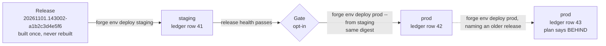

A forge deploy does not ship your working tree. It ships a **release**: an immutable record of one build of your project, holding the digest of every image and static bundle, the commit and tree it came from, and the rendered objects the environment will run. Releases are built once and promoted by digest, so the bytes that passed `staging` are the bytes `prod` runs.

The reason this matters to an agent is that "deploy" becomes a question with a checkable answer. A release has a name, a digest and a plan, and each step either happened or did not.



Follow one release left to right. It is cut once, and each environment gets a new row in a ledger naming that release. Moving prod back to an older release is one more row, not an edit, and its plan is labelled `BEHIND`.

## What a release is

A release is named `<YYYYMMDD>.<HHMMSS>-<tree12>`: the time it was cut and the first twelve characters of the git tree it was built from. It records the digest of every artifact the environment declares, the environment's declared shape, the commits since the previous release, and the dashboards and alert rules that belong to it.

Its deployable form is an **OCI bundle**: one image manifest in your organization's registry path, holding a config blob and exactly one layer of rendered manifests. Two properties follow from how it is built:

- **The same tree produces the same digest.** Entries are sorted, timestamps are fixed, and Docker builds use a reproducible source date. Pushing the same bundle twice is a no-op.
- **What is applied is what was recorded.** The apply step reads the bundle. It never re-renders, so there is no window in which the thing a reviewer approved and the thing that ran can differ.

Platform charts (cert-manager, Envoy Gateway and the like) are deliberately not in the bundle. A bundle that owned them could delete its own reconciler or orphan the data of every database whose CRDs it removed. They are installed separately with `forge env deploy <env> --target <chart>`.

## Deploying

```bash
forge env deploy staging                              # build this checkout, cut a release, deploy it
forge env deploy prod --from staging                  # deploy exactly the release staging runs
forge env deploy prod 20261019.142210-3f2a9c1b7d4e    # deploy a release that already exists
```

**With no version**, forge builds the current checkout exactly as `forge env build` does, pushes the artifacts, cuts a release, records the environment's shape, computes a plan, asks you to confirm, promotes, and waits for health. If a release already holds this exact clean checkout, it says `reusing release …` and builds nothing. If it cuts a new one, it says why: `cutting new release … because …`. A dirty checkout, a different forge version, an artifact the release lacks, or an image the registry no longer holds each cut a new release. `--dry-run` prints the same decision line without doing anything.

**With a version, or `--from`,** forge builds nothing. It deploys a release that is already cut: a redeploy, a move to an older release, or a spec-change deploy (the KCL moved and the release did not, so you name the version the environment already runs). `--from staging` means "the release staging is running right now", and it is refused with exit 3 if staging moved since the plan was read.

Deploying a dirty checkout to a shared environment asks first, because the release would describe no commit. Without a terminal it refuses with exit 5 having built nothing, and `--yes` accepts it.

`forge env releases list <env>` shows the timeline newest first, `forge env releases show <env> <release>` shows one release's commits, changes and gates, and `forge env status <env> --history` shows the promotions.

### The plan, and approving it

Nothing is written until you approve a plan. Forge compares the release the environment runs with the one it would move to, and prints every image that changes, the commits in between, and the direction. The comparison is against the last *succeeded* apply, never against the declaration, so a failed attempt is not mistaken for what is running.

How you approve depends on where you run:

- **At a terminal** you are asked, and the default is no.
- **In CI**, `--yes` means "I read the plan". With no terminal and no `--yes`, the deploy exits 5 having built, pushed and cut the release but promoted nothing, so approving it later needs no rebuild.
- **With a separate review step**, split the deploy in two. The first stage cuts the release and prints the plan with a digest. The second deploys only if the plan is still that exact plan:

  ```bash
  PLAN=$(forge env deploy prod --plan-only --json)
  forge env deploy prod "$(jq -r .target.release <<<"$PLAN")" \
    --approve "$(jq -r .deploy_plan.digest <<<"$PLAN")"
  ```

`--yes` and `--approve` are different approvals. `--yes` approves whatever forge computes at the moment it runs. `--approve <digest>` approves the plan you actually read, and if anything moved in between (another deploy landed, drift appeared) it is refused with exit 3 instead of shipping a change set nobody saw. A plan that would destroy stateful data, such as deleting a database volume, additionally needs `--acknowledge-destructive` with the codes the plan names; `--yes` never covers those.

Every release deploy is a compare-and-set. If someone else moves the environment while you are reading the plan, yours is refused rather than overwriting theirs, so a hotfix that lands while a pipeline waits for approval turns the pipeline red instead of being silently replaced.

### Exit codes

The codes are designed for scripts. The distinction that matters is not pass or fail but whether forge could look.

| Code | Meaning | What a pipeline does |
|---|---|---|
| 0 | Deployed and healthy, already on this release, or a plan-only run | Continue. |
| 1 | Failed: invalid input, release not found, degraded, or `health_gate_regressed` | Fail the job. |
| 2 | Could not determine: the control plane was unreachable | Retry or page; never treat as success or failure. |
| 3 | The environment (or `--from`'s source) moved since the plan was read | Stop and look. Retrying would overwrite whatever landed. |
| 4 | Declined, nothing lost: a rollout is in flight, the environment is pinned, or a health gate has no passing verdict yet | Wait and retry, or pass `--supersede` (recorded). |
| 5 | The plan was printed and nobody approved it | Add `--yes`. Nothing was promoted. |
| 6 | A newer promotion replaced the one being waited on | The release was overtaken. |
| 7 | Accepted and recorded, queued on a person (billing) | Hand over the printed link and stop. See [Hosting](/forge/hosting#queued-deploys). |
| 8 | The wait ran out while the rollout was still progressing | Keep watching with `forge env status <env> --wait`. |
| 9 | A self-hosted Flux environment needs a permission this credential cannot grant | A cluster admin acts; re-running changes nothing. |

Codes 6, 7 and 8 are deliberately not 1. A timeout, an overtaken wait and a queued deploy are all "we never saw this finish", and reporting any of them as "the release is bad" would fail builds for releases that were fine.

## There is no rollback command

By the time you would run one, the release has applied its migrations and written data in the new shape, so a rollback would claim to undo something it cannot. Recovery is rolling forward: deploy a release with the fix. You can still bind an environment to an older release when it is safe. It is an ordinary deploy, the plan says `BEHIND`, and you read it before confirming.

If a bad release takes the control plane itself down, `forge env deploy <env> --offline-ledger --to previous --yes` redeploys from this machine's cached copy of the last five promotions by their recorded digests. Warm the copy first: any successful `forge env status <env>` refreshes it.

## Where the ledger lives

An environment's promotions are rows in an append-only ledger. Re-deploying the release an environment already runs appends nothing and still applies and waits, so a retried CI job is safe. The ledger's location is declared by the environment, not chosen by a flag: an environment that declares `forge.ControlPlane` records on that control plane (the default for hosted environments), and every other environment records in this machine's ledger, under `~/.forge/ledger` (`FORGE_LEDGER_HOME` moves it). `forge ledger where <env>` says which, and why. A script or test that must never touch a real control plane sets `FORGE_LEDGER=machine`, which keeps every forge it starts on the machine ledger.

## Delivery: from a recorded release to a running cluster

Recording a release does not ship it. A reconciler converges the destination to the recorded bundle. For a hosted environment, or a cluster you registered with `forge cluster connect`, that reconciler is Flux, run by Reliant. The path has two halves.


In the first half, look at the order: the bundle is pushed, then Reliant verifies it before anything is signed. It re-derives the digest from the bytes, checks that every object sits inside your organization's registry path, and confirms the blob is present. A signature is only ever attached to a bundle that passed those checks.


In the second half, the dashed outline is the opt-in gate and the dashed arrow on the right is the feedback from release health. The solid path is what always happens: a promotion is one row, the environment's Flux source is pinned to that row's digest, and Flux applies the bundle in dependency order.

The design takes its building blocks from the [Flux D2 reference architecture](https://control-plane.io/posts/d2-reference-architecture-guide/) by Stefan Prodan and the ControlPlane team: gitless OCI delivery, the Flux Operator, and a signature check on the source. Forge differs on promotion. D2 moves a signed tag, while forge appends a ledger row and pins a digest, which leaves room for approvals, holds and a fence against stale writes that a tag cannot carry.

Applying proceeds in **trees**: for each cluster, each delivery unit, and each of three phases, `pre`, `rollout` and `post`. A tree depends on the one before it, so Namespaces, CRDs and migration Jobs are applied and healthy before the Deployments that need them. You can declare named delivery units with `forge.DeliveryUnit` when parts of an environment must land in a chosen order.

### Signing

Hosted release bundles are signed with a per-organization key held in a key-management service. The private half never leaves it, and nothing can export it. Rotation adds a key version, and older signatures keep verifying. Flux checks the signature on the source (`spec.verify`) before it applies anything, so with enforcement on, the cluster applies only what Reliant recorded for your organization, even if something else wrote to the registry or to the cluster's Flux objects.

A bundle signature proves the bundle is the one your organization's ledger recorded. It does not prove where the bundle was built; a valid deploy token can still record a bundle from any machine. Proving the builder is a separate control (`trusted_builder`) that is recorded but not enforced yet.

The `delivery_policy` block on an environment declares what a release must prove, with three modes per control: `off`, `audit` (record and alert, never block) and `enforce`. Two things are worth knowing in practice:

- **Signing defaults to `audit` on a control plane.** It signs, verifies, records the verdict and alerts without blocking, because enforcing it would refuse a rollback to a release recorded before signing existed. Enforcement is capped by the platform until every rollback target is signed.
- **On a self-hosted environment signing is capped at `audit`, and defaults to `off`.** Nothing signs a bundle you deliver yourself. Declaring `enforce` is refused at render when there is no control plane, because it could never pass.

Most other controls (vulnerability gate, approvals, admission verification, signed promotions, trusted builder) are validated and recorded in the release's shape, but nothing blocks a release on them yet. Treat a value of `enforce` on those as a declaration of intent. `forge env shape <env> --json` shows the resolved policy under `shape.delivery_policy`, and it is omitted when everything is at its default.

### The health gate (opt-in)

By default, prod takes whatever release you promote. If you want the order to be binding, declare it in `deploy/kcl/prod/main.k`:

```python
delivery_policy = forge.DeliveryPolicy {
    health_gate = forge.HealthGate {after = ["staging"]}     # mode defaults to enforce
}
```

Prod now takes release R only once staging has proved R good. The verdict is the control plane's own, the same rule `forge obs check` applies once the environment's release-health window has closed (15 minutes by default, plus a short settling time). A client cannot supply or skip it. No staging environment is required, and a new project declares no order, so its first `forge env deploy prod` is never gated.

| Staging's verdict for the release | `obs check` exit | Prod promotion |
|---|---|---|
| Pass | 0 | Admitted, with a `health_gate` gate recorded on the promotion. |
| Fail | 1 | Refused: `health_gate_regressed` (exit 1). |
| Inconclusive, or never ran on staging | 2 | Refused: `health_gate_unproven` (exit 4). |
| Not judged yet | 8 | Refused: `health_gate_pending` (exit 4). Run `forge obs check staging --release <v> --wait`, then retry. |

A release prod itself already ran with a pass is admitted without staging, so a roll-forward to a known-good older release needs no detour. During an incident, `forge env deploy prod <release> --override-health-gate "<why>"` overrides this gate only, and records who did it, why, and what staging showed. See [Observability](/forge/observability) for how release health is judged.

## Deploying from CI

CI has no Reliant session, so it authenticates with an organization automation token:

```bash
forge cloud token create --env prod --name github-actions --scopes deploy:read,deploy:write
```

The secret is printed once. Store it as a CI secret named `FORGE_CONTROL_PLANE_TOKEN`, then deploy with `forge env deploy <env> --yes` or the two-stage form above. See [Forge sign-in](/forge/sign-in) for how forge picks a credential.

## Scoped deploys

You can ship part of an environment from a release that already exists:

```bash
forge env deploy prod 20261019.142210-3f2a9c1b7d4e --target api        # one workload
forge env deploy prod 20261019.142210-3f2a9c1b7d4e --frontends-only    # only the static frontends
```

Both need a version. A no-version deploy cuts a release covering every artifact, and a release that shipped only some of them would not describe what is running.

## Related topics

[Self-hosted delivery](/forge/deploy/self-hosted-delivery) covers delivering to your own cluster with Flux and no control plane. [Environments](/forge/deploy/environments) covers the declarations a release is cut from, and [Hosting on Reliant](/forge/hosting) what happens once a hosted deploy is queued on billing. Agents can run `forge skill load deploy/plan`, `deploy/delivery-policy` and `deploy/offline-ledger` for the full reference.
