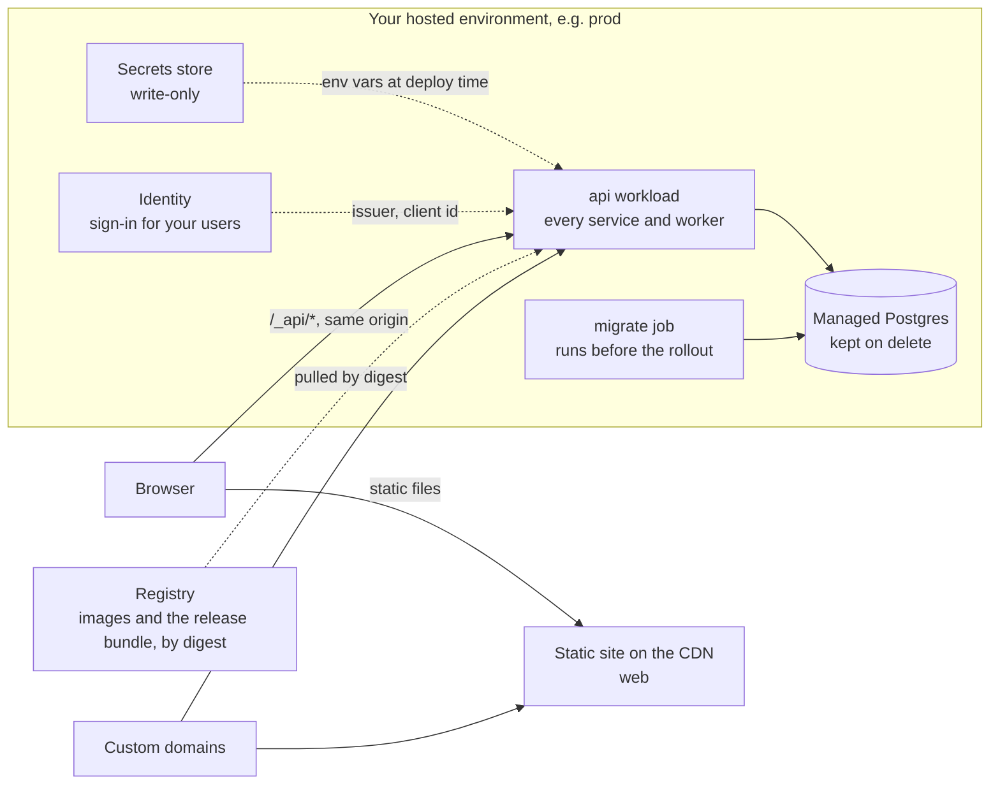
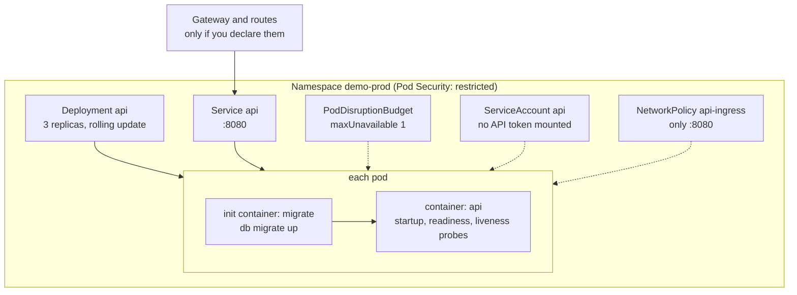

An environment's KCL is a declaration, and a deploy turns it into running things. This page shows those things, for both of the places they can land: Reliant hosting, and a Kubernetes cluster you operate. Every object listed here came from rendering a scratch project with `forge env render`, and you can reproduce any of it on your own project, because rendering is read-only and needs no cluster.

## On Reliant hosting

A hosted environment is a small set of resources that the platform runs for you. You declare four kinds of thing, and the platform supplies the rest around them.



Look at the arrow from the browser to `/_api/*`. The frontend and the API share one origin, because the platform serves the API workload at `/_api/*` on every hostname of the site, its generated one and your custom domains alike. Sign-in's session cookie is therefore first-party to the site and no CORS is involved. The scaffold wires this for you by giving the frontend an `API_URL` that references the `api` workload.

What `forge env render prod` prints for the scaffolded project is four resources, each a `forge.dev/v1alpha1` record the platform admits and renders itself: the `migrate` job, the `api` workload, the `web` static site and the `demo` database. Here are the last three, trimmed:

```yaml
# cluster: hosted
apiVersion: forge.dev/v1alpha1
kind: Workload
metadata:
  name: api
spec:
  args: [server]
  image: preflight.forge.invalid/demo@sha256:0000…0000
  kind: service
  ports:
  - {expose: true, name: http, port: 8080, protocol: tcp}
  probes:
    livenessPath: /healthz
    readinessPath: /readyz
    startupPath: /readyz
    port: 8080
  replicas: 1
  resources: {cpuRequestMillicores: 250, memoryRequestBytes: 1073741824}
  env:
  - name: CORS_ORIGINS
    workloadURL: {name: web}
  - name: JWT_ISSUER
    managedSecret: {name: RELIANT_IDENTITY_IDENTITY_ISSUER}
  …
---
# cluster: hosted
kind: StaticSite
metadata: {name: web}
spec:
  assetDir: _next/static
  keepReleases: 10
  runtimeConfig:
    API_URL: {workloadURL: {name: api}}
---
# cluster: hosted
kind: ManagedDatabase
metadata: {name: demo}
spec: {deletionPolicy: retain, engine: postgres, instances: 1, storageGiB: 10}
```

The image shown is a placeholder (`preflight.forge.invalid`). A render that has no credential and no release prints a deliberately unusable address so it can never be deployed by accident; a real deploy resolves it under your organization's registry path and pins it by digest.

Three things in that output are worth knowing:

- **References, not values.** The database URL appears as `databaseRef: {name: demo}` and the identity settings as `managedSecret` references. A rendered environment never contains a credential, so it is safe to print, diff and attach to a pull request.
- **Probes are written out.** A service forge builds gets `/readyz` and `/healthz` on its `http` port, explicitly, on every runtime. The platform, the CLI and a human reading the record all see the same probe.
- **The workload is restricted.** Hosting shares machines between customers, so it admits only what is safe there and refuses cron kinds, operators, RBAC, sidecars, volumes and pod overrides. [Hosting on Reliant](/forge/hosting#what-hosting-does-not-run) has the table, and the refusal at render names the workload and the field.

The frontend is a **static site**: files behind the CDN, with no process. `runtimeConfig` is how one built bundle serves every environment, because the platform writes the site's `config.js` after each sync from this block, resolving `API_URL` to the right `api` workload. [Secrets](/forge/secrets) covers the write-only store, and [Custom domains](/forge/custom-domains) the hostname side.

## On a cluster you operate

Bind a workload to `forge.OnCluster` and forge renders ordinary Kubernetes objects and applies them to the kubectl context your KCL names. It never uses whichever context your shell has selected. The objects depend on the workload's `kind`.

<Note>
The renders below use a scratch project with a cluster binder that sets a replica floor of three and declares `network_policy`. Those two lines come from the scaffolded `_on_cluster` binder and from the environment, not from forge's defaults, and they are why you see a PodDisruptionBudget and NetworkPolicies. A workload with one replica gets neither a PDB nor topology spread.
</Note>

### One service, in full



Read the pod from top to bottom: the migration init container runs first and must succeed, so no new pod serves traffic against an old schema, and a failed migration stalls the rollout while the old pods keep serving. The Service, PDB, ServiceAccount and NetworkPolicy attach to the pod by label.

`forge env render cloud --list` for a project like this prints one line per object:

```text
CLUSTER                    KIND                 NAMESPACE  NAME       APP
gke_acme_us-central1_prod  Namespace            -          demo-prod  -
gke_acme_us-central1_prod  Deployment           demo-prod  api        api
gke_acme_us-central1_prod  Service              demo-prod  api        api
gke_acme_us-central1_prod  PodDisruptionBudget  demo-prod  api-pdb    api
gke_acme_us-central1_prod  ServiceAccount       demo-prod  api        api
```

The Deployment carries the hardening forge writes into every pod it renders (trimmed from the real output):

```yaml
spec:
  replicas: 3
  strategy: {type: RollingUpdate, rollingUpdate: {maxSurge: 25%, maxUnavailable: 25%}}
  template:
    spec:
      automountServiceAccountToken: false
      enableServiceLinks: false
      serviceAccountName: api
      terminationGracePeriodSeconds: 40
      securityContext:
        runAsNonRoot: true
        runAsUser: 65532
        seccompProfile: {type: RuntimeDefault}
      topologySpreadConstraints:
      - {maxSkew: 1, topologyKey: kubernetes.io/hostname, whenUnsatisfiable: ScheduleAnyway, …}
      initContainers:
      - name: migrate
        args: [db, migrate, up]
      containers:
      - name: api
        securityContext:
          allowPrivilegeEscalation: false
          capabilities: {drop: [ALL]}
          readOnlyRootFilesystem: true
        startupProbe:   {httpGet: {path: /readyz,  port: 8080}, failureThreshold: 360, periodSeconds: 1}
        readinessProbe: {httpGet: {path: /readyz,  port: 8080}, periodSeconds: 5}
        livenessProbe:  {httpGet: {path: /healthz, port: 8080}, periodSeconds: 10}
        volumeMounts: [{mountPath: /tmp, name: tmp}]
      volumes: [{name: tmp, emptyDir: {}}]
```

A few defaults here are decisions rather than boilerplate, and each protects against a failure that shows up in production:

| Default | Why it is there |
|---|---|
| `terminationGracePeriodSeconds: 40` | It is derived from the drain settings the server itself uses (`PRE_STOP_DELAY` 5s plus `SHUTDOWN_TIMEOUT` 30s plus a 5s margin), so a rollout never kills a pod mid-drain. |
| Startup probe on `/readyz` | It holds liveness off until the server is ready, for the whole time the database connection is being retried, so a slow dependency does not become a restart loop. |
| `enableServiceLinks: false` | Kubernetes would otherwise inject `<SERVICE>_PORT=tcp://…` variables for every Service in the namespace. A Service named `temporal` produces `TEMPORAL_PORT`, which collides with a typed config field and fails to parse. |
| Read-only root filesystem, a `/tmp` emptyDir | Writes outside `/tmp` fail loudly in dev and staging, not only under a stricter production policy. |
| No ServiceAccount token | A workload gets one only if it declares RBAC. |
| PDB and topology spread above one replica | Node drains and zone loss cannot take every replica at once. At one replica neither is rendered. |

`replicas = 1` does not mean one process during a rollout. The default `RollingUpdate` surges a new pod before the old one stops, so two run for a moment. When the count is a correctness bound, such as a sweeper that is not safe to run twice, declare `strategy = "Recreate"` and accept the gap.

### What each workload kind renders

I rendered one workload of every kind on a cluster. The objects forge produced:

| `kind` | Objects | Notes |
|---|---|---|
| `service` | Deployment, Service, ServiceAccount, plus PodDisruptionBudget above one replica | The Service carries the ports you declare (a service with none is given `http` on 8080). Default probes on `/readyz` and `/healthz` for a service forge builds. A third-party image with ports gets a TCP probe on its first port. |
| `worker` | Deployment, ServiceAccount, plus PodDisruptionBudget above one replica | No Service, since nothing dials a worker. No probes unless you declare them. |
| `job` | Job, ServiceAccount | The Job's name carries a hash of its spec (`report-d15c2e905f`), so a changed spec is a new Job and a finished one is never mutated. It carries `forge.dev/deploy-phase: pre-rollout` and finishes before any Deployment is applied. |
| `cron` | CronJob, ServiceAccount | Hosting refuses this kind. |
| `operator` | Deployment, ServiceAccount, Role and RoleBinding, ClusterRole and ClusterRoleBinding | The ClusterRole is derived from the `crds` you list: full access to the resources, plus their `/status` and `/finalizers`. It mounts a ServiceAccount token, since it talks to the Kubernetes API. Hosting refuses it. |
| `tool` | Nothing | Built, never scheduled. |

A workload that declares `storageGiB` adds a PersistentVolumeClaim and switches the Deployment to `Recreate`, because a ReadWriteOnce volume would deadlock a surge pod. It also requires `replicas = 1`; a binder that floors replicas at three must be bypassed for it, and forge's refusal says so.

The scaffolded `migrate` workload is special. It declares `before = [fw.BEFORE_ALL]`, and on a cluster that does not render a Job of its own: it becomes the init container on every workload it gates. In the full listing there is no `migrate` Job, only a `migrate` init container in each pod template.

### Namespace-wide objects

When the environment declares `cluster_target` and a `network_policy`, forge also renders a default-deny posture for the namespace:

```text
Namespace      demo-prod     pod-security.kubernetes.io/{enforce,audit,warn}: restricted
NetworkPolicy  default-deny           all pods, Ingress and Egress, no rules
NetworkPolicy  allow-dns              egress to kube-system on 53/UDP and 53/TCP
NetworkPolicy  allow-internal         pods in the namespace may talk to each other
NetworkPolicy  allow-egress-external  egress to the internet on 443 and 5432
NetworkPolicy  allow-ingress-controller  ingress from the namespace you name (envoy-gateway-system)
NetworkPolicy  <workload>-ingress     per workload: only its declared ports (none declared, none accepted)
```

Default-deny blackholes every egress the allow-list misses, so the list is declared and not guessed. `egress_ports` defaults to 443 (HTTPS to JWKS endpoints, object storage, third-party APIs) and 5432 (a managed Postgres outside the cluster); add any other external port your code dials. A telemetry policy appears only when you name the collector's namespace.

Gateway API objects (a `Gateway`, `HTTPRoute`, `GRPCRoute`) appear only when you declare them in `deploy/kcl/ingress.k` and wire them in. The scaffolded file ships with the routes commented out, so nothing is exposed until you choose a hostname.

### A database on your cluster

`forge.ManagedDatabase` bound `OnCluster` renders a forge record that expands into a CloudNativePG `Cluster`, and a workload reaches it with `DATABASE_URL = forge.DatabaseRef {name = "…"}`. Your cluster must already run the CloudNativePG operator; forge never installs it. The default `deletionPolicy` is `retain`, because deleting a declaration is not a statement about whether the data should exist.

## Related topics

[Environments](/forge/deploy/environments) explains the declarations these objects come from, and [Escape hatches](/forge/deploy/escape-hatches) covers changing any of them. [Releases and promotion](/forge/deploy/releases-and-promotion) shows how a render becomes a release and reaches a cluster. For hosted specifics, see [Hosting on Reliant](/forge/hosting).
