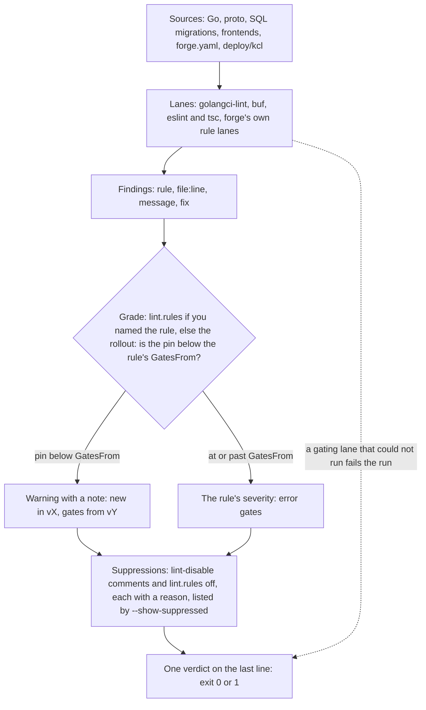

`forge lint` is the part of forge that says no. Everything else in forge makes the right thing easy to write; lint makes the wrong thing fail at the moment it is written, with the file, the line and the fix. Around golangci-lint, buf, eslint and `tsc` it runs about a hundred and twenty rules of forge's own, each for a bug that compiled, passed its tests and then did the wrong thing in production: a filter that never filters, a migration that locks a table, a log line with no trace id.

**In short**

- `forge lint` runs golangci-lint, buf, eslint and `tsc`, plus forge rules that each catch a bug class that compiles and passes tests. Every finding names the rule, the file and line, and the fix.
- A run has one verdict, printed as the last line. It exits 1 only when a lane that gates reports an error.
- A lane that could not run fails the run. A run in which nothing ran proves nothing, and lint says so.
- A new or tightened rule warns until the release after it ships, so bumping your forge pin does not turn your build red.
- You silence a rule locally, with a reason, and `--show-suppressed` lists every suppression in one place.

The [rule reference](/forge/linting/rules-index) lists every rule, with the bug it prevents and a bad-then-fixed example.

## How a run reaches its verdict



A rule you named in `lint.rules` takes the severity you gave it. Any other rule takes the default your `forge_version` pin implies: a warning while the pin is below the rule's `GatesFrom` release. The verdict counts the lanes that gated, could not run, or were skipped, and the exit code follows from it. The stages are covered in [the lanes](#the-lanes), [the output](#reading-the-output), [the rollout](/forge/linting/rollout) and [suppressions](#silencing-a-rule).

## Running it

```bash
forge lint                       # every lane that applies to this project
forge lint --quiet               # only what failed, then the verdict as the last line
forge lint --scope internal/handlers/jobs --scope proto/services/jobs
forge lint --migration-safety    # one lane
forge lint --conventions --contract   # several lanes, one verdict
forge lint --json                # machine-readable findings
forge lint --fix                 # apply the mechanical fixes, then gate
```

`forge lint` is report-only: when a formatter would change a file it prints the diff and fails, so it never rewrites a file another pull request owns. `--fix` formats your Go (never generated files), rewrites untraced log calls and constructors (see [tracing](/forge/linting/rules-tracing-and-tests)), and runs prettier and `eslint --fix` on your frontends. A Go rewrite that leaves its package failing to type-check is put back and reported. golangci-lint's own fixes stay findings for you to make.

Lint is heavy, so it queues for one of the machine's heavy slots. A `waiting for a heavy slot` line is a queue, not a hang.

### The lanes

A bare `forge lint` runs a fixed list of lanes in order and skips the ones that do not apply to your project (no `db/migrations/`, no frontends, a feature turned off in `forge.yaml`). A lane is one linter with one verdict line. Naming a lane with its flag runs just that lane, and naming several runs each under one verdict.

| Flag | Lane | Gates by default |
|------|------|------------------|
| (none) | `golangci-lint`, with your `.golangci.yml`, including a pass over files behind your build tags | yes |
| (none) | typed-config guardrail: `os.Getenv` is forbidden outside config loading | no (advisory) |
| `--contract` | contract linter: `contract.go` rules, `//forge:exclude-contract`, exported package vars | yes |
| (none) | `buf lint` | yes |
| (none) | frontend lint, TypeScript typecheck, frontend lockfile | yes |
| `--migration-safety` | SQL migration safety | yes |
| `--conventions` | proto, Go tree and frontend conventions | yes |
| `--scaffolds` | scaffold ownership headers | yes |
| `--generated-drift` | hand-edited generated files | yes |
| `--tests` | handler and hook test conventions | no |
| `--optional-deps-guard`, `--config-deps` | `Deps` shape | no |
| `--graph` | composition graph | yes |
| (none) | component drift, hosted image base, PodDisruptionBudgets | no |
| (none) | Flux-safe objects, identity sharing, ShellBuild tokens, `.env` files, commit policy | yes |
| `--secrets` | platform secrets model | yes |
| `--column-markers`, `--closed-sets`, `--db-grants` | schema markers in migrations | yes |
| `--proto-markers`, `--go-markers` | misspelled `forge:` markers | proto: no, Go: yes |
| `--create-nullability`, `--computed-fields`, `--read-only-fields` | write-policy rules | yes |
| `--fixture-drift`, `--time-bucketing`, `--guarded-fields` | fixtures, SQL and scaffolded pages | no |
| `--static-export` | Next.js static-export rules | yes |
| `--tracing` | where a request's trace is cut | yes |
| `--check-workarounds`, `--banners` | forge-internal smells; `--banners` only does anything inside the forge repo | no |

Five lanes run only when you name them, because they are whole-project questions or slow: `--frontend-stores`, `--proto-options`, `--vendored-protos`, `--config-reach` and `--slow-tests`. `--exported-vars` is part of `--contract`. `forge project capabilities` prints the live flag list for the forge you are running, including the ones `--help` hides.

A lane that gates fails the run when it reports an error. An advisory lane reports warnings, which never fail the run unless you raise a rule with [`lint.rules`](#silencing-a-rule) or run with `--strict`, which escalates advisory findings to errors.

### Flags worth knowing

| Flag | What it does |
|------|--------------|
| `--quiet`, `-q` | Prints each failing lane, its error findings, and the verdict. A clean run is one line. |
| `--scope PATH` | Reports only findings under `PATH` (repeatable) and lints only its Go packages. Whole-project lanes are skipped and named in the verdict. |
| `--json` | Findings as JSON, with the same exit code as text mode. |
| `--gate-json FILE` | Also writes the run as a gate document, for `forge release gate record` or `forge env deploy --gate`. The human output and the exit code do not change. |
| `--strict` | Escalates advisory findings to errors, including a lane that could not run. |
| `--skip-frontends` | Skips the whole frontend lane, for a backend-only gate that needs no Node toolchain. |
| `--allow-skip LANE=REASON` | Accepts, by name and with a reason, that a gating lane may not run here. `lint.allow_skip` in `forge.yaml` is the project-level form. |
| `--show-suppressed` | Lists every suppression in the project, with its reason. Runs no linter. |

`forge machine tools install golangci-lint buf` installs missing tools; a gating lane that could not run fails the run.

<Note>
`forge lint` runs under the forge version your `forge.yaml` pins in `forge_version`. When the forge you invoke is a different version, both `forge` and `reliant forge` build the pinned forge once and hand the command to it. `--allow-version-skew` (or `FORGE_ALLOW_VERSION_SKEW=1`) runs the forge you invoked instead.
</Note>

## Reading the output

Every lane prints one header line and then its findings. This run came from a scratch project with a deliberately unsafe migration and a misspelled proto marker:

```text
▸ --migration-safety
▸ --proto-markers
❌ migration-safety — 1 error, 1 warning
   ✗ db/migrations/20261103000100_add_orders_status.up.sql:2 [unsafe-add-not-null-column] ADD COLUMN ... NOT NULL without a DEFAULT fails on populated tables; add nullable column, backfill, then SET NOT NULL
      → add the column nullable, backfill it with an UPDATE, then SET NOT NULL in the same migration; for a derived column prefer making the database compute it (ADD COLUMN ... GENERATED ALWAYS AS (<expr>) STORED NOT NULL, which this rule accepts); or — if you know the table is empty — mark the migration file with a "-- forge:allow-unsafe-not-null" comment
   ⚠ db/migrations/20261103000100_add_orders_status.up.sql:3 [volatile-default] volatile DEFAULT in ADD COLUMN can rewrite/lock populated tables; prefer nullable column plus explicit backfill
      → add the column nullable, backfill it with an explicit UPDATE, then set the default for new rows — a volatile DEFAULT is evaluated per existing row and rewrites the whole table under an ACCESS EXCLUSIVE lock
⚠️  proto-markers — 1 warning
   ⚠ proto/services/order/v1/order.proto:26 [forge-proto-markers] removed forge:* proto marker "forge:server-set" (renamed to "forge:read-only")
      → "forge:server-set" was renamed to "forge:read-only" and is no longer recognized — this comment currently does NOTHING (the field stays client-writable). Rewrite it as "forge:read-only".
forge lint: 1 gating linter(s) failed: migration-safety. Fix: address the findings above under each ❌ lane; re-run 'forge lint' to confirm.
```

A finding is `marker file:line [rule] message`, with the fix on the next line after an arrow. `✗` is an error and `⚠` is a warning. The bracketed rule ID is the name you use everywhere else: in the [reference](/forge/linting/rules-index), in `lint.rules`, and in a `forge:lint-disable` comment. The lane header says whether the lane failed (❌), passed with warnings (⚠️) or passed (✓).

Lint exits 1 when any gating lane reports an error, and 0 otherwise. The last line of the report is the verdict. Read it first:

| Verdict line | Meaning |
|--------------|---------|
| `✅ All N gating linters passed.` | Every gating lane ran and found no error. |
| `forge lint: N gating linter(s) failed: LANES` | Those lanes reported errors. The fix is under each ❌ lane above. |
| `✅ N gating linter(s) passed; … new-rule finding(s) warn until they gate (…)` | Green, but a pin bump would turn it red. See [the rollout](/forge/linting/rollout). |
| `… N lane(s) could NOT run: …` | A tool is missing or a directory is not set up. This fails the run for a gating lane. |
| `no gating linter ran — this run proved nothing` | Nothing applicable ran. Lint refuses to call that a pass. |
| `… SKIPPED (allowed): …` | A lane was skipped on purpose with `--allow-skip` or `lint.allow_skip`, with its reason. |
| `… — scope PATH only; not scoped, so not run: …` | A `--scope` run. Whole-project lanes were skipped and named. |

`--quiet` hides advisory findings and says how many it hid: the same run above prints `2 advisory findings not shown (--quiet)` in its verdict.

For an agent or a script, `--json` gives the same findings in a stable shape:

```json
{
  "findings": [
    {
      "file": "internal/handlers/order/rpc_list.go",
      "line": 9,
      "severity": "warning",
      "rule": "forge-tracing-log-without-ctx",
      "message": "slog.Info logs without the context in scope, so the line carries no trace_id and cannot be joined to its request; use slog.InfoContext(ctx, …)",
      "fix_hint": "`forge lint --tracing --fix` rewrites every such call to its …Context form",
      "grace": {
        "introduced_in": "v1.0.0",
        "gates_from": "v1.0.1",
        "fix": "forge lint --tracing --fix"
      }
    }
  ],
  "summary": { "errors": 0, "warnings": 1, "infos": 0, "total": 1 },
  "ok": true
}
```

`ok` is false exactly when the text run would exit non-zero. A lane that could not run appears as a finding too, with a rule ID ending in `-unavailable`, so a consumer can tell "clean" from "did not run". The `grace` object is explained in [the rollout](/forge/linting/rollout).

<Note>
These captures come from a scratch project made with `forge project new shop --service order`, on forge v1.0.14. Progress lines (`⏳ waiting for a heavy slot`, `still running`) are trimmed.
</Note>

## Where lint runs

Lint is the same code in every place; the difference is who runs it and what it blocks.

**On your machine, and in your agent's loop.** `forge lint` directly, or `task lint`, which delegates to the pinned forge. The documented loop is `forge generate && forge lint && go build ./... && task test`. Iterate with `forge lint --quiet --scope <the paths you touched>`; it is the fast version.

**In `task ci`.** `task ci` runs `task ci:checks`, then the tests, then the integration tests, and prints one summary table; the scaffolded `ci.yml` calls the same tasks. Its lint-shaped rows are `golangci-lint`, `buf-lint`, `migration-safety` (`forge lint --migration-safety`), and per frontend `lint-<name>`, `typecheck-<name>` and `css-health-<name>`. `verify-generated` fails if `forge generate` would change anything. `forge ci gate --list` prints the rows for your project.

<Warning>
The PR gate's rows are the tool lanes listed above. They do not run the whole `forge lint` sweep, so the forge-owned rules (conventions, write policy, tracing, secrets, graph and the rest) are not in `task ci` unless you add them. To put every rule in the PR gate, add `forge lint` as an extra check in `forge.yaml`:

```yaml
ci:
  gate:
    extra_checks:
      - name: forge-lint
        command: [task, lint]
        heavy: true
```

`task lint` runs the forge version `forge.yaml` pins, so the check works where no `forge` is on the `PATH`, such as under Reliant (`reliant forge`).
</Warning>

**In the release workflow.** The scaffolded `release.yml` runs `forge lint --gate-json gates/lint.json` as its lint step. The gate document records what the run proved: how many gating lanes ran, which could not, which were skipped. A run where nothing could execute records as `skipped`, never `passed`. `forge env deploy --gate` reads that evidence. In CI, `CI=true` keeps lint report-only, so the release is cut from the commit that was reviewed and not from a checkout lint repaired.

## Silencing a rule

A rule has three off-switches, from coarsest to most local. Reach for the most local one: a repo-wide setting swallows every future finding for that rule, including the one you would have wanted.

<Steps>
  <Step title="Repo-wide: lint.rules in forge.yaml">
    Maps a rule ID to `error`, `warn` or `off`. The key `"*"` applies to every forge rule, and an exact rule ID beats it.

    ```yaml
    lint:
      rules:
        forgeconv-handler-file-size: warn
        forge-tracing-log-without-ctx: error
    ```

    Only forge's own rules are addressable. golangci-lint, buf and eslint keep their own config files. A key that names no gradable rule is itself an error, so a typo cannot silently turn a rule off. This is real output for `forge-tracing-log-without-context` (a misspelling of `…-without-ctx`):

    ```text
    ❌ lint.rules — 1 error
       ✗ [forge-lint-rules] forge.yaml lint.rules["forge-tracing-log-without-context"]: no forge lint rule has this ID, so the entry does nothing
          → did you mean "forge-tracing-log-without-ctx"? lint.rules grades forge's own rules — the [rule] each finding prints. Another tool's linters are configured in that tool's config (.golangci.yml, buf.yaml, eslint)
    ```
  </Step>
  <Step title="One file: forge:lint-disable-file">
    A comment in the file, in that file's comment syntax (`//`, `--` or `#`):

    ```go
    // forge:lint-disable-file forgeconv-no-getenv: this is the config loader
    ```
  </Step>
  <Step title="One line: forge:lint-disable-next-line">
    ```go
    // forge:lint-disable-next-line forgeconv-tx-lock-under-serializable: the lock is a hint, retries are fine here
    tx, err := s.deps.DB.RunTx(ctx, orm.Serializable, fn)
    ```

    `forge:lint-disable` on the same line works too, and `//nolint:<rule>` is honored for forge rules with golangci's own positional meaning.
  </Step>
</Steps>

A suppression of an error-severity rule must carry a reason after a colon. A bare one is itself a finding. The reason is the point: it turns a shrug into a decision a reviewer can read. `forge lint --show-suppressed` lists every suppression in the project with its file, line and reason.

Some rules have their own escape hatch, named in their fix text and in the [reference](/forge/linting/rules-index), such as `-- forge:allow-unsafe-not-null` in a migration or `//forge:exclude-contract: <why>`. Rules that read your config have a dial there instead, such as `lint.handler_file_max_loc` or `database.migration_safety`.

## Why this matters more when an agent writes the code

An agent does not carry the memory of last session's bad query, and it has no instinct that a `string` filter field is wrong or that `slog.Info` loses the trace. What it has is a loop: edit, run a command, read the result, edit again. Every forge finding is written for that loop. It names the rule, the file and line, and the exact change, and many name a command that makes it (`forge lint --tracing --fix`, `forge lint fix connect-errors`, `forge lint fix narrow-deps`). Many rules also cover failures that give no signal at all: a misspelled `forge:` marker compiles and does nothing, and a migration numbered below the merged head applies nowhere. A model reading its own diff will not find these, and tests rarely do.

## Design decisions and trade-offs

**New rules warn before they gate.** A rule that ships in a release, or is tightened in one, is a warning while your pin is below its `GatesFrom` release, the release after it shipped. The alternative, gating on arrival, made every pin bump the day you met all of a release's findings at once. The cost is one release in which a real bug class only warns; `lint.rules: {<rule>: error}` gates it now. A pin that jumps past a rule's window (v1.0.0 to v1.7.0, say) would skip the warning release, so lint also reads your previous pin from `forge.yaml`'s git history and warns for the whole new pin. With no history, in a shallow clone for example, the pin alone decides. Details: [the rollout](/forge/linting/rollout).

**A skipped check is a failed check.** A gating lane that could not run fails the run, and a run in which nothing ran says it proved nothing. Skipping quietly is how a gate stays green for months with its linter not installed. The cost: a fresh checkout is red until you install the tools. Accept a skip by name with `--allow-skip LANE=REASON`, or leave frontends out of a backend gate with `--skip-frontends`.

**One verdict, on the last line.** Lanes and progress lines interleave on a slow run, so the last line is the one a script or an agent can trust, and the exit code (and `ok` in `--json`) agrees with it. The cost is a rule to remember: pipe lint through `tail`, never `head`.

**Suppressions carry reasons and are listed together.** A suppression of a gating rule with no reason is itself a finding, and `--show-suppressed` lists them all. With bare `nolint` comments a codebase switches rules off one line at a time and nobody sees the total. The cost is a few words per suppression. `--show-suppressed` is an audit, not a gate: it exits 0.

**Scoped runs skip whole-project lanes and name them.** The composition graph, frontend lint and component drift judge the whole project and cannot be narrowed to a path, so a `--scope` run names them as not run instead of calling them passed. On a one-entity project an unscoped run took 2m54s; a run scoped to one handler package took 36s and ran 27 of 29 gating lanes. The cost: run an unscoped lint before you merge.

## Limits and what it does not do

- **It reads files, not a running database.** `--migration-safety` judges each migration file by the shape of its statements. A plain `CREATE INDEX` on an existing table passes it, though the build blocks writes to the table. `forge db analyze` applies migrations to a scratch Postgres and measures their locks, and it flagged the same file. Its rules are warn-first until v1.7.1. See [zero-downtime migrations](/guides/forge/zero-downtime-postgres-migrations).
- **The forge rules are not in a scaffolded `task ci`.** A project scaffolded by forge v1.6.1 gates on golangci-lint, buf, migration safety and frontend lint only, until you add the extra check [shown above](#where-lint-runs). The same gate's `deployability` row (not a lint lane) also reports unbounded request payloads on a fresh scaffold, where the scaffolded server already caps them at 4 MiB.
- **Slow-test checks are opt-in.** `forge lint --slow-tests` runs only when you name it, and the scaffolded CI never runs `forge ci test-budget`.
- **It does not decide who may call an RPC.** Access rules are your handler code. The list of RPCs that never check the caller is `forge project audit --json`'s `unscoped_auth`, not a lint lane, and a bare `// forge:auth-unscoped-ok` with no reason after a colon is ignored without a finding. See [find endpoints missing auth checks](/guides/forge/find-endpoints-missing-auth-checks).
- **Fix text is written for the common case.** Read it before you apply it. For example, `forgeconv-crud-owner-resolver` advises the wrong change when one RPC of an entity scopes its owner by email and the others by user id.
- **It is not fast on a whole project.** golangci-lint dominates: most of the 2m54s above. Iterate with `--scope`.

## See it for yourself

These ran in a copy of the project from [Add a database table with a CRUD API and pages](/guides/forge/add-table-crud-api-pages), pinned to forge v1.6.1. Progress lines are trimmed.

```bash terminal
$ reliant forge lint --quiet
✅ All 29 gating linters passed.

$ reliant forge lint --quiet --scope internal/handlers/catalog
✅ 27 gating linter(s) passed — scope internal/handlers/catalog only; not scoped, so not run: frontend lint, graph lint, component-drift lint (whole-project — run an unscoped `forge lint` before merging)
```

Add a migration that builds an index without `CONCURRENTLY`, then measure it. The warning carries the rollout note, because the project's pin is below the rule's `GatesFrom`:

```bash terminal
$ reliant forge db analyze --base HEAD
db/migrations/20261120090000_index_products_name.up.sql
  line 2: CREATE INDEX products_name_idx ON products (name)
    10.8ms
    locks:    products ShareLock
    scanned:  products (1 seq scan(s), 0 rows)

findings:
  warning db/migrations/20261120090000_index_products_name.up.sql:2 [db-analyze-blocking-index-build] built index products_name_idx on products without CONCURRENTLY: the build holds SHARE (or stronger), which blocks every write to products until it finishes
      warn: [db-analyze-blocking-index-build] is new in v1.7.0 and gates from v1.7.1; gate now with lint.rules: {db-analyze-blocking-index-build: error}
```

`reliant forge lint --show-suppressed` then lists every suppression in the project, with its file, line and reason, and ends with a count of those that have no reason.

## Guides

- [Gate pull requests on lint and tests](/guides/forge/gate-prs-forge-lint-tests): put every forge rule in `task ci` and run the same gate locally and in CI
- [Find endpoints missing auth checks](/guides/forge/find-endpoints-missing-auth-checks): list the RPCs that never check who is calling, and fix or justify each one
- [Zero-downtime Postgres migrations](/guides/forge/zero-downtime-postgres-migrations): write migrations that pass `--migration-safety` and `db analyze`
- [Lint unattended workflows](/guides/workflows/lint-unattended-workflows): the same idea for Reliant workflows that run with nobody watching

## Reference

- [The warn-before-gate rollout](/forge/linting/rollout) and [every rule](/forge/linting/rules-index), with bad-then-fixed examples.
- [Adding features](/forge/adding-features) for the loop around lint, and [Troubleshooting](/forge/troubleshooting#forge-lint-fails).
- [Observability](/hosting/observability), the same idea applied to a running system.
