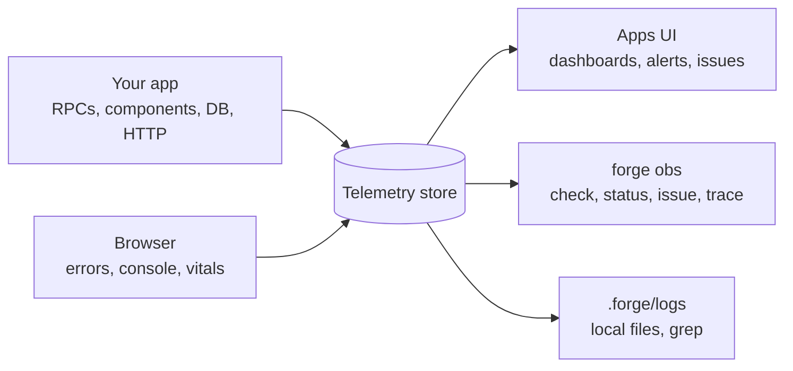

A forge app reports on itself from the first commit. Every inbound RPC, every call between your components, every database query, every outbound HTTP call and the browser records a log line, a trace span and a metric sample, all carrying the same trace ID. You write none of that instrumentation, and there is nothing to sign up for, no collector to run and no API key to paste into your code.

The point is what you can do with it. Because the signals are on disk and behind commands that print JSON and exit with meaningful codes, you and an agent working on your project can answer "what did the user's browser do", "did that deploy make things worse" and "what is in the database" without opening a dashboard. The sections below follow the signals from where they are produced to what you do with them.

<CardGroup cols={2}>
  <Card title="What every boundary records" href="/forge/observability/signals">
    The logs, traces and metrics on RPCs, component calls, the database, outbound HTTP and the browser, and how browser and API traces join.
  </Card>
  <Card title="Where the telemetry goes" href="/forge/observability/where-it-goes">
    The local ClickStack, `.forge/logs/<env>/`, the browser console mirror, the hosted store, retention and opting out.
  </Card>
  <Card title="Querying with forge obs" href="/forge/observability/forge-obs">
    `obs check` and its exit codes, `status`, `issue`, `trace` and `db query`, the same locally and hosted.
  </Card>
  <Card title="Hosted dashboards, alerts and issues" href="/forge/observability/dashboards-and-alerts">
    Generated dashboards, the default alert rules, how errors are grouped, source maps and session replay.
  </Card>
  <Card title="Health probes and graceful shutdown" href="/forge/observability/health-and-shutdown">
    `/healthz` and `/readyz`, what a booting process reports, and how a rollout drains a replica.
  </Card>
  <Card title="Why this helps an agent" href="/forge/observability/agents">
    Browser errors on disk, exit codes to branch on, recon commands, shipped skills, MCP and parallel agents.
  </Card>
</CardGroup>

## The shape of it

The app exports standard OpenTelemetry to whatever endpoint its environment provides, so the same build runs against the local ClickStack in development and your organization's store on hosting. Read the diagram from the left: two producers, one store, and three ways to read it. Locally the third arm, plain files you can `grep`, is the one agents reach for first.

## Related topics

[Environments & deploys](/forge/environments-and-deploys) covers the releases that `forge obs check` judges. [Troubleshooting](/forge/troubleshooting) covers what to check when a command fails. [Hosting on Reliant](/forge/hosting) covers what hosting runs and bills.
