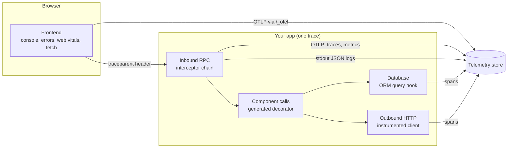

A forge app is instrumented at the places a request crosses something: an RPC arriving, one component calling another, a database query, an HTTP call to somebody else's API, and the browser calling your backend. You write none of that instrumentation. The scaffold wires it from the first commit, so the first request you serve already leaves a trace, a metric sample and a log line, and they already point at each other.

The reason it matters is what you can do afterwards. When every boundary records the same three signals with the same trace ID, "why did this request fail" becomes a lookup instead of an investigation, for you and for an agent working on your project. [Why this helps an agent](/forge/observability/agents) covers that side.

## The signal flow



Read it left to right. The browser sends a `traceparent` header with every call, so the server span it creates joins the browser's trace rather than starting a new one. Inside the app, each boundary adds a child span to that trace. Traces and metrics leave the process over standard OpenTelemetry (OTLP); logs leave as JSON lines on stdout and are collected from there. The store at the right is the local ClickStack in development and your organization's store on Reliant hosting; see [Where it goes](/forge/observability/where-it-goes).

## Inbound RPCs

Every Connect handler runs behind one interceptor chain, built once in `cmd/<bin>/cmd/serve.go`. For each RPC it records:

- **A span**, with the method as its name and the Connect status code on it.
- **A metric sample**: `rpc.server.call.duration`, a histogram carrying `rpc.method` (the full `pkg.Service/Method`) and `rpc.response.status_code` (`OK` or the upper-case Connect code, such as `NOT_FOUND`). Rate, error rate and latency per method all come from it.
- **A log record**: `rpc completed` for a success and `rpc failed` for a failure, with `procedure`, `request_id`, `duration_ms`, `status` and `code`. A success that takes more than a second carries `slow=true`.

The chain also watches a call while it runs. A unary RPC that is still in flight after 10 seconds logs `rpc still in flight` at WARN, and again every 30 seconds, so a wedged handler shows up in the log tail before its deadline ends it. Every unary RPC has a server deadline of 30 seconds by default, and you can set one per method in the proto.

The same chain also writes a structured audit record per RPC (`log_type=audit`).

### Who has to act: error levels

A log level is a routing decision. ERROR is what alerts match and what a post-deploy gate fails on, so forge sets the level from fault attribution, not from how a call site spelled its log line:

| `error_class` | Meaning | Examples | Level |
|---|---|---|---|
| `server` | Your system failed, or cannot tell that it did not | `Internal`, `Unknown`, `DataLoss`, `Unavailable`, any unrecognised error | ERROR |
| `server` | Server-side, but a retry rather than a page | `DeadlineExceeded`, `Aborted`, `Unimplemented` | WARN |
| `user` | The caller has to act; the system behaved correctly | `InvalidArgument`, `NotFound`, `PermissionDenied`, `FailedPrecondition` | INFO |
| `canceled` | One end went away, or this replica was draining | `context.Canceled`, a stream ended by a rollout | INFO |

A user error is still written, with `error`, `error_class=user` and `code`, at a level production keeps. It just stops claiming to be an incident, so a wave of bad input does not page anyone and does not become an [issue](/forge/observability/dashboards-and-alerts#how-errors-are-grouped). The same policy applies to a hand-written `logger.Error`, not only to the RPC edge, because the process's log handler lowers any record that carries a non-server error. Agents can load `observability` for how to keep a Sentry forwarder consistent with it.

## Component calls

Between the RPC edge and the database sits your own code: handlers calling the packages under `internal/`. Every package that declares a `contract.go` is wrapped by a generated decorator (`middleware_gen.go`) that gives each method call one span, one metric sample (`<pkg>_calls`, `<pkg>_errors`, `<pkg>_duration`) and one log record, plus panic recovery. You never edit the decorator; it is regenerated from the interface. The owned `observe_chain.go` next to `contract.go` is the seam where you change sampling of success logs or opt a component out.

This is the layer that used to be dark. Without it a trace shows an RPC span, then a database span, and nothing about which of your packages spent the time between them.

## The database

The ORM registers a query hook, so every query is a child span of the call that issued it, carrying a summary of the statement. The pool reports its own metrics (`db.sql.*`), and a slow query shows up as a long span in the trace waterfall without any logging on your part.

## Outbound HTTP

A call to a third-party API is the boundary most often left uninstrumented, so the scaffold hands your adapters a client that is already wrapped. Pass `infra.DefaultClient()` from `internal/app/providers.go` as an adapter's `HTTPClient` dependency and every request gets a client span, W3C trace propagation to the other side and a 30 second timeout. The compose step wires any `HTTPClient *http.Client` dependency to it for you. For a Connect client to another service, `observe.NewClientStack` gives the same instrumentation plus request-ID forwarding.

## Keeping a request in one trace

A trace fragments wherever code steps around these constructors: a log call that drops the `ctx` it has in scope (so the line has no `trace_id`), a raw `&http.Client{}`, a `sql.Open`, a contract constructed without its decorator. `forge lint` flags all four (a new rule warns for one release before it gates), and `forge lint --tracing` runs them alone:

```bash
forge lint --tracing          # report
forge lint --tracing --fix    # rewrite log calls to the *Context form and undecorated constructions
```

The fix for the first is mechanical (`slog.Info(…)` becomes `slog.InfoContext(ctx, …)`), which is why it is auto-fixed. Agents can load `observability/tracing-lint` for the four rules and how to adopt them in an existing codebase.

## The browser

A scaffolded Next.js or Vite frontend ships the HyperDX browser SDK and a small runtime, `@reliantlabs/forge-web-runtime`. In a deployed environment it records:

| Signal | What the browser reports |
|---|---|
| Errors | Uncaught errors and unhandled promise rejections, with a stack |
| Console | `console` output (switchable off per frontend) |
| Network | Every fetch and XHR, including failed Connect calls |
| Performance | Page loads, web vitals (LCP, INP, CLS) and sessions |

Two details make the browser a first-class part of the trace instead of a separate system.

**Browser and API traces join.** Every Connect call the frontend makes carries a valid W3C `traceparent`. With full tracing on, it is the context of the browser's own active span; without it, the runtime generates a valid one, so the call is correlatable even with no collector configured. The server adopts it, which is why a slow click in the browser and the RPC behind it are one trace in the waterfall. The server starts its span before authentication runs, so a request rejected for a missing token is traced too. By default the server adopts every caller's trace ID, which is right when the browser is first-party. A server reachable by callers who must not choose its trace IDs can grade each caller with `observe.TrustRemoteBy`, from adopting everything down to starting a new trace linked to the caller's; agents can load `observability/component-chain`.

**A failed call names its server trace.** When a call fails, the error the frontend sees carries the trace ID of the server span that handled it (from the `traceresponse` header, or the request's own `traceparent` as a fallback). That ID is what you paste into `forge obs trace`.

Browser data leaves through your own site. The browser posts to `/_otel` on the origin that served the page, and the platform routes that path to ingest, so there is no third-party host for an ad blocker to block, no CORS preflight, and no secret in your JavaScript bundle. A benign aborted fetch or a generic `Failed to fetch` is counted but not raised as an error issue.

In development the same frontend does one more thing, covered in [Where it goes](/forge/observability/where-it-goes#browser-console-in-the-log-directory): it mirrors the console and every uncaught error to a file next to your backend logs.

## What you declare yourself

Anything beyond the boundaries above is a metric you declare in `internal/metrics/metrics.go`. Each instrument has a name, a type, a unit, a description and the attribute keys it may carry; the registry returns the standard OpenTelemetry instrument. An attribute you did not declare panics in development and is dropped (and counted) elsewhere, so a dashboard never fills with unbounded label values. The declared set prints with `forge obs metrics declared`, and the platform draws a custom-metrics dashboard from it on every release. Agents can load `observability/dashboards`.

## Related topics

[Where it goes](/forge/observability/where-it-goes) follows these signals to a store. [Querying with forge obs](/forge/observability/forge-obs) is the command line over them. [Hosted dashboards and alerts](/forge/observability/dashboards-and-alerts) is what the platform builds from them.
