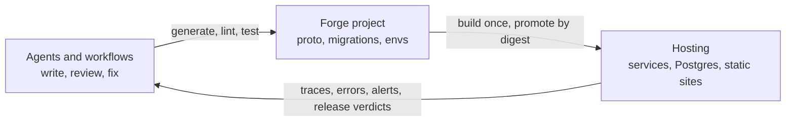

Most software stacks are stitched together. A framework comes from one vendor, CI from another, then hosting, logs, alerts, secrets and an AI assistant from five more. None of them knows what the others know. Every integration between them is glue someone writes and maintains, and an agent working in that stack works blind: it can edit code, but it cannot tell which RPC a release broke, whether a migration will lock a table, or what the user saw when the error fired.

Reliant owns the whole path, as four products: [Forge](/forge/overview), the open-source framework and CLI that puts guardrails on the code and deploys it with no account; [Reliant Cloud](/hosting/overview), the hosting and delivery platform that runs what you ship and monitors it ([observability](/hosting/observability)); [Reliant Workflows](/getting-started/quick-start), the multi-agent YAML workflows, and Autopilot built on them, that write and review the code; and Reliant Engine (coming soon), which will run those workflows inside your own app, under your brand. Because one system declares, builds, deploys and watches your app, it knows your services, RPCs, schema, config, secrets, releases, metrics and alerts. Those are standard seams, the same in every project, and they are what let Reliant and your agents do things a stitched stack can't.

For the list of tools this replaces and what stays yours, see [What Reliant replaces](/getting-started/what-reliant-replaces).

## The seams, and what each one makes possible

### Code shape: generate the plumbing instead of writing it

A forge project has two sources of truth: protobuf for the API and SQL migrations for the schema. `forge generate` projects them into handlers, the ORM, typed frontend hooks, pages and tests, so an agent spends its tokens on your logic rather than on wiring it. The layout is fixed, so an agent asks the project where things are (`forge project shapes`) instead of grepping for them.

- [Two sources of truth](/forge/concepts/two-sources-of-truth): what is generated from proto and migrations
- [Adding a feature](/forge/adding-features): the everyday generate, lint and test loop
- [Contracts and dependency injection](/forge/concepts/contracts-and-injection): generated mocks and tracing for every package boundary

### Architecture: lint for whole classes of bugs

Because forge knows what every RPC, table and boundary is, `forge lint` can check things a generic linter can't: a list filter that silently filters nothing, a server-owned field nothing writes, a trace cut by a missing context, a migration that rewrites a table under an exclusive lock. Every migration also declares whether the previous release survives it, and lint holds it to that. New rules warn for a release before they gate, so upgrading forge never turns your build red overnight.

- [Linting overview](/forge/linting/overview)
- [Migration safety rules](/forge/linting/rules-migrations)
- [How new rules roll out](/forge/linting/rollout)

### Releases: gate on measured health, never past a breaking migration

A release is built once and promoted by digest, so prod runs exactly the bytes staging ran. After every deploy, `forge obs check` judges the release against the window before it, per service, and answers with an exit code a script or an agent can branch on. Missing telemetry is reported as undetermined, never as a pass. With the opt-in health gate, prod promotion is refused until staging holds a passing verdict, and a rollback floor stops anyone deploying a release older than a breaking migration. There is no automatic rollback: a failed deploy never replaces what is serving, and you recover by deploying an earlier release or rolling forward.

- [Release promotion](/forge/deploy/releases-and-promotion): releases, plans, approvals and the ledger
- [Release gates and regression checks](/forge/deploy/release-gates): `obs check`, the health gate and rollback floors
- [Multi-environment deploys](/forge/deploy/environments): dev, staging and prod from the first commit

### Runtime: tie an error to the release that caused it

Every boundary of a forge app records logs, traces and metrics from the first commit: inbound RPCs, component calls, database queries, outbound HTTP and the browser. Errors are grouped into issues and tied to the release that opened them. Your agents read all of it through plain commands (`forge obs status`, `obs issue`, `obs trace`, `obs logs`) with JSON output, and read your database through one audited, read-only command that never shows secret columns.

- [What every boundary records](/hosting/observability/signals)
- [Dashboards, alerts and issues](/hosting/observability/dashboards-and-alerts)
- [Querying with forge obs](/hosting/observability/forge-obs)
- [Why this helps an agent](/hosting/observability/agents)

### Operations: hand an alert to an agent with the evidence attached

On Reliant hosting, a workflow trigger declared as `webhook: {source: alerting}` receives your organization's critical alerts and new or regressed error issues with no URL, token or alert route to set up. The built-in Autopilot on-call workflow uses it: each alert becomes one deduplicated GitHub issue, investigated read-only with the traces, logs and data the agent can reach. When a person labels the issue ready, the issue worker writes the fix and opens a pull request. Autopilot never merges; you do.

- [Your organization's alerts as a trigger](/automations/webhooks#your-organizations-alerts)
- [Autopilot: review, issues and on-call](/guides/autopilot)
- [AI workflows in YAML](/workflows/overview): mix agents with deterministic steps, approvals and tests

### Secrets: used by agents, never seen by them

Hosted secrets are write-only: you can set and rotate one, but never read it back. Integration steps in a workflow use saved credentials for GitHub, Gmail, Slack, Twilio and any HTTP API without the agent ever seeing the value.

- [Secrets for hosted environments](/hosting/secrets)
- [Integrations](/integrations/overview)

## Opinionated defaults, no walls

Every default is a starting point, not a lock-in:

- **Start anywhere.** Use any piece on its own, in any repo and any language. An existing app deploys from its own Dockerfile, and monitoring or release recording works without forge deploying anything. See [adopt an app that already exists](/forge/deploy/escape-hatches#adopt-an-app-that-already-exists).
- **Bring your own.** Point an environment at your own database, identity provider or OpenTelemetry backend in its config. See [bring your own](/forge/deploy/escape-hatches#bring-your-own-database-identity-provider-or-telemetry-backend).
- **Deploy where you want.** Reliant hosting, your own Kubernetes cluster, Docker Compose or plain host processes. See [self-hosted delivery](/forge/deploy/self-hosted-delivery).
- **Any model.** Use your Claude, ChatGPT or Copilot subscription, your own API key, or local models, and mix them per workflow step. See [API keys and subscriptions](/settings/api-keys).
- **Try it without an account.** [Deploy a Vite or Next.js app](/forge/deploy-without-an-account) with no signup and claim it later.

## Where to go next

- [Reliant quick start](/getting-started/quick-start): run your first agent and workflow
- [Forge quick start](/forge/quick-start): a prompt to a deployed URL
- [Hosting](/hosting/overview): what Reliant hosting runs

The product overview is on the [Reliant website](https://reliantlabs.io).
