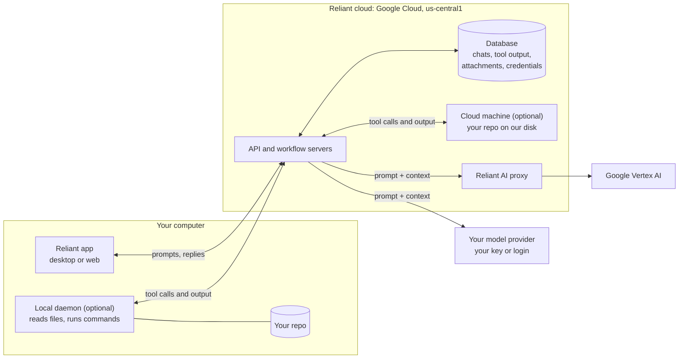

Reliant is a cloud service, and you need an account to use it. The desktop and web apps talk to Reliant's API and workflow servers in Google Cloud (us-central1), and those servers run the agent loop. They call the AI model. When the model wants to read a file or run a command, they send that tool call to a **daemon**: one running on your own machine, on any machine you own, or on a cloud machine we host for you. The daemon returns the result. Our servers store it in your chat and send it to the model as context. Model calls are always made from our servers, never from your device, whether you use your own API key, a provider login, or Reliant AI.

So your repository stays wherever the daemon runs. But **anything the agent reads, and anything a command prints, is sent to our servers, stored with your chat, and sent to your model provider.**

## How data flows



A local daemon connects outbound to our gateway; it doesn't open any inbound ports on your machine. It only reads files and runs commands when the agent asks it to.

## What goes where

| Data | Stays on your machine? | Stored by Reliant? | Sent to the model provider? |
| --- | --- | --- | --- |
| Files in your repo the agent never opens | Yes, with a local daemon | Only on a cloud machine, where the whole repo lives on its disk | No |
| Files the agent reads, search results, diffs, command output | A copy stays on your machine | **Yes**, as tool output in your chat | **Yes** |
| Your prompts and the model's replies | No | Yes | Yes |
| Attachments you upload | No | Yes | Yes, when included in the conversation |
| Memories (`reliant.md`), workflows and presets | Yes, as files where the daemon runs | Yes, copies with your project settings | Yes. Memories and workflow prompts are part of what the model sees |
| Project details: paths, repo URLs, branch names | Yes | Yes | Often, because they appear in prompts and tool output |
| Model API keys and provider logins | No | Yes, encrypted at the application layer. The connected account's email is stored, without that extra encryption, so we can show you which account is connected | Only to authenticate with that provider |
| Integration credentials (GitHub, Gmail, Slack, Twilio) | No | Yes, encrypted at the application layer | No. The results of integration actions are sent, like any other tool output |
| Secrets in your files or command output | Yes | **Yes, if the agent reads or prints them** | **Yes, if the agent reads or prints them** |
| Your Reliant sign-in tokens (desktop) | Yes, in storage encrypted by your OS | No | No |
| Analytics and crash reports | No | Yes, in our own telemetry store (both on by default; see [Telemetry](#telemetry)) | No |
| Counts of each text model request (tokens, model, provider, time) | No | Yes, as a [usage record](#model-usage-records), whichever key or login you use | No |

<Warning>
Secrets get no special handling. If the agent opens a `.env` file, prints an environment variable, or runs a command that echoes a token, that text becomes tool output. It is stored with your chat and sent to your model provider. Keep secrets out of the agent's reach, use approval modes for commands you haven't reviewed, and store deployment secrets with [Secrets](/features/secrets). If a key has been exposed, rotate it.
</Warning>

### Local daemon vs. cloud machine

| | Local daemon | Cloud machine |
| --- | --- | --- |
| Where your code lives | Your disk | A persistent disk in Google Cloud (us-central1), inside its own lightweight VM (Kata Containers) |
| What reaches our servers | Whatever the agent reads or a command prints | The same, plus the entire contents of the machine's disk |
| Where commands run | Your machine | Our infrastructure |
| When it's deleted | Whenever you choose | When you delete the machine. We may also delete a suspended machine's disk if you have no compute subscription (only after at least 14 days and two emails, the second at least 3 days before deletion), or if it stays suspended for at least 60 days (after an email warning) |

See [Machines](/machines/overview) for how to run a daemon on your own machines.

### Local models

You can point Reliant at a model server running on your own hardware (Ollama, LM Studio, or any OpenAI-compatible endpoint) in `~/.reliant/config.yaml`; see [Model Configuration](/settings/model-config). Because model calls are made by our servers, the request is relayed through your daemon to the local server. That means the prompt and the reply still pass through our servers and are stored in your chat like any other. A local model keeps the *inference* on your hardware, not the conversation. It needs a daemon on the machine that can reach the model server.

### Other services the agent can reach

- **Integrations** you connect (GitHub, Gmail, Slack, Twilio, custom HTTP): what the agent sends goes to that service under your account.
- **MCP servers** you configure get the tool calls the agent makes to them.
- **Web search and fetch:** a web search sends the agent's query to a search provider (currently DuckDuckGo), and fetching a page sends a request to that site. These requests may come from our servers or from your daemon.

## Your model provider and training

### No training

We don't use your content to train or fine-tune AI models. That includes your prompts, code, files, tool outputs, chats, attachments, and anything from services you connect. This applies to every user on every plan.

### Your own API key or provider login

If you add your own API key, or sign in with a provider subscription (Claude, Codex, GitHub Copilot and others), our servers call that provider on your behalf, **under your account**. The provider's terms and privacy policy apply to what it receives, including whether it keeps the data or trains on it. API plans and consumer subscriptions are often treated differently, so check your provider's settings:

- [Anthropic privacy policy](https://www.anthropic.com/legal/privacy)
- [OpenAI privacy policy](https://openai.com/policies/privacy-policy)
- [Google AI terms](https://ai.google.dev/terms)

### Reliant AI

If you use the optional Reliant AI provider:

- Requests go through a proxy we run ourselves (LiteLLM) to **Google Vertex AI**. The proxy records the model, token counts and cost, for billing.
- Google Cloud's terms don't allow Google to use these requests to train or fine-tune AI models without our permission, and we haven't given it.
- To respond faster, Google may hold inputs and outputs in memory for up to 24 hours. Google may also log prompts for a limited time to detect abuse, as [Google describes](https://cloud.google.com/vertex-ai/generative-ai/docs/vertex-ai-zero-data-retention).
- We use Vertex AI's global endpoint, so a request can be processed in any Google region, not only the US.

Whichever provider you use, the conversation is also stored in your chat history on our servers.

## Model usage records

Every model request is made by our servers, so we keep a **usage record** of each text request, whether it used Reliant AI, your own API key, a Claude, Codex or GitHub Copilot login, or a local model. That covers your chat turns and the requests Reliant makes for you in the background: summarizing a long conversation to free up context, titling a chat, and drafting an automation from a description.

Two kinds of request are not recorded: image and video generation (the generation APIs report no token counts), and the tiny test request made when you add an API key to check that it works. This is a service record, separate from the analytics switch in [Telemetry](#telemetry): it stays on when you turn analytics off.

**What a record contains, exactly:**

- which of your chats and runs the call belonged to, and your account ID
- the provider (for example `anthropic` or `claude`) and the model
- how the call was paid for: Reliant AI, your own API key, a subscription login, or a local model
- the number of input, output, cache-read and cache-write tokens
- whether it succeeded, was cancelled or failed, and for a failure one of a fixed set of categories (rate limit, usage limit, context length, sign-in, timeout, stalled, network or unknown)
- how long it took, which attempt it was, and when it happened

**What it never contains:** your prompt, the model's reply, tool inputs or outputs, file names or paths, the text of an error message, or your API key. The database tables have no column that could hold any of these, and a test fails if one is added.

**Why we keep it:** to show you your own usage (tokens, models, error rates) and to run the service: spotting a runaway loop, diagnosing a provider outage, and planning capacity.

**Who can see it:** only you, and only your own. Organization admins can't see usage on your own API keys or logins. Usage on Reliant AI is also part of your billing records.

**How long we keep it:** each call's record is deleted **90 days** after the call. We keep a daily total per model, provider and payment type, with no chat or run IDs, until you delete your account. Deleting your account deletes both.

## Telemetry

Both kinds of telemetry are **on by default**. To turn them off, go to **Settings → Privacy**.

Telemetry goes to **our own telemetry store**: ClickStack (ClickHouse with OpenTelemetry), which we run ourselves in Google Cloud (us-central1). The apps and our servers send to it over the standard OpenTelemetry protocol (OTLP), and no third party sees it.

| Toggle | Sent to | What's included |
| --- | --- | --- |
| **Analytics and Usage Data** | Our own telemetry store | Product-usage events such as message sent, model call completed (model, token counts, latency) and project opened, tied to your account ID. Events from the app also carry its session ID. Events record what you did, not what you wrote: a "message sent" event records the message's length, not its text. |
| **Crash and Error Reporting** | Our own telemetry store | Crash and error reports: the error type, stack trace, app version and identifiers such as chat and run IDs. You're identified by an internal user ID, not your email or name. Error messages are cut to one short line with known credential formats redacted, and that short line can still contain a fragment of text. Request bodies and console output aren't sent. Stack traces from the desktop app's background process have your home folder and install location removed. In the web app and desktop window, this also covers page-load and request timings (without query strings). Our ClickStack recorder supports masked web replays, but replay is not enabled in the packaged desktop configuration. The desktop background process does not record session replays. |

Crash reports contain error details and stack traces; we don't create or upload memory dumps.

**Crash and Error Reporting**, not the analytics switch, controls whether browser telemetry starts. Turning it off mid-session stops it.

For deployment administrators, the renderer runtime configuration's `OTEL_ENDPOINT` decides whether browser telemetry is sent at all (empty or `off`: none), and `OTEL_REPLAY` controls the ClickStack replay recorder. These configuration changes take effect on the next app initialization.

Turning off analytics also stops the analytics events our servers record about your account. The switches don't cover:

- **Server logs.** They record identifiers (such as user, chat and run IDs, and sometimes your email address), counts, durations, status codes and IP addresses, not the content of your prompts, chats, tool inputs or outputs, or files. File paths can appear in error logs for file operations. Server logs and metrics are kept for 30 days.
- **Server-side error reports**, which go to our own telemetry store with the same shortening and credential redaction.
- **Billing usage records:** the model, token count and cost of each request, which we need to bill you. These cover Reliant AI. Usage on your own keys and logins is covered by [Model usage records](#model-usage-records).
- **Model usage records:** the counts described under [Model usage records](#model-usage-records).
- **Update checks:** the desktop app checks `downloads.reliantlabs.io` for updates, which sends your IP address and app version. Updates download only after you agree.

This docs site is hosted by Mintlify, which may collect usage analytics about it under [its privacy policy](https://www.mintlify.com/legal/privacy). Our marketing site, reliantlabs.io, has its own cookie choices under **Your privacy choices** in its footer; they don't apply to this docs site.

## Deleting your data

### Chats

Deleting a chat **archives** it. Deleting the archived chat **permanently deletes** it, along with its messages, tool outputs and attachments.

### Cloud machines

Go to **Settings → Machines** and delete the machine. This deletes its disk and everything on it.

### Credentials and integrations

You can remove API keys and provider logins, and disconnect integrations, in the app's settings at any time. For Gmail, we also revoke the token with Google. Data an integration already pulled into a chat stays there until you delete the chat.

### Your account

Go to **Settings → Account → Delete account**, or email support@reliantlabs.io.

- **Before you can delete:** deletion is blocked while a paid subscription is active, so cancel it in the billing settings first. A wallet balance doesn't block deletion.
- **Your wallet balance:** Wallet top-ups include a 5% service fee; coupon credits carry none. Reliant AI usage is billed at the provider's price. When you delete your account, we refund the face value of your unused paid credit to the card you paid with (the service fee isn't refunded), and promotional credit, such as credit from coupons, is forfeited. Promotional credit counts as spent before paid credit, so a coupon can't be turned into cash. The confirmation screen shows both amounts before you confirm. Card refunds usually take 5–10 business days to appear. If a refund can't go back to your card automatically, our support team refunds it for you.
- **What's deleted:** your sign-in identity, chats and everything in them, projects, workflows, settings, credentials, model usage records and cloud machines. If you host apps with us, delete them first, or ask support to remove them.
- **What we keep:** invoices, usage records, subscription and wallet history, records of any refund made at deletion, and records at Stripe, as the law requires. We remove or replace your account identifiers in them where we can.

### How long we keep things

| Data | Retention |
| --- | --- |
| Chats, messages, tool outputs, attachments | Until you delete them |
| Workflow run history | 7 days after the run ends |
| Large stored workflow payloads | 30 days |
| Credentials | Until you remove or disconnect them |
| Cloud machine disks | Until you delete the machine, except as described in [Local daemon vs. cloud machine](#local-daemon-vs-cloud-machine) |
| Hosted app databases | Until you delete them. **They are not backed up** |
| Database backups | Nightly backups are kept for 7 days. Backups taken on demand, for example before maintenance, are deleted when they're no longer needed |
| Server logs and metrics | 30 days |
| Model usage records, per call | 90 days |
| Model usage daily totals | Until you delete your account |
| Analytics events | Up to 14 days |
| Crash and error data in our telemetry store | 30 days |
| Web session replays in our telemetry store | 14 days |
| Crash and error data and session replays sent to Sentry (web app and desktop window) before we moved error reporting off it | According to Sentry's retention settings for our account |
| Billing records, including refunds made at deletion | As long as tax and accounting law requires, typically 7 years |

The [Privacy Policy](https://reliantlabs.io/privacy#retention) has the complete list.

### Clearing local app data

These commands remove Reliant's files from your computer: your local config, the desktop app's data and sign-in state, and daemon credentials. They **don't** delete anything on our servers; delete your chats and account for that. Your project files (`reliant.md`, `.reliant/` in your repos) aren't touched.

<Warning>
`~/.reliant/` also contains the git worktrees Reliant creates (`~/.reliant/worktrees/`). Commit or push any work in them before deleting it.
</Warning>

```bash
# Local config, including worktrees (all platforms)
rm -rf ~/.reliant/

# macOS: desktop app data, daemon credentials, logs
rm -rf ~/Library/Application\ Support/reliant
rm -rf ~/Library/Logs/Reliant

# Linux
rm -rf ~/.config/reliant
```

```powershell
# Windows
Remove-Item -Recurse -Force "$env:APPDATA\reliant"
```

## Security practices

**Credentials.** API keys, provider sign-in tokens and integration credentials are encrypted at the application layer, with a key specific to your account, before they're written to our database.

**Code modifications.** In manual approval mode, Reliant shows each edit before applying it and waits for your confirmation. In auto modes, edits are applied directly and shown in the conversation as they happen.

**Tool execution.** Shell commands and file operations are logged in the conversation, visible in the UI before execution, and controllable via approval modes.

## More detail

- [Privacy Policy](https://reliantlabs.io/privacy): the full legal version, including your rights under GDPR and CCPA
- [Subprocessors](https://reliantlabs.io/subprocessors): every company that processes data for us, and what each one processes
- **Need a data processing agreement?** Email support@reliantlabs.io.
- **Security issues:** email [security@reliantlabs.io](mailto:security@reliantlabs.io).
