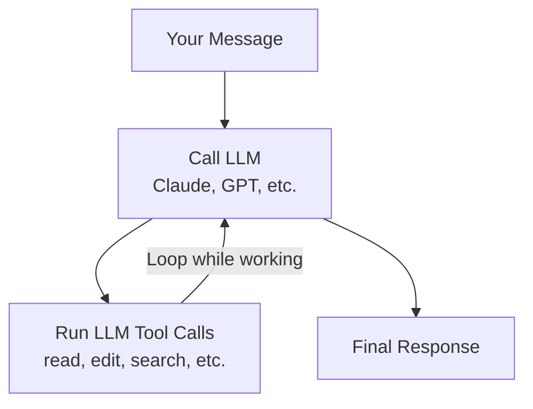

Everything in Reliant runs through workflows. Type a message, press enter, and you're triggering a workflow. The agent reads your codebase, executes tools, responds. That's a workflow.

A workflow is a programmable sequence of AI operations. It defines which tools the agent can use, how approvals work, when to loop, and when to stop.

## The Agent Workflow

The default experience in Reliant is itself a workflow called `builtin://agent`. When you chat, you're running this workflow.

Here's what happens when you send a message:



The workflow sends your message to the LLM. The LLM responds, possibly requesting tool calls—reading files, searching code, making edits. The workflow executes those tools and sends the results back to the LLM. This loop continues while the LLM has tool calls to execute. When the LLM responds without requesting more tools, the task is complete.

A single message like "add input validation to the signup form" might trigger dozens of iterations. The agent reads your codebase, identifies the relevant files, plans the changes, implements them, verifies they work. All within this loop.

## Execution Modes

The `mode` parameter controls how tool execution is handled. This is a regular workflow input you can set in the UI or in workflow YAML.

| Mode | Behavior | Good for |
|------|----------|----------|
| **Auto** | Auto-approves all tool calls. Press Escape to stop. | Large refactors, trusted tasks, autonomous work |
| **Manual** | Requires your approval before each tool execution. | Learning Reliant, sensitive code, understanding what the agent is doing |
| **Plan** | Starts the agent with reading, search and planning tools plus the shell, under a prompt that tells it to plan rather than change code. Tool calls are auto-approved. This is guidance, not containment: the shell can still write files. | Exploring unfamiliar code, creating a plan before executing it |

You can switch modes mid-conversation. A common pattern: start in plan mode to analyze and create a plan, then switch to auto to execute it.

## Running Workflows

Workflows appear in the workflow selector in the chat composer. Your default workflow (`agent` unless you change it) is pre-selected, but you can choose others, including custom workflows you've created and the [built-in workflows](/guides/overview) for longer jobs. To change the default, open the workflow in **Workflows → Library** and choose **Set as default** from its menu.

The composer shows the selected workflow's inputs. For the agent workflow these are:

| Input | Where | Purpose |
|-------|-------|---------|
| `mode` | The composer toolbar | Execution mode (auto, manual, or plan) |
| `model` | The model button | Which LLM to use, chosen by tier (such as `flagship`) or by name |
| `tools` | **Show all settings** | Which tools the agent can access |
| `spawn_presets` | **Show all settings** | Which presets the agent may [spawn](/workflows/spawn) as sub-agents; empty disables spawning |
| `skills` | **Show all settings** | [Skills](/features/skills) to preload |

The model button also sets the model's **thinking level** (low, medium, high, xhigh, limited to what the model supports) and **temperature**. These are settings of the model rather than inputs of their own, so they travel with it: a preset or workflow that sets `model: { tags: [flagship], thinking_level: high }` sets both at once. A complex refactoring might warrant a higher thinking level and lower temperature, while brainstorming might benefit from higher temperature.

A [preset](/workflows/presets) sets several of these at once.

## Workflow Outputs

Workflows produce outputs that become available when the workflow completes. For the agent workflow, the primary outputs are:

- **message**: The final assistant message from the conversation
- **response_text**: The text content of that message

These outputs matter most when workflows are composed—when a parent workflow spawns child workflows and needs their results. The agent workflow's thread also contains the complete conversation history, which persists in your session for later reference or continuation.

## Beyond the Agent Workflow

While the agent workflow handles most tasks, Reliant ships additional workflows for specialized jobs. The selector shows each one's display name; the identifier in parentheses is what you use in a `ref:` or on the command line (`reliant workflow run <name>`).

**Get It Right** (`get-it-right`) is for complex changes in an existing codebase, where a first attempt often fails. Each iteration implements, runs lint/test/build checks in parallel, then reviews. A failed check skips review and loops straight back; a bad attempt is undone before the next one. Many of the workflows below are built on it.

**Best of Three** (`parallel-compete`) runs three agents on the same task in isolated worktrees, then a reviewer picks the winner or synthesizes the best parts. Good for comparing implementation strategies.

**Build an App** (`forge-one-shot`) scopes an app with you, scaffolds it with Forge, gets the build green, then fans out sub-agents per part of the app and verifies the running result.

**Move to Forge** (`forge-migrate`) migrates an existing codebase into a Forge project, with an approval checkpoint before it starts porting components one at a time.

**Landing Page** (`landing-page`) and **Pitch Deck** (`pitch-deck`) are content pipelines: a short scoping conversation, a content review loop, a visual review loop, then a handoff that serves the result at a preview URL. When they finish, the chat switches to a plain agent so you can keep iterating.

**Create a Workflow** (`build-workflow`) turns a conversation about what you want to automate into a workflow, building and testing any integrations it needs first.

**Import from Claude Code / Cursor** (`migrate`) brings configuration across from Claude Code, Cursor, Codex, or Windsurf.

**Autopilot** is five workflows that run only as [automations](/automations/overview), never from a chat: PR review (`autopilot-pr-review`), security review (`autopilot-security-review`), issue worker (`autopilot-issue-worker`), review responder (`autopilot-review-responder`) and on-call (`autopilot-oncall`). They are listed in the library, where you enable them; see [Autopilot](/guides/autopilot).

The rest ship as **building blocks**: `structured-agent` (an agent that must answer through a response tool, for structured output), `scope-conversation` (a reusable scoping conversation), and the steps the Autopilot workflows share. They're hidden from the workflow selector, but any workflow can `ref:` them, and they appear under *Building blocks* in the workflow library.

### Inputs an integration defines

A workflow input is usually a string, a number or a choice, but an integration can define its own types: `github.repository`, `github.label` and `github.user` today. An input of such a type is a picker in the Set up and Run dialogs that lists real choices (your repositories, a repository's labels, GitHub accounts) instead of a text box, and the workflow stores plain values (`acme/app`, a label name, a numeric id as a string) so expressions read them like any other string or list.

```yaml
inputs:
  repos:
    type: github.repository
    multi: true       # a list
    required: true    # must be chosen before an automation can be turned on
    min_items: 1
```

`required: true` is explicit and takes no `default`; an input with no default is required as well, and one with a default (even `[]`) is optional. An [automation](/automations/overview) that is missing a required input shows **Needs setup** and does not run until it is finished. A trigger scopes itself by an input with `match: {repository: {input: repos}}`; see the [GitHub integration](/integrations/github#value-types). Reach for an integration's type whenever it has one for the thing you are asking for: a repository list typed as a plain array is a text box nobody can check.

Multi-phase pipeline workflows can use [node routers](/workflows/routing#node-routing) for phase skipping, letting users jump directly to the relevant phase (planning, implementation, etc.) based on their request.

For patterns you can build yourself, such as plan debates, TDD loops, and triage routers, see [Multi-Agent Patterns](/workflows/patterns).

## Related Topics

- [Multi-Agent Patterns](/workflows/patterns) - Advanced workflow patterns and composition
- [Presets](/workflows/presets) - Creating your own parameter configurations
- [Creating Custom Workflows](/workflows/custom-workflows) - Build your own workflows
- [Testing Workflows](/workflows/testing) - Validate structure and test runtime behavior