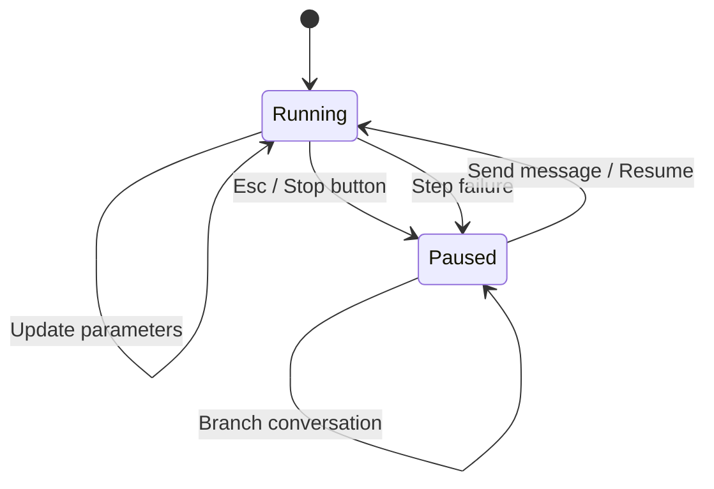

Reliant gives you control over running workflows. You can pause execution, update parameters on the fly, and send messages to the main agent or to any sub-agent while it works.

## Pause and Resume

Pause a running workflow when you need to:

- Review what's happening before it continues
- Update parameters before the next step
- Take a break and continue later

**To pause:** Click the stop button in the chat composer (its tooltip reads "Stop generation") or press `Esc`. Work in flight is stopped first, including any command running on your machine, and then the workflow pauses.

**To resume:** Send a message. Sending a message to a paused workflow resumes it, with your message added to the conversation. The run's page under **Workflows → Runs** also has **Pause** and **Resume** buttons.

**What happens when paused:**
- The workflow stops at its current point
- All state is preserved—it will continue exactly where it left off
- You can view the conversation, update parameters, or branch

**Stopping for good** is different from pausing. **Stop** on the run's page in **Workflows → Runs** ends the run; it cannot be resumed afterwards, though **Re-run (current definition)** starts a fresh run of the same workflow.

## Updating Parameters While Running

You can change workflow parameters without stopping the workflow. Changes take effect on the next iteration of the agent loop.

**Common parameter updates:**
- **mode**: Switch from `auto` to `manual` to approve each tool call, or to `plan` to have the agent plan rather than change code
- **model**: Switch to a different model, or change its thinking level or temperature

**To update parameters:**
1. Change the mode in the composer toolbar, the model with the model button, or anything else under **Show all settings**
2. Changes are applied immediately via a signal to the running workflow

**When changes take effect:**
- Most parameter changes apply on the next LLM call
- Mode changes affect the next tool execution decision
- The current in-flight operation completes with old parameters

## Messaging a Running Workflow

You do not need to pause to steer an agent. A message sent while it works is **queued**: the composer shows it in a strip above the input with how long it has waited, and the agent reads it at its next turn, before it calls the model again. Each queued message can be removed before it is read. If the agent is in the middle of something long, **Interrupt & send now** stops the work in flight so it reads your queued messages now.

When a workflow spawns sub-agents, each runs in its own thread, and each sub-agent's card in the chat has its own message box. A message sent there goes to that sub-agent alone, and it reads the message at its next step, while the rest of the chat keeps working. A sub-agent that stopped on an error can be messaged too: the message resumes it.

**Use cases:**
- Provide additional guidance to a stuck sub-agent
- Correct a misunderstanding before the agent continues
- Inject information the agent needs but didn't find

## Automatic Pause on Failure

When a step of the main agent fails after its retries, Reliant pauses the workflow instead of failing it. The chat says what failed and why, such as an expired provider login, and ends with "Workflow paused — send a message to retry". This gives you a chance to:
- Review what went wrong
- Fix the underlying issue (reconnect a provider, switch model, free up the machine)
- Send a message to retry the failed step

A provider usage limit is not a failure and does not pause the run: the run waits until the limit resets and then retries by itself.

A sub-agent whose step fails is different: that sub-agent fails on its own and its parent is told, so the rest of the chat keeps going. Message the sub-agent to resume it.

Runs that nobody is watching, such as [automations](/automations/overview), resume themselves after a failure like this, waiting longer each time, because a rate limit or a disconnected machine usually clears on its own. While one of these runs is paused, your **Inbox** lists it with what paused it. If the failure survives about half an hour of retries, the run ends as failed, with that cause as its error. A paused run still counts against its workflow's `concurrency.max_running` limit (see the [workflow schema](/reference/workflow-schema)), so ending it lets the automation's next run start instead of waiting behind it.

A `run` command that could not reach its machine is not a failure of the step. When the machine is disconnected or restarting, the step waits for it to come back for up to 30 minutes and then sends the command. This wait uses none of the node's retries and does not pause the run. If the machine is still unavailable after 30 minutes, or it was removed, the run fails with an error that names the machine and says the command never ran.

## Manual Intervention Pattern

For workflows that need human guidance, you can use pause/resume as a collaboration pattern:

1. Agent works autonomously
2. You pause when you see something interesting
3. Review the state, add context via message
4. The message resumes the agent with your input

This is especially useful with multi-agent workflows where you want to guide the direction without micromanaging every step.

## Related Topics

- [Threads](/features/threads) — Understanding thread structure
- [Spawning sub-agents](/workflows/spawn) — How sub-agents run and report back
- [Execution Modes](/workflows/overview#execution-modes) — Control tool execution
- [Workflows Overview](/workflows/overview) — How workflows power Reliant
